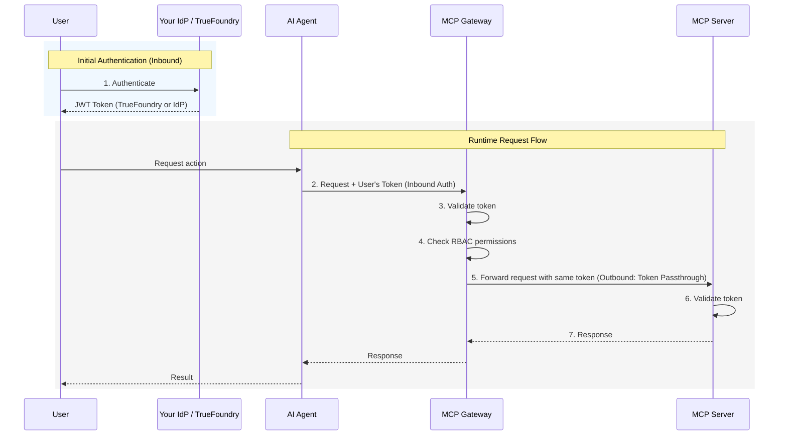
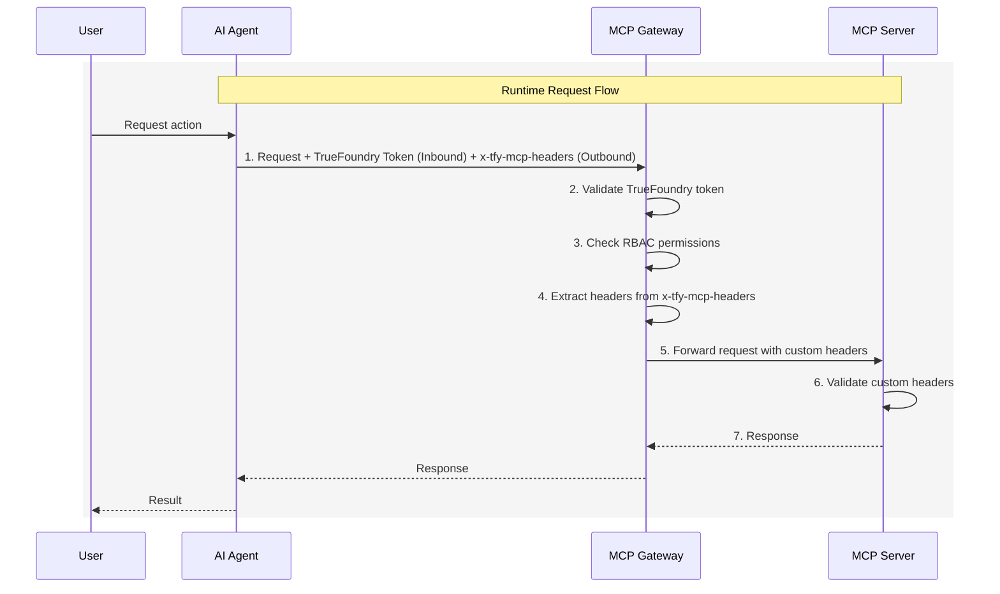

> ## Documentation Index
> Fetch the complete documentation index at: https://www.truefoundry.com/llms.txt
> Use this file to discover all available pages before exploring further.

# Authentication and Security

> Complete guide to authentication, authorization, and security for MCP Servers in TrueFoundry AI Gateway

TrueFoundry AI Gateway provides a comprehensive authentication and authorization system that separates how users authenticate to the Gateway (inbound authentication) from how the Gateway authenticates to downstream MCP servers (outbound authentication). This separation lets administrators choose the right security posture per tool without forcing end users to manage multiple credentials.

## Authentication Architecture Overview

The Gateway provides a three-part authentication and authorization system:

| Component                   | Description                                                                      |
| --------------------------- | -------------------------------------------------------------------------------- |
| **Inbound Authentication**  | How clients (AI agents, developers, end users) authenticate to the Gateway       |
| **Access Control**          | Role-based policies determine which users can access which MCP servers and tools |
| **Outbound Authentication** | How the Gateway authenticates to downstream MCP servers                          |

<Frame caption="MCP Gateway Authentication and Authorization Flow">
  
</Frame>

***

## Inbound Authentication

Inbound authentication controls how clients authenticate to the Gateway. Any user or application requires valid credentials to talk to the Gateway, which allows the Gateway to identify the caller and apply authorization rules.

TrueFoundry supports the following inbound authentication methods:

<AccordionGroup>
  <Accordion title="TrueFoundry API Key (Personal Access Token)">
    For internal developers and applications with TrueFoundry accounts. Users generate a Personal Access Token (PAT) from the TrueFoundry UI.

    <Steps>
      <Step title="Generate a Personal Access Token">
        1. Navigate to **Settings > API Keys** in the TrueFoundry UI
        2. Click **Generate New API Key**
        3. Store the token securely
      </Step>

      <Step title="Use the token in requests">
        ```python theme={"dark"}
        from fastmcp import Client
        from fastmcp.client.transports import StreamableHttpTransport

        transport = StreamableHttpTransport(
            url="{GATEWAY_BASE_URL}/mcp/<integration-id>/server",
            headers={"Authorization": "Bearer <your-tfy-api-key>"}
        )

        async with Client(transport) as client:
            result = await client.call_tool("tool_name", {"arg": "value"})
        ```
      </Step>
    </Steps>
  </Accordion>

  <Accordion title="Virtual Account Token">
    Virtual Accounts are service accounts with specific permissions to access MCP servers. Use Virtual Accounts when you need a shared token for server-to-server communication or when building applications where individual user identity isn't required at the Gateway level.

    <Steps>
      <Step title="Create a Virtual Account">
        1. Navigate to **Settings > Virtual Accounts** in the TrueFoundry UI
        2. Click **Create Virtual Account**
        3. Give it a descriptive name (e.g., `my-agent-mcp-access`)
        4. Add permissions for the MCP servers your application needs to access
      </Step>

      <Step title="Generate and use the token">
        ```python theme={"dark"}
        from fastmcp import Client
        from fastmcp.client.transports import StreamableHttpTransport

        # Virtual Account token - same for all requests from your application
        VA_TOKEN = "your-virtual-account-token"

        transport = StreamableHttpTransport(
            url="{GATEWAY_BASE_URL}/mcp/<integration-id>/server",
            headers={"Authorization": f"Bearer {VA_TOKEN}"}
        )

        async with Client(transport) as client:
            result = await client.call_tool("tool_name", {"arg": "value"})
        ```
      </Step>
    </Steps>

    <Warning>
      Virtual Account tokens provide the same level of access for all requests. For MCP servers that require user-specific access (like accessing a user's GitHub repositories), use OAuth2 with individual user tokens instead.
    </Warning>
  </Accordion>

  <Accordion title="External IdP Token">
    For end customers or when you want to use your own identity provider (Okta, Azure AD, Auth0, Cognito, etc.). The AI Gateway validates your IdP token and extracts the user's identity based on the configured identity provider.

    This approach is ideal for:

    * B2B SaaS applications where your customers don't have TrueFoundry accounts
    * Applications that want to use their existing identity infrastructure
    * Customer Identity and Access Management (CIAM) scenarios

    <Steps>
      <Step title="Configure an Identity Provider">
        Register your IdP with TrueFoundry:

        1. Navigate to **Access > External Auth > Identity Provider**
        2. Click **New Identity Provider**
        3. Fill in the form with a unique name and the JWKS URI for your IdP (e.g., Okta, Azure AD)
        4. Optionally configure `issuer` and `audience` for additional token validation

        **Example configs:**

        ```yaml Okta theme={"dark"}
        config:
          jwks_uri: https://<okta-organization>.okta.com/oauth2/v1/keys
          issuer: https://<okta-organization>.okta.com
        ```

        ```yaml Azure AD theme={"dark"}
        config:
          jwks_uri: https://login.microsoftonline.com/<tenant-id>/discovery/v2.0/keys
          issuer: https://login.microsoftonline.com/<tenant-id>/v2.0
          audience: <client-id>
        ```
      </Step>

      <Step title="Create External Identity">
        Create an External Identity that maps JWTs from your IdP to TrueFoundry access:

        1. Navigate to **Access > External Auth > Identities**
        2. Click **Add External Identity**
        3. Select the Identity Provider configured in step 1
        4. Optionally add claims to match specific users/tenants

        <Info>
          For detailed instructions, see [Setup External Identity](/docs/external-identity).
        </Info>
      </Step>

      <Step title="Grant MCP server access">
        Add the External Identity as a collaborator on the MCP server:

        1. Navigate to the MCP server's settings
        2. Go to **Collaborators**
        3. Add the External Identity with appropriate permissions
      </Step>

      <Step title="Use your IdP token in requests">
        When your end user logs into your platform, your application receives their JWT. Use that JWT to authenticate with the Gateway:

        ```python theme={"dark"}
        from fastmcp import Client
        from fastmcp.client.transports import StreamableHttpTransport

        # JWT from your IdP (e.g., Auth0, Okta)
        user_jwt = "eyJhbGciOiJSUzI1NiIsInR5cCI6IkpXVCJ9..."

        transport = StreamableHttpTransport(
            url="{GATEWAY_BASE_URL}/mcp/<integration-id>/server",
            headers={"Authorization": f"Bearer {user_jwt}"}
        )

        async with Client(transport) as client:
            result = await client.call_tool("tool_name", {"arg": "value"})
        ```
      </Step>
    </Steps>
  </Accordion>

  <Accordion title="TrueFoundry OAuth">
    TrueFoundry OAuth enables IDE tools like **Cursor** and **VS Code** to connect to the MCP Gateway using OAuth 2.0 authentication provided by TrueFoundry. This allows seamless authentication without requiring users to manually generate or manage API keys.

    **When to use TrueFoundry OAuth:**

    * Connecting to MCP servers from Cursor, VS Code, or other MCP-compatible IDEs
    * Enabling team members to access MCP tools without sharing or managing API keys
    * Leveraging existing TrueFoundry user authentication for MCP access

    **How it works:**

    When you connect to an MCP server from your IDE using the Gateway URL, TrueFoundry automatically initiates an OAuth flow:

    1. The IDE prompts you to authenticate with TrueFoundry
    2. You sign in using your TrueFoundry credentials (or SSO if configured)
    3. TrueFoundry issues an OAuth token that the IDE uses for subsequent requests
    4. No manual token configuration is required

    <Tip>
      TrueFoundry OAuth tokens can be used in combination with Token Forwarding (outbound) to pass additional MCP server-specific headers alongside the OAuth token.
    </Tip>
  </Accordion>
</AccordionGroup>

***

## Access Control

Once authenticated, the Gateway verifies whether the user has permission to access the requested MCP server and tools.


Access control is enforced based on the user's identity (TrueFoundry user, Virtual Account, or External Identity). You can define granular permissions for:

* Which MCP servers a user can access
* Which tools within an MCP server a user can invoke

<Note>
  You can also create a [Virtual MCP Server](/docs/ai-gateway/mcp/virtual-mcp-server) to expose a subset of tools from different MCP servers and grant access to specific users or teams.
</Note>

***

## Outbound Authentication

Outbound authentication controls how the Gateway authenticates to downstream MCP servers. TrueFoundry supports multiple authentication models to handle different MCP server requirements.

<AccordionGroup>
  <Accordion title="No Auth / API Key">
    **No Auth:** The MCP server doesn't require any authentication. Suitable for:

    * Demo or sandbox APIs
    * Public tools like a Calculator MCP Server or DeepWiki MCP server

    <Warning>
      Not recommended for production MCP servers or any server that provides access to sensitive data.
    </Warning>

    **API Key:** Authenticate using a static API key or token sent as a request header. When configuring API Key auth, you can choose between two credential modes:

    * **Shared Credentials:** One key is used by everyone. You configure the credential once, and the Gateway injects it into every request regardless of which end user is calling.
    * **Individual Credentials:** Each user provides their own key. Users must supply their own API key through [Auth Overrides](/docs/ai-gateway/mcp/mcp-server-auth-overrides) before they can use the MCP server. The Gateway injects the user-specific key into requests.

    **Example (Shared):** A Hugging Face MCP server uses a shared API token. Users connect through the Gateway with their TrueFoundry credentials, while the Gateway injects the shared token and enforces which models or datasets each role can access.

    **Example (Individual):** Each developer has their own API key for a third-party service. The admin configures the MCP server with Individual Credentials and a `Bearer {{API_KEY}}` placeholder. Each developer provides their API key via [Auth Overrides](/docs/ai-gateway/mcp/mcp-server-auth-overrides), and the Gateway injects the correct key per user.
  </Accordion>

  <Accordion title="OAuth2">
    OAuth2 allows the Gateway to authenticate with downstream MCP servers using tokens obtained through standard OAuth2 flows. TrueFoundry supports two grant types:

    ### Authorization Code

    The Authorization Code flow is a user-facing flow where each end user is redirected to the provider (e.g., GitHub, Slack, Atlassian) to authorize access to **their** resources. The Gateway manages the full OAuth lifecycle — consent, token storage, and automatic refresh.

    **How it works:**

    1. End user authenticates with the Gateway (using TrueFoundry token or External Identity)
    2. End user attempts to call an MCP tool → Gateway returns an auth error with the authorization URL
    3. End user visits the URL and completes OAuth consent on the third-party service (e.g., GitHub)
    4. TrueFoundry stores the OAuth token for that end user
    5. Future requests automatically include the end user's OAuth token

    **Example:** A Slack MCP server prompts each employee to authorize their Slack account during first use. TrueFoundry stores the OAuth refresh token, rotates it automatically, and injects it only when that user invokes a Slack tool. Each user can only access their own messages and channels.

    <Tip>
      With the Authorization Code flow, end users authenticate **twice** — once with the Gateway (inbound), and once with the third-party service (GitHub, Slack, etc.) to grant access to their resources there (outbound).
    </Tip>

    ### Client Credentials

    The Client Credentials flow is a server-to-server flow where the Gateway authenticates to the downstream MCP server using a shared client ID and secret. No user interaction is required — the Gateway obtains an access token directly from the provider's token endpoint.

    **How it works:**

    1. The Gateway sends the client ID and secret to the provider's token endpoint
    2. The provider returns an access token
    3. The Gateway uses this token to authenticate requests to the MCP server
    4. Tokens are automatically refreshed when they expire

    **Example:** An internal analytics MCP server requires OAuth2 Client Credentials for authentication. The admin configures the client ID and secret once, and the Gateway handles token acquisition and refresh for all users accessing this server.

    <Tip>
      Use Client Credentials when the downstream MCP server authenticates the **application** rather than individual users — common for internal services, shared APIs, and backend integrations.
    </Tip>
  </Accordion>

  <Accordion title="Token Passthrough">
    The incoming token used for inbound authentication (TrueFoundry token or External IdP token) is forwarded directly to the MCP server. The MCP server validates and uses this token for authorization.

    **When to use Token Passthrough:**

    * Your MCP server trusts the same IdP that authenticated the user to the Gateway
    * The MCP server is configured to validate TrueFoundry tokens or your IdP's JWTs
    * You want the MCP server to make authorization decisions based on the user's identity

    **How Token Passthrough works:**

    1. User authenticates to the Gateway with their token (TrueFoundry or IdP)
    2. Gateway validates the token and checks access control
    3. Gateway forwards the **same token** to the MCP server
    4. MCP server validates the token and processes the request

    **Example:** An internal MCP server that connects to your organization's services validates the user's IdP token to ensure they have access to specific resources based on their role claims.

    <Tip>
      **Key point**: Token Passthrough is ideal when your MCP server needs to know the user's identity and can validate tokens from TrueFoundry or your IdP.
    </Tip>
  </Accordion>

  <Accordion title="Token Forwarding (Custom Headers)">
    Token Forwarding allows clients to pass additional headers to MCP servers using the `x-tfy-mcp-headers` header. This is useful when the MCP server requires specific authentication tokens or metadata that are different from the Gateway authentication.

    **When to use Token Forwarding:**

    * The MCP server requires a specific token format that differs from Gateway authentication
    * You need to pass additional metadata or authentication headers
    * The client has direct credentials for the MCP server

    **How Token Forwarding works:**

    1. Client authenticates to the Gateway with TrueFoundry token or IdP token (inbound auth)
    2. Client includes `x-tfy-mcp-headers` with additional headers for the MCP server
    3. Gateway validates the inbound token and checks access control
    4. Gateway forwards the custom headers to the MCP server

    <CodeGroup>
      ```python Remote MCP Server highlight="10-11" theme={"dark"}
      import json
      from fastmcp import Client
      from fastmcp.client.transports import StreamableHttpTransport

      # Pass headers for a remote MCP server (flat structure)
      mcp_headers = json.dumps({"Authorization": "Bearer mcp-server-token"})

      transport = StreamableHttpTransport(
          url="{GATEWAY_BASE_URL}/mcp/<integration-id>/server",
          headers={
              "Authorization": "Bearer <your-tfy-api-key>",  # Inbound auth
              "x-tfy-mcp-headers": mcp_headers  # Outbound auth - forwarded to MCP server
          }
      )

      async with Client(transport) as client:
          result = await client.call_tool("tool_name", {"arg": "value"})
      ```

      ```python Virtual MCP Server highlight="13-14" theme={"dark"}
      import json
      from fastmcp import Client
      from fastmcp.client.transports import StreamableHttpTransport

      # Pass headers for each server in a virtual MCP server (nested structure)
      mcp_headers = json.dumps({
          "server-1": {"Authorization": "Bearer TOKEN-1"},
          "server-2": {"Authorization": "Bearer TOKEN-2"}
      })

      transport = StreamableHttpTransport(
          url="{GATEWAY_BASE_URL}/mcp/<integration-id>/server",
          headers={
              "Authorization": "Bearer <your-tfy-api-key>",  # Inbound auth
              "x-tfy-mcp-headers": mcp_headers  # Outbound auth - forwarded to MCP servers
          }
      )

      async with Client(transport) as client:
          result = await client.call_tool("tool_name", {"arg": "value"})
      ```
    </CodeGroup>

    <Note>
      For virtual MCP servers, use the remote MCP server identifier as the key (e.g., `server-1`). Copy the identifier from the UI since virtual MCP servers contain multiple remote MCP servers.
    </Note>

    <Warning>
      Custom headers from `x-tfy-mcp-headers` always override the default authentication configured for the MCP server.
    </Warning>
  </Accordion>
</AccordionGroup>

### Outbound Authentication Summary

TrueFoundry MCP Gateway supports registering MCP servers with different outbound authentication models. The Gateway keeps the user-facing experience consistent even when different MCP servers use different authentication models.

| MCP Server                        | Outbound Auth               | Reason                                         |
| --------------------------------- | --------------------------- | ---------------------------------------------- |
| Gmail, Slack, GitHub              | OAuth2 (Authorization Code) | Personal data, user-specific permissions       |
| Backend microservices             | OAuth2 (Client Credentials) | Server-to-server auth without user interaction |
| Hugging Face, DeepWiki            | No Auth / API Key (Shared)  | Public or shared access                        |
| Third-party per-user APIs         | API Key (Individual)        | Each user has their own upstream API key       |
| Internal MCP Server with IdP auth | Token Passthrough           | MCP server validates user's IdP token          |
| Internal MCP Server from OpenAPI  | Token Forwarding            | Client provides MCP server credentials         |

***

## Authentication Scenarios

The following scenarios show how different combinations of inbound and outbound authentication work in practice. Each scenario includes a sequence diagram and a detailed step-by-step breakdown.

### Scenario 1: TrueFoundry API Key + OAuth2 Outbound

**Inbound:** TrueFoundry API Key | **Outbound:** OAuth2 (Authorization Code)

**Use case:** Internal developers with TrueFoundry accounts accessing OAuth-protected services like Slack, GitHub, or Atlassian.

This is the most common enterprise scenario where your developers authenticate to TrueFoundry and the Gateway handles OAuth token management for downstream MCP servers.


<AccordionGroup>
  <Accordion title="One-Time Setup (Steps 1-8)">
    | Step | Action                            | Description                                                                      |
    | ---- | --------------------------------- | -------------------------------------------------------------------------------- |
    | 1    | User → Control Plane              | User logs into TrueFoundry                                                       |
    | 2    | Control Plane → IdP               | TrueFoundry redirects to your identity provider (Okta, Azure AD, etc.)           |
    | 3    | IdP → User                        | User authenticates and receives IdP access token                                 |
    | 4    | User → Control Plane              | User initiates OAuth flow for the MCP server (e.g., "Connect to Atlassian")      |
    | 5    | Control Plane                     | Verifies user has permission to access this MCP server                           |
    | 6    | Control Plane → External Provider | User is redirected to the external service (e.g., Atlassian) to authorize access |
    | 7    | External Provider → Control Plane | External service returns OAuth tokens after user approval                        |
    | 8    | Control Plane                     | Securely stores access and refresh tokens, linked to the user's identity         |
  </Accordion>

  <Accordion title="Runtime Flow (Every Request)">
    | Step | Action                         | Description                                                      |
    | ---- | ------------------------------ | ---------------------------------------------------------------- |
    | 1    | Agent → Gateway                | AI Agent sends request with TrueFoundry token (inbound auth)     |
    | 2    | Gateway                        | Validates the TrueFoundry token                                  |
    | 3    | Gateway                        | Checks if the token has access to the requested MCP server/tool  |
    | 4    | Gateway → Control Plane        | (If not cached) Retrieves user's OAuth token for this MCP server |
    | 5    | Gateway                        | Caches the OAuth token for subsequent requests                   |
    | 6    | Gateway → MCP Server           | Forwards request with the user's OAuth token (outbound auth)     |
    | 7    | MCP Server → External Provider | Validates token and fetches user-specific data                   |
    | 8    | MCP Server → Agent             | Returns response through the Gateway                             |
  </Accordion>
</AccordionGroup>

**Key benefits of this flow:**

* Users authenticate once to TrueFoundry and access multiple OAuth-protected services
* Tokens are automatically refreshed when they expire
* Each user's actions are attributed to their individual identity
* Users can revoke access to specific services at any time

***

### Scenario 2: External IdP Token + OAuth2 Outbound (CIAM)

**Inbound:** External IdP Token | **Outbound:** OAuth2 (Authorization Code)

**Use case:** Your end customers (who don't have TrueFoundry accounts) accessing OAuth-protected services through your application.

This scenario is common for Customer Identity and Access Management (CIAM) where you want your customers to connect their own accounts (e.g., their Gmail, Slack, or CRM) to your AI-powered application.


<AccordionGroup>
  <Accordion title="One-Time Setup (Steps 1-7)">
    | Step | Action                            | Description                                                       |
    | ---- | --------------------------------- | ----------------------------------------------------------------- |
    | 1    | User → IdP                        | User logs into your identity provider directly (not TrueFoundry)  |
    | 2    | IdP → User                        | User receives IdP access token                                    |
    | 3    | User → Control Plane              | User initiates OAuth flow for the MCP server                      |
    | 4    | Control Plane                     | Validates the IdP token and extracts user identity (inbound auth) |
    | 5    | Control Plane                     | Checks if the user/role has access to this MCP server             |
    | 6    | Control Plane → External Provider | Redirects user to authorize access (3-legged OAuth)               |
    | 7    | External Provider → Control Plane | Returns OAuth tokens; Control Plane stores them securely          |
  </Accordion>

  <Accordion title="Runtime Flow (Every Request)">
    | Step | Action                         | Description                                                               |
    | ---- | ------------------------------ | ------------------------------------------------------------------------- |
    | 1    | Agent → Gateway                | AI Agent sends request with IdP token (inbound auth)                      |
    | 2    | Gateway                        | Validates the IdP token using your SSO configuration                      |
    | 3    | Gateway                        | Checks if the extracted user identity has access to the MCP server/tool   |
    | 4    | Gateway → Control Plane        | (If not cached) Retrieves the user's OAuth token using their IdP identity |
    | 5    | Gateway                        | Caches the OAuth token for performance                                    |
    | 6    | Gateway → MCP Server           | Forwards request with user's OAuth token (outbound auth)                  |
    | 7    | MCP Server → External Provider | Validates and processes the request                                       |
    | 8    | MCP Server → Agent             | Returns response through the Gateway                                      |
  </Accordion>
</AccordionGroup>

**Key differences from Scenario 1:**

* Users authenticate with your IdP, not TrueFoundry (different inbound auth)
* The Gateway validates your IdP tokens directly
* Useful for B2B SaaS applications with end-customer integrations

<Tip>
  You can also use this method for internal developers if you prefer not to use TrueFoundry tokens and want to leverage your existing identity infrastructure.
</Tip>

***

### Scenario 3: TrueFoundry/IdP Token + API Key Outbound

**Inbound:** TrueFoundry API Key or External IdP Token | **Outbound:** No Auth / API Key (Shared or Individual)

**Use case:** Accessing MCP servers with shared credentials where individual user identity at the downstream service is not required.

This scenario is ideal for read-only access to shared resources, internal tools, or services that don't support per-user OAuth.


<AccordionGroup>
  <Accordion title="Administrator Setup (One-Time)">
    | Step | Action                | Description                                                                         |
    | ---- | --------------------- | ----------------------------------------------------------------------------------- |
    | 1    | Admin → Control Plane | Administrator registers the MCP server with static header authentication (outbound) |
    | 2    | Admin                 | Configures the shared API key or bearer token in the MCP server settings            |
    | 3    | Admin                 | Defines which users/roles have access to this MCP server through RBAC policies      |

    The shared credentials are stored securely and never exposed to end users.
  </Accordion>

  <Accordion title="Runtime Flow (Every Request)">
    | Step | Action               | Description                                                                      |
    | ---- | -------------------- | -------------------------------------------------------------------------------- |
    | 1    | Agent → Gateway      | AI Agent sends request with user's TrueFoundry or IdP token (inbound auth)       |
    | 2    | Gateway              | Validates the user token                                                         |
    | 3    | Gateway              | Checks if the user has access to this MCP server (RBAC)                          |
    | 4    | Gateway              | Injects the shared credentials (static headers) into the request (outbound auth) |
    | 5    | Gateway → MCP Server | Forwards request with shared service account credentials                         |
    | 6    | MCP Server           | Processes request using the shared credentials                                   |
    | 7    | MCP Server → Agent   | Returns response through the Gateway                                             |
  </Accordion>
</AccordionGroup>

**Security considerations:**

* All users share the same level of access to the downstream service
* Actions cannot be attributed to individual users at the downstream service level
* TrueFoundry's audit logs still track which user made each request at the Gateway level

***

### Scenario 4: Token Passthrough (Inbound Token Forwarded to MCP Server)

**Inbound:** TrueFoundry API Key or External IdP Token | **Outbound:** Token Passthrough

**Use case:** Accessing MCP servers that validate the same token used for Gateway authentication.

This scenario is for organizations where the MCP server itself can validate the user's TrueFoundry token or IdP JWT.



<AccordionGroup>
  <Accordion title="Setup Requirements">
    | Step | Action                 | Description                                                                           |
    | ---- | ---------------------- | ------------------------------------------------------------------------------------- |
    | 1    | Configure Inbound Auth | Set up TrueFoundry API Key or [External Identity](#external-idp-token)                |
    | 2    | Register MCP Server    | Register the MCP server with Token Passthrough as outbound authentication             |
    | 3    | Configure MCP Server   | Ensure the MCP server is configured to validate TrueFoundry tokens or your IdP's JWTs |
  </Accordion>

  <Accordion title="Runtime Flow (Every Request)">
    | Step | Action                 | Description                                                                |
    | ---- | ---------------------- | -------------------------------------------------------------------------- |
    | 1    | User → IdP/TrueFoundry | User authenticates and receives a token                                    |
    | 2    | Agent → Gateway        | AI Agent sends request with user's token (inbound auth)                    |
    | 3    | Gateway                | Validates the token                                                        |
    | 4    | Gateway                | Checks if the user has access to this MCP server (RBAC)                    |
    | 5    | Gateway → MCP Server   | Forwards request with user's token unchanged (outbound: token passthrough) |
    | 6    | MCP Server             | Validates the token and processes the request                              |
    | 7    | MCP Server → Agent     | Returns response through the Gateway                                       |
  </Accordion>
</AccordionGroup>

**When to use Token Passthrough:**

* Your MCP server can validate TrueFoundry tokens or your IdP's JWTs
* You want the MCP server to know the user's identity
* The MCP server makes authorization decisions based on token claims

***

### Scenario 5: Token Forwarding (Custom MCP Server Headers)

**Inbound:** TrueFoundry API Key or External IdP Token | **Outbound:** Token Forwarding

**Use case:** The client has specific credentials for the MCP server that are different from the Gateway authentication token.

This scenario is useful when the MCP server requires its own authentication that cannot be managed by the Gateway (e.g., internal APIs with their own token systems).



<AccordionGroup>
  <Accordion title="Setup Requirements">
    | Step | Action                 | Description                                                                     |
    | ---- | ---------------------- | ------------------------------------------------------------------------------- |
    | 1    | Configure Inbound Auth | Set up TrueFoundry API Key or External Identity                                 |
    | 2    | Register MCP Server    | Register the MCP server (no outbound auth configured, or Token Forwarding mode) |
    | 3    | Client Configuration   | Client must include `x-tfy-mcp-headers` with MCP server credentials             |
  </Accordion>

  <Accordion title="Runtime Flow (Every Request)">
    | Step | Action               | Description                                                             |
    | ---- | -------------------- | ----------------------------------------------------------------------- |
    | 1    | Agent → Gateway      | AI Agent sends request with TrueFoundry/IdP token + `x-tfy-mcp-headers` |
    | 2    | Gateway              | Validates the inbound token                                             |
    | 3    | Gateway              | Checks if the user has access to this MCP server (RBAC)                 |
    | 4    | Gateway              | Extracts headers from `x-tfy-mcp-headers`                               |
    | 5    | Gateway → MCP Server | Forwards request with extracted headers (outbound auth)                 |
    | 6    | MCP Server           | Validates the custom headers and processes the request                  |
    | 7    | MCP Server → Agent   | Returns response through the Gateway                                    |
  </Accordion>
</AccordionGroup>

**When to use Token Forwarding:**

* The MCP server has its own authentication system separate from Gateway authentication
* You need to pass user-specific tokens that the client manages
* The MCP server requires additional metadata alongside authentication

***

## Choosing the Right Authentication Model

<Tip>
  For code examples, see [Using MCP Gateway in Your Agent](/docs/ai-gateway/mcp/use-mcp-gateway-in-agent).
</Tip>

### Quick Reference

**Inbound Authentication** (client → Gateway):

* **TrueFoundry API Key**: Internal developers with TrueFoundry accounts
* **External IdP Token**: End customers authenticating via your IdP (B2B SaaS, CIAM)
* **TrueFoundry OAuth**: Third-party apps needing delegated user access

**Outbound Authentication** (Gateway → MCP server):

* **OAuth2 (Authorization Code)**: Per-user access to third-party services (Gmail, Slack, GitHub)
* **OAuth2 (Client Credentials)**: Server-to-server access without user interaction
* **API Key (Shared)**: Shared resources or public APIs (Hugging Face, DeepWiki)
* **API Key (Individual)**: Per-user API keys for upstream services (each user provides their own key via [Auth Overrides](/docs/ai-gateway/mcp/mcp-server-auth-overrides))
* **No Auth**: Public APIs that require no authentication
* **Token Passthrough**: Internal MCP servers that validate your IdP tokens
* **Token Forwarding**: MCP servers with separate auth systems (client provides credentials via `x-tfy-mcp-headers`)

***

## FAQ

<AccordionGroup>
  <Accordion title="What's the difference between Inbound and Outbound Authentication?">
    * **Inbound Authentication**: How clients (AI agents, developers, end users) prove their identity to the Gateway. This determines who is making the request.
    * **Outbound Authentication**: How the Gateway authenticates to downstream MCP servers. This determines how the MCP server trusts and processes the request.

    These two are independent - you can mix and match based on your requirements. For example, a client might authenticate with their IdP token (inbound) while the Gateway uses OAuth2 to access the user's GitHub (outbound).
  </Accordion>

  <Accordion title="OAuth2 vs Token Passthrough: Which outbound auth should I choose?">
    Use this quick reference to decide between OAuth2 and Token Passthrough:

    | Question                                                                           | If Yes →                        |
    | ---------------------------------------------------------------------------------- | ------------------------------- |
    | Does the MCP server connect to third-party services (GitHub, Slack, Google, etc.)? | **OAuth2 (Authorization Code)** |
    | Is this a server-to-server flow with no user interaction?                          | **OAuth2 (Client Credentials)** |
    | Does the MCP server validate the same token used for inbound auth?                 | **Token Passthrough**           |

    **OAuth2 (Authorization Code)** is for when users need to authorize access to their accounts on external services. The Gateway manages the OAuth flow and stores tokens.

    **OAuth2 (Client Credentials)** is for server-to-server authentication where no user interaction is needed.

    **Token Passthrough** is for when the MCP server trusts your IdP or TrueFoundry and can validate the inbound token directly.
  </Accordion>

  <Accordion title="Token Passthrough vs Token Forwarding: What's the difference?">
    * **Token Passthrough**: The Gateway forwards the **same token** used for inbound authentication to the MCP server. The MCP server must be able to validate TrueFoundry tokens or your IdP tokens.

    * **Token Forwarding**: The client provides **separate credentials** for the MCP server via `x-tfy-mcp-headers`. These are different from the inbound auth token and are forwarded as-is to the MCP server.

    Use Token Passthrough when your MCP server trusts your existing identity provider. Use Token Forwarding when the MCP server has its own authentication system that doesn't recognize your inbound tokens.
  </Accordion>

  <Accordion title="Can I use multiple inbound auth methods for the same MCP server?">
    Yes. The Gateway validates any supported inbound auth method (TrueFoundry API Key, External IdP Token, or TrueFoundry OAuth). Access control is then applied based on the authenticated identity. This means you can have some users authenticate with TrueFoundry tokens and others with IdP tokens, as long as both have appropriate permissions.
  </Accordion>
</AccordionGroup>
