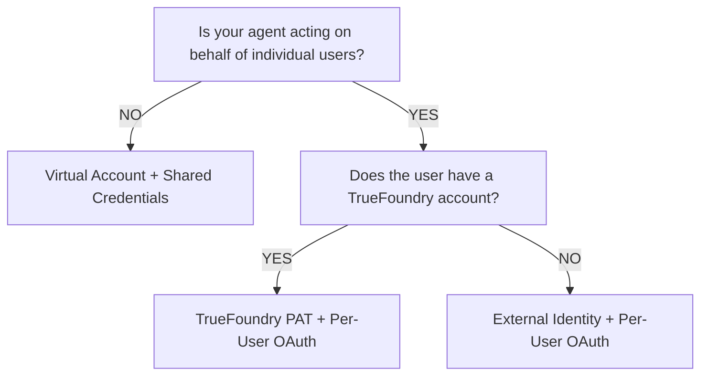
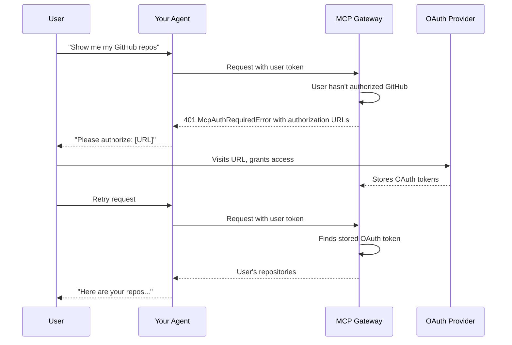

> ## Documentation Index
> Fetch the complete documentation index at: https://www.truefoundry.com/llms.txt
> Use this file to discover all available pages before exploring further.

# Using MCP Gateway in Your Agent

> Learn how to integrate MCP servers into your agent with the right authentication approach for your use case.

<Note>
  **Prerequisite:** Before proceeding, we recommend reviewing the [Authentication and Security](/docs/ai-gateway/mcp/mcp-gateway-auth-security) guide to understand the Gateway's authentication architecture, including inbound/outbound authentication and access control concepts.
</Note>

When building an AI agent that uses MCP tools, authentication can be confusing. This guide helps you understand **which token(s) to pass** and **when**, based on your specific use case.

## The Two Fundamental Questions

Before writing any code, answer these two questions:

| Question                                             | What It Determines                                                   |
| ---------------------------------------------------- | -------------------------------------------------------------------- |
| **Who is calling the Gateway?**                      | The **Gateway Token** - identifies the caller to TrueFoundry         |
| **Whose credentials access the downstream service?** | The **MCP Server Auth** - determines whose data/permissions are used |

These are **separate authentication layers**. Understanding this is key to implementing authentication correctly.

***

## Quick Start: Which Scenario Are You?

<AccordionGroup>
  <Accordion title="Scenario A: Agent Acts on YOUR Behalf (Developer/Service Mode)">
    **Your agent performs actions using your organization's credentials** - like a service account that does work on behalf of your company.

    **Examples:**

    * An internal support bot that queries your company's knowledge base
    * A code assistant that uses a shared GitHub service account
    * A data analysis agent that accesses shared analytics databases

    **What tokens to use:**

    | Token Type          | What to Use                         | Why                                       |
    | ------------------- | ----------------------------------- | ----------------------------------------- |
    | **Gateway Token**   | Virtual Account token               | Identifies your service/application       |
    | **MCP Server Auth** | Shared credentials (pre-configured) | All requests use the same service account |

    **Key point:** You pass ONE token (Virtual Account). The MCP server's shared credentials are configured in the UI, not in your code.

    ```python theme={"dark"}
    import os
    from fastmcp import Client
    from fastmcp.client.transports import StreamableHttpTransport

    # Only pass the Virtual Account token
    # MCP server auth is pre-configured with shared credentials in the UI
    VA_TOKEN = os.environ["VIRTUAL_ACCOUNT_TOKEN"]

    async def call_tool_as_service():
        transport = StreamableHttpTransport(
            url="https://<gateway-url>/mcp/<server-name>/server",
            headers={"Authorization": f"Bearer {VA_TOKEN}"}
        )
        
        async with Client(transport) as client:
            # All users of your agent get the same level of access
            result = await client.call_tool("query_knowledge_base", {"question": "..."})
            return result
    ```

    <Warning>
      With this approach, all requests from your agent have the same permissions. User A and User B get identical access to the downstream service.
    </Warning>
  </Accordion>

  <Accordion title="Scenario B: Agent Acts on USER'S Behalf (Per-User Mode)">
    **Your agent performs actions using the end user's credentials** - the agent accesses each user's own data and respects their permissions.

    **Examples:**

    * A productivity agent that accesses the user's own Gmail, Slack, or Calendar
    * A development assistant that accesses the user's GitHub repositories
    * A CRM agent that sees only what the logged-in user can see

    **What tokens to use:**

    | Token Type          | What to Use                             | Why                                         |
    | ------------------- | --------------------------------------- | ------------------------------------------- |
    | **Gateway Token**   | User's token (TFY PAT or IdP JWT)       | Identifies which user is making the request |
    | **MCP Server Auth** | Per-user OAuth (managed by TrueFoundry) | Each user's own credentials                 |

    **Key point:** You pass the USER's token. TrueFoundry looks up and injects the OAuth token for that specific user.

    ```python theme={"dark"}
    from fastmcp import Client
    from fastmcp.client.transports import StreamableHttpTransport

    async def call_tool_as_user(user_token: str):
        # Pass the USER's token (not a shared service token)
        # TrueFoundry looks up the OAuth token for THIS user
        transport = StreamableHttpTransport(
            url="https://<gateway-url>/mcp/<server-name>/server",
            headers={"Authorization": f"Bearer {user_token}"}
        )
        
        async with Client(transport) as client:
            # User A sees their emails, User B sees their emails
            result = await client.call_tool("search_emails", {"query": "..."})
            return result
    ```

    <Tip>
      With this approach, User A and User B get different data based on their own OAuth authorizations. Each user must complete OAuth consent once.
    </Tip>
  </Accordion>

  <Accordion title="Scenario C: Hybrid - Some Tools Shared, Some Per-User">
    **Your agent uses some tools with shared credentials and other tools with per-user credentials.**

    **Examples:**

    * An assistant that searches the web (shared API key) and sends emails on user's behalf (per-user OAuth)
    * A dev tool that queries documentation (shared) but accesses user's GitHub (per-user)

    **What tokens to use:**

    | Token Type          | What to Use                       | Why                              |
    | ------------------- | --------------------------------- | -------------------------------- |
    | **Gateway Token**   | User's token                      | Identifies the caller            |
    | **MCP Server Auth** | Mixed - configured per MCP server | Gateway handles it automatically |

    **Key point:** You pass ONE Gateway token. The Gateway routes to different MCP servers, each with its own auth model configured.

    ```python theme={"dark"}
    from fastmcp import Client
    from fastmcp.client.transports import StreamableHttpTransport

    async def call_mixed_tools(user_token: str):
        # Pass ONE token - the Gateway handles the rest
        transport = StreamableHttpTransport(
            url="https://<gateway-url>/mcp/<virtual-mcp-name>/server",
            headers={"Authorization": f"Bearer {user_token}"}
        )
        
        async with Client(transport) as client:
            # Web search uses shared API key (configured on MCP server)
            await client.call_tool("web_search", {"query": "..."})
            
            # Gmail uses user's OAuth token (user must have completed OAuth)
            await client.call_tool("send_email", {"to": "...", "body": "..."})
    ```

    <Note>
      The Gateway abstracts away the complexity. You don't need to pass different tokens for different MCP servers.
    </Note>
  </Accordion>
</AccordionGroup>

***

## Quick Decision Guide

Use the flowchart below to pick your scenario, then refer to the table for token and auth details.



| Outcome                                  | Gateway Token      | MCP Server Auth                                                              |
| ---------------------------------------- | ------------------ | ---------------------------------------------------------------------------- |
| **Virtual Account + Shared Credentials** | Virtual Account    | Static headers (configured once in UI). All users get the same access level. |
| **TrueFoundry PAT + Per-User OAuth**     | User's TFY API Key | Per-user OAuth; user completes consent once.                                 |
| **External Identity + Per-User OAuth**   | Your IdP's JWT     | Per-user OAuth; user completes consent once.                                 |

***

## Guide to Implementing an Agent

Follow this high-level path to integrate the MCP Gateway into your agent:

1. **Choose your scenario** — Use the [Quick Decision Guide](#quick-decision-guide) and [Quick Start scenarios](#quick-start-which-scenario-are-you) above to decide whether your agent acts on behalf of users or a shared service, and which tokens you need.
2. **Meet the prerequisites** — Ensure you have access, a registered MCP server, and the right token type (see [Prerequisites](#prerequisites) below).
3. **Get your MCP server URL** — Copy the URL for your MCP server from the TrueFoundry UI (e.g. `https://gateway.truefoundry.ai/mcp/sentry/server`).
4. **Connect from your agent** — Use the Gateway token in the `Authorization` header and call the MCP server URL with your chosen client (e.g. `fastmcp`). See [Connecting to an MCP Server](#connecting-to-an-mcp-server) and the scenario examples above.

Once you have the URL and token, the rest is standard MCP tool calls; the Gateway handles auth to the downstream MCP server.

***

## Prerequisites

Before you begin, ensure you have:

1. **Access to TrueFoundry**: A TrueFoundry account with access to the AI Gateway

2. **MCP server registered**: At least one MCP server registered in the gateway (see [Getting Started](/docs/ai-gateway/mcp/mcp-server-getting-started))

3. **Authentication token**: One of the following:
   * TrueFoundry Personal Access Token (PAT)
   * Virtual Account token
   * JWT from your Identity Provider (if using External Identity)

4. **Python environment** with the `fastmcp` package:

```bash theme={"dark"}
pip install fastmcp
```

***

## Connecting to an MCP Server

The MCP Gateway exposes each registered MCP server at a unique URL. You can copy each server's URL from the TrueFoundry UI.

### Basic Connection Example

```python theme={"dark"}
import asyncio
from fastmcp import Client
from fastmcp.client.transports import StreamableHttpTransport


async def call_mcp_tool():
    # MCP server URL from TrueFoundry UI
    mcp_url = "https://<gateway-url>/mcp/<server-name>/server"
    
    # Your authentication token (see scenarios above)
    auth_token = "your-token"
    
    transport = StreamableHttpTransport(
        url=mcp_url,
        headers={"Authorization": f"Bearer {auth_token}"}
    )
    
    async with Client(transport) as client:
        # List available tools
        tools = await client.list_tools()
        print(f"Available tools: {[t.name for t in tools]}")
        
        # Call a specific tool
        result = await client.call_tool("tool_name", {"arg1": "value1"})
        print(f"Result: {result}")


asyncio.run(call_mcp_tool())
```

***

## Detailed Implementation Examples

### Using TrueFoundry Personal Access Token (PAT)

For internal developers with TrueFoundry accounts.

<Steps>
  <Step title="Generate a Personal Access Token">
    1. Navigate to **Settings > API Keys** in the TrueFoundry UI
    2. Click **Generate New API Key**
    3. Store the token securely
  </Step>

  <Step title="Use the token in your code">
    ```python theme={"dark"}
    import os
    from fastmcp import Client
    from fastmcp.client.transports import StreamableHttpTransport

    TFY_API_KEY = os.environ["TFY_API_KEY"]

    async def call_with_pat():
        transport = StreamableHttpTransport(
            url="https://<gateway-url>/mcp/<server-name>/server",
            headers={"Authorization": f"Bearer {TFY_API_KEY}"}
        )
        
        async with Client(transport) as client:
            result = await client.call_tool("search", {"query": "AI agents"})
            return result
    ```
  </Step>
</Steps>

### Using Virtual Accounts (Service-to-Service)

For backend services, automated pipelines, or when individual user identity isn't required.

<Steps>
  <Step title="Create a Virtual Account">
    1. Navigate to **Settings > Virtual Accounts** in the TrueFoundry UI
    2. Click **Create Virtual Account**
    3. Give it a descriptive name (e.g., `my-agent-mcp-access`)
    4. Add permissions for the MCP servers your application needs
    5. Generate and securely store the token
  </Step>

  <Step title="Use the Virtual Account token">
    ```python theme={"dark"}
    import os
    from fastmcp import Client
    from fastmcp.client.transports import StreamableHttpTransport

    VA_TOKEN = os.environ["VIRTUAL_ACCOUNT_TOKEN"]

    async def call_mcp_tool(tool_name: str, tool_args: dict):
        transport = StreamableHttpTransport(
            url="https://<gateway-url>/mcp/<server-name>/server",
            headers={"Authorization": f"Bearer {VA_TOKEN}"}
        )
        
        async with Client(transport) as client:
            return await client.call_tool(tool_name, tool_args)
    ```
  </Step>
</Steps>

<Warning>
  Virtual Accounts cannot have per-user OAuth tokens. If your MCP server requires OAuth for user-specific data, use a user token (TFY PAT or IdP JWT) instead.
</Warning>

### Handling OAuth-Protected MCP Servers

When an MCP server is configured with OAuth2 and the user hasn't completed the OAuth flow, the Gateway returns a `401` HTTP error whose JSON body contains `authorization_urls` the user must visit.



**Handling OAuth Errors in Code:**

```python theme={"dark"}
import httpx
from fastmcp import Client
from fastmcp.client.transports import StreamableHttpTransport


def _make_httpx_client(**kwargs) -> httpx.AsyncClient:
    """Factory that creates an httpx client which reads error response bodies.

    The MCP library uses streaming requests, so response bodies are not
    automatically read. This hook ensures 4xx/5xx bodies are loaded before
    raise_for_status() discards them.
    """
    async def _read_error_body(response: httpx.Response):
        if response.status_code >= 400:
            await response.aread()

    hooks = kwargs.pop("event_hooks", {})
    hooks.setdefault("response", []).append(_read_error_body)
    return httpx.AsyncClient(event_hooks=hooks, **kwargs)


async def call_mcp_with_oauth(
    mcp_url: str,
    user_token: str,
    tool_name: str,
    tool_args: dict
):
    """Call an MCP tool, handling OAuth authorization if needed."""
    transport = StreamableHttpTransport(
        url=mcp_url,
        headers={"Authorization": f"Bearer {user_token}"},
        httpx_client_factory=_make_httpx_client,
    )

    try:
        async with Client(transport) as client:
            result = await client.call_tool(tool_name, tool_args)
            return {"success": True, "result": result}
    except httpx.HTTPStatusError as e:
        if e.response.status_code == 401:
            body = e.response.json()
            if body.get("error", {}).get("type") == "McpAuthRequiredError":
                return {
                    "success": False,
                    "auth_required": True,
                    "authorization_urls": body.get("authorization_urls", {}),
                    "server_names": body.get("server_names", {}),
                    "message": body.get("message", ""),
                }
        raise


# Example usage
async def main():
    result = await call_mcp_with_oauth(
        mcp_url="https://<gateway-url>/mcp/<server-name>/server",
        user_token="user-tfy-token-or-idp-jwt",
        tool_name="get_repositories",
        tool_args={}
    )

    if result.get("auth_required"):
        print(result["message"])
        for server, url in result["authorization_urls"].items():
            print(f"  Authorize {server}: {url}")
        # After user completes OAuth, retry the request
    else:
        print(f"Success: {result['result']}")
```

<Note>
  **OAuth errors are returned as HTTP 401 responses** with a JSON body containing `error.type` set to `"McpAuthRequiredError"`. The `authorization_urls` field is a dictionary keyed by server name, and each value is the URL the user must visit to complete the OAuth consent flow.
</Note>

<Tip>
  **After OAuth completion**: Once the user completes the OAuth consent flow, TrueFoundry stores their token. Future requests automatically include the OAuth credentials—no code changes needed.
</Tip>

### Token Passthrough for Custom MCP Servers

For MCP servers that validate JWTs from your Identity Provider directly.

```python theme={"dark"}
from fastmcp import Client
from fastmcp.client.transports import StreamableHttpTransport


async def call_passthrough_mcp(
    mcp_url: str,
    user_jwt: str,  # JWT from your IdP (Auth0, Okta, Cognito, etc.)
    tool_name: str,
    tool_args: dict
):
    """Call an MCP tool with token passthrough."""
    transport = StreamableHttpTransport(
        url=mcp_url,
        headers={"Authorization": f"Bearer {user_jwt}"}
    )
    
    async with Client(transport) as client:
        return await client.call_tool(tool_name, tool_args)
```

<Note>
  With Token Passthrough, the MCP server validates the JWT directly against your IdP's configuration. The Gateway passes the JWT unchanged.
</Note>

***

## Mixing OAuth and Header-Based MCP Servers

A common question: "My agent uses Gmail (OAuth) and a web search API (header-based). Do I need to handle them differently?"

**Answer: No.** The Gateway handles this for you.

### How It Works

1. **Configure each MCP server with its auth model in the UI:**
   * Gmail MCP Server → OAuth2
   * Web Search MCP Server → Static Header (API key)

2. **In your code, pass ONE Gateway token:**

```python theme={"dark"}
# Same code for all MCP servers - Gateway handles auth injection
transport = StreamableHttpTransport(
    url="https://<gateway-url>/mcp/<virtual-mcp-name>/server",
    headers={"Authorization": f"Bearer {user_token}"}
)

async with Client(transport) as client:
    # Web search - Gateway injects the pre-configured API key
    await client.call_tool("web_search", {"query": "AI news"})
    
    # Gmail - Gateway injects THIS user's OAuth token
    await client.call_tool("search_emails", {"query": "from:boss"})
```

3. **The Gateway handles auth per server:**

| MCP Server | Auth Model    | What Gateway Does                       |
| ---------- | ------------- | --------------------------------------- |
| Web Search | Static Header | Injects pre-configured API key          |
| Gmail      | OAuth2        | Looks up user's OAuth token, injects it |
| Calculator | No Auth       | Passes request as-is                    |

***

## Overriding Authentication with Custom Headers

If you need to override the default auth for a specific MCP server, use the `x-tfy-mcp-headers` header.

### For a Single MCP Server

```python theme={"dark"}
import json
from fastmcp import Client
from fastmcp.client.transports import StreamableHttpTransport

async def call_with_custom_headers():
    custom_headers = json.dumps({
        "Authorization": "Bearer custom-token",
        "X-Custom-Header": "custom-value"
    })
    
    transport = StreamableHttpTransport(
        url="https://<gateway-url>/mcp/<server-name>/server",
        headers={
            "Authorization": "Bearer your-gateway-token",
            "x-tfy-mcp-headers": custom_headers
        }
    )
    
    async with Client(transport) as client:
        return await client.call_tool("tool_name", {})
```

### For Virtual MCP Servers

When connecting to a [Virtual MCP Server](/docs/ai-gateway/mcp/virtual-mcp-server) (which aggregates multiple MCP servers), use a nested structure:

```python theme={"dark"}
import json
from fastmcp import Client
from fastmcp.client.transports import StreamableHttpTransport

async def call_virtual_mcp_with_headers():
    # Headers for each underlying MCP server
    custom_headers = json.dumps({
        "server-1": {"Authorization": "Bearer token-for-server-1"},
        "server-2": {"Authorization": "Bearer token-for-server-2"}
    })
    
    transport = StreamableHttpTransport(
        url="https://<gateway-url>/mcp/<virtual-mcp-name>/server",
        headers={
            "Authorization": "Bearer your-gateway-token",
            "x-tfy-mcp-headers": custom_headers
        }
    )
    
    async with Client(transport) as client:
        return await client.call_tool("tool_from_server_1", {})
```

<Warning>
  Custom headers **override** the default authentication. Use this sparingly, as it bypasses TrueFoundry's token management.
</Warning>

***

## Complete Example: Building an MCP-Enabled Agent

Here's a complete example with proper error handling for multiple MCP servers:

```python theme={"dark"}
import asyncio
import os
from dataclasses import dataclass

import httpx
from fastmcp import Client
from fastmcp.client.transports import StreamableHttpTransport


def _make_httpx_client(**kwargs) -> httpx.AsyncClient:
    """Factory that creates an httpx client which reads error response bodies.

    The MCP library uses streaming requests, so response bodies are not
    automatically read. This hook ensures 4xx/5xx bodies are loaded before
    raise_for_status() discards them.
    """
    async def _read_error_body(response: httpx.Response):
        if response.status_code >= 400:
            await response.aread()

    hooks = kwargs.pop("event_hooks", {})
    hooks.setdefault("response", []).append(_read_error_body)
    return httpx.AsyncClient(event_hooks=hooks, **kwargs)


@dataclass
class MCPConfig:
    url: str
    name: str


class MCPAgent:
    """An agent that can call tools from multiple MCP servers."""
    
    def __init__(self, auth_token: str):
        self.auth_token = auth_token
        self.mcp_configs: dict[str, MCPConfig] = {}
    
    def register_mcp_server(self, name: str, url: str):
        self.mcp_configs[name] = MCPConfig(url=url, name=name)
    
    async def call_tool(self, server_name: str, tool_name: str, tool_args: dict) -> dict:
        if server_name not in self.mcp_configs:
            raise ValueError(f"MCP server '{server_name}' not registered")
        
        config = self.mcp_configs[server_name]
        transport = StreamableHttpTransport(
            url=config.url,
            headers={"Authorization": f"Bearer {self.auth_token}"},
            httpx_client_factory=_make_httpx_client,
        )
        
        try:
            async with Client(transport) as client:
                result = await client.call_tool(tool_name, tool_args)
                return {"success": True, "result": result}
        except httpx.HTTPStatusError as e:
            if e.response.status_code == 401:
                body = e.response.json()
                if body.get("error", {}).get("type") == "McpAuthRequiredError":
                    return {
                        "success": False,
                        "auth_required": True,
                        "authorization_urls": body.get("authorization_urls", {}),
                        "server_names": body.get("server_names", {}),
                        "server": server_name,
                        "message": body.get("message", ""),
                    }
            return {"success": False, "error": str(e)}
    
    async def list_tools(self, server_name: str) -> list[str]:
        if server_name not in self.mcp_configs:
            raise ValueError(f"MCP server '{server_name}' not registered")
        
        config = self.mcp_configs[server_name]
        transport = StreamableHttpTransport(
            url=config.url,
            headers={"Authorization": f"Bearer {self.auth_token}"},
            httpx_client_factory=_make_httpx_client,
        )
        
        async with Client(transport) as client:
            tools = await client.list_tools()
            return [tool.name for tool in tools]


# Example usage
async def main():
    # Initialize with user token for per-user access
    # Or use Virtual Account token for shared access
    agent = MCPAgent(auth_token=os.environ["TFY_API_KEY"])
    
    agent.register_mcp_server(
        name="github",
        url="https://<gateway-url>/mcp/github-integration/server"
    )
    agent.register_mcp_server(
        name="web-search",
        url="https://<gateway-url>/mcp/web-search/server"
    )
    
    # Call a tool
    result = await agent.call_tool(
        server_name="github",
        tool_name="list_repositories",
        tool_args={"owner": "truefoundry"}
    )
    
    if result.get("auth_required"):
        print("OAuth authorization required:")
        for server, url in result["authorization_urls"].items():
            print(f"  Authorize {server}: {url}")
    elif result.get("success"):
        print(f"Result: {result['result']}")
    else:
        print(f"Error: {result.get('error')}")


if __name__ == "__main__":
    asyncio.run(main())
```

***

## Troubleshooting

<AccordionGroup>
  <Accordion title="Connection refused or timeout">
    * Verify the MCP server URL is correct (copy from TrueFoundry UI)
    * Check that the MCP server is running and healthy
    * Ensure your network can reach the TrueFoundry control plane
  </Accordion>

  <Accordion title="401 Unauthorized">
    * Verify your authentication token is valid and not expired
    * Check that you have access to the MCP server (see collaborators in UI)
    * For Virtual Accounts, ensure the account has the required permissions
  </Accordion>

  <Accordion title="OAuth errors keep appearing">
    * The user needs to complete the OAuth consent flow
    * Redirect them to the authorization URL provided in the error
    * After consent, tokens are stored automatically—retry the request
  </Accordion>

  <Accordion title="Tool not found">
    * List available tools using `client.list_tools()` to see what's available
    * Tool names are case-sensitive
    * The MCP server may have been updated—refresh the tool list
  </Accordion>

  <Accordion title="Can I use Virtual Account with OAuth MCP servers?">
    Not directly. Virtual Accounts don't have per-user OAuth tokens.

    **Options:**

    1. Use TFY PAT or IdP JWT for per-user OAuth
    2. Configure the MCP server with Static Header auth instead (shared access)
  </Accordion>
</AccordionGroup>
