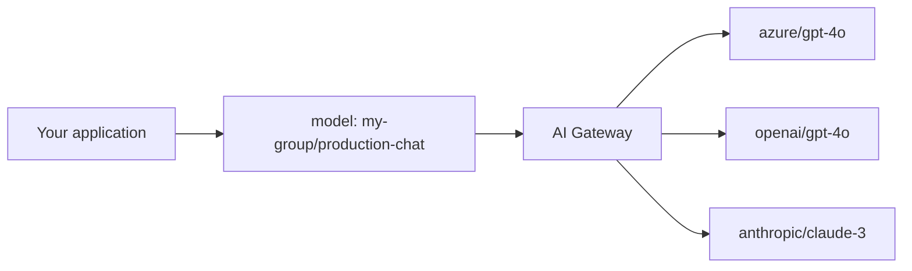

> ## Documentation Index
> Fetch the complete documentation index at: https://www.truefoundry.com/llms.txt
> Use this file to discover all available pages before exploring further.

# Virtual Models

> Route requests across multiple model providers with load balancing, failover, and retries using a single model name

A **virtual model** is a named entry in TrueFoundry AI Gateway that your application calls like any other model (for example `my-group/production-chat`). Behind that name, you configure **one routing strategy** and **one or more real target models** (for example `azure/gpt-4o` and `openai/gpt-4o`). The gateway handles load balancing, health-aware routing, retries, and fallbacks automatically so you do not hard-code provider details in every service.



## Why route across multiple targets?

Production LLM traffic benefits when the gateway can choose or fail over among more than one backend. Common drivers:

<AccordionGroup>
  <Accordion title="Service outages and downtime">
    Model providers experience outages and downtimes. For e.g. here's a screenshot of OpenAI's and Anthropic's status page from Feb to May 2025.

    <div style={{ display: "flex", gap: "16px", justifyContent: "center" }}>
      <Frame caption="OpenAI Status Page" style={{ flex: 1 }}>
        
      </Frame>

      <Frame caption="Anthropic Status Page" style={{ flex: 1 }}>
        
      </Frame>
    </div>

    To avoid the downtime of your applications when models go down, a lot of organizations use multiple model providers and configure load balancing to route to the healthy model in case one of the models goes down, hence avoiding any downtime of their applications for their users.
  </Accordion>

  <Accordion title="Latency variance among models">
    Latency and performance varies on time, region, model and provider. Here's a graph of the latency variance of a few models over a course of a month.

    <Frame caption="Latency variance of models over a course of a month">
      
    </Frame>

    We want to be able to route dynamically to the model with the lowest latency at any point in time.
  </Accordion>

  <Accordion title="Rate limits of models">
    A lot of the LLM providers enforce strict rate limits on API usage. Here's a screenshot of Azure OpenAI's rate limits:

    <Frame caption="Azure OpenAI Rate Limits">
      
    </Frame>

    When these limits are exceeded, requests begin to fail and we want to be able to route to other models to keep our application running.
  </Accordion>

  <Accordion title="Canary testing">
    Testing new models or updates in production carries significant risks. Dynamic load balancing can be used to route a small percentage of traffic to the new model and monitor the performance before routing all the traffic to the new model.
  </Accordion>
</AccordionGroup>

## Why virtual models?

* **Stable API surface** — Your apps pass one model identifier; you change targets, weights, or providers in the gateway without redeploying clients.
* **Resilience** — Retries and fallback status codes route around rate limits and transient errors across targets.
* **Governance** — Virtual model provider groups support [collaborator roles](/docs/ai-gateway/gateway-access-control) so teams can **use** or **manage** routing separately.

## Routing strategies

When you create a virtual model, you choose **one** of three routing strategies. Each strategy uses the same list of targets; the difference is how the gateway picks among healthy targets for each request.

| Strategy                                      | How it works                                                                                                                                         | Best for                                               |
| --------------------------------------------- | ---------------------------------------------------------------------------------------------------------------------------------------------------- | ------------------------------------------------------ |
| [**Weight-based**](#weight-based-routing)     | Distributes traffic by assigned weights (e.g. 80/20). Also supports [sticky routing](#sticky-routing-weight-based-only) to pin sessions to a target. | Canary rollouts, fixed capacity splits, A/B allocation |
| [**Priority-based**](#priority-based-routing) | Routes to the highest-priority healthy target (0 = highest). Falls back to the next on failure. Supports [SLA cutoff](#sla-cutoff).                  | Primary + backup topologies, cost optimization         |
| [**Latency-based**](#latency-based-routing)   | Automatically routes to the target with the lowest recent latency. No weights needed.                                                                | Performance chasing across regions or providers        |

### Weight-based routing

You assign a weight to each target. The gateway distributes incoming requests in proportion to those weights. For example, 90% to `azure/gpt-4o` and 10% to `openai/gpt-4o`.

#### Sticky routing (weight-based only)

Sticky routing pins requests that share the same session key to the same target model for a configurable time window (`ttl_seconds`). Within that window, every request carrying the same session identifier is routed to the same model. When the window expires, the session is re-evaluated and may land on a different model. Useful for multi-turn conversations, prompt cache efficiency, and consistent user experience.

<Accordion title="Configuring sticky routing">
  Add a `sticky_routing` block inside your weight-based routing configuration. Two fields are required: `ttl_seconds` and at least one entry in `session_identifiers`.

  ```yaml theme={"dark"}
  routing_config:
    type: weight-based-routing
    sticky_routing:
      ttl_seconds: 3600
      session_identifiers:
        - key: x-user-id
          source: headers
    load_balance_targets:
      - target: provider-a/model-a
        weight: 70
        fallback_candidate: true
      - target: provider-b/model-b
        weight: 30
        fallback_candidate: true
  ```

  <Frame caption="Sticky routing configuration in the Virtual Model dashboard">
    
  </Frame>

  **Session identifiers** tell the gateway which fields to read from the request to identify a session. All configured identifiers are combined into a single session key — you can mix headers and metadata fields.

  * **`key`** — The header or metadata field name to read.
  * **`source`** — `headers` to read from HTTP request headers, or `metadata` to read from request metadata.

  ```yaml theme={"dark"}
  # Pin by a combination of user and conversation
  session_identifiers:
    - key: x-user-id
      source: headers
    - key: x-conversation-id
      source: headers

  # Pin using request metadata
  session_identifiers:
    - key: tenant-id
      source: metadata
    - key: user-id
      source: metadata
  ```

  <Warning>
    If a configured identifier is missing from the request, it contributes an empty string to the session key. All requests missing that field will be treated as the same session. Make sure your clients always send the identifier fields you configure.
  </Warning>

  **TTL window:** `ttl_seconds` defines how long a session stays pinned. For chatbots, `3600` (1 hour) is a common starting point. For longer workflows, consider `86400` (24 hours).

  **Fallback during a sticky session:** If the pinned model fails, the remaining healthy targets are tried in sequence (this fallback order is **not weight-based**). Only targets with `fallback_candidate: true` are eligible. After a successful fallback, subsequent requests for that session in the same TTL window are routed to the working target — not back to the one that failed.
</Accordion>

### Priority-based routing

Each target has a priority number. The gateway routes to the highest priority target (**0 is highest**) that is healthy. If that target fails or is unavailable, the gateway falls back to the next.

<Accordion title="SLA cutoff">
  Priority-based routing supports **SLA cutoff** to automatically mark models as unhealthy when they breach performance thresholds:

  * Configure a **Time Per Output Token (TPOT)** threshold per target using `sla_cutoff.time_per_output_token_ms`
  * The gateway monitors average TPOT over a **3-minute rolling window** (up to 10 samples, minimum 3 required)
  * If TPOT exceeds the threshold, the target is marked unhealthy and moved to the end of the list
  * Recovery is automatic when metrics improve or older data ages out

  SLA cutoff is only available for priority-based routing, not weight-based or latency-based.
</Accordion>

### Latency-based routing

You do not set weights. The gateway chooses the target with the lowest recent latency automatically.

<Accordion title="How latency is measured">
  The gateway uses **Time Per Output Token (TPOT)** as the latency metric. TPOT is calculated as total time until the last token divided by the number of output tokens. Because it folds in both time-to-first-token and inter-token latency, it captures the full generation speed in a single number that is independent of output length.

  1. Only requests in the **last 20 minutes** are considered. If more than 100 requests exist in that window, the last 100 are used. If fewer than 3 requests exist, the model is treated as the fastest so that more traffic is routed to it to gather data.
  2. Models are considered **equally fast** if their TPOT is within **1.2×** of the fastest — this avoids rapid switching due to minor differences.
</Accordion>

## Configuration structure

The following YAML shows the complete shape of a virtual model's routing configuration with all available fields. In the dashboard UI, the same fields are set through the form editor.

<CodeGroup>
  ```yaml YAML theme={"dark"}
  routing_config:
    type: weight-based-routing | latency-based-routing | priority-based-routing

    # Sticky routing (weight-based only)
    sticky_routing:
      ttl_seconds: integer              # how long a session stays pinned (seconds)
      session_identifiers:
        - key: string                   # header or metadata field name
          source: headers | metadata    # where to read the session key from

    load_balance_targets:
      - target: string                  # model identifier in the gateway (e.g. azure/gpt-4o)

        # Routing strategy fields (mutually exclusive)
        weight: integer                 # 0–100, sum to 100 (weight-based only)
        priority: integer               # lower = higher priority (priority-based only)

        # Retry configuration
        retry_config:
          attempts: integer             # retries on the SAME target; default: 2
          delay: integer                # ms between retries; default: 100
          on_status_codes: string[]     # codes that trigger retry; default: ["429","500","502","503"]

        # Fallback configuration
        fallback_status_codes: string[] # codes that trigger trying a DIFFERENT target
                                        # default: ["401","403","404","429","500","502","503"]
        fallback_candidate: boolean     # eligible to receive fallback traffic from other targets?
                                        # default: true

        # SLA cutoff (priority-based only)
        sla_cutoff:
          time_per_output_token_ms: integer  # TPOT threshold; target marked unhealthy when exceeded

        # Metadata-based target filtering
        metadata_match:                 # key-value pairs that must match resolved request metadata
          key1: value1                  # all pairs must match (AND logic)
          key2: value2

        # Header overrides
        headers_override:
          set:                          # headers to add or overwrite on the outgoing request
            header-name: header-value
          remove:                       # headers to strip from the outgoing request
            - header-name

        # Override parameters
        override_params:
          temperature: number           # per-target temperature override
          max_tokens: integer           # per-target max_tokens override
          prompt_version_fqn: string    # per-target prompt version for hydration
  ```
</CodeGroup>

### Key fields

**`type`** — The routing strategy for this virtual model:

* **`weight-based-routing`** — Distribute traffic by assigned weights that sum to 100.
* **`latency-based-routing`** — Automatically route to the target with the lowest recent latency. No weights needed.
* **`priority-based-routing`** — Route to the highest priority (lowest number) healthy target, falling back to the next on failure.

**`load_balance_targets`** — The list of real models eligible for routing. Each target and its configuration options are described in detail in the [Per-target configuration](#per-target-configuration) section below.

## Per-target configuration

Regardless of which routing strategy you choose, each target in the virtual model supports several options that control what happens when a request is routed to that target.

### Retries and fallbacks

Each target can define how the gateway should handle failures before giving up or moving to another target:

* **Retry configuration** — Number of attempts, delay between retries, and which status codes trigger a retry on the **same** target. Defaults: 2 attempts, 100 ms delay, retry on `429`, `500`, `502`, `503`.
* **Fallback status codes** — Which status codes cause the gateway to stop retrying this target and try a **different** target instead. Default: `401`, `403`, `404`, `429`, `500`, `502`, `503`.
* **Fallback candidate** — Whether this target is eligible to receive traffic when **another** target fails. Default: `true`. Set to `false` when you want a target to be used only as a primary and never receive fallback traffic from other targets.

<Accordion title="Retry and fallback example">
  ```yaml theme={"dark"}
  routing_config:
    type: priority-based-routing
    load_balance_targets:
      - target: azure/gpt-4o
        priority: 0
        retry_config:
          attempts: 3
          delay: 200
          on_status_codes: ["429", "500", "503"]
        fallback_status_codes: ["429", "500", "502", "503"]
        fallback_candidate: true
      - target: openai/gpt-4o
        priority: 1
        retry_config:
          attempts: 2
          delay: 100
        fallback_status_codes: ["429"]
        fallback_candidate: true
      - target: anthropic/claude-sonnet
        priority: 2
        fallback_candidate: false   # only used as primary, never receives fallback traffic
  ```

  In this configuration:

  * A request first goes to `azure/gpt-4o` (priority 0). If it returns `429`, the gateway retries up to 3 times with 200 ms delay. If retries are exhausted or a fallback status code is returned, it falls back to the next target.
  * `openai/gpt-4o` (priority 1) is tried next with its own retry config.
  * `anthropic/claude-sonnet` (priority 2) has `fallback_candidate: false`, so it is **never** tried as a fallback for the other two targets — it is only used when it is itself the highest-priority healthy target.
</Accordion>

### Header overrides

You can inject or remove HTTP headers on a per-target basis, applied just before the request is sent to that model. This is useful when a specific target requires headers that the others don't — for example, a region identifier, a deployment ID, or an API version header expected by one provider but not the rest.

<Accordion title="Configuration and examples">
  Add a `headers_override` block to any target in your `load_balance_targets` list:

  ```yaml theme={"dark"}
  routing_config:
    type: weight-based-routing
    load_balance_targets:
      - target: provider-a/model-a
        weight: 80
        headers_override:
          set:
            x-region: us-east-1
          remove:
            - x-internal-debug
      - target: provider-b/model-b
        weight: 20
        headers_override:
          set:
            x-region: eu-west-1
  ```

  <Frame caption="Header overrides configuration per target in the Virtual Model dashboard">
    
  </Frame>

  * **`set`** — Key-value pairs of headers to add or overwrite on the outgoing request.
  * **`remove`** — List of header keys to strip from the outgoing request.

  Header keys are **case-insensitive** — `X-Custom-Auth` and `x-custom-auth` refer to the same header. The gateway normalises all keys to lowercase before applying overrides. Header overrides are applied **last**, after parameter overrides, so they reflect the final outgoing headers sent to the provider.
</Accordion>

### Metadata-based target filtering

You can constrain a target to only receive traffic when request metadata matches specific key-value pairs using `metadata_match`.

The gateway evaluates **resolved metadata** (not just raw request headers). Metadata can come from:

* **Request metadata header** — `x-tfy-metadata` (JSON object with string keys and values)
* **Virtual account tags** — when using a virtual account, its tags are included in metadata
* **Default gateway metadata** — configured at gateway level (commonly used in self-hosted setups)
* **SaaS gateway location metadata** — `tfy_gateway_region` and `tfy_gateway_zone` are automatically added by the SaaS gateway based on which region handled the request

<Tip>
  For the full list of SaaS gateway location metadata keys and their values, see [Metadata Keys](/docs/ai-gateway/globally-distributed-saas#metadata-keys).
</Tip>

When the same key appears in multiple sources, precedence is:

1. request metadata
2. default gateway metadata (overrides request value for overlapping keys)
3. virtual account tags (highest precedence)

For each target:

* If `metadata_match` is not set (or empty), that target always stays eligible.
* If `metadata_match` is set, **all** configured pairs must match exactly (`AND` semantics).
* Filtering happens before load-balancing order and sticky routing are computed, so only matching targets participate in routing for that request.

<Accordion title="Basic metadata filtering">
  ```yaml theme={"dark"}
  routing_config:
    type: weight-based-routing
    load_balance_targets:
      - target: azure/gpt-4o
        weight: 70
        metadata_match:
          region: us
          tier: enterprise
      - target: openai/gpt-4o
        weight: 30
  ```

  For a request with:

  ```http theme={"dark"}
  x-tfy-metadata: {"region":"us","tier":"enterprise"}
  ```

  both targets are eligible. For:

  ```http theme={"dark"}
  x-tfy-metadata: {"region":"eu","tier":"enterprise"}
  ```

  only `openai/gpt-4o` remains eligible because the first target does not match.
</Accordion>

<Accordion title="SaaS gateway region-based routing">
  On the [SaaS gateway](/docs/ai-gateway/globally-distributed-saas), every request is automatically tagged with `tfy_gateway_region` and `tfy_gateway_zone` based on which gateway handled it. You can use `metadata_match` to route traffic from specific regions to region-appropriate model deployments — without the client needing to send any metadata.

  ```yaml theme={"dark"}
  routing_config:
    type: priority-based-routing
    load_balance_targets:
      # US gateway traffic → Azure US East deployment
      - target: azure-us/gpt-4o
        priority: 0
        metadata_match:
          tfy_gateway_region: US
      # EU gateway traffic → Azure EU West deployment
      - target: azure-eu/gpt-4o
        priority: 0
        metadata_match:
          tfy_gateway_region: EU
      # India gateway traffic → Azure India deployment
      - target: azure-in/gpt-4o
        priority: 0
        metadata_match:
          tfy_gateway_region: IN
      # Catch-all fallback for any other region
      - target: openai/gpt-4o
        priority: 1
  ```

  In this setup:

  * A user in the US hits `gateway.truefoundry.ai`, which routes to the nearest US gateway. The gateway automatically sets `tfy_gateway_region: US` in resolved metadata, so the request matches `azure-us/gpt-4o`.
  * A user in Europe hits the nearest EU gateway (`tfy_gateway_region: EU`), matching `azure-eu/gpt-4o`.
  * A user in India hits the nearest India gateway (`tfy_gateway_region: IN`), matching `azure-in/gpt-4o`.
  * Users from any other region (e.g. Australia, South America) don't match any `metadata_match` rule, so they fall through to `openai/gpt-4o` (priority 1) which has no `metadata_match` and acts as the default.

  You can also filter by zone for finer-grained control:

  ```yaml theme={"dark"}
  metadata_match:
    tfy_gateway_zone: SFO   # only match traffic from the San Francisco gateway
  ```
</Accordion>

<Warning>
  If no target matches the request metadata, the gateway returns `404` with an error indicating that none of the configured targets matched `metadata_match` conditions. Always include at least one target without `metadata_match` as a catch-all, or ensure your metadata rules cover all possible values.
</Warning>

### Model-specific prompt overrides

When a virtual model sends traffic to targets from different model families, you may need different prompt versions per provider. Configure `prompt_version_fqn` in override parameters on each target. When a request is routed to a target, the gateway uses that target's prompt version for hydration.

<Accordion title="When and how to use prompt overrides">
  This is useful when:

  * Different models require different prompt formats or structures
  * You want to optimize prompts for specific model capabilities
  * You need to maintain model-specific prompt versions behind one virtual model name

  ```yaml theme={"dark"}
  routing_config:
    type: weight-based-routing
    load_balance_targets:
      - target: openai/gpt-4o
        weight: 70
        override_params:
          prompt_version_fqn: chat_prompt:internal/my-app/gpt4-optimized-prompt:1
      - target: anthropic/claude-sonnet
        weight: 30
        override_params:
          prompt_version_fqn: chat_prompt:internal/my-app/claude-optimized-prompt:1
  ```

  <Note>
    `prompt_version_fqn` override does not work with agents (when using MCP/tools). It is supported for standard chat completion requests.
  </Note>
</Accordion>

## Unhealthy target detection

All the routing strategies described above only consider **healthy** targets when deciding where to send a request. The gateway continuously monitors every target and automatically marks targets as unhealthy when they start failing or breaching performance thresholds. This section explains how that health tracking works.

When a target is marked unhealthy, healthy targets are always tried first. Unhealthy targets are moved to the end of the list and only used as a last resort if all healthy targets fail. Recovery is automatic once errors age out of the evaluation window.

<Accordion title="Failure-based cooldown (all routing types)">
  The gateway tracks error responses for each target and marks a target unhealthy when failures cross a threshold in a recent time window.

  * Error responses considered: `5xx`, `429`, `401`, and `403`
  * Default failure threshold: `2` or more failures
  * Default evaluation window: last `2` minutes (rolling window)
  * Recovery: automatic, once failures age out of the window
</Accordion>

<Accordion title="SLA-based cooldown (priority-based routing only)">
  For priority-based routing, you can also configure a latency threshold per target using `sla_cutoff.time_per_output_token_ms`. If the average TPOT over a 3-minute rolling window exceeds the configured threshold (with at least 3 samples), the target is marked unhealthy. See [SLA cutoff](#sla-cutoff) above.
</Accordion>

## FAQ

<AccordionGroup>
  <Accordion title="Can I change the routing strategy after creating a virtual model?">
    Yes. Updates apply to new requests immediately; in-flight requests keep their current routing.
  </Accordion>

  <Accordion title="How do I know which target handled a request?">
    The gateway returns the actual model used in the `x-tfy-resolved-model` [response header](/docs/ai-gateway/headers#response-headers). This may differ from the virtual model you requested due to load balancing or fallbacks. You can also view per-target traffic, success rates, and latency in the AI Gateway dashboard.
  </Accordion>

  <Accordion title="Can one virtual model support several API types (chat and embedding)?">
    Yes, if you enable multiple model types on the virtual model. Every target must support the operation you call.
  </Accordion>

  <Accordion title="What if every target fails?">
    After retries and fallbacks are exhausted, the request fails with an error. Add enough fallback candidates for critical paths.
  </Accordion>

  <Accordion title="Can a virtual model point to another virtual model as a target?">
    No. Allowing virtual models as targets could lead to recursive or deeply nested routing chains that are hard to reason about and debug. To keep routing predictable, targets must be real catalog models. If you need to split traffic further, create separate virtual models and have your client choose between them.
  </Accordion>

  <Accordion title="Can I use sticky routing with latency-based or priority-based routing?">
    No — but it's typically not needed. With **priority-based routing**, requests already go to the same highest-priority healthy target consistently. With **latency-based routing**, the gateway sticks with the fastest target and only switches when another target becomes measurably faster (within a 1.2× threshold), so oscillation between models is rare. Sticky routing exists for **weight-based routing** because that strategy deliberately spreads traffic across targets, and you may want to override that for session consistency.
  </Accordion>

  <Accordion title="Will the same session always go to the same model forever?">
    No — only within the configured `ttl_seconds` window. Once the window expires, the session is re-evaluated and may land on a different model. Size `ttl_seconds` to match your typical session duration.
  </Accordion>

  <Accordion title="Will sticky routing work if my gateway has multiple pods?">
    Yes. Every gateway pod uses the same configuration and the same time-based window, so all pods independently arrive at the same assignment for the same session. When a fallback occurs mid-window, the update is propagated across all pods automatically.
  </Accordion>

  <Accordion title="Do header overrides affect all targets or just the one I configure them on?">
    Header overrides are strictly **per-target** — they only apply when a request is dispatched to that specific target. Other targets in the same virtual model are not affected.
  </Accordion>

  <Accordion title="How does metadata matching work across multiple keys?">
    `metadata_match` uses **all-keys-must-match** logic for a target. If you configure multiple keys, every key-value pair must match request metadata exactly for that target to be eligible.
  </Accordion>

  <Accordion title="What if I set metadata rules on some targets but not others?">
    Targets without `metadata_match` remain eligible for all requests and act as a default path. Targets with `metadata_match` are included only when their conditions match.
  </Accordion>

  <Accordion title="How does metadata filtering interact with sticky routing and fallback?">
    Metadata filtering runs first. Sticky routing and fallback then operate only within the filtered target set for that request.
  </Accordion>
</AccordionGroup>

## Next steps

Ready to set up a virtual model? See [Create a virtual model](/docs/ai-gateway/virtual-model-advanced) for the step-by-step walkthrough and common configuration patterns.
