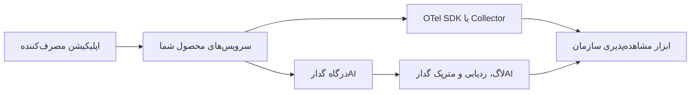

# OpenTelemetry برای مشاهده‌پذیری

OpenTelemetry یا `OTel` یک استاندارد متن‌باز برای جمع‌آوری و ارسال داده‌های مشاهده‌پذیری است. وقتی محصول شما چند سرویس، پردازشگر پس‌زمینه، صف یا ابزار پایش بیرونی دارد، OTel کمک می‌کند درخواست‌های مدل در گدارAI را با بقیه مسیر محصول همبسته کنید.

گدارAI خودش لاگ درخواست‌ها، ردیابی درخواست‌ها و متریک‌های مدل را در اختیار شما می‌گذارد. OTel زمانی ارزش بیشتری دارد که بخواهید این داده‌ها را کنار رخدادهای اپلیکیشن، دیتابیس، صف‌ها و سرویس‌های دیگر ببینید.

:::info
OpenTelemetry جایگزین لاگ‌ها، ردیابی و متریک‌های گدارAI نیست. OTel لایه‌ای برای همبستگی داده‌ها بین گدارAI و سرویس‌های دیگر محصول شماست.
:::

## OpenTelemetry چه داده‌هایی را پوشش می‌دهد؟

در OTel معمولاً با سه نوع داده کار می‌کنید:

| نوع داده | کاربرد |
| --- | --- |
| `Traces` | دنبال‌کردن مسیر اجرای یک درخواست در چند سرویس. |
| `Metrics` | سنجه‌های عددی مثل تاخیر، نرخ خطا و نرخ عبور. |
| `Logs` | رویدادها و جزئیات اجرایی برای عیب‌یابی. |

در workloadهای هوش مصنوعی، این داده‌ها وقتی ارزشمندتر می‌شوند که با مدل، ارائه‌دهنده، توکن، هزینه، شناسه درخواست و شناسه ردیابی درخواست همراه باشند.

## چرا در کنار گدارAI مهم است؟

گدارAI در مسیر فراخوانی مدل قرار دارد و داده‌هایی مثل مدل انتخاب‌شده، ارائه‌دهنده، هزینه، مصرف توکن، کش، rate limit، budget limit، retry و fallback را قابل مشاهده می‌کند. اما اگر تاخیر بالا باشد، همیشه فقط از روی داده درگاه نمی‌فهمید مشکل از کجاست:

- فرانت‌اند
- بک‌اند محصول
- صف یا پردازشگر پس‌زمینه
- دیتابیس
- شبکه
- ارائه‌دهنده مدل

با OTel می‌توانید داده‌های گدارAI را کنار spanها و متریک‌های سرویس‌های خودتان ببینید و ریشه مسئله را سریع‌تر محدود کنید.

## تصویر کلی جریان داده

در یک معماری معمول، داده مشاهده‌پذیری از دو مسیر وارد ابزار پایش شما می‌شود:

1. داده‌های گدارAI، مثل لاگ درخواست‌ها، ردیابی درخواست‌ها و متریک‌های مدل.
2. داده‌های OTel از سرویس‌ها و اپلیکیشن‌های instrument شده.

## شناسه‌ها و propagation

برای اینکه مسیرها از هم جدا نشوند، شناسه‌های ردیابی باید بین لایه‌ها منتقل شوند. در اکوسیستم OTel معمولاً از استاندارد `W3C Trace Context` استفاده می‌شود و سرآیندهای زیر اهمیت دارند:

- `traceparent`
- `baggage`

اگر سرویس‌های شما این سرآیندها را حفظ کنند، همبستگی بین spanهای اپلیکیشن و ردیابی درخواست در گدارAI دقیق‌تر می‌شود. برای سرآیندهای مربوط به درگاه، [سرآیندهای درخواست](/request-headers) را ببینید.

:::tip
در لاگ‌های اپلیکیشن خودتان `request_id` و در صورت وجود `trace_id` را هم ثبت کنید. همین دو شناسه معمولاً سریع‌ترین پل بین لاگ اپلیکیشن، لاگ گدارAI و ابزار مشاهده‌پذیری بیرونی هستند.
:::

## قراردادهای معنایی GenAI

در OTel، قراردادهای معنایی GenAI تلاش می‌کنند attributeهای مربوط به درخواست‌های هوش مصنوعی را یکدست کنند؛ برای نمونه:

- نام مدل
- ارائه‌دهنده
- نوع عملیات
- تعداد توکن ورودی و خروجی
- وضعیت خطا
- اطلاعات ابزارها یا پیام‌ها، در صورت پشتیبانی فریم‌ورک

اگر فریم‌ورک یا سرویس شما این attributeها را تولید کند، تحلیل داده‌های مدل در ابزارهای بیرونی ساده‌تر می‌شود. با این حال، جزئیات ثبت‌شده به SDK، فریم‌ورک و سیاست داده شما بستگی دارد.

## چه زمانی OTel را اضافه کنید؟

OTel را زودتر بررسی کنید اگر:

- چند سرویس یا چند تیم روی یک تجربه کار می‌کنند.
- درخواست مدل بخشی از یک workflow طولانی‌تر است.
- پردازشگر پس‌زمینه، صف یا کار غیرهمزمان دارید.
- همزمان تاخیر، خطا، هزینه و مصرف برایتان مهم است.
- ابزار مشاهده‌پذیری سازمانی از قبل دارید و می‌خواهید داده گدارAI را همان‌جا ببینید.

اگر فقط یک اتصال ساده دارید، معمولاً [لاگ درخواست‌ها](/observability-logs)، [ردیابی درخواست‌ها](/observability-traces)، [متریک‌های مدل](/observability-model-metrics) و [رهگیری هزینه](/cost-tracking) برای شروع کافی‌اند.

## داده حساس در OTel

داده‌های OTel ممکن است از محیط گدارAI خارج شوند و وارد ابزارهای سازمانی یا سرویس‌های ثالث شوند. بنابراین:

- پرامپت و پاسخ کامل را بی‌دلیل به span attribute تبدیل نکنید.
- به‌جای payload، تا جای ممکن شناسه‌ها، اندازه، hash، وضعیت، مدل، هزینه و توکن را ثبت کنید.
- سیاست نگهداری داده ابزار مشاهده‌پذیری بیرونی را با سیاست گدارAI و سازمان خودتان هماهنگ کنید.
- برای داده‌های حساس از [گاردریل‌های محتوا و امنیت](/guardrails) و تنظیمات ثبت داده کمک بگیرید.

:::warning
اگر payload را هم در گدارAI و هم در ابزار OTel بیرونی ثبت کنید، سطح ریسک داده و تعداد محل‌های نگهداری بیشتر می‌شود. قبل از فعال‌سازی، نیاز واقعی عیب‌یابی و سیاست حذف/دسترسی را روشن کنید.
:::

## مسیر پیشنهادی پیاده‌سازی

1. ابتدا اتصال پایه به گدارAI و ارسال درخواست را پایدار کنید.
2. در لاگ درخواست‌ها، `request_id`، مدل، هزینه، توکن و وضعیت خطا را بررسی کنید.
3. در سرویس‌های خودتان OTel SDK یا Collector را فعال کنید.
4. سرآیندهای `traceparent` و `baggage` را در مسیر درخواست حفظ کنید.
5. `request_id` و `trace_id` را در لاگ‌ها و spanهای اپلیکیشن ذخیره کنید.
6. بعد از مشاهده داده واقعی، تصمیم بگیرید کدام attributeها برای هزینه، کیفیت و عیب‌یابی لازم‌اند.

## گام بعدی

- برای بررسی مستقیم درخواست‌ها، [لاگ درخواست‌ها](/observability-logs) را ببینید.
- برای خط زمانی در گدارAI، [ردیابی درخواست‌ها](/observability-traces) را بخوانید.
- برای روندهای مصرف و تاخیر، [متریک‌های مدل](/observability-model-metrics) را دنبال کنید.

## پرسش‌های پرتکرار

### آیا بدون OpenTelemetry هم می‌توانم از گدارAI استفاده کنم؟

بله. OTel پیش‌نیاز اتصال به گدارAI نیست. وقتی پیچیدگی سیستم و نیاز به دید end-to-end بیشتر می‌شود، ارزش OTel بیشتر می‌شود.

### آیا باید پرامپت و پاسخ را در spanها ذخیره کنم؟

نه به‌صورت پیش‌فرض. برای بیشتر تحلیل‌ها، شناسه‌ها، مدل، ارائه‌دهنده، هزینه، توکن، وضعیت و زمان کافی است. payload کامل را فقط با دلیل روشن و سیاست داده مشخص ثبت کنید.

### اگر ابزار مشاهده‌پذیری سازمانی داریم، از کجا شروع کنیم؟

از propagation شناسه‌ها شروع کنید: `traceparent`، `baggage`، `request_id` و `trace_id`. بعد attributeهای GenAI را به‌اندازه نیاز اضافه کنید.
