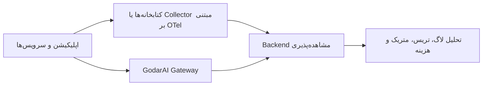

# OpenTelemetry برای مشاهده‌پذیری در GodarAI

این صفحه توضیح می‌دهد OpenTelemetry چگونه می‌تواند در کنار GodarAI به شما یک دید یکپارچه‌تر از رفتار اپلیکیشن، درخواست‌های مدل و مصرف عملیاتی بدهد.

اگر `Logs`، `Metrics` و `Traces` را فقط در سطح گیت‌وی ببینید، بخشی از داستان را از دست می‌دهید. OpenTelemetry کمک می‌کند داده‌های رهگیری و مشاهده‌پذیری را از کل استک اپلیکیشن جمع‌آوری کنید و آن را در کنار داده‌های گیت‌وی تفسیر کنید.

## OpenTelemetry چیست؟

OpenTelemetry یا به‌اختصار `OTel` یک استاندارد متن‌باز برای جمع‌آوری، پردازش و ارسال داده‌های مشاهده‌پذیری است. این استاندارد معمولاً سه نوع داده را پوشش می‌دهد:

- `Traces` برای دنبال‌کردن مسیر اجرای یک درخواست
- `Metrics` برای شاخص‌های عددی مانند latency، throughput و error rate
- `Logs` برای رویدادها و جزئیات اجرایی

در اکوسیستم هوش مصنوعی هم بسیاری از ابزارها و فریم‌ورک‌ها از OTel پشتیبانی می‌کنند. بنابراین اگر اپلیکیشن یا ابزارهای شما از قبل instrument شده باشند، استفاده از این استاندارد می‌تواند GodarAI را به بخشی از زنجیره مشاهده‌پذیری شما تبدیل کند.

## چرا OTel در کنار GodarAI مهم است؟

GodarAI در نقطه‌ای قرار می‌گیرد که درخواست‌های مدل از آن عبور می‌کنند. همین جایگاه باعث می‌شود اطلاعات ارزشمندی مثل این موارد در گیت‌وی قابل مشاهده باشند:

- مدل و provider انتخاب‌شده
- نتیجه routing یا fallback
- داده‌های هزینه و مصرف توکن
- اعمال شدن cache، rate limit یا budget policy
- هویت مصرف‌کننده و بافت سازمانی درخواست

اما این کافی نیست. برای مثال، اگر latency بالا باشد، فقط از روی داده‌های گیت‌وی همیشه معلوم نیست مشکل از کجاست:

- frontend
- backend application
- queue یا worker
- database
- provider upstream

OpenTelemetry این فاصله را پر می‌کند و کمک می‌کند رخدادهای داخل اپلیکیشن را با تعامل‌های LLM که از GodarAI عبور کرده‌اند کنار هم ببینید.

## تصویر کلی جریان داده

در یک معماری معمول، داده‌های مشاهده‌پذیری از دو مسیر می‌آیند:

1. داده‌های بومی GodarAI از خود gateway
2. داده‌های OTel از سرویس‌ها و اپلیکیشن‌های instrument شده

در این مدل، GodarAI فقط منبع لاگ gateway نیست؛ بخشی از تصویری بزرگ‌تر درباره سلامت، هزینه و رفتار کل سیستم است.

## چه نوع همبستگی‌ای ایجاد می‌شود؟

وقتی داده‌های OTel و داده‌های گیت‌وی کنار هم قرار بگیرند، این نوع تحلیل‌ها ممکن می‌شوند:

- ربط دادن یک خطای کاربری به یک فراخوانی مشخص مدل
- دیدن این‌که افزایش latency از اپلیکیشن شروع شده یا از provider
- تحلیل هم‌زمان هزینه، token usage و رفتار ترافیک
- پیدا کردن requestهایی که fallback یا retry شده‌اند
- بررسی این‌که کدام workload بیشترین فشار یا هزینه را ایجاد کرده است

این همان جایی است که مشاهده‌پذیری از «فقط لاگ گرفتن» فراتر می‌رود و به ابزار تصمیم‌گیری عملیاتی تبدیل می‌شود.

## نسبت OTel با رهگیری هزینه

OTel جایگزین cost tracking نیست، بلکه مکمل آن است.

- [رهگیری هزینه](/cost-tracking) برای سنجش و نسبت‌دادن هزینه به درخواست‌ها، تیم‌ها و workloadها مهم است
- OTel برای دیدن زمینه اجرایی و فنی همان درخواست‌ها ارزش دارد

اگر این دو را کنار هم داشته باشید، می‌توانید هم بفهمید یک request چقدر هزینه داشته و هم بفهمید چرا آن request کند، پرخطا یا پرهزینه بوده است.

## قراردادهای معنایی GenAI

در اکوسیستم OTel، مفهومی به‌نام قراردادهای معنایی GenAI یا `GenAI Semantic Conventions` وجود دارد. این قراردادها تلاش می‌کنند attributeهای مربوط به workloadهای هوش مصنوعی را استاندارد کنند؛ برای مثال:

- مدل درخواستی
- provider
- تعداد token ورودی و خروجی
- اطلاعات مربوط به operation
- metadataهای مرتبط با messageها یا toolها

اگر اپلیکیشن یا فریم‌ورک شما این attributeها را تولید کند، تحلیل داده‌های LLM بسیار قابل‌فهم‌تر می‌شود. این موضوع مخصوصاً برای ابزارهایی مثل LangChain، LlamaIndex یا SDKهایی که OTel را پشتیبانی می‌کنند مفید است.

## W3C Trace Context و propagation

برای این‌که تریس‌ها بین سرویس‌ها و GodarAI از هم جدا نشوند، باید context رهگیری بین لایه‌ها propagate شود. در عمل، استاندارد W3C Trace Context معمولاً از این headerها استفاده می‌کند:

- `traceparent`
- `baggage`

اگر این headerها در مسیر درخواست حفظ شوند، ارتباط بین spanهای اپلیکیشن و spanهای گیت‌وی بسیار بهتر قابل بازسازی خواهد بود. برای آشنایی با headerهای مرتبط، [راهنمای Request Headers](/request-headers) را هم ببینید.

## چه زمانی این صفحه برای شما مهم‌تر است؟

اگر یکی از این سناریوها را دارید، OTel برای شما اهمیت بیشتری پیدا می‌کند:

- چند سرویس یا چند لایه backend دارید
- از worker، queue یا jobهای غیرهمزمان استفاده می‌کنید
- چند تیم روی یک gateway مشترک کار می‌کنند
- همزمان latency، هزینه و خطا برایتان مهم است
- می‌خواهید ریشه خطا را سریع‌تر پیدا کنید

## رویکرد پیشنهادی در GodarAI

برای بیشتر تیم‌ها، این مسیر عملی‌تر است:

1. ابتدا از [شروع سریع](/quick-start) و [اولین درخواست به Gateway](/making-llm-requests-via-gateway) استفاده کنید تا integration پایه برقرار شود.
2. سپس [رهگیری هزینه](/cost-tracking) و سیاست‌هایی مثل [Rate Limiting](/guides/rate-limiting) و [Budget Limiting](/guides/budget-limiting) را فعال و تحلیل کنید.
3. وقتی نیاز به دید end-to-end پیدا کردید، instrumentation مبتنی بر OTel را در اپلیکیشن و سرویس‌های پیرامونی اضافه کنید.
4. propagation تریس را بین کلاینت، سرویس‌ها و GodarAI جدی بگیرید.

## چند توصیه عملی

### OTel را فقط برای tracing نبینید

اگر فقط trace بگیرید ولی metric و logهای کلیدی را نداشته باشید، تحلیل شما ناقص می‌ماند.

### attributeهای هویتی و محصولی را فراموش نکنید

شناسه tenant، team، workload یا feature flagها معمولاً در تحلیل production از خود span name مهم‌تر می‌شوند.

### هزینه را از تریس جدا نکنید

در workloadهای GenAI، latency بدون cost و usage تصویر کاملی نمی‌دهد.

### از استانداردها پیروی کنید

تا حد امکان از قراردادهای شناخته‌شده OTel و GenAI استفاده کنید تا بعداً ابزارها و pipelineهای بیشتری با داده شما سازگار باشند.

## FAQ

### آیا GodarAI بدون OpenTelemetry هم قابل استفاده است؟

بله. GodarAI بدون OTel هم برای احراز هویت، routing، کنترل هزینه و سیاست‌های مصرف قابل استفاده است. OTel زمانی ارزش بیشتری پیدا می‌کند که بخواهید دید end-to-end روی کل سیستم داشته باشید.

### آیا OTel جایگزین لاگ‌ها و متریک‌های داخلی گیت‌وی می‌شود؟

خیر. OTel بیشتر یک لایه استاندارد و مکمل برای همبستگی داده‌هاست، نه جایگزین کامل telemetry داخلی GodarAI.

### اگر فقط یک سرویس ساده دارم، باز هم OTel لازم است؟

نه لزوماً. برای یک integration ساده، احتمالاً همان لاگ‌ها، متریک‌ها و cost tracking اولیه کافی است. OTel بیشتر وقتی ارزشمند می‌شود که پیچیدگی سیستم یا تعداد نقاط failure بیشتر شود.
