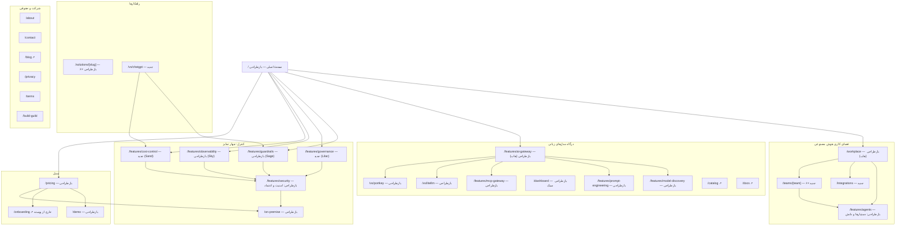

# نقشهٔ سایت، ناوبری و مسیرهای پرسونا

## اصل سازمان‌دهی

گدارAI دو محصول هم‌وزن دارد و چهار تمایز که هر دو محصول را می‌پوشانند. سایت با همین سه محور سازمان‌دهی می‌شود:

1. **فضای کاری هوش مصنوعی** (برای مدیر و همهٔ تیم‌ها): `/workplace` هاب این محصول است.
2. **درگاه مدل‌های زبانی** (برای توسعه‌دهنده): `/features/ai-gateway` هاب این محصول است.
3. **کنترل** (چهار تمایز، مشترک بین دو محصول، هر کدام یک رنگ پنل):
   - گاردریل معنایی ← `/features/guardrails` (پنل Sage)
   - حاکمیت ← `/features/governance` (جدید، پنل Lilac)
   - مشاهده‌پذیری ← `/features/observability` (پنل Sky)
   - مدیریت هزینه ← `/features/cost-control` (جدید، پنل Sand)
   - و `/features/security` به‌عنوان مرکز امنیت و اعتماد که هر چهار را از نگاه مسئول امنیت جمع می‌کند.

صفحهٔ اصلی (`/`) چتر هر دو محصول است، با تأکید بر فضای کاری چون تصمیم‌گیر اصلی مدیر فناوری است.

## تصمیم دربارهٔ صفحه‌های پیشنهادی

| صفحهٔ پیشنهادی | تصمیم | دلیل |
| --- | --- | --- |
| `/platform` | **ساخته نمی‌شود** | با `/` (چتر) و `/workplace` (هاب فضای کاری) همپوشانی کامل دارد. سه صفحهٔ نمای کلی، بازدیدکننده را سرگردان می‌کند. |
| `/features/governance` | **جدید، P0** | تمایز دوم صفحه ندارد. محتوای فعلی آن بین `/features/security` («نقش‌ها، مجوزها و محدودهٔ تیمی») پراکنده است. |
| `/features/cost-control` | **جدید، P0** | تمایز چهارم صفحه ندارد. محتوایش بین `/features/ai-gateway` (حافظهٔ نهان، مسیریابی) و `/pricing` پراکنده است. |
| `/features/knowledge` | **ساخته نمی‌شود؛ ادغام در `/features/agents`** | دانش (آپلود فایل و پایگاه دانش) جزئی از دستیار است و به‌تنهایی صفحهٔ کم‌محتوایی می‌شود. پیاده‌سازی RAG در این ریپو دیده نشد (نیاز به تأیید محصول). |
| `/integrations` | **جدید، P1** | پرسش «به ابزارهای ما وصل می‌شود؟» پرسش ثابت مدیر است. MCP، پیام‌رسان‌ها، Jira، Notion، Git و CRM یک جا. |
| `/teams/[team]` | **جدید، P1** | شش تیم موجود در `TeamTabs`: `sales`، `support`، `finance`، `legal`، `hr`، `engineering`. مکمل `/solutions/*` (نوع کسب‌وکار). |
| `/trust` | **ساخته نمی‌شود؛ نقشش به `/features/security`** | گواهی و سند امنیتی نداریم؛ صفحهٔ دوم امنیت تکراری و کم‌محتوا می‌شود. |
| `/customers` | **به بک‌لاگ** | محتوای واقعی وجود ندارد. وقتی دست‌کم سه داستان واقعی با اجازهٔ انتشار برسد ساخته می‌شود. |
| `/vs/chatgpt` | **جدید، P1** | تنها رقیب نام‌برده: استفادهٔ کنترل‌نشده از ChatGPT. |
| `/roi` | **به بک‌لاگ** | دادهٔ قابل اتکای صرفه‌جویی نداریم؛ عدد ساختگی ممنوع است. |

## نقشهٔ کامل

وضعیت: «بدون تغییر» = فقط مهاجرت توکن در صورت نیاز؛ «بازطراحی» = مسیر ثابت، محتوا و ظاهر نو؛ «جدید».

## ناوبری اصلی

ترتیب از راست به چپ. پیشنهاد مرجع («پلتفرم، راه‌حل‌ها، منابع، قیمت‌گذاری، اعتماد») با دو محصول هم‌وزن تطبیق داده شده است: «پلتفرم» به دو منوی محصول شکسته می‌شود و «اعتماد» درون منوی «کنترل» است.

| آیتم | نوع | محتوا |
| --- | --- | --- |
| **فضای کاری** | مگامنو | نمای کلی (`/workplace`)، دستیارها و دانش (`/features/agents`)، اتصال‌ها (`/integrations`)؛ ستون دوم: شش تیم (`/teams/*`) |
| **کنترل** | مگامنو، چهار ردیف رنگی | گاردریل معنایی، حاکمیت، مشاهده‌پذیری، مدیریت هزینه؛ زیر آن: امنیت و اعتماد (`/features/security`)، استقرار در سازمان (`/on-premise`) |
| **درگاه API** | مگامنو | درگاه مدل‌های زبانی، کشف مدل‌ها، رجیستری پرامپت، درگاه MCP؛ ستون دوم: کاتالوگ مدل‌ها ↗، مستندات ↗، مقایسه با LiteLLM و Portkey |
| **راهکارها** | منوی ساده | بر اساس نوع کسب‌وکار (شش `/solutions/*`)، «گدارAI یا ChatGPT کنترل‌نشده» (`/vs/chatgpt`) |
| **قیمت‌گذاری** | پیوند | `/pricing` |
| اقدام‌ها | — | «ورود» (بی‌زمینه)، «درخواست دمو» (بی‌زمینه)، «۱۵ روز رایگان شروع کنید» (دکمهٔ اصلی) |

بلاگ و مستندات در منوی «درگاه API» و فوتر هستند؛ منوی جداگانهٔ «منابع» ساخته نمی‌شود چون جز بلاگ و مستندات منبعی وجود ندارد.

**موبایل:** برگهٔ تمام‌قد با پنج گروه آکاردئونی به همان ترتیب، ردیف‌های ۴۸ پیکسلی، و دو اقدام «درخواست دمو» و «۱۵ روز رایگان» ثابت در پایین.

## فوتر

بالای فوتر، **نوار اعتماد** با سه مزیت محلی: پرداخت تومانی بدون کارت بین‌المللی · روی ابر گدارAI یا سرور خودتان · فارسی از رابط تا پشتیبانی. (همان سه مورد `WorkplaceCta`.)

| فضای کاری | کنترل | درگاه API | راهکارها | شرکت |
| --- | --- | --- | --- | --- |
| نمای کلی | گاردریل معنایی | درگاه مدل‌های زبانی | شش تیم | دربارهٔ ما |
| دستیارها و دانش | حاکمیت | کشف مدل‌ها | شش نوع کسب‌وکار | تماس |
| اتصال‌ها | مشاهده‌پذیری | رجیستری پرامپت | گدارAI یا ChatGPT | درخواست دمو |
| قیمت‌گذاری | مدیریت هزینه | درگاه MCP | | بلاگ ↗ |
| | امنیت و اعتماد | داشبورد | | قوانین / حریم خصوصی |
| | استقرار در سازمان | کاتالوگ ↗ / مستندات ↗ | | نماد اعتماد الکترونیکی |
| | | LiteLLM / Portkey | | |

## مسیرهای پرسونا

### ۱. مدیر فناوری / تحول دیجیتال (تصمیم‌گیر اصلی)
پرسش: «آیا می‌شود AI را امن و کنترل‌شده به کار روزانهٔ همهٔ تیم‌ها آورد؟»

ورود: `/` (جست‌وجوی برند یا معرفی) ← `/workplace` (چه چیزی به تیم‌ها می‌دهیم) ← `/teams/<تیم خودش>` (کار واقعی) ← `/features/governance` (چه کسی به چه چیزی دسترسی دارد) ← `/pricing` ← **CTA: درخواست دمو** (یا آزمایش ۱۵ روزه).

### ۲. مدیر مالی (هزینه)
پرسش: «هزینه از کنترل خارج نمی‌شود؟ با چه پولی پرداخت می‌کنیم؟»

ورود: لینکی که مدیر فناوری می‌فرستد، معمولاً `/pricing` یا `/features/cost-control` ← `/features/observability` (گزارش هزینه به تفکیک تیم) ← **CTA: درخواست دمو**.

### ۳. مسئول امنیت و انطباق
پرسش: «داده کجا می‌رود، چه چیزی ثبت می‌شود، و چه چیزی جلوی نشت را می‌گیرد؟»

ورود: `/features/security` (از لینک مدیر فناوری یا منوی «کنترل») ← `/features/guardrails` (گاردریل معنایی) ← `/features/governance` (ثبت و حسابرسی) ← `/on-premise` ← **CTA: درخواست استقرار در سازمان** یا دمو.

### ۴. توسعه‌دهنده / تیم فنی (مسیر ثانویه، محصول درگاه)
پرسش: «یک نشانی برای همهٔ مدل‌ها، با کلید و هزینهٔ کنترل‌شده؟»

ورود: جست‌وجو یا `/vs/litellm` ← `/features/ai-gateway` ← `/catalog` و `/docs` ← **CTA: ۱۵ روز رایگان** (ثبت‌نام و اولین درخواست).

### ۵. کارمند یا مدیری که از ChatGPT استفاده می‌کند
پرسش: «چرا چیزی جز ChatGPT؟»

ورود: جست‌وجو ← `/vs/chatgpt` ← `/features/guardrails` و `/features/cost-control` ← **CTA: ۱۵ روز رایگان**.
