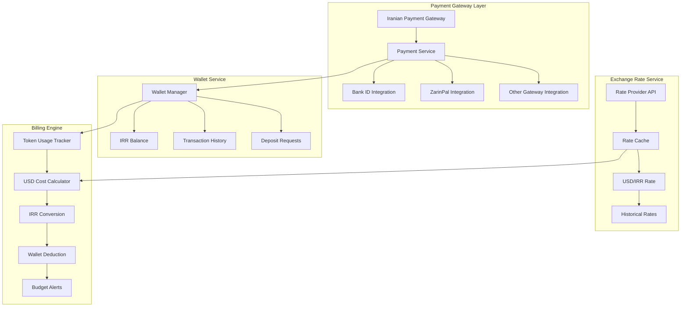
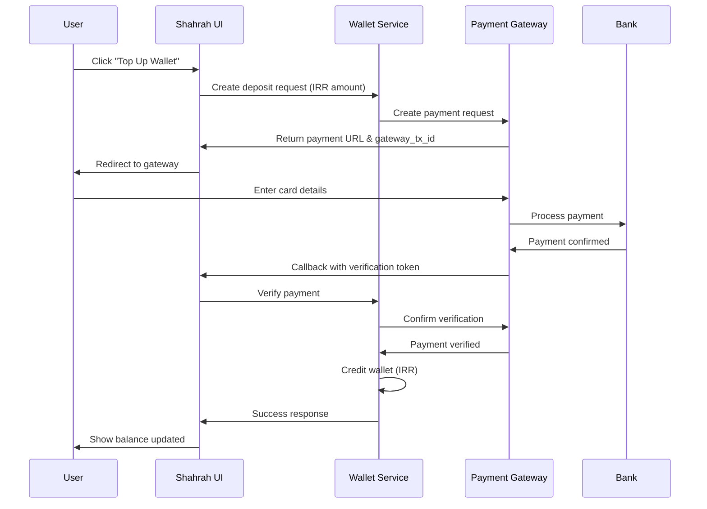

# Shahrah Payment System - Iranian Rial Wallet & Billing

## Overview

This document describes the payment and billing system for Shahrah, designed specifically for the Iranian market. The system supports Rial (IRR) wallet top-ups through Iranian payment gateways while maintaining USD-based token consumption tracking with real-time exchange rate conversion.

## Implementation Status (2026-04-28)

- `COMPLETED (MVP)`: wallet top-up intent and callback pipeline in control-plane
- Implemented providers:
  - `mock` (development/staging)
  - `zarinpal` (request + verify)
  - `idpay` (request + verify)
- Implemented runtime flow:
  1. `POST /api/v1/wallet/topup/intents` with `amount_usd` and provider
  2. USD-to-IRR conversion with current exchange rate
  3. tax/fee application (current defaults: tax `0%`, fee `2%`)
  4. redirect to gateway via returned `payment_url`
  5. gateway callback to `/api/v1/wallet/topup/callback/:provider`
  6. server-to-server verify with provider API
  7. atomic wallet credit + `DEPOSIT` transaction on success
  8. redirect to tenant app with query-string status
- Implemented idempotency:
  - callback completion is idempotent using unique `authority` and transactional `FOR UPDATE` flow
- Implemented auditable fields:
  - `ref_id`, `gateway_txn_id`, `card_mask`, `payer_phone`, `raw_payload`, `wallet_tx_id`

## Architecture

### Core Components



## 1. Wallet System Design

### 1.1 Wallet Entity Schema

```prisma
model ShahrahWallet {
    wallet_id       String   @id @default(uuid())
    tenant_id       String
    user_id         String?
    team_id         String?
    
    // Balance in IRR (Iranian Rial)
    balance_irr     Float    @default(0.0)
    pending_irr     Float    @default(0.0)  // For pending deposits
    
    // USD equivalent (computed)
    balance_usd     Float?   @default(null)
    
    // Limits
    daily_limit_irr     Float?
    monthly_limit_irr   Float?
    
    created_at      DateTime @default(now())
    updated_at      DateTime @default(now()) @updatedAt
    last_deposit_at DateTime?
    
    @@index([tenant_id])
    @@index([user_id])
    @@index([team_id])
}

model ShahrahTransaction {
    transaction_id  String   @id @default(uuid())
    wallet_id       String
    
    // Transaction type
    tx_type         TransactionType
    amount_irr      Float
    amount_usd      Float?  // Computed at transaction time
    
    // Exchange rate used
    exchange_rate   Float?  // IRR per 1 USD at transaction time
    rate_source     String?
    
    // Payment gateway info
    gateway         GatewayType?
    gateway_tx_id   String?
    gateway_status  String?
    
    // Metadata
    description     String?
    metadata        Json?
    
    status          TransactionStatus @default(PENDING)
    
    created_at      DateTime @default(now())
    completed_at    DateTime?
    
    wallet          ShahrahWallet @relation(fields: [wallet_id], references: [wallet_id])
    
    @@index([wallet_id])
    @@index([gateway_tx_id])
    @@index([created_at])
}

enum TransactionType {
    DEPOSIT
    WITHDRAWAL
    CONSUMPTION
    REFUND
    ADJUSTMENT
    SUBSCRIPTION_FEE
    TAX_PAYMENT
}

enum GatewayType {
    ZARINPAL
    ID_PAY
    PAY_PING
    BANK_ID
    MANUAL
    ADMIN_ADJUSTMENT
}

enum TransactionStatus {
    PENDING
    COMPLETED
    FAILED
    CANCELLED
    REFUNDED
}
```

### 1.2 Subscription Management

```prisma
model ShahrahSubscription {
    subscription_id String   @id @default(uuid())
    tenant_id       String
    plan_id         String
    
    // Billing period
    billing_cycle   BillingCycle  // MONTHLY, YEARLY
    start_date      DateTime
    end_date        DateTime?
    next_billing_at DateTime
    
    // Pricing
    base_price_irr    Float
    tax_amount_irr    Float  // VAT (9% standard in Iran)
    total_amount_irr  Float
    
    // Payment status
    status          SubscriptionStatus @default(ACTIVE)
    last_paid_at    DateTime?
    last_paid_tx_id String?
    
    created_at      DateTime @default(now())
    updated_at      DateTime @default(now()) @updatedAt
    
    @@index([tenant_id])
}

enum BillingCycle {
    MONTHLY
    YEARLY
}

enum SubscriptionStatus {
    ACTIVE
    PAST_DUE
    CANCELLED
    EXPIRED
    TRIAL
}
```

## 2. Exchange Rate Service

### 2.1 Rate Provider Integration

The system must fetch real-time USD/IRR exchange rates from a reliable API source:

```go
// ExchangeRateService manages USD to IRR exchange rates.
// Fetches real-time rates from configured API providers.
type ExchangeRateService struct {
    RateProviderURL    string        // e.g., bonbast.com API, navasan.tech, etc.
    RateCacheTTL       time.Duration // 5 minutes
    RateUpdateInterval time.Duration // 1 minute minimum
    cache              *ExchangeRate
    cacheExpiry        time.Time
    mu                 sync.RWMutex
}

// GetCurrentRate returns current USD/IRR rate, using cache if available.
func (s *ExchangeRateService) GetCurrentRate(ctx context.Context) (*ExchangeRate, error) {
    s.mu.RLock()
    if s.cache != nil && time.Now().Before(s.cacheExpiry) {
        cache := *s.cache
        s.mu.RUnlock()
        return &cache, nil
    }
    s.mu.RUnlock()

    return s.FetchRateFromProvider(ctx)
}

// FetchRateFromProvider fetches fresh rate from external API.
func (s *ExchangeRateService) FetchRateFromProvider(ctx context.Context) (*ExchangeRate, error) {
    rate, err := fetchRateFromAPI(ctx, s.RateProviderURL)
    if err != nil {
        return nil, err
    }

    s.mu.Lock()
    s.cache = rate
    s.cacheExpiry = time.Now().Add(s.RateCacheTTL)
    s.mu.Unlock()

    return rate, nil
}

// ConvertUsdToIrr converts USD amount to IRR using given rate.
func (s *ExchangeRateService) ConvertUsdToIrr(usdAmount float64, rate *ExchangeRate) float64 {
    return usdAmount * rate.UsdToIrr
}

// ConvertIrrToUsd converts IRR amount to USD using given rate.
func (s *ExchangeRateService) ConvertIrrToUsd(irrAmount float64, rate *ExchangeRate) float64 {
    return irrAmount / rate.UsdToIrr
}
```

### 2.2 Rate History & Audit

```prisma
model ShahrahExchangeRate {
    rate_id         String   @id @default(uuid())
    
    // Rate info
    usd_to_irr      Float
    source          String  // API provider name
    fetched_at      DateTime @default(now())
    
    // Rate type
    rate_type       RateType @default(MARKET)
    
    // Manual override
    is_manual       Boolean @default(false)
    overridden_by   String?
    override_reason String?
    
    @@index([fetched_at])
}

enum RateType {
    MARKET
    FIXED
    MANUAL_OVERRIDE
}
```

## 3. Payment Gateway Integration

### 3.1 Gateway Interface

```go
// PaymentGatewayInterface defines the interface for Iranian payment gateways.
type PaymentGatewayInterface interface {
    // CreatePaymentRequest creates a new payment request with the gateway.
    CreatePaymentRequest(ctx context.Context, req CreatePaymentRequestInput) (*PaymentRequest, error)

    // VerifyPayment verifies a completed payment.
    VerifyPayment(ctx context.Context, gatewayTxID string, amountIrr float64) (*PaymentVerification, error)

    // RefundPayment processes a refund.
    RefundPayment(ctx context.Context, gatewayTxID string, amountIrr float64, reason string) (*RefundResult, error)
}

// CreatePaymentRequestInput contains the input parameters for creating a payment request.
type CreatePaymentRequestInput struct {
    AmountIrr    float64
    CallbackURL  string
    Description  string
    Metadata     map[string]interface{}
}
```

### 3.2 Supported Gateways

| Gateway | Type | API Docs | Notes |
|---------|------|----------|-------|
| ZarinPal | Payment Facilitator | https://docs.zarinpal.com | Most popular, good coverage |
| IDPay | Payment Facilitator | https://idpay.ir/api | Alternative option |
| PayPing | Payment Facilitator | https://payping.ir | Good for recurring payments |
| Bank IPG | Direct Bank | Various | For direct bank integration |

### 3.3 Payment Flow



## 4. Billing Engine

### 4.1 Token Consumption Billing

The billing engine tracks token usage in USD and deducts from IRR wallet:

```go
// BillingEngine handles token consumption billing with USD->IRR conversion.
type BillingEngine struct {
    walletService    *WalletService
    exchangeRateSvc  *ExchangeRateService
    db               *gorm.DB
}

// ProcessUsage processes a usage record:
// 1. Calculate USD cost based on token count
// 2. Get current exchange rate
// 3. Convert to IRR
// 4. Deduct from wallet
// 5. Record transaction
func (e *BillingEngine) ProcessUsage(ctx context.Context, tenantID string, usageRecord *UsageRecord) (*BillingResult, error) {
    // Calculate USD cost
    costUsd := calculateTokenCost(usageRecord)

    // Get current exchange rate
    rate, err := e.exchangeRateSvc.GetCurrentRate(ctx)
    if err != nil {
        return nil, fmt.Errorf("failed to get exchange rate: %w", err)
    }

    // Convert to IRR
    costIrr := e.exchangeRateSvc.ConvertUsdToIrr(costUsd, rate)

    // Check balance and deduct
    sufficient, err := e.CheckBalanceSufficient(ctx, tenantID, costUsd)
    if err != nil || !sufficient {
        return nil, ErrInsufficientBalance
    }

    // Deduct from wallet and record transaction
    result, err := e.deductFromWallet(ctx, tenantID, costIrr, rate)
    if err != nil {
        return nil, fmt.Errorf("failed to deduct from wallet: %w", err)
    }

    return result, nil
}

// CheckBalanceSufficient checks if wallet has sufficient balance.
func (e *BillingEngine) CheckBalanceSufficient(ctx context.Context, tenantID string, estimatedCostUsd float64) (bool, error) {
    var wallet ShahrahWallet
    if err := e.db.Where("tenant_id = ?", tenantID).First(&wallet).Error; err != nil {
        return false, err
    }

    rate, err := e.exchangeRateSvc.GetCurrentRate(ctx)
    if err != nil {
        return false, err
    }

    estimatedCostIrr := e.exchangeRateSvc.ConvertUsdToIrr(estimatedCostUsd, rate)
    return wallet.BalanceIrr >= estimatedCostIrr, nil
}

// ApplySubscriptionFee applies monthly/yearly subscription fee.
func (e *BillingEngine) ApplySubscriptionFee(ctx context.Context, tenantID string, plan *SubscriptionPlan) (*BillingResult, error) {
    var wallet ShahrahWallet
    if err := e.db.Where("tenant_id = ?", tenantID).First(&wallet).Error; err != nil {
        return nil, err
    }

    if wallet.BalanceIrr < plan.TotalAmountIrr {
        return nil, ErrInsufficientBalance
    }

    return e.deductFromWallet(ctx, tenantID, plan.TotalAmountIrr, nil)
}
```

### 4.2 Cost Calculation

Token costs are stored in USD (similar to LiteLLM's `model_prices_and_context_window.json`):

```json
{
    "gpt-4o": {
        "input_cost_per_token": 0.0000025,
        "output_cost_per_token": 0.00001,
        "currency": "USD"
    },
    "claude-sonnet-4-20250514": {
        "input_cost_per_token": 0.000003,
        "output_cost_per_token": 0.000015,
        "currency": "USD"
    }
}
```

## 5. Tax Handling

### 5.1 Iranian VAT

- Standard VAT rate: 9%
- Applied to subscription fees
- NOT applied to token consumption (pass-through cost)

```go
// TaxCalculator calculates taxes for the Iranian market.
type TaxCalculator struct {
    VATRate float64 // 0.09 for 9%
}

// NewTaxCalculator creates a new TaxCalculator with default VAT rate.
func NewTaxCalculator() *TaxCalculator {
    return &TaxCalculator{
        VATRate: 0.09,
    }
}

// TaxBreakdown represents the breakdown of a tax calculation.
type TaxBreakdown struct {
    BaseAmount float64 `json:"base_amount"`
    VATAmount  float64 `json:"vat_amount"`
    Total      float64 `json:"total"`
}

// CalculateSubscriptionTax calculates VAT for subscription.
func (tc *TaxCalculator) CalculateSubscriptionTax(baseAmountIrr float64) *TaxBreakdown {
    vat := baseAmountIrr * tc.VATRate
    return &TaxBreakdown{
        BaseAmount: baseAmountIrr,
        VATAmount:  vat,
        Total:      baseAmountIrr + vat,
    }
}
```

### 5.2 Tax Transaction Recording

```prisma
model ShahrahTaxRecord {
    tax_record_id   String   @id @default(uuid())
    tenant_id       String
    subscription_id String?
    
    tax_type        TaxType
    tax_rate        Float  // e.g., 0.09 for 9%
    taxable_amount_irr Float
    tax_amount_irr   Float
    total_irr        Float
    
    transaction_id  String?  // Link to payment
    paid_at         DateTime?
    
    created_at      DateTime @default(now())
    
    @@index([tenant_id])
}

enum TaxType {
    VAT
    CUSTOMS_DUTY
    OTHER
}
```

## 6. Budget Alerts & Controls

### 6.1 Alert Thresholds

```prisma
model ShahrahBudgetAlert {
    alert_id        String   @id @default(uuid())
    tenant_id       String
    
    // Trigger conditions
    threshold_type  AlertThresholdType
    threshold_value Float  // IRR amount or percentage
    
    // Notification
    notify_emails   String[]
    notify_webhook  String?
    
    // State
    is_active       Boolean @default(true)
    triggered_count Int @default(0)
    last_triggered  DateTime?
    
    created_at      DateTime @default(now())
    
    @@index([tenant_id])
}

enum AlertThresholdType {
    BALANCE_LOW
    BALANCE_CRITICAL
    MONTHLY_SPEND_LIMIT
    TOKEN_LIMIT
}
```

### 6.2 Auto-Recharge

```prisma
model ShahrahAutoRecharge {
    config_id       String   @id @default(uuid())
    wallet_id       String
    
    // Trigger
    trigger_balance_irr Float  // When balance drops below this
    recharge_amount_irr Float  // Recharge this amount
    
    // Payment method
    payment_method_id String
    is_active       Boolean @default(true)
    
    // Limits
    max_monthly_recharges Int?
    recharges_this_month Int @default(0)
    
    created_at      DateTime @default(now())
    updated_at      DateTime @default(now()) @updatedAt
    
    @@unique([wallet_id])
}
```

## 7. Reporting & Analytics

### 7.1 Report Types

1. **Wallet Balance Report**: Current balance, pending transactions
2. **Transaction History**: All deposits, withdrawals, consumption
3. **Usage Report**: Token consumption by model, date range
4. **Cost Report**: USD spent, IRR charged, exchange rates used
5. **Tax Report**: VAT paid, tax breakdown
6. **Subscription Report**: Active subscriptions, billing history

### 7.2 Export Formats

- CSV
- Excel (XLSX)
- PDF (formatted invoices)

## 8. Multi-Tenant Considerations

- Each tenant has isolated wallet(s)
- Exchange rates are shared across all tenants
- Subscription plans can be tenant-specific
- Tax rates are system-wide (can be overridden per tenant if needed)

## 9. On-Premise Deployment Notes

For on-premise deployments:
- Payment gateway integration may differ based on local Iranian banking infrastructure
- Exchange rate API should be configurable
- Subscription billing can be disabled if not needed
- Tax rates should be configurable

## 10. Future Enhancements

- Multi-currency support (EUR, AED)
- Crypto payment integration
- Invoice factoring for enterprise clients
- Credit line for trusted enterprise customers
- Automated tax filing integration
