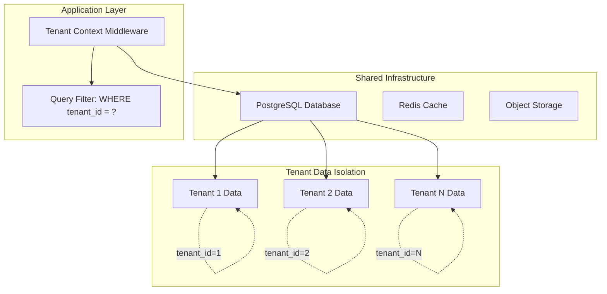
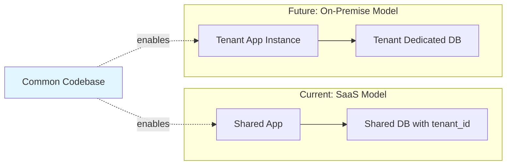
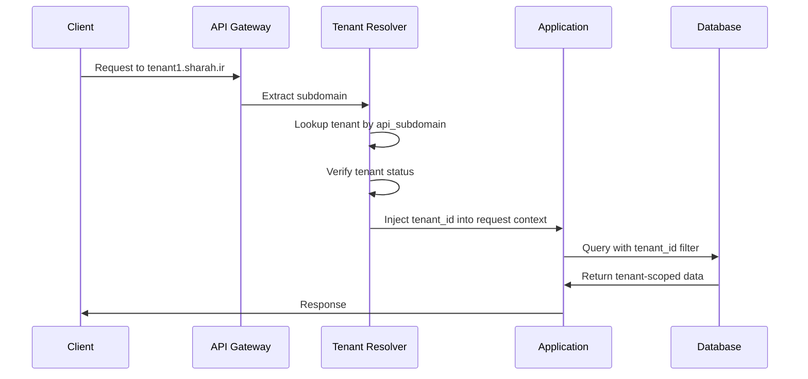
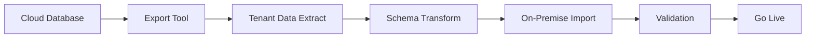

# Shahrah Multi-Tenant Architecture

## Overview

This document describes the multi-tenant architecture for Shahrah, designed to support both cloud-hosted SaaS and future on-premise deployments. The architecture ensures complete data isolation between tenants while maintaining operational efficiency for the cloud deployment model.

## 1. Tenant Isolation Model

### 1.1 Isolation Strategy: Row-Level (Schema-per-Tenant via Tenant ID)

For the cloud-hosted SaaS model, we use a **shared database with row-level isolation**:



### 1.2 Why Row-Level Isolation?

| Factor | Decision |
|--------|----------|
| Cost Efficiency | Shared infrastructure reduces costs |
| Operational Simplicity | Single schema to manage, migrate, backup |
| Scalability | Easy to add new tenants |
| Data Size | Suitable for expected data volumes |
| Future On-Premise | Clean separation enables extraction |

### 1.3 Future On-Premise Readiness

The architecture is designed to support on-premise deployment in the future:



**Key Design Principles for On-Premise Readiness:**

1. **Tenant ID as First-Class Citizen**: Every database query includes `tenant_id` filtering
2. **Configuration Externalization**: All tenant-specific config stored in DB, not hardcoded
3. **Connection Abstraction**: Database access through a tenant-aware connection manager
4. **Feature Flags**: Per-tenant feature flags to enable/disable cloud-specific features
5. **External Service Abstraction**: Payment, email, etc. through interfaces that can be swapped

## 2. Tenant Data Model

### 2.1 Tenant Entity

```prisma
model ShahrahTenant {
    tenant_id       String   @id @default(uuid())
    
    // Identification
    tenant_slug     String   @unique  // e.g., "acme-corp"
    tenant_name     String
    tenant_type     TenantType
    
    // Subdomain configuration
    api_subdomain   String   @unique  // e.g., "tenant1" -> tenant1.sharah.ir
    admin_subdomain String?  @unique  // e.g., "tenant1" -> tenant1.app.sharah.ir
    
    // Status
    status          TenantStatus @default(ACTIVE)
    suspended_at    DateTime?
    suspended_reason String?
    
    // Configuration
    config          Json     @default("{}")
    feature_flags   Json     @default("{}")
    
    // Billing linkage
    wallet_id       String?
    subscription_id String?
    
    // On-premise tracking
    deployment_type DeploymentType @default(CLOUD)
    on_premise_config Json?      // For future on-premise deployments
    
    created_at      DateTime @default(now())
    updated_at      DateTime @default(now()) @updatedAt
    activated_at    DateTime?
    
    // Relations
    users           ShahrahTenantUser[]
    api_keys        ShahrahApiKey[]
    usage_logs      ShahrahUsageLog[]
    models          ShahrahTenantModel[]
    
    @@index([tenant_slug])
    @@index([status])
}

enum TenantType {
    ORGANIZATION
    INDIVIDUAL
    TRIAL
}

enum TenantStatus {
    PENDING
    ACTIVE
    SUSPENDED
    DEACTIVATED
    DELETED
}

enum DeploymentType {
    CLOUD
    ON_PREMISE
    HYBRID
}
```

### 2.2 Tenant User Management

```prisma
model ShahrahTenantUser {
    id              String   @id @default(uuid())
    tenant_id       String
    user_id         String   // Reference to global user table
    
    // Roles within tenant
    role            TenantRole @default(MEMBER)
    permissions     Json     @default("{}")
    
    // Status
    status          UserStatus @default(ACTIVE)
    invited_at      DateTime @default(now())
    joined_at       DateTime?
    
    tenant          ShahrahTenant @relation(fields: [tenant_id], references: [tenant_id])
    
    @@unique([tenant_id, user_id])
    @@index([tenant_id])
}

enum TenantRole {
    OWNER
    ADMIN
    DEVELOPER
    MEMBER
    VIEWER
}

enum UserStatus {
    PENDING
    ACTIVE
    SUSPENDED
    REMOVED
}
```

### 2.3 API Key Management (Per Tenant)

```prisma
model ShahrahApiKey {
    api_key_id      String   @id @default(uuid())
    tenant_id       String
    
    // Key info
    key_hash        String   @unique  // Hashed API key
    key_prefix      String   // First 8 chars for identification (sk_abc12345...)
    key_name        String?
    
    // Permissions
    permissions     Json     @default("{}")
    allowed_models  String[]
    allowed_routes  String[]
    
    // Rate limits
    rpm_limit       Int?
    tpm_limit       Int?
    
    // Status
    status          ApiKeyStatus @default(ACTIVE)
    expires_at      DateTime?
    last_used_at    DateTime?
    
    // Metadata
    created_by      String
    created_at      DateTime @default(now())
    updated_at      DateTime @default(now()) @updatedAt
    
    tenant          ShahrahTenant @relation(fields: [tenant_id], references: [tenant_id])
    
    @@index([tenant_id])
    @@index([status])
    @@index([key_prefix])
}

enum ApiKeyStatus {
    ACTIVE
    INACTIVE
    EXPIRED
    REVOKED
}
```

## 3. Tenant Context Middleware

### 3.1 Request Processing Flow



### 3.2 Implementation Pattern

```go
// TenantContext holds tenant information for the current request.
type TenantContext struct {
    TenantID     string
    TenantSlug   string
    Config       map[string]interface{}
    FeatureFlags map[string]interface{}
}

// contextKey is a custom type for context keys to avoid collisions.
type contextKey string

const tenantContextKey contextKey = "tenant"

// TenantMiddleware extracts tenant from subdomain and injects into request context.
func TenantMiddleware(db *gorm.DB) func(http.Handler) http.Handler {
    return func(next http.Handler) http.Handler {
        return http.HandlerFunc(func(w http.ResponseWriter, r *http.Request) {
            host := r.Host
            subdomain := extractSubdomain(host)

            if subdomain == "" {
                http.Error(w, "Invalid tenant subdomain", http.StatusBadRequest)
                return
            }

            var tenant ShahrahTenant
            if err := db.Where("api_subdomain = ?", subdomain).First(&tenant).Error; err != nil {
                http.Error(w, "Tenant not found", http.StatusNotFound)
                return
            }

            if tenant.Status != "ACTIVE" {
                http.Error(w, "Tenant is not active", http.StatusForbidden)
                return
            }

            // Set tenant context for this request
            ctx := &TenantContext{
                TenantID:     tenant.TenantID,
                TenantSlug:   tenant.TenantSlug,
                Config:       tenant.Config,
                FeatureFlags: tenant.FeatureFlags,
            }

            ctx_with_tenant := context.WithValue(r.Context(), tenantContextKey, ctx)
            next.ServeHTTP(w, r.WithContext(ctx_with_tenant))
        })
    }
}

// GetCurrentTenant retrieves the tenant context from the request context.
func GetCurrentTenant(ctx context.Context) (*TenantContext, error) {
    tenant, ok := ctx.Value(tenantContextKey).(*TenantContext)
    if !ok || tenant == nil {
        return nil, fmt.Errorf("no tenant context available")
    }
    return tenant, nil
}

// RequireTenantPermission checks if current tenant has specific permission.
func RequireTenantPermission(ctx context.Context, permission string) bool {
    tenant, err := GetCurrentTenant(ctx)
    if err != nil {
        return false
    }
    val, ok := tenant.FeatureFlags[permission]
    if !ok {
        return false
    }
    hasPermission, _ := val.(bool)
    return hasPermission
}
```

### 3.3 Database Query Filtering

```go
// TenantScopedQuery ensures all database queries include tenant_id filtering.
type TenantScopedQuery struct {
    DB       *gorm.DB
    TenantID string
}

// NewTenantScopedQuery creates a new TenantScopedQuery with the current tenant.
func NewTenantScopedQuery(ctx context.Context, db *gorm.DB) (*TenantScopedQuery, error) {
    tenant, err := GetCurrentTenant(ctx)
    if err != nil {
        return nil, err
    }
    return &TenantScopedQuery{
        DB:       db,
        TenantID: tenant.TenantID,
    }, nil
}

// FilterByCurrentTenant applies tenant filter to a GORM query.
func (q *TenantScopedQuery) FilterByCurrentTenant(query *gorm.DB) *gorm.DB {
    return query.Where("tenant_id = ?", q.TenantID)
}

// Find performs a tenant-scoped find operation.
func (q *TenantScopedQuery) Find(dest interface{}, conds ...interface{}) error {
    return q.FilterByCurrentTenant(q.DB).Find(dest, conds...).Error
}

// First performs a tenant-scoped first operation.
func (q *TenantScopedQuery) First(dest interface{}, conds ...interface{}) error {
    return q.FilterByCurrentTenant(q.DB).First(dest, conds...).Error
}
```

## 4. On-Premise Deployment Architecture (Future)

### 4.1 Deployment Modes Comparison

| Aspect | Cloud SaaS | On-Premise |
|--------|------------|------------|
| Infrastructure | Shared | Dedicated |
| Database | Shared with tenant_id | Dedicated per tenant |
| Updates | Automatic | Manual/Tenant-controlled |
| Billing | Built-in | External/Optional |
| Tunnel Service | Included | Optional/External |
| Support | Shahrah team | Self-managed |

### 4.2 On-Premise Package Structure

```
shahrah-on-premise/
├── docker-compose.yml          # Docker deployment
├── .env.example                # Environment template
├── configs/
│   ├── shahrah-config.yaml     # Main configuration
│   └── tenant-config.yaml      # Single-tenant config
├── database/
│   ├── migrations/             # Database migrations
│   └── seed/                   # Initial data
└── scripts/
    ├── install.sh              # Installation script
    └── health-check.sh         # System health check
```

### 4.3 Configuration Abstraction

```go
// ShahrahConfig holds unified configuration for both cloud and on-premise deployments.
type ShahrahConfig struct {
    // Deployment mode
    DeploymentMode DeploymentMode // CLOUD or ON_PREMISE

    // Tenant configuration
    Tenant TenantConfig

    // Database configuration
    Database DatabaseConfig

    // Services (abstracted)
    PaymentGateway *PaymentGatewayConfig // nil for on-premise
    EmailService   EmailServiceConfig
    TunnelService  TunnelServiceConfig
}

// LoadFromEnv loads configuration from environment variables.
func LoadFromEnv() (*ShahrahConfig, error) {
    mode := DeploymentMode(os.Getenv("SHAHR_DEPLOYMENT_MODE"))
    if mode == "" {
        mode = DeploymentModeCloud
    }

    cfg := &ShahrahConfig{
        DeploymentMode: mode,
    }

    // Load common config from environment
    cfg.Database.URL = os.Getenv("DATABASE_URL")
    cfg.Tenant.ID = os.Getenv("TENANT_ID")

    if mode == DeploymentModeOnPremise {
        cfg.loadOnPremiseConfig()
    } else {
        cfg.loadCloudConfig()
    }

    return cfg, nil
}

func (c *ShahrahConfig) loadOnPremiseConfig() {
    // On-premise specific configuration
    c.PaymentGateway = nil
    c.TunnelService.Enabled = false
}

func (c *ShahrahConfig) loadCloudConfig() {
    // Cloud-specific configuration
    c.PaymentGateway = &PaymentGatewayConfig{
        Provider: os.Getenv("PAYMENT_GATEWAY_PROVIDER"),
        APIKey:   os.Getenv("PAYMENT_GATEWAY_API_KEY"),
    }
    c.TunnelService.Enabled = true
}
```

## 5. Data Migration Strategy

### 5.1 Cloud to On-Premise Migration

For tenants who want to migrate from cloud to on-premise:



### 5.2 Migration Tool Features

1. **Data Export**: Export all tenant-scoped data
2. **Schema Transform**: Remove cloud-specific fields
3. **Data Validation**: Verify data integrity
4. **Rollback Support**: Ability to revert if issues found

## 6. Security Considerations

### 6.1 Tenant Data Isolation

- All queries MUST include `tenant_id` filter
- API keys are tenant-scoped
- Cache keys include tenant prefix
- Logs include tenant_id for audit

### 6.2 Cross-Tenant Access Prevention

```go
// VerifyTenantOwnership verifies that a resource belongs to the specified tenant.
func VerifyTenantOwnership(db *gorm.DB, tenantID string, resourceID string) (bool, error) {
    var resource struct {
        TenantID string `gorm:"column:tenant_id"`
    }
    if err := db.Select("tenant_id").Where("id = ?", resourceID).First(&resource).Error; err != nil {
        return false, err
    }
    return resource.TenantID == tenantID, nil
}

// SanitizeTenantID validates tenant_id format to prevent injection.
func SanitizeTenantID(tenantID string) (string, error) {
    matched, err := regexp.MatchString(`^[a-f0-9-]{36}$`, tenantID)
    if err != nil {
        return "", err
    }
    if !matched {
        return "", fmt.Errorf("invalid tenant_id format")
    }
    return tenantID, nil
}
```

## 7. Scalability Considerations

### 7.1 Horizontal Scaling

- Stateless application servers
- Shared database with connection pooling
- Redis for caching and session management
- Load balancer distributes across instances

### 7.2 Database Scaling Strategy

| Stage | Strategy | Capacity |
|-------|----------|----------|
| Initial | Single PostgreSQL instance | ~100 tenants |
| Growth | Read replicas | ~500 tenants |
| Scale | Horizontal sharding by tenant_id | ~10000+ tenants |

## 8. Monitoring & Observability

### 8.1 Tenant-Aware Metrics

```go
// Metrics includes tenant context using Prometheus metrics.
var (
    RequestsTotal = prometheus.NewCounterVec(
        prometheus.CounterOpts{
            Name: "shahrah_requests_total",
            Help: "Total requests",
        },
        []string{"tenant_id", "model"},
    )
    RequestLatency = prometheus.NewHistogramVec(
        prometheus.HistogramOpts{
            Name: "shahrah_request_latency",
            Help: "Request latency",
        },
        []string{"tenant_id"},
    )
    TokenUsage = prometheus.NewCounterVec(
        prometheus.CounterOpts{
            Name: "shahrah_tokens_total",
            Help: "Token usage",
        },
        []string{"tenant_id", "model", "type"},
    )
    SpendUSD = prometheus.NewCounterVec(
        prometheus.CounterOpts{
            Name: "shahrah_spend_usd",
            Help: "Spend in USD",
        },
        []string{"tenant_id"},
    )
)

func init() {
    prometheus.MustRegister(RequestsTotal, RequestLatency, TokenUsage, SpendUSD)
}
```

### 8.2 Per-Tenant Dashboards

- Request volume and latency
- Token usage by model
- Spend and budget tracking
- Error rates and types
- Cache hit rates
