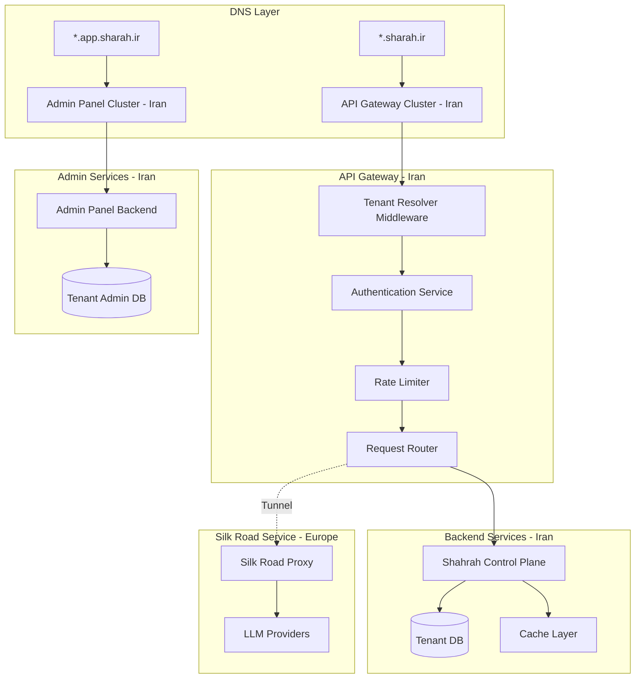
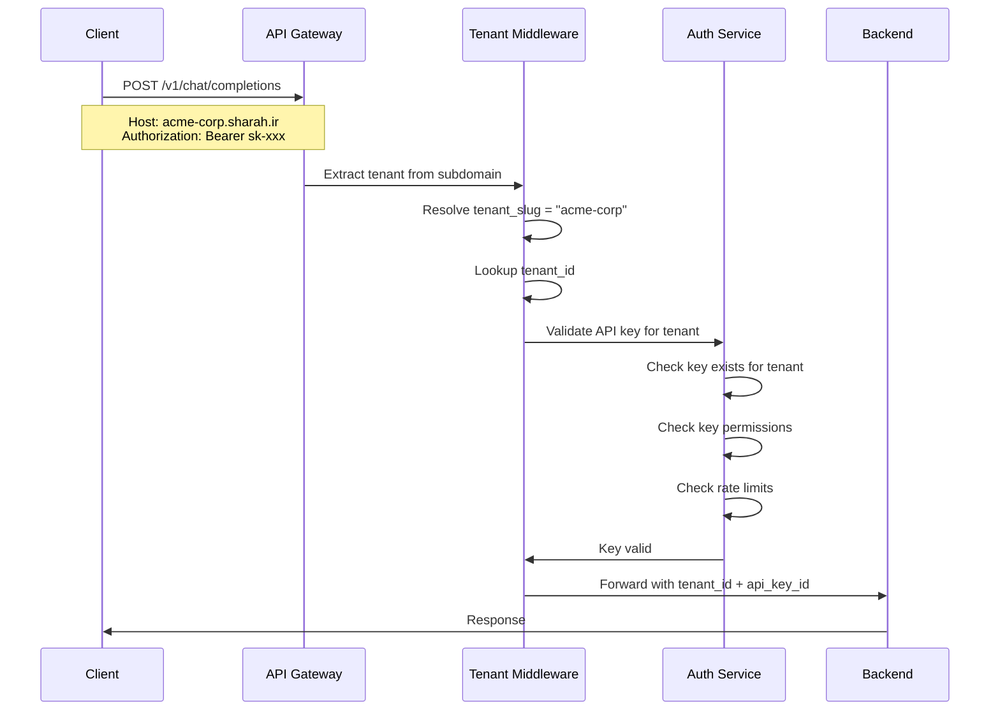
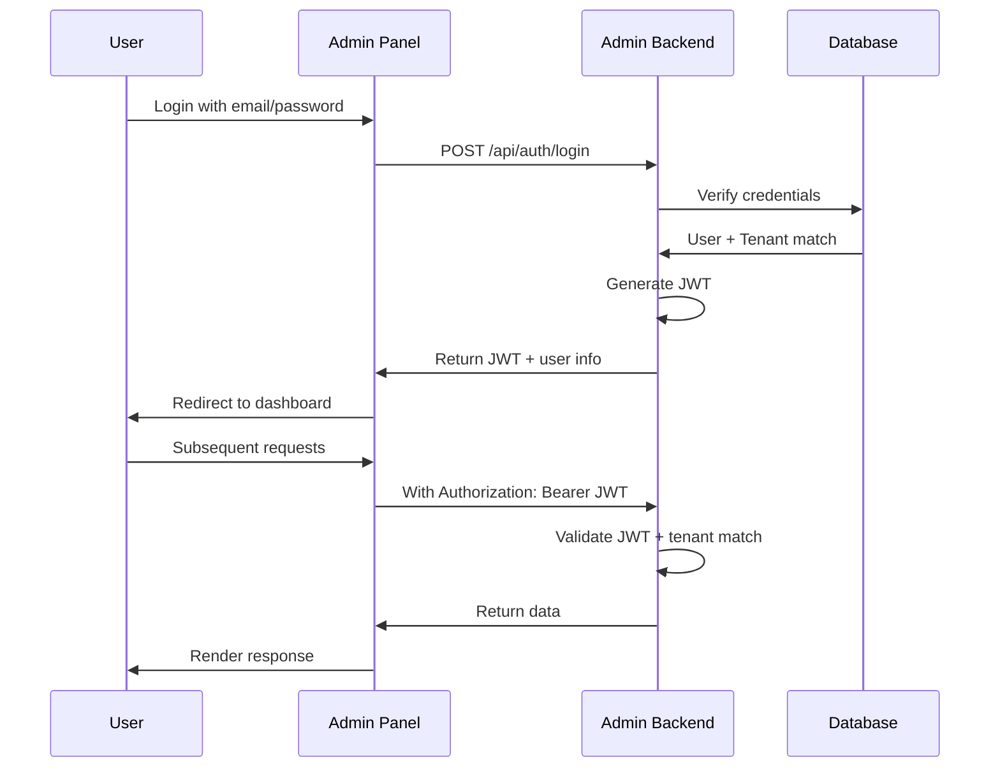
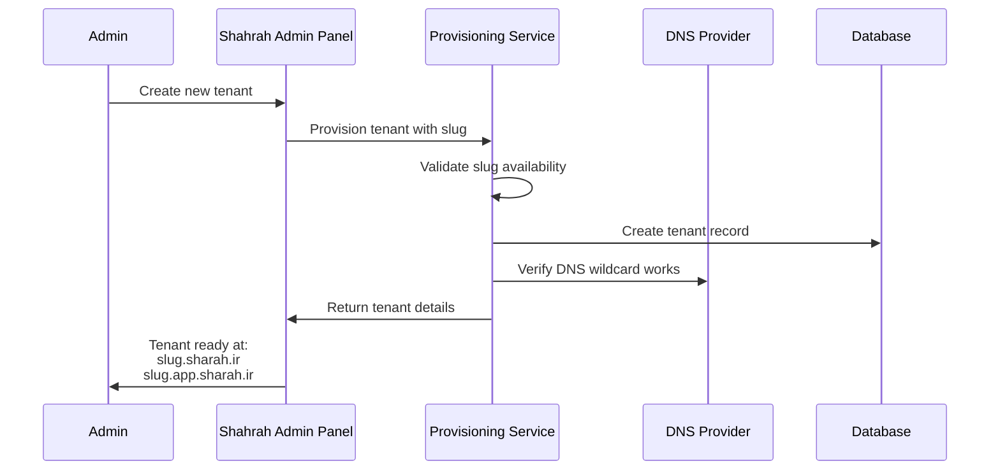

# Shahrah Subdomain-Based Tenant Access

## Overview

This document describes the subdomain-based tenant access architecture for Shahrah. Each tenant accesses their dedicated services through unique subdomains, providing clean URL-based tenant isolation and routing.

## 1. Subdomain Architecture

### 1.1 URL Structure

Shahrah uses a two-tier subdomain structure for each tenant:

```
API Endpoints:        https://<tenant-slug>.sharah.ir/
Customer Admin Panel: https://<tenant-slug>.app.sharah.ir/
```

### 1.2 Example URLs

| Tenant Slug | API Endpoint | Admin Panel |
|-------------|--------------|-------------|
| acme-corp | https://acme-corp.sharah.ir/ | https://acme-corp.app.sharah.ir/ |
| mycompany | https://mycompany.sharah.ir/ | https://mycompany.app.sharah.ir/ |
| test-org | https://test-org.sharah.ir/ | https://test-org.app.sharah.ir/ |

### 1.3 Architecture Overview



## 2. DNS Configuration

### 2.1 Wildcard DNS Setup

```dns
# API subdomain wildcard
*.sharah.ir.        IN  CNAME  api-gateway.sharah.ir.

# Admin subdomain wildcard
*.app.sharah.ir.    IN  CNAME  admin-gateway.sharah.ir.
```

### 2.2 SSL/TLS Certificate

Use a wildcard SSL certificate for each subdomain pattern:

- `*.sharah.ir` - For API endpoints
- `*.app.sharah.ir` - For admin panels

```yaml
# Nginx Ingress Controller configuration
apiVersion: networking.k8s.io/v1
kind: Ingress
metadata:
  name: shahrah-api-ingress
  annotations:
    cert-manager.io/cluster-issuer: letsencrypt-prod
    nginx.ingress.kubernetes.io/use-regex: "true"
spec:
  tls:
    - hosts:
        - "*.sharah.ir"
      secretName: shahrah-api-wildcard-tls
  rules:
    - host: "*.sharah.ir"
      http:
        paths:
          - path: /
            pathType: Prefix
            backend:
              service:
                name: shahrah-api-gateway
                port:
                  number: 4000
```

## 3. Tenant Resolution Middleware

### 3.1 Subdomain Extraction

```go
package middleware

import (
	"net/http"
	"regexp"
)

// TenantSubdomainInfo contains extracted subdomain information.
type TenantSubdomainInfo struct {
	TenantSlug  string
	ServiceType string // "api" or "admin"
	FullHost    string
}

var (
	apiDomainPattern   = regexp.MustCompile(`^([a-z0-9-]+)\.shahrah\.ir$`)
	adminDomainPattern = regexp.MustCompile(`^([a-z0-9-]+)\.app\.shahrah\.ir$`)
)

// Resolve extracts tenant information from host header.
func ResolveSubdomain(host string) (*TenantSubdomainInfo, bool) {
	if m := apiDomainPattern.FindStringSubmatch(host); m != nil {
		return &TenantSubdomainInfo{
			TenantSlug:  m[1],
			ServiceType: "api",
			FullHost:    host,
		}, true
	}
	if m := adminDomainPattern.FindStringSubmatch(host); m != nil {
		return &TenantSubdomainInfo{
			TenantSlug:  m[1],
			ServiceType: "admin",
			FullHost:    host,
		}, true
	}
	return nil, false
}

// ValidateSlug validates tenant slug format.
func ValidateSlug(slug string) bool {
	pattern := regexp.MustCompile(`^[a-z0-9]([a-z0-9-]{1,30}[a-z0-9])?$`)
	return pattern.MatchString(slug)
}
```

### 3.2 Chi Middleware Integration

```go
package middleware

import (
	"context"
	"encoding/json"
	"net/http"
	"strings"
)

// contextKey is a custom type for context keys to avoid collisions.
type contextKey string

const (
	CtxTenantSlug    contextKey = "tenant_slug"
	CtxTenantID      contextKey = "tenant_id"
	CtxTenantConfig  contextKey = "tenant_config"
	CtxServiceType   contextKey = "service_type"
)

// TenantSubdomainMiddleware resolves tenant from subdomain and sets request context.
func TenantSubdomainMiddleware(next http.Handler) http.Handler {
	return http.HandlerFunc(func(w http.ResponseWriter, r *http.Request) {
		host := r.Host
		// Strip port if present
		if h, _, err := net.SplitHostPort(host); err == nil {
			host = h
		}

		// Skip tenant resolution for health checks and system endpoints
		if isSystemPath(r.URL.Path) {
			next.ServeHTTP(w, r)
			return
		}

		// Resolve tenant from subdomain
		subdomainInfo, ok := ResolveSubdomain(host)
		if !ok {
			http.Error(w, `{"error": "Invalid host header. Expected format: <tenant>.sharah.ir"}`, http.StatusBadRequest)
			return
		}

		// Validate slug format
		if !ValidateSlug(subdomainInfo.TenantSlug) {
			http.Error(w, `{"error": "Invalid tenant slug format"}`, http.StatusBadRequest)
			return
		}

		// Look up tenant in database (with cache)
		tenant, err := lookupTenant(r.Context(), subdomainInfo.TenantSlug)
		if err != nil {
			http.Error(w, `{"error": "Tenant not found"}`, http.StatusNotFound)
			return
		}
		if tenant.Status != "ACTIVE" {
			http.Error(w, `{"error": "Tenant is not active"}`, http.StatusForbidden)
			return
		}

		// Set tenant context on request
		ctx := context.WithValue(r.Context(), CtxTenantSlug, tenant.TenantSlug)
		ctx = context.WithValue(ctx, CtxTenantID, tenant.TenantID)
		ctx = context.WithValue(ctx, CtxTenantConfig, tenant.Config)
		ctx = context.WithValue(ctx, CtxServiceType, subdomainInfo.ServiceType)

		// Add tenant info to response headers
		w.Header().Set("X-Tenant-Slug", tenant.TenantSlug)

		next.ServeHTTP(w, r.WithContext(ctx))
	})
}

func isSystemPath(path string) bool {
	systemPaths := []string{"/health", "/ready", "/metrics", "/docs", "/openapi.json"}
	for _, p := range systemPaths {
		if strings.HasPrefix(path, p) {
			return true
		}
	}
	return false
}

func lookupTenant(ctx context.Context, slug string) (*Tenant, error) {
	// First check cache
	if tenant, ok := cache.Get("tenant:slug:" + slug); ok {
		return tenant.(*Tenant), nil
	}

	// Fall back to database
	tenant, err := db.GetTenantBySlug(ctx, slug)
	if err != nil {
		return nil, err
	}
	cache.Set("tenant:slug:"+slug, tenant, 5*time.Minute)
	return tenant, nil
}

## 4. API Gateway Configuration

### 4.1 API Gateway (Iran) - OpenResty/Nginx

```nginx
# shahrah-api.conf
server {
    listen 443 ssl http2;
    server_name *.sharah.ir;
    
    ssl_certificate /etc/ssl/wildcard.sharah.ir.crt;
    ssl_certificate_key /etc/ssl/wildcard.sharah.ir.key;
    
    # Extract subdomain
    set $tenant_slug "";
    if ($host ~ "^([a-z0-9-]+)\.shahrah\.ir$") {
        set $tenant_slug $1;
    }
    
    # Reject if no valid tenant subdomain
    if ($tenant_slug = "") {
        return 400 '{"error": "Invalid tenant subdomain"}';
    }
    
    # Add tenant header for backend
    proxy_set_header X-Tenant-Slug $tenant_slug;
    proxy_set_header Host $host;
    proxy_set_header X-Real-IP $remote_addr;
    proxy_set_header X-Forwarded-For $proxy_add_x_forwarded_for;
    proxy_set_header X-Forwarded-Proto $scheme;
    
    # Proxy to backend
    location / {
        proxy_pass http://shahrah-backend:4000;
        proxy_http_version 1.1;
        proxy_set_header Connection "";
        
        # Timeouts
        proxy_connect_timeout 60s;
        proxy_read_timeout 300s;
        proxy_send_timeout 60s;
    }
    
    # WebSocket support for streaming
    location /v1/chat/completions {
        proxy_pass http://shahrah-backend:4000;
        proxy_http_version 1.1;
        proxy_set_header Upgrade $http_upgrade;
        proxy_set_header Connection "upgrade";
        proxy_set_header X-Tenant-Slug $tenant_slug;
        
        # Longer timeout for streaming
        proxy_read_timeout 600s;
    }
}
```

### 4.2 Admin Panel Gateway

```nginx
# shahrah-admin.conf
server {
    listen 443 ssl http2;
    server_name *.app.sharah.ir;
    
    ssl_certificate /etc/ssl/wildcard.app.sharah.ir.crt;
    ssl_certificate_key /etc/ssl/wildcard.app.sharah.ir.key;
    
    # Extract tenant subdomain
    set $tenant_slug "";
    if ($host ~ "^([a-z0-9-]+)\.app\.shahrah\.ir$") {
        set $tenant_slug $1;
    }
    
    if ($tenant_slug = "") {
        return 400 '{"error": "Invalid tenant subdomain"}';
    }
    
    location / {
        proxy_pass http://shahrah-admin-frontend:3000;
        proxy_set_header X-Tenant-Slug $tenant_slug;
        proxy_set_header Host $host;
        proxy_set_header X-Real-IP $remote_addr;
    }
    
    # Admin API endpoints
    location /api/ {
        proxy_pass http://shahrah-admin-backend:8000;
        proxy_set_header X-Tenant-Slug $tenant_slug;
        proxy_set_header Host $host;
    }
}
```

## 5. API Endpoint Routing

### 5.1 Endpoint Structure

Each tenant's API endpoints follow OpenAI-compatible format:

```
POST https://<tenant>.sharah.ir/v1/chat/completions
POST https://<tenant>.sharah.ir/v1/completions
POST https://<tenant>.sharah.ir/v1/embeddings
POST https://<tenant>.sharah.ir/v1/images/generations
GET  https://<tenant>.sharah.ir/v1/models
GET  https://<tenant>.sharah.ir/v1/models/{model_id}
```

### 5.2 Admin Panel Endpoints

```
GET  https://<tenant>.app.sharah.ir/                    # Admin Dashboard
GET  https://<tenant>.app.sharah.ir/api/usage           # Usage stats
GET  https://<tenant>.app.sharah.ir/api/keys            # API key management
GET  https://<tenant>.app.sharah.ir/api/billing         # Billing info
POST https://<tenant>.app.sharah.ir/api/keys/create     # Create API key
PUT  https://<tenant>.app.sharah.ir/api/settings        # Update settings
```

### 5.3 OpenAPI Spec Endpoint

```go
package handler

import (
	"context"
	"encoding/json"
	"net/http"
)

// TenantContext holds tenant information extracted from the request.
type TenantContext struct {
	TenantID   string
	TenantSlug string
}

// GetTenantFromRequest retrieves tenant context from the request context.
func GetTenantFromRequest(r *http.Request) *TenantContext {
	tenantID, _ := r.Context().Value(CtxTenantID).(string)
	tenantSlug, _ := r.Context().Value(CtxTenantSlug).(string)
	return &TenantContext{
		TenantID:   tenantID,
		TenantSlug: tenantSlug,
	}
}

// ChatCompletions handles POST /v1/chat/completions with tenant context automatically injected.
func ChatCompletions(w http.ResponseWriter, r *http.Request) {
	tenant := GetTenantFromRequest(r)
	// Tenant is already validated, just use it
	result := processChatCompletion(r.Context(), tenant.TenantID)
	w.Header().Set("Content-Type", "application/json")
	json.NewEncoder(w).Encode(result)
}
```

## 6. Authentication Flow

### 6.1 API Key Authentication



### 6.2 Admin Panel Authentication



## 7. Cross-Origin Resource Sharing (CORS)

```go
package middleware

import (
	"fmt"
	"net/http"
	"strings"
)

// CORSMiddleware handles cross-origin resource sharing for admin panel.
func CORSMiddleware(next http.Handler) http.Handler {
	return http.HandlerFunc(func(w http.ResponseWriter, r *http.Request) {
		origin := r.Header.Get("Origin")
		allowed := isAllowedOrigin(origin)
		if allowed {
			w.Header().Set("Access-Control-Allow-Origin", origin)
			w.Header().Set("Access-Control-Allow-Credentials", "true")
			w.Header().Set("Access-Control-Allow-Methods", "GET, POST, PUT, DELETE, OPTIONS")
			w.Header().Set("Access-Control-Allow-Headers", "*")
			w.Header().Set("Access-Control-Expose-Headers", "X-Tenant-Slug")
		}

		if r.Method == http.MethodOptions {
			w.WriteHeader(http.StatusNoContent)
			return
		}

		next.ServeHTTP(w, r)
	})
}

func isAllowedOrigin(origin string) bool {
	if origin == "" {
		return false
	}
	return strings.HasSuffix(origin, ".app.sharah.ir")
}

// GetCORSOrigins returns allowed origins for a specific tenant.
func GetCORSOrigins(tenantSlug string) []string {
	return []string{
		fmt.Sprintf("https://%s.app.sharah.ir", tenantSlug),
		fmt.Sprintf("https://%s.app.sharah.ir/*", tenantSlug),
	}
}
```

## 8. Tenant Provisioning Flow

### 8.1 New Tenant Creation



### 8.2 Slug Availability Check

```go
package service

import (
	"context"
	"slices"
	"strings"
)

var reservedSlugs = []string{
	"www", "api", "admin", "app", "docs", "blog",
	"mail", "ftp", "cdn", "static", "assets",
}

// SlugAvailability represents the result of a slug availability check.
type SlugAvailability struct {
	Available bool
	Reason    string
}

// CheckSlugAvailability checks if a tenant slug is available.
func CheckSlugAvailability(ctx context.Context, slug string) SlugAvailability {
	// Check format
	if !ValidateSlug(slug) {
		return SlugAvailability{Available: false, Reason: "Invalid format"}
	}

	// Check reserved slugs
	if slices.Contains(reservedSlugs, strings.ToLower(slug)) {
		return SlugAvailability{Available: false, Reason: "Reserved slug"}
	}

	// Check database
	existing, err := db.GetTenantBySlug(ctx, slug)
	if err == nil && existing != nil {
		return SlugAvailability{Available: false, Reason: "Already taken"}
	}

	return SlugAvailability{Available: true}
}
```

## 9. Local Development Setup

### 9.1 Using /etc/hosts for Local Testing

```bash
# Add to /etc/hosts (Linux/Mac) or C:\Windows\System32\drivers\etc\hosts (Windows)
127.0.0.1   acme-corp.shahrah.local
127.0.0.1   acme-corp.app.shahrah.local
127.0.0.1   test-org.shahrah.local
127.0.0.1   test-org.app.shahrah.local
```

### 9.2 Development Configuration

```yaml
# dev-config.yaml
server:
  host: "0.0.0.0"
  port: 4000

tenant:
  # For local dev, use these domain patterns
  api_domain_pattern: "{slug}.shahrah.local"
  admin_domain_pattern: "{slug}.app.shahrah.local"
  
  # Or use path-based for simpler local testing
  use_path_based_routing: false  # Set true to use /tenant/{slug}/...
```

## 10. Security Considerations

### 10.1 Subdomain Takeover Prevention

- DNS records must be managed carefully
- Remove DNS entries when tenants are deleted
- Implement tenant slug release policy

### 10.2 Host Header Validation

```go
import "regexp"

// ValidateHostHeader validates that host header matches expected domain pattern.
func ValidateHostHeader(host, expectedDomain string) bool {
	pattern := regexp.MustCompile(`^[a-z0-9-]+\.` + regexp.QuoteMeta(expectedDomain) + `$`)
	return pattern.MatchString(host)
}
```

### 10.3 Rate Limiting per Tenant

```go
package ratelimit

import (
	"context"
	"fmt"
)

// RateLimitResult represents the result of a rate limit check.
type RateLimitResult struct {
	Allowed    bool
	RetryAfter int
}

// TenantRateLimiter tracks rate limits per tenant.
type TenantRateLimiter struct {
	redis Client
}

// CheckRateLimit checks if request is within rate limits.
func (l *TenantRateLimiter) CheckRateLimit(ctx context.Context, tenantID, endpoint, apiKeyID string) (*RateLimitResult, error) {
	// Get tenant-specific limits
	limits, err := l.getTenantLimits(ctx, tenantID)
	if err != nil {
		return nil, err
	}

	// Check using Redis
	key := fmt.Sprintf("ratelimit:%s:%s", tenantID, endpoint)
	current, err := l.redis.Get(ctx, key).Int()
	if err != nil && current >= limits.MaxRequests {
		return &RateLimitResult{Allowed: false, RetryAfter: 60}, nil
	}

	return &RateLimitResult{Allowed: true}, nil
}
```

## 11. Monitoring & Observability

### 11.1 Tenant-Specific Metrics

```go
package metrics

import (
	"github.com/prometheus/client_golang/prometheus"
)

var (
	TenantRequests = prometheus.NewCounterVec(
		prometheus.CounterOpts{
			Name: "shahrah_requests_total",
			Help: "Total requests by tenant",
		},
		[]string{"tenant_slug", "endpoint", "status_code"},
	)

	TenantLatency = prometheus.NewHistogramVec(
		prometheus.HistogramOpts{
			Name: "shahrah_request_duration_seconds",
			Help: "Request duration by tenant",
			Buckets: []float64{0.01, 0.05, 0.1, 0.25, 0.5, 1.0, 2.5, 5.0, 10.0},
		},
		[]string{"tenant_slug", "endpoint"},
	)
)

func init() {
	prometheus.MustRegister(TenantRequests, TenantLatency)
}
```

### 11.2 Tenant Access Logs

```go
package logging

import (
	"net/http"
	"time"

	"github.com/rs/zerolog/log"
)

// LogRequest logs request with tenant context.
func LogRequest(r *http.Request, statusCode int, duration time.Duration, tenantSlug, tenantID string) {
	log.Info().
		Str("tenant_slug", tenantSlug).
		Str("tenant_id", tenantID).
		Str("method", r.Method).
		Str("path", r.URL.Path).
		Int("status_code", statusCode).
		Dur("duration_ms", duration).
		Str("user_agent", r.UserAgent()).
		Str("remote_addr", r.RemoteAddr).
		Msg("http_request")
}
```
