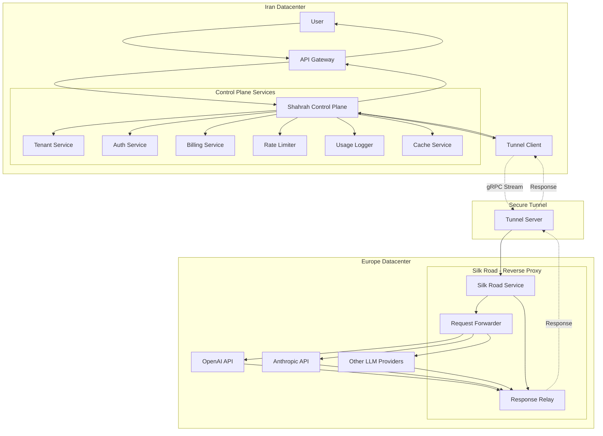
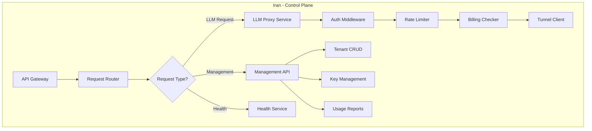
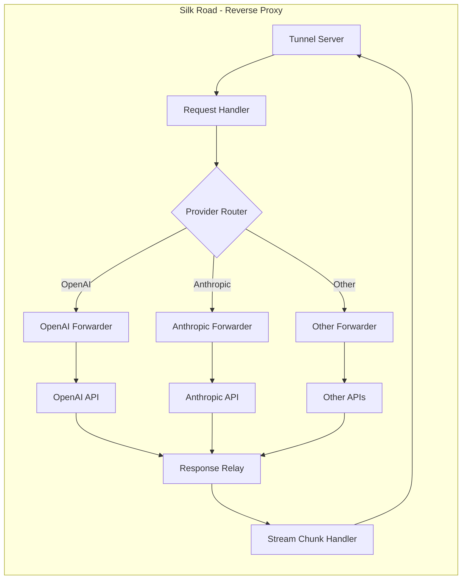
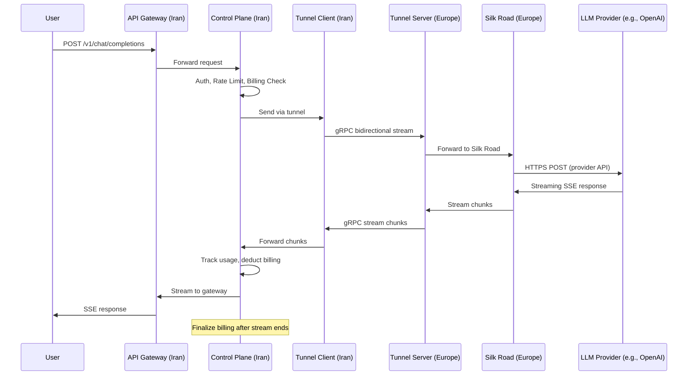
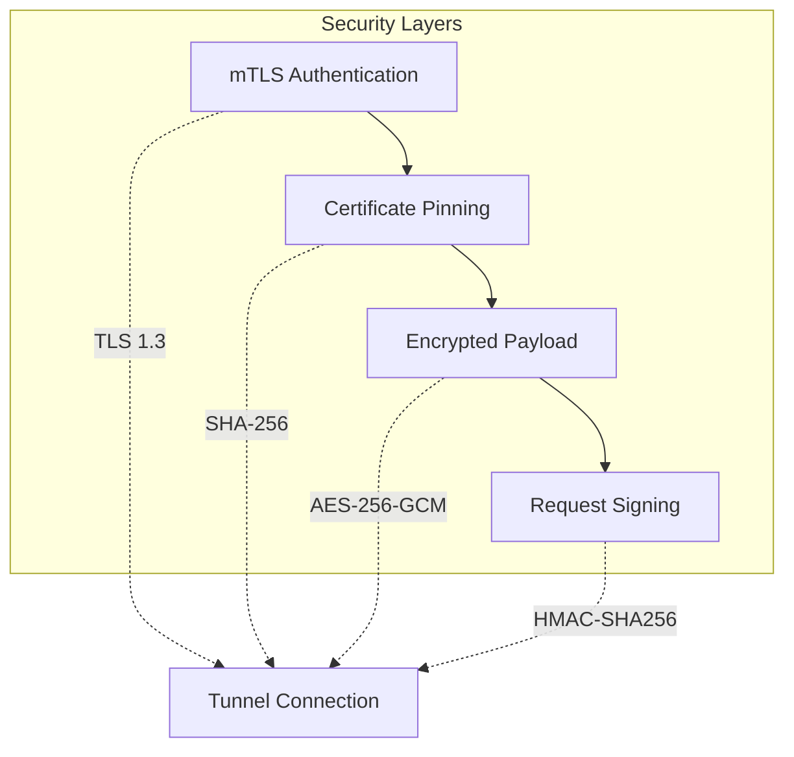
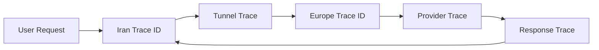
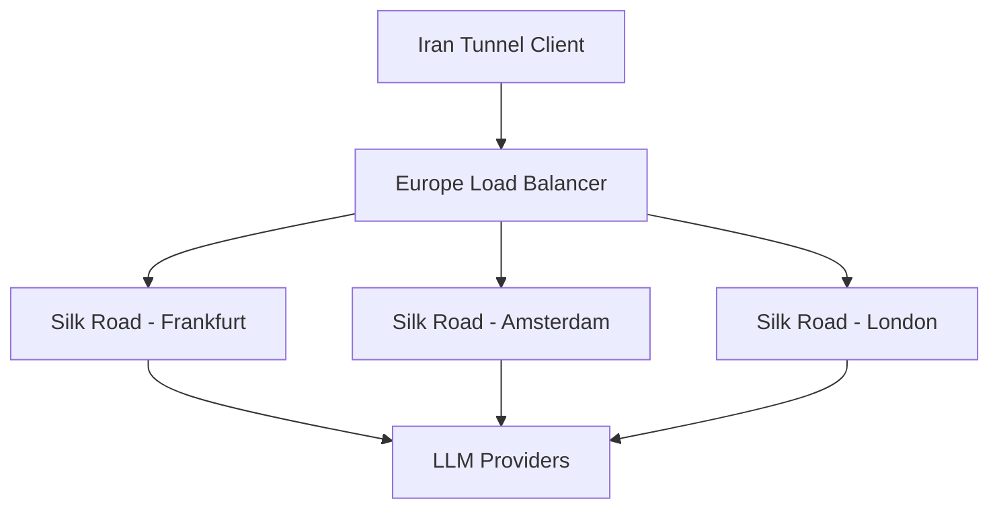

# Shahrah Microservices Architecture with Iran-Europe Tunnel

## Overview

This document describes the microservices architecture for Shahrah, focusing on the split between Iran-based control plane services and the Europe-based "Silk Road" reverse proxy service. This architecture enables Iranian users to access LLM providers that are otherwise blocked due to sanctions.

## 1. Architecture Overview

### 1.1 Service Topology



### 1.2 Service Responsibilities

| Service | Location | Responsibility |
|---------|----------|----------------|
| API Gateway | Iran | Entry point, TLS termination, routing |
| Control Plane | Iran | Business logic, tenant management, auth, billing |
| Tunnel Client | Iran | Establishes/maintains connection to Europe |
| Tunnel Server | Europe | Accepts connections from Iran |
| Silk Road | Europe | Stateless reverse proxy to LLM providers |

## 2. Tunnel Protocol Selection

### 2.1 Protocol Options Comparison

| Protocol | Latency | Throughput | Security | Maturity | Operational Complexity |
|----------|---------|------------|----------|----------|------------------------|
| gRPC + HTTP/2 | ⭐⭐⭐⭐⭐ | ⭐⭐⭐⭐⭐ | ⭐⭐⭐⭐ | ⭐⭐⭐⭐ | ⭐⭐⭐ |
| WireGuard | ⭐⭐⭐⭐ | ⭐⭐⭐⭐⭐ | ⭐⭐⭐⭐⭐ | ⭐⭐⭐⭐⭐ | ⭐⭐⭐⭐ |
| WebSocket Tunnel | ⭐⭐⭐ | ⭐⭐⭐ | ⭐⭐⭐ | ⭐⭐⭐⭐ | ⭐⭐ |
| TUN/TAP over WebSocket | ⭐⭐ | ⭐⭐ | ⭐⭐⭐ | ⭐⭐⭐ | ⭐⭐⭐⭐⭐ |
| Custom TCP Proxy | ⭐⭐⭐⭐ | ⭐⭐⭐⭐ | ⭐⭐⭐ | ⭐⭐⭐ | ⭐⭐⭐⭐ |

### 2.2 Recommended Protocol: gRPC with Bidirectional Streaming

**Recommendation**: Use **gRPC with bidirectional streaming** for the tunnel between Iran and Europe services.

#### Why gRPC?

1. **Low Latency**: HTTP/2 multiplexing reduces connection overhead
2. **Bidirectional Streaming**: Perfect for request/response patterns with streaming responses
3. **Strong Typing**: Protocol Buffers ensure API contract between services
4. **Built-in Features**: Health checking, load balancing, deadline propagation
5. **Excellent Ecosystem**: Go (grpc-go) has first-class support, excellent performance
6. **Firewall Friendly**: Uses standard HTTPS port (443) and looks like normal HTTPS traffic

### 2.3 gRPC Tunnel Architecture

```protobuf
// tunnel.proto
syntax = "proto3";

package shahrah.tunnel.v1;

service TunnelService {
  // Bidirectional streaming for request/response
  rpc ProxyStream(stream TunnelMessage) returns (stream TunnelMessage);
  
  // Health check
  rpc HealthCheck(HealthCheckRequest) returns (HealthCheckResponse);
}

message TunnelMessage {
  string request_id = 1;
  oneof payload {
    HttpRequest request = 2;
    HttpResponse response = 3;
    StreamChunk chunk = 4;
    ErrorInfo error = 5;
  }
}

message HttpRequest {
  string method = 1;
  string url = 2;
  map<string, string> headers = 3;
  bytes body = 4;
  bool is_streaming = 5;
}

message HttpResponse {
  int32 status_code = 1;
  map<string, string> headers = 2;
  bytes body = 3;
}

message StreamChunk {
  bytes data = 1;
  bool is_done = 2;
}

message ErrorInfo {
  string code = 1;
  string message = 2;
  int32 http_status = 3;
}

message HealthCheckRequest {}

message HealthCheckResponse {
  bool healthy = 1;
  int64 active_connections = 2;
  string version = 3;
}
```

## 3. Iran-Based Services (Control Plane)

### 3.1 Service Decomposition



### 3.2 LLM Proxy Service (Iran)

```go
package proxy

import (
	"context"
	"net/http"

	"github.com/rs/zerolog/log"
)

// LLMProxyService is an Iran-based service that handles LLM requests.
// It performs business logic, then forwards to Silk Road via tunnel.
type LLMProxyService struct {
	tunnelClient    TunnelClient
	billingService  BillingService
	authService     AuthService
}

// NewLLMProxyService creates a new LLM proxy service.
func NewLLMProxyService(tc TunnelClient, bs BillingService, as AuthService) *LLMProxyService {
	return &LLMProxyService{
		tunnelClient:    tc,
		billingService:  bs,
		authService:     as,
	}
}

// HandleChatCompletion handles chat completion request:
//  1. Authenticate API key
//  2. Check rate limits
//  3. Check billing balance
//  4. Transform request for provider
//  5. Send to Silk Road via tunnel
//  6. Stream response back
//  7. Log usage and deduct billing
func (s *LLMProxyService) HandleChatCompletion(w http.ResponseWriter, r *http.Request, payload *ChatCompletionRequest) {
	tenantID := r.Context().Value(CtxTenantID).(string)
	apiKeyID := r.Context().Value(CtxAPIKeyID).(string)

	// Step 1: Authenticate
	if err := s.authService.ValidateAPIKey(r.Context(), tenantID, apiKeyID); err != nil {
		http.Error(w, "Unauthorized", http.StatusUnauthorized)
		return
	}

	// Step 2: Rate limiting
	if err := s.authService.CheckRateLimit(r.Context(), tenantID, apiKeyID); err != nil {
		http.Error(w, "Rate limit exceeded", http.StatusTooManyRequests)
		return
	}

	// Step 3: Check balance
	if ok, _ := s.billingService.CheckBalanceSufficient(r.Context(), tenantID); !ok {
		http.Error(w, "Insufficient balance", http.StatusPaymentRequired)
		return
	}

	// Step 4: Prepare provider request
	providerRequest := s.transformToProviderRequest(payload)

	// Step 5: Send via tunnel to Silk Road
	requestID := GenerateRequestID()
	responseStream, err := s.tunnelClient.SendRequest(r.Context(), requestID, providerRequest)
	if err != nil {
		log.Error().Err(err).Msg("Tunnel send failed")
		http.Error(w, "Internal server error", http.StatusInternalServerError)
		return
	}

	// Step 6: Stream response and track usage
	w.Header().Set("Content-Type", "text/event-stream")
	flusher := w.(http.Flusher)
	for chunk := range responseStream {
		w.Write(chunk.Data)
		flusher.Flush()
		// Track tokens for billing
		s.billingService.TrackUsage(r.Context(), requestID, chunk.Tokens)
	}

	// Step 7: Finalize billing
	s.billingService.FinalizeUsage(r.Context(), requestID)
}
```

### 3.3 Tunnel Client (Iran)

```go
package tunnel

import (
	"context"
	"crypto/tls"
	"fmt"
	"sync"
	"time"

	"google.golang.org/grpc"
	"google.golang.org/grpc/credentials"
	"google.golang.org/grpc/keepalive"
	pb "github.com/shahrah/tunnel/proto"
	"github.com/rs/zerolog/log"
)

// TunnelClient maintains a persistent gRPC connection to the Tunnel Server in Europe.
type TunnelClient struct {
	serverAddr   string
	tlsCert      []byte
	conn         *grpc.ClientConn
	stub         pb.TunnelServiceClient
	streams      sync.Map // requestID -> chan *pb.TunnelMessage
	outgoing     chan *pb.TunnelMessage
	mu           sync.Mutex
}

// NewTunnelClient creates a new tunnel client.
func NewTunnelClient(serverAddr string, tlsCert []byte) *TunnelClient {
	return &TunnelClient{
		serverAddr: serverAddr,
		tlsCert:    tlsCert,
		outgoing:   make(chan *pb.TunnelMessage, 1000),
	}
}

// Connect establishes a persistent connection to the tunnel server.
func (c *TunnelClient) Connect(ctx context.Context) error {
	creds := credentials.NewTLS(&tls.Config{
		RootCAs:    nil, // Load from tlsCert
		ServerName: "tunnel.shahrah.eu",
	})

	conn, err := grpc.NewClient(c.serverAddr,
		grpc.WithTransportCredentials(creds),
		grpc.WithKeepaliveParams(keepalive.ClientParameters{
			Time:                30 * time.Second,
			Timeout:             10 * time.Second,
			PermitWithoutStream: true,
		}),
	)
	if err != nil {
		return fmt.Errorf("grpc dial: %w", err)
	}

	c.conn = conn
	c.stub = pb.NewTunnelServiceClient(conn)

	// Start bidirectional streaming
	go c.maintainStream(ctx)
	return nil
}

// maintainStream maintains a persistent bidirectional stream.
func (c *TunnelClient) maintainStream(ctx context.Context) {
	for {
		select {
		case <-ctx.Done():
			return
		default:
		}

		stream, err := c.stub.ProxyStream(ctx)
		if err != nil {
			log.Error().Err(err).Msg("Tunnel connection lost, reconnecting...")
			time.Sleep(5 * time.Second)
			continue
		}

		// Send outgoing messages
		go func() {
			for msg := range c.outgoing {
				if err := stream.Send(msg); err != nil {
					log.Error().Err(err).Msg("Failed to send message")
					return
				}
			}
		}()

		// Receive responses
		for {
			resp, err := stream.Recv()
			if err != nil {
				log.Error().Err(err).Msg("Stream receive error")
				break
			}
			if ch, ok := c.streams.Load(resp.RequestId); ok {
				ch.(chan *pb.TunnelMessage) <- resp
			}
		}
	}
}

// SendRequest sends a request via tunnel and receives a streaming response.
func (c *TunnelClient) SendRequest(ctx context.Context, requestID string, req *ProviderRequest) (<-chan *ResponseChunk, error) {
	respCh := make(chan *ResponseChunk, 100)
	c.streams.Store(requestID, respCh)

	msg := &pb.TunnelMessage{
		RequestId: requestID,
		Request: &pb.HttpRequest{
			Method:      "POST",
			Url:         req.URL,
			Headers:     req.Headers,
			Body:        req.Body,
			IsStreaming: req.IsStreaming,
		},
	}

	select {
	case c.outgoing <- msg:
	case <-ctx.Done():
		return nil, ctx.Err()
	}

	return respCh, nil
}

// Close closes the tunnel connection.
func (c *TunnelClient) Close() error {
	if c.conn != nil {
		return c.conn.Close()
	}
	return nil
}
```

## 4. Europe-Based Services (Silk Road)

### 4.1 Silk Road Service Design



### 4.2 Key Design Principles

1. **No Business Logic**: Silk Road does NOT perform authentication, billing, or rate limiting
2. **Fast Forwarding**: Minimal processing, just forward requests and stream responses
3. **Provider Agnostic**: Supports any LLM provider with appropriate forwarder
4. **Stateless**: Each request is independent, no session state
5. **Resilient**: Automatic reconnection, circuit breaking for provider failures

### 4.3 Silk Road Implementation (Rust for Performance)

```go
// silk-road/cmd/server/main.go
package main

import (
	"context"
	"net"
	"net/http"
	"os"
	"os/signal"
	"syscall"
	"time"

	"github.com/go-chi/chi/v5"
	"github.com/go-chi/chi/v5/middleware"
	"github.com/rs/zerolog/log"
)

// AppState holds shared application state.
type AppState struct {
	ProviderClients map[string]*http.Client
}

func main() {
	ctx, stop := signal.NotifyContext(context.Background(), os.Interrupt, syscall.SIGTERM)
	defer stop()

	// Initialize provider clients with connection pooling
	providerClients := map[string]*http.Client{
		"openai": &http.Client{
			Transport: &http.Transport{
				MaxIdleConns:        1000,
				MaxIdleConnsPerHost: 100,
				IdleConnTimeout:     30 * time.Second,
			},
			Timeout: 300 * time.Second,
		},
		"anthropic": &http.Client{
			Transport: &http.Transport{
				MaxIdleConns:        1000,
				MaxIdleConnsPerHost: 100,
				IdleConnTimeout:     30 * time.Second,
			},
			Timeout: 300 * time.Second,
		},
	}

	state := &AppState{ProviderClients: providerClients}

	// HTTP server for provider forwarding
	r := chi.NewRouter()
	r.Use(middleware.Logger)
	r.Use(middleware.Recoverer)
	r.Handle("/proxy/*", NewProxyHandler(state))

	// gRPC tunnel server (runs in separate goroutine)
	go func() {
		lis, _ := net.Listen("tcp", ":50051")
		// Start gRPC tunnel server on :50051
	}()

	srv := &http.Server{
		Addr:    ":8080",
		Handler: r,
	}

	go func() {
		if err := srv.ListenAndServe(); err != nil && err != http.ErrServerClosed {
			log.Fatal().Err(err).Msg("Server failed")
		}
	}()

	<-ctx.Done()
	log.Info().Msg("Shutting down...")
	srv.Shutdown(context.Background())
}
```

### 4.4 Tunnel Server (Europe)

```go
// silk-road/internal/tunnel/service.go
package tunnel

import (
	"context"
	"fmt"

	pb "github.com/shahrah/tunnel/proto"
	"github.com/rs/zerolog/log"
)

// TunnelService implements the gRPC TunnelServiceServer interface.
type TunnelService struct {
	pb.UnimplementedTunnelServiceServer
	providerClients map[string]*http.Client
}

// NewTunnelService creates a new tunnel service.
func NewTunnelService(clients map[string]*http.Client) *TunnelService {
	return &TunnelService{providerClients: clients}
}

// ProxyStream handles bidirectional streaming for tunnel requests.
func (s *TunnelService) ProxyStream(stream pb.TunnelService_ProxyStreamServer) error {
	ctx := stream.Context()

	for {
		select {
		case <-ctx.Done():
			return ctx.Err()
		default:
		}

		msg, err := stream.Recv()
		if err != nil {
			return err
		}

		if msg.Request != nil {
			// Forward request to provider
			resp, err := s.forwardToProvider(ctx, msg.Request)
			var responseMsg *pb.TunnelMessage
			if err != nil {
				responseMsg = &pb.TunnelMessage{
					RequestId: msg.RequestId,
					Error: &pb.ErrorInfo{
						Code:    "PROXY_ERROR",
						Message: err.Error(),
					},
				}
			} else {
				responseMsg = &pb.TunnelMessage{
					RequestId: msg.RequestId,
					Response:  resp,
				}
			}

			if err := stream.Send(responseMsg); err != nil {
				log.Error().Err(err).Msg("Failed to send response")
			}
		}
	}
}

func (s *TunnelService) forwardToProvider(ctx context.Context, req *pb.HttpRequest) (*pb.HttpResponse, error) {
	// Build HTTP request to provider
	httpReq, _ := http.NewRequestWithContext(ctx, req.Method, req.Url, nil)
	for k, v := range req.Headers {
		httpReq.Header.Set(k, v)
	}

	client := s.providerClients["default"]
	resp, err := client.Do(httpReq)
	if err != nil {
		return nil, fmt.Errorf("provider request: %w", err)
	}
	defer resp.Body.Close()

	// Read response body and return
	body := make([]byte, 0)
	// ... read body ...

	return &pb.HttpResponse{
		StatusCode: int32(resp.StatusCode),
		Headers:    headerMap(resp.Header),
		Body:       body,
	}, nil
}
```

## 5. Communication Protocol Details

### 5.1 Request Flow (Complete)



### 5.2 Message Format

```json
{
    "request_id": "req_abc123def456",
    "tenant_id": "tenant_789",
    "timestamp": "2024-01-15T10:30:00Z",
    "request": {
        "method": "POST",
        "url": "https://api.openai.com/v1/chat/completions",
        "headers": {
            "Content-Type": "application/json",
            "Authorization": "Bearer sk-openai-xxx"
        },
        "body": {
            "model": "gpt-4o",
            "messages": [{"role": "user", "content": "Hello"}],
            "stream": true
        }
    }
}
```

### 5.3 Streaming Response Format

```json
{
    "request_id": "req_abc123def456",
    "chunk": {
        "data": "data: {\"id\":\"chatcmpl-xxx\",\"choices\":[{\"delta\":{\"content\":\"Hello\"}}]}\n\n",
        "is_done": false
    }
}
```

## 6. Security Considerations

### 6.1 Tunnel Security



### 6.2 mTLS Configuration

```go
package tunnel

import (
	"crypto/tls"
	"crypto/x509"
	"fmt"

	"google.golang.org/grpc"
	"google.golang.org/grpc/credentials"
)

// CreateSecureChannel creates an mTLS secured gRPC channel.
func CreateSecureChannel(serverAddr string, clientCert, clientKey, serverCACert []byte) (*grpc.ClientConn, error) {
	cert, err := tls.X509KeyPair(clientCert, clientKey)
	if err != nil {
		return nil, fmt.Errorf("load client key pair: %w", err)
	}

	caCertPool := x509.NewCertPool()
	caCertPool.AppendCertsFromPEM(serverCACert)

	tlsConfig := &tls.Config{
		Certificates: []tls.Certificate{cert},
		RootCAs:      caCertPool,
		ServerName:   "tunnel.shahrah.eu",
	}

	creds := credentials.NewTLS(tlsConfig)

	return grpc.NewClient(serverAddr, grpc.WithTransportCredentials(creds))
}
```

### 6.3 API Key Management for Providers

Provider API keys are stored encrypted in Iran and decrypted only when forwarding to Silk Road:

```go
package crypto

import (
	"context"
	"crypto/aes"
	"crypto/cipher"
	"encoding/base64"
	"fmt"
)

// ProviderKeyManager manages encrypted provider API keys.
type ProviderKeyManager struct {
	gcm cipher.AEAD
	db  Database
}

// NewProviderKeyManager creates a new key manager.
func NewProviderKeyManager(masterKey []byte) (*ProviderKeyManager, error) {
	block, err := aes.NewCipher(masterKey)
	if err != nil {
		return nil, fmt.Errorf("create cipher: %w", err)
	}
	gcm, err := cipher.NewGCM(block)
	if err != nil {
		return nil, fmt.Errorf("create GCM: %w", err)
	}
	return &ProviderKeyManager{gcm: gcm}, nil
}

// GetProviderKey returns a decrypted provider API key.
func (m *ProviderKeyManager) GetProviderKey(ctx context.Context, provider string) (string, error) {
	encryptedKey, err := m.db.GetStoredKey(ctx, provider)
	if err != nil {
		return "", err
	}

	nonce := encryptedKey[:m.gcm.NonceSize()]
	ciphertext := encryptedKey[m.gcm.NonceSize():]

	plaintext, err := m.gcm.Open(nil, nonce, ciphertext, nil)
	if err != nil {
		return "", fmt.Errorf("decrypt: %w", err)
	}
	return string(plaintext), nil
}

// RotateKey rotates a provider API key.
func (m *ProviderKeyManager) RotateKey(ctx context.Context, provider, newKey string) error {
	nonce := make([]byte, m.gcm.NonceSize())
	// ... fill nonce from rand.Read ...
	ciphertext := m.gcm.Seal(nonce, nonce, []byte(newKey), nil)
	return m.db.StoreKey(ctx, provider, base64.StdEncoding.EncodeToString(ciphertext))
}
```

## 7. Resilience & Fault Tolerance

### 7.1 Circuit Breaker Pattern

```go
package circuitbreaker

import (
	"context"
	"sync"
	"time"
)

// CircuitBreaker implements the circuit breaker pattern for providers.
type CircuitBreaker struct {
	mu                sync.Mutex
	failureThreshold  int
	recoveryTimeout   time.Duration
	failures          map[string][]time.Time
	state             map[string]string // "closed", "open", "half-open"
}

// NewCircuitBreaker creates a new circuit breaker.
func NewCircuitBreaker(failureThreshold int, recoveryTimeout time.Duration) *CircuitBreaker {
	return &CircuitBreaker{
		failureThreshold: failureThreshold,
		recoveryTimeout:  recoveryTimeout,
		failures:         make(map[string][]time.Time),
		state:            make(map[string]string),
	}
}

// Execute runs the request with circuit breaker protection.
func (cb *CircuitBreaker) Execute(ctx context.Context, provider string, fn func() error) error {
	cb.mu.Lock()
	state := cb.getState(provider)
	cb.mu.Unlock()

	if state == "open" {
		return ErrCircuitOpen
	}

	err := fn()
	if err != nil {
		cb.mu.Lock()
		cb.recordFailure(provider)
		cb.mu.Unlock()
	} else {
		cb.mu.Lock()
		cb.resetFailures(provider)
		cb.mu.Unlock()
	}
	return err
}

func (cb *CircuitBreaker) getState(provider string) string {
	if time.Since(cb.lastFailure(provider)) > cb.recoveryTimeout {
		cb.state[provider] = "half-open"
	}
	if len(cb.failures[provider]) >= cb.failureThreshold {
		cb.state[provider] = "open"
	}
	return cb.state[provider]
}

func (cb *CircuitBreaker) recordFailure(provider string) {
	cb.failures[provider] = append(cb.failures[provider], time.Now())
}

func (cb *CircuitBreaker) resetFailures(provider string) {
	delete(cb.failures, provider)
	cb.state[provider] = "closed"
}

func (cb *CircuitBreaker) lastFailure(provider string) time.Time {
	fails := cb.failures[provider]
	if len(fails) == 0 {
		return time.Time{}
	}
	return fails[len(fails)-1]
}
```

### 7.2 Connection Pooling

```go
package httpclient

import (
	"net"
	"net/http"
	"sync"
	"time"
)

// ProviderConnectionPool manages connection pools to providers.
type ProviderConnectionPool struct {
	mu      sync.Mutex
	clients map[string]*http.Client
}

// NewProviderConnectionPool creates a new connection pool.
func NewProviderConnectionPool() *ProviderConnectionPool {
	return &ProviderConnectionPool{
		clients: make(map[string]*http.Client),
	}
}

// GetClient returns an HTTP client for the given provider.
func (p *ProviderConnectionPool) GetClient(provider string) *http.Client {
	p.mu.Lock()
	defer p.mu.Unlock()

	if client, ok := p.clients[provider]; ok {
		return client
	}

	transport := &http.Transport{
		DialContext: (&net.Dialer{
			Timeout:   10 * time.Second,
			KeepAlive: 30 * time.Second,
		}).DialContext,
		MaxIdleConns:        1000,
		MaxIdleConnsPerHost: 100,
		IdleConnTimeout:     30 * time.Second,
	}

	client := &http.Client{
		Transport: transport,
		Timeout:   300 * time.Second,
	}
	p.clients[provider] = client
	return client
}
```

### 7.3 Retry Strategy

```go
package retry

import (
	"context"
	"math"
	"time"
)

// RetryStrategy implements exponential backoff retry for provider requests.
type RetryStrategy struct {
	MaxTries  int
	MaxTime   time.Duration
}

// SendWithRetry sends a request with exponential backoff retry.
func (r *RetryStrategy) SendWithRetry(ctx context.Context, client *http.Client, req *http.Request) (*http.Response, error) {
	deadline := time.Now().Add(r.MaxTime)
	var lastErr error

	for i := 0; i < r.MaxTries; i++ {
		if time.Now().After(deadline) {
			return nil, ErrRetryTimeout
		}

		resp, err := client.Do(req)
		if err == nil {
			return resp, nil
		}
		lastErr = err

		// Exponential backoff
		backoff := time.Duration(math.Pow(2, float64(i))) * time.Second
		select {
		case <-time.After(backoff):
		case <-ctx.Done():
			return nil, ctx.Err()
		}
	}
	return nil, lastErr
}
```

## 8. Monitoring & Observability

### 8.1 Distributed Tracing



### 8.2 Metrics Collection

```go
package metrics

import (
	"github.com/prometheus/client_golang/prometheus"
)

var (
	// Tunnel metrics
	TunnelConnections = prometheus.NewGauge(
		prometheus.GaugeOpts{
			Name: "shahrah_tunnel_active_connections",
			Help: "Active tunnel connections",
		},
	)

	TunnelLatency = prometheus.NewHistogramVec(
		prometheus.HistogramOpts{
			Name:    "shahrah_tunnel_latency_seconds",
			Help:    "Tunnel round-trip latency",
			Buckets: []float64{0.01, 0.025, 0.05, 0.1, 0.25, 0.5, 1.0, 2.5, 5.0},
		},
		[]string{"provider"},
	)

	// Provider metrics
	ProviderRequests = prometheus.NewCounterVec(
		prometheus.CounterOpts{
			Name: "shahrah_provider_requests_total",
			Help: "Total provider requests",
		},
		[]string{"provider", "status_code"},
	)

	ProviderTokens = prometheus.NewCounterVec(
		prometheus.CounterOpts{
			Name: "shahrah_provider_tokens_total",
			Help: "Total tokens used per provider",
		},
		[]string{"provider", "model", "type"}, // input/output
	)
)

func init() {
	prometheus.MustRegister(
		TunnelConnections,
		TunnelLatency,
		ProviderRequests,
		ProviderTokens,
	)
}
```

### 8.3 Health Checks

```go
package handler

import (
	"encoding/json"
	"net/http"
)

// HealthCheckResponse represents the health check response.
type HealthCheckResponse struct {
	Status string         `json:"status"`
	Checks map[string]bool `json:"checks"`
	Version string        `json:"version"`
}

const version = "1.0.0"

// HealthCheck returns a comprehensive health check.
func HealthCheck(w http.ResponseWriter, r *http.Request) {
	checks := map[string]bool{
		"tunnel_connection":   checkTunnelConnection(),
		"provider_connectivity": checkProviderConnectivity(),
		"memory_usage":        checkMemoryUsage(),
	}

	healthy := true
	for _, h := range checks {
		if !h {
			healthy = false
			break
		}
	}

	status := "healthy"
	if !healthy {
		status = "degraded"
	}

	resp := HealthCheckResponse{
		Status: status,
		Checks: checks,
		Version: version,
	}

	w.Header().Set("Content-Type", "application/json")
	json.NewEncoder(w).Encode(resp)
}
```

## 9. Deployment Configuration

### 9.1 Iran Services (Docker Compose)

```yaml
# docker-compose.iran.yml
version: '3.8'

services:
  api-gateway:
    image: shahrah/api-gateway:latest
    ports:
      - "443:443"
    depends_on:
      - control-plane
  
  control-plane:
    image: shahrah/control-plane:latest
    environment:
      - TUNNEL_SERVER_ADDRESS=tunnel.shahrah.eu:443
      - DATABASE_URL=postgresql://...
      - REDIS_URL=redis://redis:6379
    depends_on:
      - postgres
      - redis
  
  tunnel-client:
    image: shahrah/tunnel-client:latest
    environment:
      - TUNNEL_SERVER_ADDRESS=tunnel.shahrah.eu:443
      - TLS_CERT_PATH=/certs/client.crt
      - TLS_KEY_PATH=/certs/client.key
      - TLS_CA_PATH=/certs/ca.crt
    volumes:
      - ./certs:/certs:ro
  
  postgres:
    image: postgres:16
    volumes:
      - postgres-data:/var/lib/postgresql/data
  
  redis:
    image: redis:7-alpine

volumes:
  postgres-data:
```

### 9.2 Europe Services (Docker Compose)

```yaml
# docker-compose.europe.yml
version: '3.8'

services:
  tunnel-server:
    image: shahrah/tunnel-server:latest
    ports:
      - "443:443"
      - "50051:50051"  # gRPC
    environment:
      - TLS_CERT_PATH=/certs/server.crt
      - TLS_KEY_PATH=/certs/server.key
      - TLS_CA_PATH=/certs/ca.crt
    volumes:
      - ./certs:/certs:ro
  
  silk-road:
    image: shahrah/silk-road:latest
    environment:
      - OPENAI_API_KEY=${OPENAI_API_KEY}
      - ANTHROPIC_API_KEY=${ANTHROPIC_API_KEY}
      - MAX_CONNECTIONS=1000
    depends_on:
      - tunnel-server

volumes:
  certs:
```

## 10. Performance Optimization

### 10.1 Latency Budget

| Component | Target Latency | Budget |
|-----------|----------------|--------|
| API Gateway (Iran) | < 1ms | 1ms |
| Control Plane Processing | < 5ms | 5ms |
| Tunnel Round-Trip | < 100ms | 80ms |
| Silk Road Processing | < 1ms | 1ms |
| Provider Network | Variable | Variable |
| **Total Overhead** | **< 110ms** | **< 90ms** |

### 10.2 Connection Warm-up

```go
package warmup

import (
	"context"
	"fmt"
	"net"
	"net/http"
	"time"
)

// ConnectionWarmer pre-warms connections to reduce cold-start latency.
type ConnectionWarmer struct {
	tunnelClient *tunnel.TunnelClient
	providers    []ProviderConfig
}

// WarmConnections establishes connections before they're needed.
func (w *ConnectionWarmer) WarmConnections(ctx context.Context) error {
	// Pre-connect to tunnel server
	if err := w.tunnelClient.Connect(ctx); err != nil {
		return err
	}

	// Pre-resolve DNS for providers
	w.warmDNSResolution()

	// Pre-establish TLS connections to providers
	return w.warmTLSConnections(ctx)
}

func (w *ConnectionWarmer) warmDNSResolution() {
	for _, p := range w.providers {
		net.LookupHost(p.BaseURL)
	}
}

func (w *ConnectionWarmer) warmTLSConnections(ctx context.Context) error {
	client := &http.Client{Timeout: 10 * time.Second}
	for _, p := range w.providers {
		url := fmt.Sprintf("https://%s/health", p.BaseURL)
		req, _ := http.NewRequestWithContext(ctx, http.MethodGet, url, nil)
		resp, err := client.Do(req)
		if err != nil {
			continue // Don't fail warm-up for individual providers
		}
		if resp != nil {
			resp.Body.Close()
		}
	}
	return nil
}
```

### 10.3 Request Batching

For non-streaming requests, batch multiple requests through single tunnel message:

```go
package batch

import (
	"context"
	"time"
)

// batchItem holds a request and its result channel.
type batchItem struct {
	request *ProviderRequest
	result  chan *ProviderResponse
}

// RequestBatcher batches multiple requests for efficiency.
type RequestBatcher struct {
	maxBatchSize int
	maxWait      time.Duration
	queue        chan *batchItem
}

// NewRequestBatcher creates a new request batcher.
func NewRequestBatcher(maxBatchSize int, maxWait time.Duration) *RequestBatcher {
	b := &RequestBatcher{
		maxBatchSize: maxBatchSize,
		maxWait:      maxWait,
		queue:        make(chan *batchItem, 1000),
	}
	go b.processBatchLoop()
	return b
}

// AddRequest adds a request to the current batch.
func (b *RequestBatcher) AddRequest(ctx context.Context, req *ProviderRequest) (*ProviderResponse, error) {
	result := make(chan *ProviderResponse, 1)
	select {
	case b.queue <- &batchItem{request: req, result: result}:
	case <-ctx.Done():
		return nil, ctx.Err()
	}
	select {
	case resp := <-result:
		return resp, nil
	case <-ctx.Done():
		return nil, ctx.Err()
	}
}

// processBatchLoop processes batches of requests.
func (b *RequestBatcher) processBatchLoop() {
	for {
		var batch []*batchItem
		timer := time.NewTimer(b.maxWait)

		for len(batch) < b.maxBatchSize {
			select {
			case item := <-b.queue:
				batch = append(batch, item)
			case <-timer.C:
				break
			}
			if len(batch) >= b.maxBatchSize {
				break
			}
		}

		if len(batch) > 0 {
			b.sendBatch(batch)
		}
	}
}

func (b *RequestBatcher) sendBatch(batch []*batchItem) {
	// Send batch to provider...
}
```

## 11. Future Enhancements

### 11.1 Multi-Region Europe Deployment



### 11.2 Edge Caching

- Cache model metadata and pricing information
- Cache common completions for frequently asked questions
- Implement CDN for static assets

### 11.3 Protocol Optimization

- Consider QUIC/HTTP/3 for reduced latency
- Implement request compression for large payloads
- Explore custom binary protocol for internal communication
