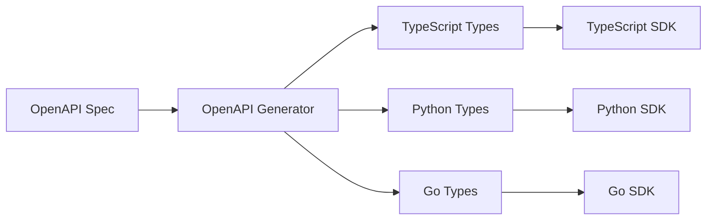

# GodarAI SDK Development Strategy

## Overview

This document describes the SDK development strategy forGodarAI. Since Shahrah's customers are technical users (developers, engineers), having high-quality SDKs for popular frameworks like Next.js, NestJS, Python, and others is critical for developer experience and adoption.

## 1. SDK Requirements Analysis

### 1.1 Target Platforms & Languages

| Language/Framework | Priority | Package Manager | Package Name |
|-------------------|----------|-----------------|--------------|
| TypeScript/Node.js | P0 | npm | `@shahrah/sdk` |
| Python | P0 | pip | `shahrah` |
| Next.js | P1 | npm | `@shahrah/nextjs` |
| NestJS | P1 | npm | `@shahrah/nestjs` |
| Go | P2 | go mod | `github.com/shahrah/shahrah-go` |
| Rust | P2 | cargo | `shahrah` |
| cURL/OpenAPI | P3 | - | OpenAPI Spec |

### 1.2 Core SDK Features

1. **OpenAI-Compatible API**: Drop-in replacement for OpenAI SDK
2. **Type Safety**: Full TypeScript support with generated types
3. **Streaming Support**: Native streaming for chat completions
4. **Error Handling**: Structured error types with Shahrah-specific errors
5. **Retry Logic**: Built-in retry with exponential backoff
6. **Configuration**: Easy configuration with environment variables
7. **Logging**: Debug logging for troubleshooting

## 2. Monorepo Architecture

### 2.1 Recommended: Turborepo Monorepo

```mermaid
graph TB
    subgraph "GodarAI SDK Monorepo"
        A[@shahrah/openapi] --> B[@shahrah/core]
        B --> C[@shahrah/typescript]
        B --> D[@shahrah/python]
        B --> E[@shahrah/go]
        
        C --> F[@shahrah/nextjs]
        C --> G[@shahrah/nestjs]
        
        H[OpenAPI Spec] --> A
        I[Code Generator] --> A
    end
    
    style A fill:#e1f5fe
    style B fill:#fff3e0
    style C fill:#e8f5e9
    style D fill:#e8f5e9
    style E fill:#e8f5e9
```

### 2.2 Directory Structure

```
shahrah-sdk/
├── packages/
│   ├── openapi/                    # OpenAPI spec & code generation
│   │   ├── shahrah-api.yaml
│   │   └── generate.ts
│   ├── core/                       # Core shared utilities
│   │   ├── src/
│   │   │   ├── errors.ts
│   │   │   ├── retry.ts
│   │   │   ├── streaming.ts
│   │   │   └── utils.ts
│   │   └── package.json
│   ├── typescript/                 # TypeScript/Node.js SDK
│   │   ├── src/
│   │   │   ├── index.ts
│   │   │   ├── client.ts
│   │   │   ├── chat/
│   │   │   │   └── completions.ts
│   │   │   ├── completions.ts
│   │   │   ├── embeddings.ts
│   │   │   ├── images.ts
│   │   │   ├── audio.ts
│   │   │   ├── models.ts
│   │   │   └── types.ts
│   │   ├── package.json
│   │   └── tsconfig.json
│   ├── python/                     # Python SDK
│   │   ├── shahrah/
│   │   │   ├── __init__.py
│   │   │   ├── client.py
│   │   │   ├── chat/
│   │   │   │   └── completions.py
│   │   │   └── types.py
│   │   ├── pyproject.toml
│   │   └── setup.cfg
│   ├── nextjs/                     # Next.js specific utilities
│   │   ├── src/
│   │   │   ├── index.ts
│   │   │   ├── api-routes.ts
│   │   │   └── server-actions.ts
│   │   └── package.json
│   ├── nestjs/                     # NestJS specific module
│   │   ├── src/
│   │   │   ├── index.ts
│   │   │   ├──GodarAI.module.ts
│   │   │   ├──GodarAI.service.ts
│   │   │   └──GodarAI.provider.ts
│   │   └── package.json
│   └── go/                         # Go SDK
│       ├── client.go
│       ├── chat.go
│       └── go.mod
├── examples/
│   ├── typescript/
│   │   ├── chat-completion.ts
│   │   ├── streaming.ts
│   │   └── function-calling.ts
│   ├── python/
│   │   ├── chat_completion.py
│   │   ├── streaming.py
│   │   └── function_calling.py
│   └── nextjs/
│       ├── app/
│       │   └── api/
│       │       └── chat/
│       │           └── route.ts
│       └── pages/
│           └── api/
│               └── chat.ts
├── scripts/
│   ├── generate-types.ts
│   └── publish-packages.ts
├── turbo.json
├── package.json
└── pnpm-workspace.yaml
```

## 3. API Design Philosophy

### 3.1 OpenAI Compatibility

The GodarAI SDK should be a **drop-in replacement** for OpenAI SDK:

```typescript
// OpenAI SDK usage
import OpenAI from 'openai'

const openai = new OpenAI({
  apiKey: process.env.OPENAI_API_KEY,
})

const response = await openai.chat.completions.create({
  model: 'gpt-4o',
  messages: [{ role: 'user', content: 'Hello' }],
})

// GodarAI SDK usage (nearly identical)
import GodarAI from '@shahrah/typescript'

const GodarAI = new Shahrah({
  baseUrl: 'https://your-tenant.sharah.ir',
  apiKey: process.env.SHAHRAH_API_KEY,
})

const response = awaitGodarAI.chat.completions.create({
  model: 'gpt-4o',  // Same model format
  messages: [{ role: 'user', content: 'Hello' }],
})
```

### 3.2 TypeScript SDK Implementation

```typescript
// packages/typescript/src/client.ts
import { Chat } from './chat'
import { Completions } from './completions'
import { Embeddings } from './embeddings'
import { Models } from './models'
import { ShahrahConfig, ShahRHError } from './types'

export class ShahrahClient {
  public chat: Chat
  public completions: Completions
  public embeddings: Embeddings
  public models: Models
  
  private config: Required<ShahrahConfig>
  
  constructor(config: ShahrahConfig) {
    this.config = {
      baseUrl: config.baseUrl || process.env.SHAHRAH_BASE_URL || '',
      apiKey: config.apiKey || process.env.SHAHRAH_API_KEY || '',
      timeout: config.timeout || 300000,  // 5 minutes
      maxRetries: config.maxRetries ?? 3,
      ...config,
    }
    
    if (!this.config.baseUrl || !this.config.apiKey) {
      throw new ShahrahError({
        message: 'baseUrl and apiKey are required',
        type: 'configuration_error',
      })
    }
    
    this.chat = new Chat(this.config)
    this.completions = new Completions(this.config)
    this.embeddings = new Embeddings(this.config)
    this.models = new Models(this.config)
  }
  
  async request<T>(path: string, options: RequestOptions): Promise<T> {
    // Core request handling with retry, error handling
    const response = await fetch(`${this.config.baseUrl}${path}`, {
      ...options,
      headers: {
        'Content-Type': 'application/json',
        'Authorization': `Bearer ${this.config.apiKey}`,
        ...options.headers,
      },
    })
    
    if (!response.ok) {
      throw await ShahrahError.fromResponse(response)
    }
    
    return response.json()
  }
}

export default ShahrahClient
```

### 3.3 Chat Completions Implementation

```typescript
// packages/typescript/src/chat/completions.ts
import { ShahrahConfig, ChatCompletionParams, ChatCompletion } from '../types'

export class Chat {
  public completions: ChatCompletions
  
  constructor(config: ShahrahConfig) {
    this.completions = new ChatCompletions(config)
  }
}

export class ChatCompletions {
  private config: ShahrahConfig
  
  constructor(config: ShahrahConfig) {
    this.config = config
  }
  
  async create(
    params: ChatCompletionParams
  ): Promise<ChatCompletion> {
    const response = await fetch(`${this.config.baseUrl}/v1/chat/completions`, {
      method: 'POST',
      headers: {
        'Content-Type': 'application/json',
        'Authorization': `Bearer ${this.config.apiKey}`,
      },
      body: JSON.stringify(params),
    })
    
    if (!response.ok) {
      throw await ShahrahError.fromResponse(response)
    }
    
    return response.json()
  }
  
  async *stream(
    params: ChatCompletionParams
  ): AsyncGenerator<ChatCompletionChunk> {
    const response = await fetch(`${this.config.baseUrl}/v1/chat/completions`, {
      method: 'POST',
      headers: {
        'Content-Type': 'application/json',
        'Authorization': `Bearer ${this.config.apiKey}`,
      },
      body: JSON.stringify({ ...params, stream: true }),
    })
    
    if (!response.ok) {
      throw await ShahrahError.fromResponse(response)
    }
    
    const reader = response.body?.getReader()
    if (!reader) {
      throw new Error('Response body is not readable')
    }
    
    const decoder = new TextDecoder()
    let buffer = ''
    
    while (true) {
      const { done, value } = await reader.read()
      if (done) break
      
      buffer += decoder.decode(value, { stream: true })
      
      const lines = buffer.split('\n')
      buffer = lines.pop() || ''
      
      for (const line of lines) {
        if (line.startsWith('data: ')) {
          const data = line.slice(6)
          if (data === '[DONE]') {
            return
          }
          
          try {
            yield JSON.parse(data)
          } catch (e) {
            // Skip malformed chunks
          }
        }
      }
    }
  }
}
```

### 3.4 Python SDK Implementation

```python
# packages/python/shahrah/__init__.py
from .client import ShahrahClient
from .types import ShahrahError

__all__ = ["ShahrahClient", "ShahrahError"]

# packages/python/shahrah/client.py
import os
from typing import Optional, Dict, Any
import httpx
from .chat import Chat
from .completions import Completions
from .embeddings import Embeddings
from .models import Models

class ShahrahClient:
    def __init__(
        self,
        base_url: Optional[str] = None,
        api_key: Optional[str] = None,
        timeout: float = 300.0,
        max_retries: int = 3,
    ):
        self.base_url = base_url or os.environ.get("SHAHRAH_BASE_URL", "")
        self.api_key = api_key or os.environ.get("SHAHRAH_API_KEY", "")
        
        if not self.base_url or not self.api_key:
            raise ValueError("base_url and api_key are required")
        
        self._client = httpx.AsyncClient(
            base_url=self.base_url,
            timeout=timeout,
            headers={
                "Authorization": f"Bearer {self.api_key}",
                "Content-Type": "application/json",
            },
        )
        
        self.chat = Chat(self._client)
        self.completions = Completions(self._client)
        self.embeddings = Embeddings(self._client)
        self.models = Models(self._client)
    
    async def close(self):
        await self._client.aclose()
    
    async def __aenter__(self):
        return self
    
    async def __aexit__(self, *args):
        await self.close()

# packages/python/shahrah/chat/completions.py
from typing import AsyncGenerator, Dict, Any
import httpx
import json

class ChatCompletions:
    def __init__(self, client: httpx.AsyncClient):
        self._client = client
    
    async def create(
        self,
        model: str,
        messages: list[dict[str, str]],
        **kwargs: Any
    ) -> dict[str, Any]:
        response = await self._client.post(
            "/v1/chat/completions",
            json={"model": model, "messages": messages, **kwargs},
        )
        response.raise_for_status()
        return response.json()
    
    async def stream(
        self,
        model: str,
        messages: list[dict[str, str]],
        **kwargs: Any
    ) -> AsyncGenerator[dict[str, Any], None]:
        async with self._client.stream(
            "POST",
            "/v1/chat/completions",
            json={"model": model, "messages": messages, "stream": True, **kwargs},
        ) as response:
            response.raise_for_status()
            async for line in response.aiter_lines():
                if line.startswith("data: "):
                    data = line[6:]
                    if data == "[DONE]":
                        break
                    try:
                        yield json.loads(data)
                    except json.JSONDecodeError:
                        pass
```

## 4. Framework-Specific SDKs

### 4.1 Next.js SDK

```typescript
// packages/nextjs/src/index.ts
import { ShahrahClient } from '@shahrah/typescript'

// Server-side API route handler
export function createShahrahHandler(config: {
  getApiKey: (req: Request) => Promise<string>
}) {
  return async function handler(req: Request) {
    const apiKey = await config.getApiKey(req)
    const client = new ShahrahClient({
      baseUrl: process.env.SHAHRAH_BASE_URL!,
      apiKey,
    })
    
    const body = await req.json()
    const response = await client.chat.completions.create(body)
    
    return Response.json(response)
  }
}

// Edge runtime compatible version
export function createEdgeHandler(config: { apiKey: string }) {
  return async function handler(req: Request) {
    const client = new ShahrahClient({
      baseUrl: process.env.SHAHRAH_BASE_URL!,
      apiKey: config.apiKey,
    })
    
    // Forward request to Shahrah
    const response = await fetch(
      `${process.env.SHAHRAH_BASE_URL}/v1/chat/completions`,
      {
        method: 'POST',
        headers: {
          'Content-Type': 'application/json',
          'Authorization': `Bearer ${config.apiKey}`,
        },
        body: req.body,
      }
    )
    
    return new Response(response.body, {
      headers: {
        'Content-Type': 'text/event-stream',
      },
    })
  }
}

// packages/nextjs/src/server-actions.ts
'use server'

import { ShahrahClient } from '@shahrah/typescript'

export async function createChatCompletion(params: {
  model: string
  messages: Array<{ role: string; content: string }>
}) {
  const client = new ShahrahClient({
    baseUrl: process.env.SHAHRAH_BASE_URL!,
    apiKey: process.env.SHAHRAH_API_KEY!,
  })
  
  return client.chat.completions.create(params)
}
```

### 4.2 NestJS SDK

```typescript
// packages/nestjs/src/shahrah.module.ts
import { Module, DynamicModule, Global } from '@nestjs/common'
import { ShahrahClient } from '@shahrah/typescript'
import { ShahrahService } from './shahrah.service'
import { SHAHRAH_CLIENT } from './shahrah.provider'

export interface ShahrahModuleOptions {
  baseUrl: string
  apiKey: string
  timeout?: number
  maxRetries?: number
}

@Global()
@Module({})
export class ShahrahModule {
  static forRoot(options: ShahrahModuleOptions): DynamicModule {
    const client = new ShahrahClient(options)
    
    return {
      module: ShahrahModule,
      providers: [
        {
          provide: SHAHRAH_CLIENT,
          useValue: client,
        },
        ShahrahService,
      ],
      exports: [SHAHRAH_CLIENT, ShahrahService],
    }
  }
}

// packages/nestjs/src/shahrah.service.ts
import { Inject, Injectable } from '@nestjs/common'
import { ShahrahClient } from '@shahrah/typescript'
import { SHAHRAH_CLIENT } from './shahrah.provider'

@Injectable()
export class ShahrahService {
  constructor(
    @Inject(SHAHRAH_CLIENT)
    private readonly client: ShahrahClient
  ) {}
  
  async createChatCompletion(params: any) {
    return this.client.chat.completions.create(params)
  }
  
  async *streamChatCompletion(params: any) {
    yield* this.client.chat.completions.stream(params)
  }
}
```

## 5. Code Generation Strategy

### 5.1 OpenAPI First Approach



### 5.2 OpenAPI Generator Configuration

```yaml
# openapi-generator-config.yaml
generatorName: typescript-axios
outputDir: packages/typescript
inputSpec: packages/openapi/shahrah-api.yaml
additionalProperties:
  npmName: "@shahrah/typescript"
  supportsES6: true
  withInterfaces: true
```

### 5.3 Custom Code Generator

```typescript
// scripts/generate-types.ts
import { readFileSync, writeFileSync } from 'fs'
import { parse } from 'yaml'

// Parse OpenAPI spec
const spec = parse(readFileSync('packages/openapi/shahrah-api.yaml', 'utf-8'))

// Generate TypeScript types
const types = generateTypes(spec)
writeFileSync('packages/typescript/src/types.ts', types)

// Generate Python types
const pythonTypes = generatePythonTypes(spec)
writeFileSync('packages/python/shahrah/types.py', pythonTypes)

// Generate Go types
const goTypes = generateGoTypes(spec)
writeFileSync('packages/go/types.go', goTypes)
```

## 6. Package Publishing Strategy

### 6.1 Versioning

All SDK packages follow semantic versioning:

```
MAJOR.MINOR.PATCH
```

- **MAJOR**: Breaking API changes
- **MINOR**: New features, backward compatible
- **PATCH**: Bug fixes, backward compatible

### 6.2 Release Process

```yaml
# .github/workflows/release-sdk.yml
name: Release SDK Packages

on:
  push:
    tags:
      - 'sdk-v*'

jobs:
  release:
    runs-on: ubuntu-latest
    steps:
      - uses: actions/checkout@v4
      
      - name: Setup Node
        uses: actions/setup-node@v4
        with:
          node-version: '22'
          registry-url: 'https://registry.npmjs.org'
      
      - name: Setup Python
        uses: actions/setup-python@v5
        with:
          python-version: '3.12'
      
      - name: Install dependencies
        run: pnpm install
      
      - name: Build packages
        run: pnpm build
      
      - name: Publish TypeScript SDK
        run: pnpm publish packages/typescript --access public
        env:
          NODE_AUTH_TOKEN: ${{ secrets.NPM_TOKEN }}
      
      - name: Publish Python SDK
        run: |
          cd packages/python
          python -m build
          python -m twine upload dist/*
        env:
          TWINE_USERNAME: __token__
          TWINE_PASSWORD: ${{ secrets.PYPI_TOKEN }}
```

### 6.3 Package Registry Publishing

| Package | Registry | Publishing Command |
|---------|----------|-------------------|
| TypeScript SDK | npm | `npm publish` |
| Next.js SDK | npm | `npm publish` |
| NestJS SDK | npm | `npm publish` |
| Python SDK | PyPI | `twine upload` |
| Go SDK | GitHub | `git tag` + push |
| Rust SDK | crates.io | `cargo publish` |

## 7. SDK Testing

### 7.1 Test Strategy

```typescript
// packages/typescript/src/__tests__/chat.test.ts
import { ShahrahClient } from '../client'
import { describe, it, expect, beforeEach } from 'vitest'

describe('Chat Completions', () => {
  let client: ShahrahClient
  
  beforeEach(() => {
    client = new ShahrahClient({
      baseUrl: process.env.SHAHRAH_TEST_BASE_URL!,
      apiKey: process.env.SHAHRAH_TEST_API_KEY!,
    })
  })
  
  it('should create a chat completion', async () => {
    const response = await client.chat.completions.create({
      model: 'gpt-4o',
      messages: [{ role: 'user', content: 'Hello, world!' }],
    })
    
    expect(response.choices).toHaveLength(1)
    expect(response.choices[0].message.content).toBeDefined()
  })
  
  it('should stream a chat completion', async () => {
    const chunks: any[] = []
    
    for await (const chunk of client.chat.completions.stream({
      model: 'gpt-4o',
      messages: [{ role: 'user', content: 'Hello, world!' }],
    })) {
      chunks.push(chunk)
    }
    
    expect(chunks.length).toBeGreaterThan(0)
  })
})
```

### 7.2 Integration Tests

```yaml
# CI integration tests
name: SDK Integration Tests

on:
  push:
    branches: [main]

jobs:
  test:
    runs-on: ubuntu-latest
    steps:
      - uses: actions/checkout@v4
      
      - name: Start local Shahrah
        run: docker-compose up -d
      
      - name: Run TypeScript SDK tests
        run: pnpm test:typescript
        env:
          SHAHRAH_TEST_BASE_URL: http://localhost:4000
          SHAHRAH_TEST_API_KEY: sk-test-key
      
      - name: Run Python SDK tests
        run: pnpm test:python
      
      - name: Run Next.js SDK tests
        run: pnpm test:nextjs
```

## 8. Documentation for SDKs

### 8.1 README Template

```markdown
# @shahrah/{package}

> Official GodarAI SDK for {language/framework}

## Installation

\`\`\`bash
npm install @shahrah/{package}
# or
pip install shahrah
# or
go get github.com/shahrah/shahrah-go
\`\`\`

## Quick Start

\`\`\`typescript
import GodarAI from '@shahrah/{package}'

const client = new Shahrah({
  baseUrl: 'https://your-tenant.sharah.ir',
  apiKey: process.env.SHAHRAH_API_KEY,
})

const response = await client.chat.completions.create({
  model: 'gpt-4o',
  messages: [{ role: 'user', content: 'Hello!' }],
})
\`\`\`

## API Reference

See [full documentation](https://sharah.ir/docs/sdks/{package})

## License

MIT
```

### 8.2 Code Examples

Each SDK should include extensive examples:

```
examples/
├── basic-chat.ts
├── streaming.ts
├── function-calling.ts
├── tool-use.ts
├── image-generation.ts
├── embeddings.ts
├── error-handling.ts
└── retry-logic.ts
```

## 9. SDK Maintenance

### 9.1 Automated Updates

When the GodarAI API spec changes:

1. CI/CD pipeline triggers code generation
2. Generated types are updated
3. Tests run automatically
4. PR created for review

### 9.2 Version Compatibility Matrix

| GodarAI API Version | SDK Version | Status |
|--------------------|-------------|--------|
| v1.0 | 1.x | Current |
| v0.9 | 0.9.x | Deprecated |

## 10. Developer Experience

### 10.1 Environment Variables

```bash
# Required
SHAHRAH_BASE_URL=https://your-tenant.sharah.ir
SHAHRAH_API_KEY=sk-your-api-key

# Optional
SHAHRAH_TIMEOUT=300000
SHAHRAH_MAX_RETRIES=3
SHAHRAH_DEBUG=true
```

### 10.2 Debug Logging

```typescript
import GodarAI from '@shahrah/typescript'

const client = new Shahrah({
  baseUrl: '...',
  apiKey: '...',
  debug: true,  // Enable debug logging
})
```

### 10.3 Error Types

```typescript
export class ShahrahError extends Error {
  type: 'api_error' | 'authentication_error' | 'rate_limit_error' | 'timeout_error'
  status?: number
  request_id?: string
  
  static async fromResponse(response: Response): Promise<ShahrahError> {
    const body = await response.json()
    return new ShahrahError({
      message: body.error?.message || 'Unknown error',
      type: body.error?.type || 'api_error',
      status: response.status,
      request_id: response.headers.get('x-request-id'),
    })
  }
}
```
