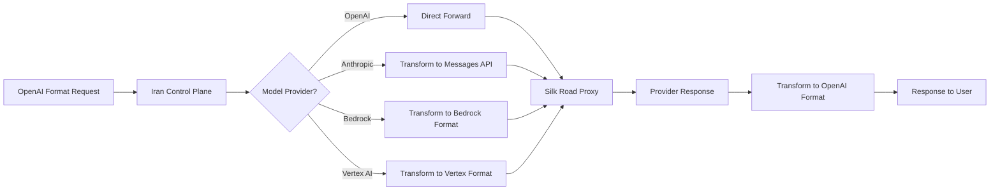

# GodarAI Features - LiteLLM-Inspired Feature Set

## Overview

This document maps LiteLLM's comprehensive feature set to GodarAI's planned features, highlighting adaptations made for the Iranian market and multi-tenant architecture.

## 1. Feature Mapping from LiteLLM to GodarAI

### 1.1 Core LLM Gateway Features

| LiteLLM Feature | GodarAI Equivalent | Notes |
|-----------------|-------------------|-------|
| OpenAI-compatible interface | ✅ Direct mapping | Same API contract |
| 100+ LLM provider support | ✅ Core feature | Via Silk Road provider egress |
| Provider-specific transformations | ✅ Core feature | In Iran Control Plane |
| Streaming support | ✅ Direct mapping | SSE streaming |
| Function/Tool calling | ✅ Direct mapping | OpenAI format |
| Embeddings | ✅ Direct mapping | `/v1/embeddings` |
| Image generation | ✅ Direct mapping | `/v1/images/generations` |
| Audio (Speech/Transcription) | ✅ Direct mapping | `/v1/audio/*` |
| Batch API | ✅ Planned | Async processing |
| Fine-tuning API | ⏸️ Future | Pass-through only |

### 1.2 Proxy/Gateway Features

| LiteLLM Feature | GodarAI Equivalent | Notes |
|-----------------|-------------------|-------|
| API Key Management | ✅ Enhanced | Tenant-scoped keys |
| Rate Limiting (TPM/RPM) | ✅ Enhanced | Per-tenant + per-key |
| Budget Management | ✅ Enhanced | IRR wallet + USD tracking |
| Load Balancing/Router | ✅ Direct mapping | Provider failover |
| Caching (Redis) | ✅ Direct mapping | Shared cache layer |
| Retry/Fallback | ✅ Direct mapping | Provider fallbacks |
| JWT Authentication | ✅ Direct mapping | OAuth2 support |
| SSO Integration | ✅ Direct mapping | Enterprise SSO |
| Guardrails/Content Moderation | ✅ Direct mapping | LlamaGuard, etc. |
| Logging/Observability callbacks | ✅ Enhanced | Full observability |

### 1.3 Admin & Management Features

| LiteLLM Feature | GodarAI Equivalent | Notes |
|-----------------|-------------------|-------|
| Admin UI (built-in) | ✅ Enhanced | Separate tenant admin |
| Internal user management | ✅ Mapped | Support team access |
| Team management | ✅ Mapped | Tenant = Team |
| Organization management | ✅ Mapped | Enterprise orgs |
| Key management endpoints | ✅ Direct mapping | CRUD operations |
| Model management | ✅ Direct mapping | Add/configure models |
| Spend tracking | ✅ Enhanced | IRR + USD dual tracking |
| Budget alerts | ✅ Direct mapping | Slack, email, webhook |
| Usage analytics | ✅ Direct mapping | Per-tenant dashboards |

## 2. GodarAI API Endpoints

### 2.1 LLM API Endpoints (OpenAI Compatible)

```
POST /v1/chat/completions          # Chat completions
POST /v1/completions               # Text completions (legacy)
POST /v1/embeddings                # Embeddings
POST /v1/images/generations        # Image generation
POST /v1/images/edits              # Image editing
POST /v1/images/variations         # Image variations
POST /v1/audio/speech              # Text-to-speech
POST /v1/audio/transcriptions      # Speech-to-text
POST /v1/audio/translations        # Audio translation
GET  /v1/models                    # List available models
GET  /v1/models/{model_id}         # Get model details
POST /v1/batches                   # Create batch job
GET  /v1/batches/{batch_id}        # Get batch status
POST /v1/files                     # Upload file (for batches)
GET  /v1/files/{file_id}           # Get file info
DELETE /v1/files/{file_id}         # Delete file
GET  /v1/files/{file_id}/content   # Get file content
```

### 2.2 Management API Endpoints

```
# API Keys
POST   /api/v1/keys               # Create API key
GET    /api/v1/keys               # List API keys
GET    /api/v1/keys/{key_id}      # Get API key details
PUT    /api/v1/keys/{key_id}      # Update API key
DELETE /api/v1/keys/{key_id}      # Delete API key

# Models
POST   /api/v1/models             # Add model to tenant
GET    /api/v1/models             # List tenant models
DELETE /api/v1/models/{model_id}  # Remove model

# Routing
POST   /api/v1/routes             # Create routing rule
GET    /api/v1/routes             # List routing rules
PUT    /api/v1/routes/{route_id}  # Update routing rule
DELETE /api/v1/routes/{route_id}  # Delete routing rule

# Fallbacks
POST   /api/v1/fallbacks          # Create fallback rule
GET    /api/v1/fallbacks          # List fallback rules
PUT    /api/v1/fallbacks/{id}     # Update fallback
DELETE /api/v1/fallbacks/{id}     # Delete fallback

# Budget & Rate Limits
GET    /api/v1/budget             # Get current budget status
PUT    /api/v1/budget             # Update budget limits
GET    /api/v1/rate-limits        # Get rate limit config
PUT    /api/v1/rate-limits        # Update rate limits

# Usage
GET    /api/v1/usage              # Get usage statistics
GET    /api/v1/usage/{key_id}     # Get usage by API key
GET    /api/v1/usage/{model}      # Get usage by model

# Billing
GET    /api/v1/wallet             # Get wallet balance
POST   /api/v1/wallet/topup/intents # Create top-up payment intent from USD amount
GET    /api/v1/wallet/topup/callback/{provider} # Provider callback endpoint (public)
POST   /api/v1/wallet/topup/callback/{provider} # Provider callback endpoint (public)
GET    /api/v1/wallet/topup/settings # Get min/max USD + tax/fee settings
PUT    /api/v1/wallet/topup/settings # Update min/max USD + tax/fee settings (support-admin)
GET    /api/v1/transactions       # List transactions
GET    /api/v1/invoices           # List invoices
GET    /api/v1/invoices/{id}      # Get invoice details

# Settings
GET    /api/v1/settings           # Get tenant settings
PUT    /api/v1/settings           # Update tenant settings

# Health
GET    /health                    # Health check
GET    /ready                     # Readiness check
```

## 3. Detailed Feature Specifications

### 3.1 Request/Response Transformation

Similar to LiteLLM's provider transformations, GodarAI transforms requests:



### 3.2 Router/Load Balancing

```go
package router

import (
	"time"
)

// RoutingStrategy defines the type of routing strategy to use.
type RoutingStrategy string

const (
	SimpleShuffle RoutingStrategy = "simple_shuffle" // Shuffle and try each
	LowestCost    RoutingStrategy = "lowest_cost"    // Cheapest provider first
	LowestLatency RoutingStrategy = "lowest_latency" // Fastest response time
	LeastBusy     RoutingStrategy = "least_busy"     // Least concurrent requests
	BudgetLimiter RoutingStrategy = "budget_limiter" // Based on budget limits
	TagBased      RoutingStrategy = "tag_based"      // Route by deployment tags
)

// FallbackRule defines a fallback rule for a model/provider.
type FallbackRule struct {
	Model     string
	Providers []string
}

// RouterConfig is a LiteLLM-inspired router configuration with GodarAI enhancements.
type RouterConfig struct {
	// Routing strategy
	Strategy RoutingStrategy

	// Cooldown settings
	CooldownTime time.Duration // Seconds to wait after failure
	AllowedFails int           // Failures before cooldown
	TTL          time.Duration // Cache TTL

	// Fallback settings
	Fallbacks []FallbackRule

	// Model grouping
	ModelGroupAliasMap map[string][]string
}

// DefaultRouterConfig returns a default router configuration.
func DefaultRouterConfig() *RouterConfig {
	return &RouterConfig{
		Strategy:     SimpleShuffle,
		CooldownTime: 60 * time.Second,
		AllowedFails: 3,
		TTL:          600 * time.Second,
	}
}

### 3.3 Caching System

```go
package cache

import (
	"context"
	"crypto/sha256"
	"encoding/hex"
	"encoding/json"
	"fmt"
	"time"

	"github.com/patrickmn/go-cache"
	"github.com/redis/go-redis/v9"
)

// CacheParams holds parameters for cache key generation.
type CacheParams struct {
	Temperature float64 `json:"temperature"`
	TopP        float64 `json:"top_p"`
	MaxTokens   int     `json:"max_tokens"`
}

// GodarAICache is a multi-level caching system inspired by LiteLLM.
type GodarAICache struct {
	inMemory *cache.Cache
	redis    *redis.Client
}

// NewGodarAICache creates a new cache instance.
func NewGodarAICache(redisAddr string) *GodarAICache {
	return &GodarAICache{
		inMemory: cache.New(5*time.Minute, 10*time.Minute),
		redis:    redis.NewClient(&redis.Options{Addr: redisAddr}),
	}
}

// GetCacheKey generates a cache key including tenant isolation.
func (c *GodarAICache) GetCacheKey(model string, messages []map[string]string, tenantID string, params CacheParams) (string, error) {
	payload := map[string]interface{}{
		"model":    model,
		"messages": messages,
		"params":   params,
	}
	data, err := json.Marshal(payload)
	if err != nil {
		return "", err
	}

	hash := sha256.Sum256(data)
	return fmt.Sprintf("GodarAI:%s:%s", tenantID, hex.EncodeToString(hash[:])), nil
}

// GetCachedResponse retrieves a response from cache (Redis first, then in-memory).
func (c *GodarAICache) GetCachedResponse(ctx context.Context, cacheKey string) (map[string]interface{}, bool) {
	// Try Redis first
	data, err := c.redis.Get(ctx, cacheKey).Bytes()
	if err == nil {
		var response map[string]interface{}
		if json.Unmarshal(data, &response) == nil {
			return response, true
		}
	}

	// Fall back to in-memory
	if val, found := c.inMemory.Get(cacheKey); found {
		return val.(map[string]interface{}), true
	}

	return nil, false
}

// SetCachedResponse stores a response in both cache layers.
func (c *GodarAICache) SetCachedResponse(ctx context.Context, cacheKey string, response map[string]interface{}, ttl time.Duration) error {
	data, _ := json.Marshal(response)

	// Set in Redis
	c.redis.Set(ctx, cacheKey, data, ttl)

	// Set in in-memory
	c.inMemory.Set(cacheKey, response, ttl)

	return nil
}
```

### 3.4 Guardrails/Content Moderation

```go
package guardrails

import (
	"context"
)

// GuardrailType defines the type of guardrail.
type GuardrailType string

const (
	LlamaGuard       GuardrailType = "llamaguard"
	Presidio         GuardrailType = "presidio"
	OpenAIModeration GuardrailType = "openai_moderations"
	GoogleModeration GuardrailType = "google_moderation"
	KeywordFilter    GuardrailType = "keyword_filter"
)

// GuardrailInfo holds metadata about a guardrail.
type GuardrailInfo struct {
	Description string
	Type        string
}

// GuardrailInfoMap holds info about all supported guardrails.
var GuardrailInfoMap = map[GuardrailType]*GuardrailInfo{
	LlamaGuard: {
		Description: "Meta's LlamaGuard content moderation",
		Type:        "prompt_injection",
	},
	Presidio: {
		Description: "PII detection and redaction",
		Type:        "pii_detection",
	},
	OpenAIModeration: {
		Description: "OpenAI moderation endpoint",
		Type:        "content_moderation",
	},
	GoogleModeration: {
		Description: "Google content moderation",
		Type:        "content_moderation",
	},
	KeywordFilter: {
		Description: "Custom keyword blocking",
		Type:        "keyword_filter",
	},
}

// GuardrailConfig holds the enabled guardrails for a tenant.
type GuardrailConfig struct {
	EnabledGuardrails []GuardrailType
}

// GuardrailResult represents the result of a guardrail evaluation.
type GuardrailResult struct {
	Blocked   bool
	Reason    string
	Guardrail GuardrailType
}

// Guardrail interface for all guardrail implementations.
type Guardrail interface {
	Evaluate(ctx context.Context, messages []map[string]string) (*GuardrailResult, error)
}

// GodarAIGuardrail is the content moderation and guardrails system.
type GodarAIGuardrail struct {
	guardrails map[GuardrailType]Guardrail
}

// NewGodarAIGuardrail creates a new guardrails system.
func NewGodarAIGuardrail() *GodarAIGuardrail {
	return &GodarAIGuardrail{
		guardrails: make(map[GuardrailType]Guardrail),
	}
}

// RegisterGuardrail registers a guardrail implementation.
func (g *GodarAIGuardrail) RegisterGuardrail(t GuardrailType, impl Guardrail) {
	g.guardrails[t] = impl
}

// ApplyGuardrails applies configured guardrails to a request.
func (g *GodarAIGuardrail) ApplyGuardrails(ctx context.Context, messages []map[string]string, tenantID string, config *GuardrailConfig) (*GuardrailResult, error) {
	for _, guardrailName := range config.EnabledGuardrails {
		guardrail, ok := g.guardrails[guardrailName]
		if !ok {
			continue
		}

		result, err := guardrail.Evaluate(ctx, messages)
		if err != nil {
			continue
		}

		if result.Blocked {
			return &GuardrailResult{
				Blocked:   true,
				Reason:    result.Reason,
				Guardrail: guardrailName,
			}, nil
		}
	}

	return &GuardrailResult{Blocked: false}, nil
}
```

### 3.5 Observability & Callbacks

```go
package callbacks

import (
	"context"

	"github.com/rs/zerolog/log"
)

// CallbackName identifies a callback type.
type CallbackName string

const (
	Langfuse    CallbackName = "langfuse"
	LangSmith   CallbackName = "langsmith"
	Prometheus  CallbackName = "prometheus"
	Datadog     CallbackName = "datadog"
	Arize       CallbackName = "arize"
	PostHog     CallbackName = "posthog"
	Webhook     CallbackName = "webhook"
	S3          CallbackName = "s3"
	SlackAlert  CallbackName = "slack_alerting"
	PagerDuty   CallbackName = "pagerduty"
	EmailAlert  CallbackName = "email"
)

// SuccessCallbacks lists available success callback types.
var SuccessCallbacks = []CallbackName{
	Langfuse, LangSmith, Prometheus, Datadog, Arize, PostHog, Webhook, S3,
}

// FailureCallbacks lists available failure callback types.
var FailureCallbacks = []CallbackName{
	SlackAlert, PagerDuty, EmailAlert, Webhook,
}

// Callback interface for observability integrations.
type Callback interface {
	OnSuccess(ctx context.Context, kwargs map[string]interface{}) error
	OnFailure(ctx context.Context, kwargs map[string]interface{}, err error) error
}

// GodarAICallbacks provides comprehensive observability callbacks.
type GodarAICallbacks struct {
	successCallbacks []Callback
	failureCallbacks []Callback
}

// NewGodarAICallbacks creates a new callbacks manager.
func NewGodarAICallbacks() *GodarAICallbacks {
	return &GodarAICallbacks{}
}

// RegisterSuccess registers a success callback.
func (c *GodarAICallbacks) RegisterSuccess(cb Callback) {
	c.successCallbacks = append(c.successCallbacks, cb)
}

// RegisterFailure registers a failure callback.
func (c *GodarAICallbacks) RegisterFailure(cb Callback) {
	c.failureCallbacks = append(c.failureCallbacks, cb)
}

// LogSuccess logs a successful request to all configured callbacks.
func (c *GodarAICallbacks) LogSuccess(ctx context.Context, kwargs map[string]interface{}) {
	for _, cb := range c.successCallbacks {
		if err := cb.OnSuccess(ctx, kwargs); err != nil {
			log.Error().Err(err).Msg("Success callback failed")
		}
	}
}

// LogFailure logs a failed request to all configured callbacks.
func (c *GodarAICallbacks) LogFailure(ctx context.Context, kwargs map[string]interface{}, err error) {
	for _, cb := range c.failureCallbacks {
		if err := cb.OnFailure(ctx, kwargs, err); err != nil {
			log.Error().Err(err).Msg("Failure callback failed")
		}
	}
}
```

### 3.6 Budget Management

```go
package budget

import (
	"context"
	"math"
)

// BudgetCheckResult represents the result of a budget check.
type BudgetCheckResult struct {
	Allowed   bool
	Remaining float64
	Reason    string
}

// TenantBudget holds budget limits for a tenant.
type TenantBudget struct {
	MaxBudgetUSD float64
}

// Wallet holds wallet balance in IRR.
type Wallet struct {
	BalanceIRR float64
}

// ExchangeRate holds current exchange rate.
type ExchangeRate struct {
	USDtoIRR float64
}

// KeyBudget holds budget limits for an API key.
type KeyBudget struct {
	MaxBudgetUSD float64
}

// GodarAIBudgetManager provides budget management with dual currency support.
type GodarAIBudgetManager struct {
	db      Database
	cache   Cache
}

// NewGodarAIBudgetManager creates a new budget manager.
func NewGodarAIBudgetManager(db Database, cache Cache) *GodarAIBudgetManager {
	return &GodarAIBudgetManager{db: db, cache: cache}
}

// CheckBudget checks if request is within budget.
// Returns allowed, remaining, reason.
func (m *GodarAIBudgetManager) CheckBudget(ctx context.Context, tenantID, apiKeyID string, estimatedCostUSD float64) (*BudgetCheckResult, error) {
	// Check tenant budget (USD)
	tenantSpend, _ := m.db.GetTenantSpend(ctx, tenantID)
	tenantBudget, _ := m.db.GetTenantBudget(ctx, tenantID)
	tenantRemaining := tenantBudget.MaxBudgetUSD - tenantSpend

	if tenantRemaining < estimatedCostUSD {
		return &BudgetCheckResult{
			Allowed:   false,
			Remaining: tenantRemaining,
			Reason:    "Tenant budget exceeded",
		}, nil
	}

	// Check wallet balance (IRR)
	wallet, _ := m.db.GetWallet(ctx, tenantID)
	exchangeRate, _ := m.db.GetExchangeRate(ctx)
	walletRemainingUSD := wallet.BalanceIRR / exchangeRate.USDtoIRR

	if walletRemainingUSD < estimatedCostUSD {
		return &BudgetCheckResult{
			Allowed:   false,
			Remaining: walletRemainingUSD,
			Reason:    "Insufficient wallet balance",
		}, nil
	}

	// Check API key budget
	if apiKeyID != "" {
		keyBudget, err := m.db.GetKeyBudget(ctx, apiKeyID)
		if err == nil {
			keySpend, _ := m.db.GetKeySpend(ctx, apiKeyID)
			keyRemaining := keyBudget.MaxBudgetUSD - keySpend

			if keyRemaining < estimatedCostUSD {
				return &BudgetCheckResult{
					Allowed:   false,
					Remaining: keyRemaining,
					Reason:    "API key budget exceeded",
				}, nil
			}
		}
	}

	return &BudgetCheckResult{
		Allowed:   true,
		Remaining: math.Min(tenantRemaining, walletRemainingUSD),
	}, nil
}
```

## 4. MCP (Model Context Protocol) Support

### 4.1 MCP Server Integration

Similar to LiteLLM's MCP support:

```prisma
model GodarAIMCPServer {
    server_id       String   @id @default(uuid())
    tenant_id       String
    
    server_name     String
    url             String
    transport       MCPTransport  // sse, stdio, http
    
    // Auth
    auth_type       String
    credentials     Json
    
    // Access control
    allowed_tools   String[]
    allowed_users   String[]
    
    // Status
    status          String
    last_health_check DateTime?
    
    created_at      DateTime @default(now())
    
    @@index([tenant_id])
}

enum MCPTransport {
    SSE
    STDIO
    HTTP
}
```

### 4.2 Tool Calling via MCP

```go
package mcp

import (
	"context"
)

// MCPTool represents a tool available from an MCP server.
type MCPTool struct {
	Name        string                 `json:"name"`
	Description string                 `json:"description"`
	InputSchema map[string]interface{} `json:"input_schema"`
}

// MCPToolResult holds the result of a tool call.
type MCPToolResult struct {
	Content []string
	IsError bool
}

// GodarAIMCPClient is an MCP client for tool calling.
type GodarAIMCPClient struct {
	servers map[string]*MCPServer
}

// NewGodarAIMCPClient creates a new MCP client.
func NewGodarAIMCPClient() *GodarAIMCPClient {
	return &GodarAIMCPClient{
		servers: make(map[string]*MCPServer),
	}
}

// RegisterServer registers an MCP server.
func (c *GodarAIMCPClient) RegisterServer(serverID string, server *MCPServer) {
	c.servers[serverID] = server
}

// ListTools lists available tools from an MCP server.
func (c *GodarAIMCPClient) ListTools(ctx context.Context, serverID string) ([]MCPTool, error) {
	server, ok := c.servers[serverID]
	if !ok {
		return nil, ErrServerNotFound
	}
	return server.ListTools(ctx)
}

// CallTool calls a tool on an MCP server.
func (c *GodarAIMCPClient) CallTool(ctx context.Context, serverID, toolName string, arguments map[string]interface{}) (*MCPToolResult, error) {
	server, ok := c.servers[serverID]
	if !ok {
		return nil, ErrServerNotFound
	}
	return server.CallTool(ctx, toolName, arguments)
}
```

## 5. A2A (Agent-to-Agent) Support

### 5.1 Agent Registry

```prisma
model GodarAIAgent {
    agent_id        String   @id @default(uuid())
    tenant_id       String
    
    agent_name      String   @unique
    agent_url       String
    
    # Agent capabilities
    capabilities    Json
    supported_models String[]
    
    # Access control
    allowed_users   String[]
    
    created_at      DateTime @default(now())
    
    @@index([tenant_id])
}
```

## 6. Feature Comparison Matrix

### 6.1 LiteLLM vs GodarAI Feature Parity

| Feature Category | LiteLLM | GodarAI | Notes |
|-----------------|---------|---------|-------|
| **Core LLM** |
| Chat Completions | ✅ | ✅ | Same API |
| Completions | ✅ | ✅ | Same API |
| Embeddings | ✅ | ✅ | Same API |
| Image Generation | ✅ | ✅ | Same API |
| Audio | ✅ | ✅ | Same API |
| **Providers** |
| OpenAI | ✅ | ✅ | Direct |
| Anthropic | ✅ | ✅ | Via Silk Road |
| Azure OpenAI | ✅ | ✅ | Via Silk Road |
| Google Vertex | ✅ | ✅ | Via Silk Road |
| AWS Bedrock | ✅ | ✅ | Via Silk Road |
| Ollama | ✅ | ⏸️ | Future |
| 100+ Others | ✅ | ✅ | Via Silk Road |
| **Gateway Features** |
| API Key Auth | ✅ | ✅ | Enhanced |
| Rate Limiting | ✅ | ✅ | Enhanced |
| Budget Control | ✅ | ✅ | IRR wallet |
| Load Balancing | ✅ | ✅ | Same |
| Caching | ✅ | ✅ | Same |
| Retry/Fallback | ✅ | ✅ | Same |
| JWT Auth | ✅ | ✅ | Same |
| SSO | ✅ | ✅ | Same |
| Guardrails | ✅ | ✅ | Same |
| **Observability** |
| Langfuse | ✅ | ✅ | Same |
| LangSmith | ✅ | ✅ | Same |
| Prometheus | ✅ | ✅ | Same |
| Datadog | ✅ | ✅ | Same |
| Custom Webhooks | ✅ | ✅ | Same |
| **Admin** |
| Admin UI | ✅ | ✅ | Separate |
| Key Management | ✅ | ✅ | Tenant-scoped |
| Model Management | ✅ | ✅ | Tenant-scoped |
| Spend Tracking | ✅ | ✅ | Dual currency |
| Budget Alerts | ✅ | ✅ | Enhanced |

## 7. GodarAI-Unique Features

### 7.1 Controlled European Provider Egress

- **Not in LiteLLM**: Unique to GodarAI
- Enables access to sanctioned LLM providers
- Direct Control Plane dispatch to stateless Silk Road adapters
- Explicit European HTTP proxy for provider-bound traffic

### 7.2 Rial Wallet & Iranian Payment

- **Not in LiteLLM**: Unique to GodarAI
- Iranian payment gateway integration
- Dual currency tracking (IRR/USD)
- Real-time exchange rate conversion

### 7.3 Subdomain Multi-Tenancy

- **Enhanced**: LiteLLM has org/teams, but GodarAI has subdomain isolation
- Each tenant gets unique URLs
- Clean separation of tenant resources
