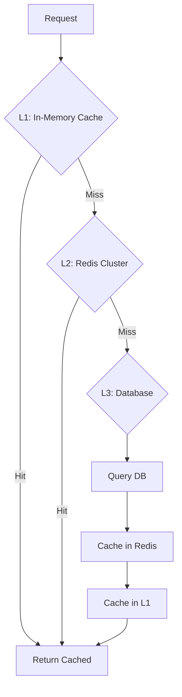
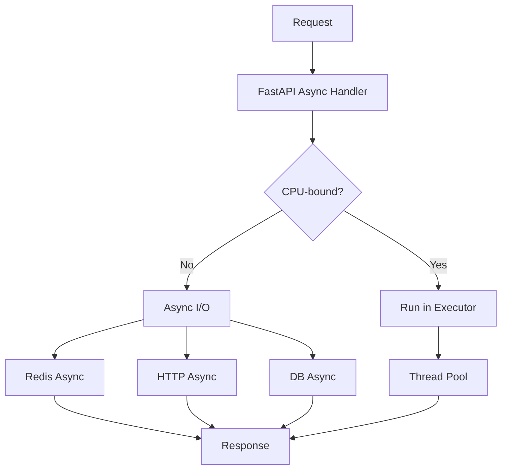
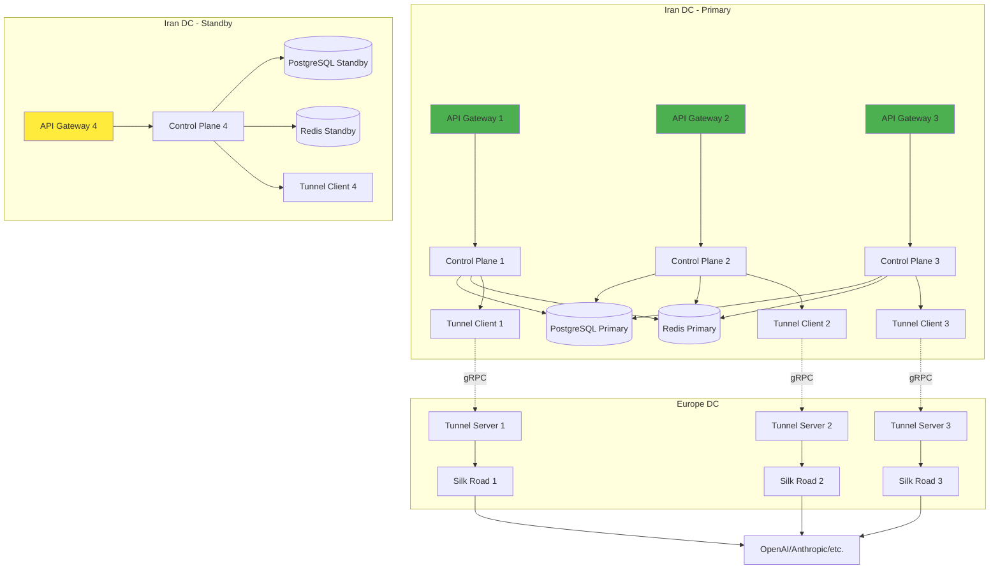
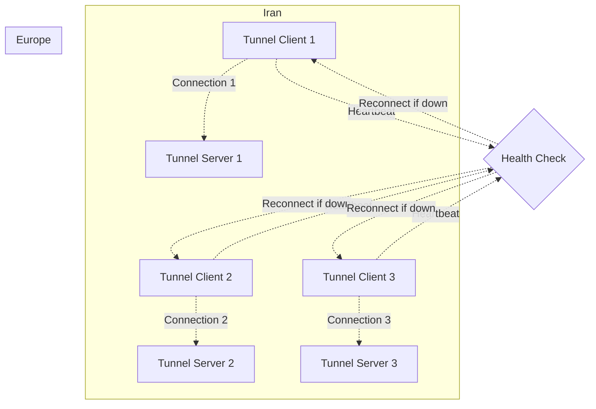

# GodarAI Performance & Availability Architecture

## Overview

This document describes the performance requirements and availability architecture for GodarAI. The target is P95 latency under 10ms for control plane operations (excluding provider network latency), and 99.99% availability for the core gateway services.

## 1. Performance Requirements

### 1.1 Latency Budget

| Operation | Target P50 | Target P95 | Target P99 | Notes |
|-----------|-----------|-----------|-----------|------|
| Tenant Resolution | < 1ms | < 3ms | < 5ms | Cache hit |
| API Key Validation | < 2ms | < 5ms | < 10ms | Redis cache |
| Rate Limit Check | < 1ms | < 2ms | < 5ms | Redis + Lua |
| Budget Check | < 2ms | < 5ms | < 10ms | Redis cache |
| Request Routing | < 1ms | < 3ms | < 5ms | In-memory |
| Tunnel Forward (Iran→EU) | < 30ms | < 80ms | < 120ms | Network latency |
| Response Relay (EU→Iran) | < 30ms | < 80ms | < 120ms | Network latency |
| **Total Control Plane** | **< 7ms** | **< 18ms** | **< 30ms** | Excluding provider |
| **Target Control Plane** | **< 3ms** | **< 10ms** | **< 15ms** | Optimized goal |

### 1.2 Throughput Requirements

| Metric | Target | Notes |
|--------|--------|-------|
| Requests/sec (single instance) | 10,000+ | Control plane only |
| Concurrent connections | 50,000+ | Including streaming |
| Tunnel throughput | 100,000+ req/sec | Iran-Europe link |
| Streaming tokens/sec | 1,000,000+ | Aggregate across tenants |

### 1.3 Availability Requirements

| Service | Target SLA | Max Downtime/Month | Notes |
|---------|-----------|-------------------|-------|
| API Gateway | 99.99% | 4.3 minutes | Core entry point |
| Control Plane | 99.99% | 4.3 minutes | Business logic |
| Tunnel Service | 99.95% | 21.6 minutes | Iran-Europe link |
| Silk Road (EU) | 99.95% | 21.6 minutes | Reverse proxy |
| Database | 99.99% | 4.3 minutes | PostgreSQL |
| Redis Cache | 99.9% | 43.2 minutes | Caching layer |

## 2. Architecture for Performance

### 2.1 Multi-Layer Caching



#### Layer 1: In-Memory Cache (Application)

```go
package cache

import (
	"sync"
	"time"

	"github.com/patrickmn/go-cache"
)

// L1Cache is a thread-safe in-memory L1 cache per application instance.
type L1Cache struct {
	cache *cache.Cache
	mu    sync.RWMutex
}

// NewL1Cache creates a new L1 cache with the given max size and TTL.
func NewL1Cache(maxSize int, ttl time.Duration) *L1Cache {
	return &L1Cache{
		cache: cache.New(ttl, ttl*2),
	}
}

// Get retrieves a value from the L1 cache.
func (c *L1Cache) Get(key string) (interface{}, bool) {
	return c.cache.Get(key)
}

// Set stores a value in the L1 cache.
func (c *L1Cache) Set(key string, value interface{}, ttl time.Duration) {
	c.cache.Set(key, value, ttl)
}

#### Layer 2: Redis Cluster

```go
package cache

import (
	"context"
	"encoding/json"

	"github.com/redis/go-redis/v9"
)

// L2Cache is a Redis cluster cache for shared state.
type L2Cache struct {
	client *redis.Client
}

// NewL2Cache creates a new Redis cache client.
func NewL2Cache(addr string, password string) *L2Cache {
	return &L2Cache{
		client: redis.NewClient(&redis.Options{
			Addr:     addr,
			Password: password,
		}),
	}
}

// Get retrieves a value from Redis.
func (c *L2Cache) Get(ctx context.Context, key string, dest interface{}) (bool, error) {
	data, err := c.client.Get(ctx, key).Bytes()
	if err != nil {
		return false, err
	}
	if err := json.Unmarshal(data, dest); err != nil {
		return false, err
	}
	return true, nil
}

// Set stores a value in Redis with a TTL.
func (c *L2Cache) Set(ctx context.Context, key string, value interface{}, ttl time.Duration) error {
	data, err := json.Marshal(value)
	if err != nil {
		return err
	}
	return c.client.Set(ctx, key, data, ttl).Err()
}

// Delete removes a value from Redis.
func (c *L2Cache) Delete(ctx context.Context, key string) error {
	return c.client.Del(ctx, key).Err()
}

### 2.2 Rate Limiting Architecture

#### Lua Script-Based Rate Limiting

```lua
-- rate_limit.lua
local key = KEYS[1]
local limit = tonumber(ARGV[1])
local window = tonumber(ARGV[2])
local current = tonumber(ARGV[3])

local count = redis.call('GET', key)
if not count then
    count = 0
else
    count = tonumber(count)
end

if count + 1 > limit then
    return {0, tostring(limit - count)}
end

redis.call('INCR', key)
redis.call('EXPIRE', key, window)

return {1, tostring(limit - count - 1)}
```

```go
package ratelimit

import (
	"context"
	"time"

	"github.com/redis/go-redis/v9"
)

// RateLimitResult represents the result of a rate limit check.
type RateLimitResult struct {
	Allowed    bool
	RetryAfter int
}

// RateLimiter is a high-performance rate limiter using Redis Lua scripts.
type RateLimiter struct {
	client *redis.Client
	script *redis.Script
}

// Rate limit Lua script - runs atomically in Redis.
const rateLimitScript = `
local key = KEYS[1]
local limit = tonumber(ARGV[1])
local window = tonumber(ARGV[2])

local count = redis.call('GET', key)
if not count then
    count = 0
else
    count = tonumber(count)
end

if count >= limit then
    local ttl = redis.call('TTL', key)
    return {0, tostring(ttl)}
end

redis.call('INCR', key)
if count == 0 then
    redis.call('EXPIRE', key, window)
end

return {1, "0"}
`

// NewRateLimiter creates a new rate limiter.
func NewRateLimiter(client *redis.Client) *RateLimiter {
	return &RateLimiter{
		client: client,
		script: redis.NewScript(rateLimitScript),
	}
}

// CheckRateLimit checks rate limit in a single Redis round-trip.
func (l *RateLimiter) CheckRateLimit(ctx context.Context, key string, limit int, window time.Duration) (*RateLimitResult, error) {
	result, err := l.script.Run(ctx, l.client, []string{key}, limit, int(window.Seconds())).IntSlice()
	if err != nil {
		return nil, err
	}

	allowed := result[0] == 1
	retryAfter := result[1]
	if !allowed {
		return &RateLimitResult{
			Allowed:    false,
			RetryAfter: retryAfter,
		}, nil
	}

	return &RateLimitResult{Allowed: true}, nil
}

### 2.3 Connection Pooling

#### HTTP Connection Pool Configuration

```go
package httpclient

import (
	"net"
	"net/http"
	"sync"
	"time"
)

// ConnectionPoolManager manages HTTP connection pools for optimal performance.
type ConnectionPoolManager struct {
	mu    sync.Mutex
	pools map[string]*http.Client
}

// NewConnectionPoolManager creates a new connection pool manager.
func NewConnectionPoolManager() *ConnectionPoolManager {
	return &ConnectionPoolManager{
		pools: make(map[string]*http.Client),
	}
}

// GetClient returns or creates an HTTP client with connection pooling for the given service.
func (m *ConnectionPoolManager) GetClient(service, baseURL string) *http.Client {
	m.mu.Lock()
	defer m.mu.Unlock()

	if client, ok := m.pools[service]; ok {
		return client
	}

	transport := &http.Transport{
		DialContext: (&net.Dialer{
			Timeout:   5 * time.Second,
			KeepAlive: 30 * time.Second,
		}).DialContext,
		MaxIdleConns:        1000,
		MaxIdleConnsPerHost: 200,
		IdleConnTimeout:     30 * time.Second,
	}

	client := &http.Client{
		Transport: transport,
		Timeout:   300 * time.Second, // Long for streaming
	}
	m.pools[service] = client
	return client
}

#### Database Connection Pool

```go
package database

import (
	"time"

	"gorm.io/driver/postgres"
	"gorm.io/gorm"
	"gorm.io/gorm/logger"
)

// DatabasePoolManager manages PostgreSQL connection pool.
type DatabasePoolManager struct {
	db *gorm.DB
}

// NewDatabasePoolManager initializes a new database connection pool.
func NewDatabasePoolManager(dsn string) (*DatabasePoolManager, error) {
	sqlDB, err := gorm.Open(postgres.Open(dsn), &gorm.Config{
		Logger: logger.Default.LogMode(logger.Silent),
	})
	if err != nil {
		return nil, err
	}

	db, err := sqlDB.DB()
	if err != nil {
		return nil, err
	}

	// Configure connection pool
	db.SetMaxOpenConns(20)      // Base pool size
	db.SetMaxIdleConns(10)      // Max additional connections
	db.SetConnMaxLifetime(time.Hour) // Recycle connections after 1 hour
	db.SetConnMaxIdleTime(30 * time.Minute)

	return &DatabasePoolManager{db: sqlDB}, nil
}

### 2.4 Async Processing Architecture



```go
package handler

import (
	"context"
	"net/http"
)

// ChatCompletions is a fully async handler for I/O bound operations.
func ChatCompletions(w http.ResponseWriter, r *http.Request) {
	ctx := r.Context()

	// All I/O operations are async
	tenant, err := getTenant(ctx, r)
	if err != nil {
		http.Error(w, "Unauthorized", http.StatusUnauthorized)
		return
	}

	key, err := validateKey(ctx, r)
	if err != nil {
		http.Error(w, "Invalid API key", http.StatusUnauthorized)
		return
	}

	allowed, err := checkRateLimit(ctx, tenant.ID, key.ID)
	if err != nil || !allowed {
		http.Error(w, "Rate limit exceeded", http.StatusTooManyRequests)
		return
	}

	// Forward to tunnel (async via goroutine + channel)
	w.Header().Set("Content-Type", "text/event-stream")
	flusher := w.(http.Flusher)

	responseStream, err := tunnelClient.SendRequest(ctx, r)
	if err != nil {
		http.Error(w, "Internal server error", http.StatusInternalServerError)
		return
	}

	for chunk := range responseStream {
		w.Write(chunk)
		flusher.Flush()
	}
}

// runCPUBoundTask is a CPU-bound task run in a goroutine.
func runCPUBoundTask(ctx context.Context, data map[string]interface{}) (map[string]interface{}, error) {
	// Heavy computation here
	return result, nil
}

// AsyncTask runs a CPU-bound task in a separate goroutine.
func AsyncTask(w http.ResponseWriter, r *http.Request) {
	ctx := r.Context()
	data := parseRequest(r)

	resultCh := make(chan map[string]interface{}, 1)
	errCh := make(chan error, 1)

	go func() {
		result, err := runCPUBoundTask(ctx, data)
		if err != nil {
			errCh <- err
			return
		}
		resultCh <- result
	}()

	select {
	case result := <-resultCh:
		writeJSON(w, result)
	case err := <-errCh:
		http.Error(w, err.Error(), http.StatusInternalServerError)
	case <-ctx.Done():
		http.Error(w, "Request timeout", http.StatusGatewayTimeout)
	}
}

## 3. High Availability Architecture

### 3.1 Deployment Topology



### 3.4 Redis High Availability

#### Redis Sentinel Configuration

```go
package redis

import (
	"context"

	"github.com/redis/go-redis/v9"
)

// RedisHA provides Redis Sentinel for automatic failover.
type RedisHA struct {
	client *redis.Client
}

// NewRedisHA creates a new Redis HA client using Sentinel.
func NewRedisHA(sentinelAddrs []string, masterName, password string) *RedisHA {
	client := redis.NewFailoverClient(&redis.FailoverOptions{
		MasterName:    masterName,
		SentinelAddrs: sentinelAddrs,
		Password:      password,
		DB:            0,
	})
	return &RedisHA{client: client}
}

// GetClient returns the Redis client for operations.
func (r *RedisHA) GetClient() *redis.Client {
	return r.client
}

// Ping checks if the connection is alive.
func (r *RedisHA) Ping(ctx context.Context) error {
	return r.client.Ping(ctx).Err()
}

### 3.5 Tunnel Service High Availability



#### Tunnel Client with Automatic Reconnection

```go
package tunnel

import (
	"context"
	"fmt"
	"time"

	"github.com/rs/zerolog/log"
)

// TunnelClientHA is a high availability tunnel client with automatic reconnection.
type TunnelClientHA struct {
	servers        []string
	currentServer  string
	conn           *Connection
	reconnectCh    chan struct{}
	mu             sync.Mutex
}

// NewTunnelClientHA creates a new HA tunnel client.
func NewTunnelClientHA(servers []string) *TunnelClientHA {
	return &TunnelClientHA{
		servers:     servers,
		reconnectCh: make(chan struct{}, 1),
	}
}

// Connect connects to a tunnel server with exponential backoff retry.
func (c *TunnelClientHA) Connect(ctx context.Context) error {
	var lastErr error
	for attempt := 0; attempt < 5; attempt++ {
		for _, server := range c.servers {
			conn, err := c.createConnection(ctx, server)
			if err != nil {
				log.Error().Err(err).Str("server", server).Msg("Failed to connect")
				lastErr = err
				continue
			}

			c.mu.Lock()
			c.conn = conn
			c.currentServer = server
			c.mu.Unlock()

			go c.maintainConnection(ctx)
			return nil
		}

		// Exponential backoff
		backoff := time.Duration(1<<uint(attempt)) * time.Second
		if backoff > 30*time.Second {
			backoff = 30 * time.Second
		}
		select {
		case <-time.After(backoff):
		case <-ctx.Done():
			return ctx.Err()
		}
	}
	return fmt.Errorf("all tunnel servers unreachable: %w", lastErr)
}

// maintainConnection monitors and reconnects if connection is lost.
func (c *TunnelClientHA) maintainConnection(ctx context.Context) {
	for {
		select {
		case <-c.reconnectCh:
			if err := c.Connect(ctx); err != nil {
				log.Error().Err(err).Msg("Reconnection failed")
				time.Sleep(5 * time.Second)
				c.reconnectCh <- struct{}{}
			}
		case <-ctx.Done():
			return
		}
	}
}

// SendWithFallback sends a request with automatic server fallback.
func (c *TunnelClientHA) SendWithFallback(ctx context.Context, req *TunnelRequest) (*TunnelResponse, error) {
	c.mu.Lock()
	conn := c.conn
	c.mu.Unlock()

	resp, err := conn.Send(ctx, req)
	if err != nil {
		select {
		case c.reconnectCh <- struct{}{}:
		default:
		}
		// Wait for reconnection with timeout
		select {
		case <-time.After(30 * time.Second):
			return nil, ErrReconnectTimeout
		case <-ctx.Done():
			return nil, ctx.Err()
		case <-c.reconnectCh:
		}
		// Retry
		c.mu.Lock()
		conn = c.conn
		c.mu.Unlock()
		return conn.Send(ctx, req)
	}
	return resp, nil
}

## 4. Performance Optimization Techniques

### 4.1 Request Pre-processing

```go
package optimize

import (
	"net/http"
	"regexp"
	"sync"
)

// Pre-compiled regex patterns.
var (
	tenantPattern = regexp.MustCompile(`^([a-z0-9-]+)\.shahrah\.ir$`)
	keyPattern    = regexp.MustCompile(`^sk-[a-zA-Z0-9]{8,}$`)
)

// RequestOptimizer optimizes requests before processing overhead.
type RequestOptimizer struct {
	modelConfigs sync.Map
}

// OptimizedRequest holds optimized request data.
type OptimizedRequest struct {
	TenantSlug     string
	KeyValidFormat bool
	ModelConfig    *ModelConfig
}

// NewRequestOptimizer creates a new request optimizer.
func NewRequestOptimizer() *RequestOptimizer {
	return &RequestOptimizer{}
}

// OptimizeRequest pre-processes and optimizes request handling.
func (o *RequestOptimizer) OptimizeRequest(r *http.Request) *OptimizedRequest {
	optimized := &OptimizedRequest{}

	// 1. Fast tenant extraction (regex match)
	if m := tenantPattern.FindStringSubmatch(r.Host); m != nil {
		optimized.TenantSlug = m[1]
	}

	// 2. Fast key validation (format check before DB lookup)
	apiKey := r.Header.Get("Authorization")
	optimized.KeyValidFormat = keyPattern.MatchString(apiKey)

	// 3. Pre-load model config (in-memory cache)
	optimized.ModelConfig = o.getModelConfigCached(r.URL.Path)

	return optimized
}

### 4.2 Streaming Optimization

```go
package streaming

// StreamingOptimizer optimizes streaming response handling.
type StreamingOptimizer struct{}

// StreamWithBuffering streams with optimized buffering for reduced latency.
func (o *StreamingOptimizer) StreamWithBuffering(source <-chan []byte, bufferSize int) <-chan []byte {
	out := make(chan []byte, 1)
	go func() {
		defer close(out)
		var buffer []byte
		for chunk := range source {
			buffer = append(buffer, chunk...)

			// Send when buffer is full or chunk contains a complete line
			if len(buffer) >= bufferSize || containsNewline(chunk) {
				data := make([]byte, len(buffer))
				copy(data, buffer)
				out <- data
				buffer = buffer[:0]
			}
		}

		// Send remaining buffer
		if len(buffer) > 0 {
			data := make([]byte, len(buffer))
			copy(data, buffer)
			out <- data
		}
	}()
	return out
}

// StreamDirect streams with minimal overhead (lowest latency).
func (o *StreamingOptimizer) StreamDirect(source <-chan []byte) <-chan []byte {
	out := make(chan []byte, 1)
	go func() {
		defer close(out)
		for chunk := range source {
			out <- chunk
		}
	}()
	return out
}

func containsNewline(data []byte) bool {
	for _, b := range data {
		if b == '\n' {
			return true
		}
	}
	return false
}

### 4.3 Response Compression

```go
package middleware

import (
	"compress/gzip"
	"net/http"
)

// GZipMiddleware compresses responses larger than the minimum size.
func GZipMiddleware(next http.Handler) http.Handler {
	return http.HandlerFunc(func(w http.ResponseWriter, r *http.Request) {
		if !acceptsGzip(r) {
			next.ServeHTTP(w, r)
			return
		}

		gzWriter, err := gzip.NewWriterLevel(w, gzip.BestSpeed)
		if err != nil {
			next.ServeHTTP(w, r)
			return
		}
		defer gzWriter.Close()

		w.Header().Set("Content-Encoding", "gzip")
		gzResponseWriter := &gzipResponseWriter{
			ResponseWriter: w,
			Writer:         gzWriter,
		}
		next.ServeHTTP(gzResponseWriter, r)
	})
}

func acceptsGzip(r *http.Request) bool {
	ae := r.Header.Get("Accept-Encoding")
	return ae != "" && (ae == "*" || strings.Contains(ae, "gzip"))
}

## 5. Monitoring & Performance Tracking

### 5.1 Prometheus Metrics

```go
package metrics

import (
	"github.com/prometheus/client_golang/prometheus"
)

var (
	// Request metrics
	RequestLatency = prometheus.NewHistogramVec(
		prometheus.HistogramOpts{
			Name:    "shahrah_request_latency_seconds",
			Help:    "Request latency",
			Buckets: []float64{0.001, 0.005, 0.01, 0.025, 0.05, 0.1, 0.25, 0.5, 1.0},
		},
		[]string{"endpoint", "tenant_id", "status_code"},
	)

	RequestRate = prometheus.NewCounterVec(
		prometheus.CounterOpts{
			Name: "shahrah_requests_total",
			Help: "Total requests",
		},
		[]string{"endpoint", "tenant_id", "status_code"},
	)

	// Cache metrics
	CacheHitRate = prometheus.NewCounterVec(
		prometheus.CounterOpts{
			Name: "shahrah_cache_hits_total",
			Help: "Cache hits",
		},
		[]string{"cache_layer"}, // l1, l2
	)

	CacheMissRate = prometheus.NewCounterVec(
		prometheus.CounterOpts{
			Name: "shahrah_cache_misses_total",
			Help: "Cache misses",
		},
		[]string{"cache_layer"},
	)

	// Tunnel metrics
	TunnelLatency = prometheus.NewHistogramVec(
		prometheus.HistogramOpts{
			Name:    "shahrah_tunnel_latency_seconds",
			Help:    "Tunnel round-trip latency",
			Buckets: []float64{0.01, 0.025, 0.05, 0.1, 0.25, 0.5, 1.0},
		},
		nil,
	)

	// Connection pool metrics
	ConnectionPoolActive = prometheus.NewGauge(
		prometheus.GaugeOpts{
			Name: "shahrah_db_connections_active",
			Help: "Active database connections",
		},
	)

	ConnectionPoolIdle = prometheus.NewGauge(
		prometheus.GaugeOpts{
			Name: "shahrah_db_connections_idle",
			Help: "Idle database connections",
		},
	)
)

func init() {
	prometheus.MustRegister(
		RequestLatency,
		RequestRate,
		CacheHitRate,
		CacheMissRate,
		TunnelLatency,
		ConnectionPoolActive,
		ConnectionPoolIdle,
	)
}

### 5.2 Distributed Tracing

```go
package tracing

import (
	"context"

	"go.opentelemetry.io/otel"
	"go.opentelemetry.io/otel/attribute"
	"go.opentelemetry.io/otel/trace"
)

var tracer = otel.Tracer("shahrah")

// ProcessRequestWithTracing processes a request with distributed tracing.
func ProcessRequestWithTracing(ctx context.Context, r *http.Request) (*Response, error) {
	ctx, span := tracer.Start(ctx, "process_request",
		trace.WithAttributes(
			attribute.String("tenant.id", getTenantID(r)),
			attribute.String("request.model", getModel(r)),
		),
	)
	defer span.End()

	var response *Response
	var err error

	// Validate key
	_, childSpan := tracer.Start(ctx, "validate_key")
	err = validateKey(ctx, r)
	childSpan.End()
	if err != nil {
		return nil, err
	}

	// Tunnel forward
	_, childSpan = tracer.Start(ctx, "tunnel_forward")
	response, err = tunnel.Send(ctx, r)
	childSpan.End()

	return response, err
}

### 5.3 Performance Dashboards

```yaml
# Grafana Dashboard Configuration
dashboard:
  panels:
    - title: "P95 Latency"
      type: graph
      query: histogram_quantile(0.95, rate(shahrah_request_latency_seconds_bucket[5m]))
    
    - title: "Requests/sec"
      type: graph
      query: rate(shahrah_requests_total[1m])
    
    - title: "Cache Hit Rate"
      type: graph
      query: rate(shahrah_cache_hits_total[5m]) / (rate(shahrah_cache_hits_total[5m]) + rate(shahrah_cache_misses_total[5m]))
    
    - title: "Tunnel Latency"
      type: graph
      query: histogram_quantile(0.95, rate(shahrah_tunnel_latency_seconds_bucket[5m]))
    
    - title: "Active Connections"
      type: graph
      query: shahrah_db_connections_active
    
    - title: "Error Rate"
      type: graph
      query: rate(shahrah_requests_total{status_code=~"5.."}[5m]) / rate(shahrah_requests_total[5m])
```

## 6. Capacity Planning

### 6.1 Resource Requirements

| Component | CPU | Memory | Network | Storage |
|-----------|-----|--------|---------|---------|
| API Gateway (per instance) | 2 cores | 4 GB | 1 Gbps | 50 GB |
| Control Plane (per instance) | 4 cores | 8 GB | 1 Gbps | 100 GB |
| Tunnel Client (per instance) | 2 cores | 4 GB | 1 Gbps | 20 GB |
| PostgreSQL (primary) | 8 cores | 32 GB | 10 Gbps | 1 TB SSD |
| Redis (per node) | 2 cores | 16 GB | 1 Gbps | 50 GB |
| Silk Road (per instance) | 4 cores | 8 GB | 10 Gbps | 20 GB |

### 6.2 Scaling Triggers

| Metric | Scale Up | Scale Down |
|--------|----------|------------|
| CPU Utilization | > 70% for 5 min | < 30% for 15 min |
| Memory Utilization | > 80% for 5 min | < 50% for 15 min |
| Request Latency P95 | > 15ms for 5 min | < 5ms for 15 min |
| Active Connections | > 80% of pool | < 40% of pool |
| Queue Depth | > 1000 | < 100 |

### 6.3 Auto-scaling Configuration

```yaml
# Kubernetes HPA Configuration
apiVersion: autoscaling/v2
kind: HorizontalPodAutoscaler
metadata:
  name: shahrah-control-plane-hpa
spec:
  scaleTargetRef:
    apiVersion: apps/v1
    kind: Deployment
    name: shahrah-control-plane
  minReplicas: 3
  maxReplicas: 20
  metrics:
    - type: Resource
      resource:
        name: cpu
        target:
          type: Utilization
          averageUtilization: 70
    - type: Pods
      pods:
        metric:
          name: requests_per_second
        target:
          type: AverageValue
          averageValue: 5000
```

## 7. Disaster Recovery

### 7.1 Recovery Time & Point Objectives

| Service | RTO | RPO | Strategy |
|---------|-----|-----|----------|
| API Gateway | 5 min | 0 | Stateless, auto-recreate |
| Control Plane | 10 min | 0 | Stateless, auto-recreate |
| PostgreSQL | 15 min | 5 min | Streaming replication + PITR |
| Redis | 5 min | 0 | Sentinel + persistence |
| Tunnel Service | 10 min | 0 | Multi-instance, auto-reconnect |

### 7.2 Backup Strategy

```yaml
# PostgreSQL Backup Configuration
backup:
  type: pgbackrest
  schedule: "0 */6 * * *"  # Every 6 hours
  retention: 7 days
  wal_archive: true
  pitr_enabled: true

# Redis Backup Configuration
redis_backup:
  rdb_schedule: "0 */4 * * *"  # Every 4 hours
  aof_enabled: true
  aof_rewrite_schedule: "0 */2 * * *"
```

## 8. Chaos Engineering

### 8.1 Chaos Tests

| Test | Expected Behavior | Frequency |
|------|-------------------|-----------|
| Kill API Gateway instance | Traffic shifts to remaining instances | Weekly |
| Kill Control Plane instance | Traffic shifts to remaining instances | Weekly |
| Database failover | Automatic promotion of standby | Monthly |
| Redis master failover | Sentinel promotes slave | Monthly |
| Tunnel connection drop | Automatic reconnection within 30s | Weekly |
| Network partition Iran-EU | Graceful degradation | Quarterly |

### 8.2 Chaos Testing Tool

```go
package chaostest

import (
	"context"
	"fmt"
	"math/rand"

	metav1 "k8s.io/apimachinery/pkg/apis/meta/v1"
	"k8s.io/client-go/kubernetes"
)

// ChaosTest represents a chaos test configuration.
type ChaosTest struct {
	Title       string
	Description string
	Actions     []ChaosAction
}

// ChaosAction represents a single chaos action.
type ChaosAction struct {
	Name          string
	Namespace     string
	LabelSelector string
}

// KillRandomPod kills a random pod matching the given criteria.
func KillRandomPod(ctx context.Context, clientset *kubernetes.Clientset, action ChaosAction) error {
	pods, err := clientset.CoreV1().Pods(action.Namespace).List(ctx, metav1.ListOptions{
		LabelSelector: action.LabelSelector,
	})
	if err != nil {
		return fmt.Errorf("list pods: %w", err)
	}
	if len(pods.Items) == 0 {
		return fmt.Errorf("no pods found matching %s", action.LabelSelector)
	}

	// Pick a random pod
	idx := rand.Intn(len(pods.Items))
	pod := pods.Items[idx]

	return clientset.CoreV1().Pods(action.Namespace).Delete(ctx, pod.Name, metav1.DeleteOptions{})
}

// RunChaosTest runs the chaos test.
func RunChaosTest(ctx context.Context, clientset *kubernetes.Clientset, test ChaosTest) error {
	for _, action := range test.Actions {
		if err := KillRandomPod(ctx, clientset, action); err != nil {
			return fmt.Errorf("action %s failed: %w", action.Name, err)
		}
	}
	return nil
}

## 9. Performance Checklist

### 9.1 Pre-Deployment Checklist

- [ ] All endpoints have P95 < 10ms targets documented
- [ ] Load tests run with 10x expected traffic
- [ ] Database connection pools configured and tested
- [ ] Redis cluster deployed and validated
- [ ] Caching layers (L1, L2) configured
- [ ] Rate limiting scripts tested
- [ ] Circuit breakers configured for all external services
- [ ] Health checks implemented for all services
- [ ] Auto-scaling policies configured and tested
- [ ] Chaos tests run in staging environment

### 9.2 Post-Deployment Checklist

- [ ] Prometheus metrics flowing to dashboard
- [ ] Distributed tracing enabled
- [ ] Alert thresholds configured
- [ ] SLO monitoring active
- [ ] Error budget tracking active
- [ ] Performance regression tests in CI/CD
- [ ] Load testing scheduled quarterly

## 10. Future Optimization Opportunities

### 10.1 Edge Computing

- Deploy edge caches closer to users
- Use CDN for caching common responses
- Edge-based rate limiting

### 10.2 Protocol Optimization

- Evaluate HTTP/3 (QUIC) for reduced latency
- Custom binary protocol for internal services
- Connection multiplexing improvements

### 10.3 Hardware Optimization

- Use dedicated CPU instances for latency-critical services
- Evaluate ARM-based instances for cost efficiency
- GPU acceleration for embedding processing
