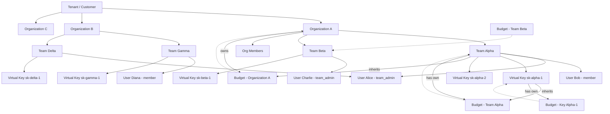
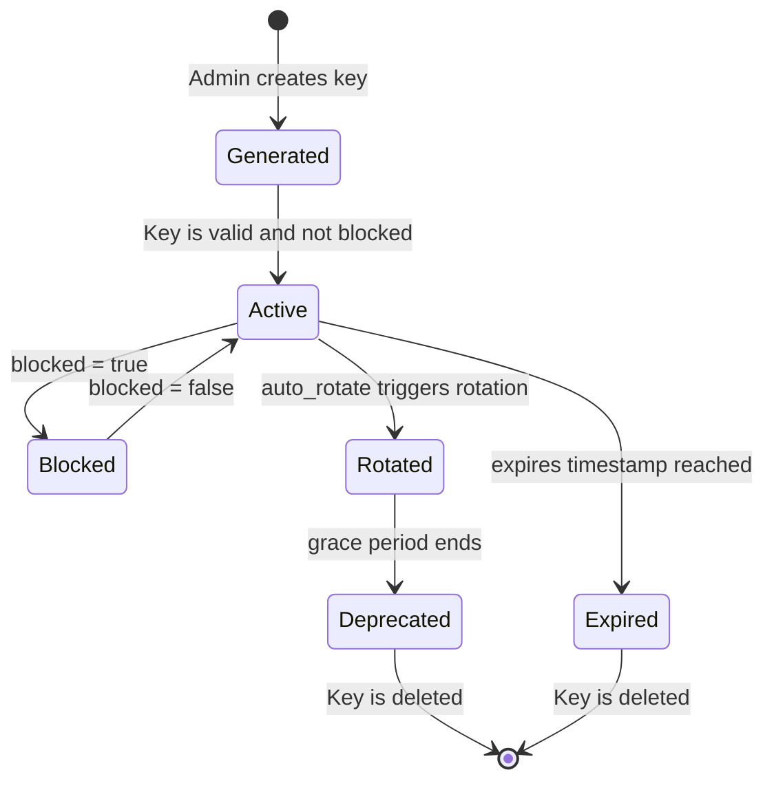

# Shahrah: Organization, Team, and Virtual Key Design

> **Note**: This document describes the LiteLLM-based architecture. For the updated Shahrah-specific design with Tenant subdomains, Organization Units, and Virtual Users, see [tenant-organization-team-design.md](./tenant-organization-team-design.md).

This document defines the hierarchical access control and resource isolation model for Shahrah, inspired by LiteLLM's Organization / Team / Virtual Key architecture. It enables enterprise tenants (customers) to manage multiple isolated organizational units, each with their own teams, budgets, and API keys.

---

## Table of Contents

1. [Overview](#overview)
2. [Core Concepts](#core-concepts)
3. [Hierarchy Diagram](#hierarchy-diagram)
4. [Data Model](#data-model)
5. [LiteLLM Reference Models](#litellm-reference-models)
6. [Shahrah Entity Mapping](#shahrah-entity-mapping)
7. [Virtual Key Design](#virtual-key-design)
8. [Budget and Rate Limiting](#budget-and-rate-limiting)
9. [Access Control and Permissions](#access-control-and-permissions)
10. [API Endpoints](#api-endpoints)
11. [Use Cases](#use-cases)
12. [Implementation Notes](#implementation-notes)

---

## Overview

Shahrah adopts a multi-tenant architecture where each **Tenant** (customer) can create multiple **Organizations**, each containing multiple **Teams**. Every Team can have multiple **Users** (internal members) and **Virtual Keys** (API keys). This structure provides:

- **Isolation**: Organizations are isolated from each other within a tenant
- **Granular Control**: Teams have their own budgets, model access, and rate limits
- **Auditability**: All spend and usage is tracked per key, per team, per organization
- **Scalability**: Large enterprises with multiple business units can manage access independently

### Why This Structure?

Large enterprises (Shahrah tenants) often have multiple departments or business units that need:
- Separate budgets and spending controls
- Different model access policies
- Independent rate limiting
- Isolated audit trails
- Different team member roles and permissions

This design ensures that a single tenant can serve as a unified platform while maintaining strict boundaries between organizational units.

---

## Core Concepts

### Tenant
A **Tenant** represents a paying customer or organization. It is the root isolation boundary. All data within a tenant belongs to that customer.

### Organization
An **Organization** is a logical grouping within a tenant. It represents a business unit, division, or department. Organizations:
- Have their own budget (max spend, TPM/RPM limits)
- Can have multiple teams under them
- Have organization-level admins who manage members and teams
- Track aggregated spend across all their teams

### Team
A **Team** is a working group within an organization. Teams:
- Have their own budget (can be scoped from organization budget)
- Control which models are accessible
- Have team admins and team members
- Generate virtual keys for API access
- Track spend independently

### User (Internal User)
A **User** is an internal user within the Shahrah platform. Users:
- Belong to one or more organizations (via `OrganizationMembership`)
- Belong to one or more teams (via `TeamMembership`)
- Have roles within each context (e.g., `org_admin`, `team_admin`, `member`)
- Can generate personal virtual keys

### Virtual Key
A **Virtual Key** is an API key that authenticates requests to the Shahrah proxy. Keys:
- Are associated with a user and/or team (and optionally an organization)
- Have model access restrictions
- Have budget and rate limit controls (TPM, RPM, max budget)
- Can expire after a configured duration
- Track spend independently
- Support automatic rotation

### Budget
A **Budget** defines spending limits and rate constraints. Budgets can be attached to:
- Organizations
- Teams
- Virtual Keys
- Individual Users (within teams/organizations)

Budgets include:
- `max_budget`: Maximum monetary spend
- `soft_budget`: Warning threshold (does not block requests)
- `tpm_limit`: Tokens per minute limit
- `rpm_limit`: Requests per minute limit
- `budget_duration`: How often the budget resets (e.g., "30d")
- `model_max_budget`: Per-model budget limits

---

## Hierarchy Diagram



### Relationship Rules

1. A **Tenant** contains multiple **Organizations**
2. An **Organization** belongs to exactly one **Tenant**
3. An **Organization** contains multiple **Teams**
4. A **Team** belongs to exactly one **Organization** (can be NULL for standalone teams)
5. A **User** can belong to multiple **Organizations** (via `OrganizationMembership`)
6. A **User** can belong to multiple **Teams** (via `TeamMembership`)
7. A **Virtual Key** is associated with a **User** and/or **Team** (and optionally **Organization**)
8. A **Budget** can be attached to any entity level

---

## Data Model

### Entity Relationships

```
Tenant (1) -----> (N) Organization
Organization (1) -----> (N) Team
Organization (1) -----> (N) OrganizationMembership
Team (1) -----> (N) TeamMembership
Team (1) -----> (N) VirtualKey
User (1) -----> (N) OrganizationMembership
User (1) -----> (N) TeamMembership
User (1) -----> (N) VirtualKey
Budget (1) -----> (N) Organization / Team / VirtualKey / User
```

### Core Tables

| Table | Primary Key | Key Fields | Relations |
|-------|-------------|------------|-----------|
| `Organization` | `organization_id` | `organization_alias`, `budget_id`, `models[]`, `spend`, `metadata` | Belongs to Budget, has Teams, has Users, has Keys |
| `Team` | `team_id` | `team_alias`, `organization_id`, `admins[]`, `members[]`, `members_with_roles[]`, `models[]`, `spend`, `max_budget`, `tpm_limit`, `rpm_limit`, `blocked` | Belongs to Organization, has Members, has Keys |
| `User` | `user_id` | `user_alias`, `user_email`, `user_role`, `teams[]`, `models[]`, `spend`, `max_budget` | Has Memberships, has Keys |
| `VirtualKey` | `token` (hashed) | `key_alias`, `user_id`, `team_id`, `organization_id`, `models[]`, `spend`, `max_budget`, `tpm_limit`, `rpm_limit`, `expires`, `blocked`, `permissions` | Belongs to User/Team/Organization, has Budget |
| `Budget` | `budget_id` | `max_budget`, `soft_budget`, `tpm_limit`, `rpm_limit`, `model_max_budget`, `budget_duration`, `budget_reset_at` | Attached to Org/Team/Key/User |
| `OrganizationMembership` | `(user_id, organization_id)` composite | `user_role`, `spend`, `budget_id` | Links User to Organization |
| `TeamMembership` | `(user_id, team_id)` composite | `spend`, `total_spend`, `budget_id` | Links User to Team |
| `ObjectPermission` | `object_permission_id` | `mcp_servers[]`, `vector_stores[]`, `agents[]`, `models[]` | Attached to Org/Team/Key/User |

---

## Virtual Key Design

### Key Lifecycle



### Key Generation Parameters

When creating a Virtual Key, the following parameters are supported:

| Parameter | Type | Description |
|-----------|------|-------------|
| `key_alias` | `string` | Human-readable name for the key |
| `user_id` | `string` | Owner of the key (optional for service account keys) |
| `team_id` | `string` | Team the key belongs to |
| `organization_id` | `string` | Organization the key belongs to (auto-inherited from team) |
| `models` | `string[]` | Models this key can access (subset of team models) |
| `max_budget` | `float` | Maximum spend for this key |
| `budget_duration` | `string` | Budget reset period (e.g., "30d", "1mo") |
| `tpm_limit` | `int` | Tokens per minute limit |
| `rpm_limit` | `int` | Requests per minute limit |
| `max_parallel_requests` | `int` | Max concurrent requests |
| `duration` | `string` | Key expiration (e.g., "90d"). "-1" means never expires |
| `permissions` | `object` | Key-specific permissions (e.g., PII controls) |
| `blocked` | `bool` | Whether the key is blocked |
| `auto_rotate` | `bool` | Enable automatic key rotation |
| `rotation_interval` | `string` | Rotation frequency (e.g., "30d") |
| `key_type` | `enum` | `llm_api`, `management`, `read_only`, `default` |

### Service Account Keys

Service account keys are keys that belong to a team but not to any specific user. This prevents the key from being deleted when a user leaves the organization.

- Set `user_id = null`
- `team_id` is required
- Key applies team-level limits, not team-member-level limits

### Key Rotation

Keys support automatic rotation:

1. Set `auto_rotate = true` and `rotation_interval` (e.g., "30d")
2. At rotation time, a new key is generated with the same settings
3. The old key enters a deprecated state with a configurable grace period
4. During grace period, both old and new keys work
5. After grace period, old key is permanently disabled

### Budget Inheritance

Keys inherit budgets from their parent entity hierarchy:

```
Organization Budget (top-level)
    └── Team Budget (overrides or adds to org budget)
        └── Key Budget (overrides or adds to team budget)
```

If a key has its own `budget_id`, it uses that budget. Otherwise, it inherits the team's budget. If the team has no budget, it inherits the organization's budget.

---

## Budget and Rate Limiting

### Budget Tiers

Budgets can be configured at multiple levels, creating a hierarchical enforcement model:

```
Level 1: Organization Budget
    ├── max_budget: $10,000/month
    ├── tpm_limit: 1,000,000
    └── rpm_limit: 5,000
    
    Level 2: Team Budget (within Org)
        ├── max_budget: $2,000/month (subset of org budget)
        ├── tpm_limit: 200,000
        └── rpm_limit: 1,000
        
        Level 3: Key Budget (within Team)
            ├── max_budget: $500/month (subset of team budget)
            ├── tpm_limit: 50,000
            └── rpm_limit: 250
```

### Budget Validation Rules

1. **Team budget cannot exceed Organization budget**: When creating a team within an org, the team's `max_budget` must be <= the org's `max_budget`
2. **Key budget cannot exceed Team budget**: Same validation applies at the key level
3. **Model access validation**: A team can only access models that its parent organization allows. A key can only access models that its parent team allows.
4. **TPM/RPM overallocation prevention**: When `tpm_limit_type` or `rpm_limit_type` is set to `guaranteed_throughput`, the system validates that the sum of child budgets does not exceed the parent budget

### Soft Budget vs Hard Budget

- **`max_budget`** (Hard): When reached, all requests with this key/team/org are blocked until budget resets
- **`soft_budget`**: When reached, alerts are triggered (e.g., Slack notification) but requests continue

### Budget Reset

The `budget_duration` field controls how often budgets reset:
- `"30d"`: Reset every 30 days
- `"1mo"`: Reset every month
- `"7d"`: Reset every week
- `"1d"`: Reset every day

The `budget_reset_at` field stores the next reset timestamp, calculated when `budget_duration` is set.

### Concurrent Budget Windows (Advanced)

Keys and teams support multiple concurrent budget windows:

```json
{
  "budget_limits": [
    { "budget_limit": 10.0, "time_period": "1d" },
    { "budget_limit": 50.0, "time_period": "7d" },
    { "budget_limit": 200.0, "time_period": "30d" }
  ]
}
```

This allows fine-grained control: a daily limit, a weekly limit, and a monthly limit can all be enforced simultaneously.

---

## Access Control and Permissions

### User Roles

| Role | Scope | Permissions |
|------|-------|-------------|
| `org_admin` | Organization | Create/delete teams, manage org members, view org spend |
| `team_admin` | Team | Add/remove team members, create team keys, manage team settings |
| `team_member` | Team | Access team resources (scope defined by `team_member_permissions`) |

### Team Member Permissions

Non-admin team members can be granted specific route-level permissions:

```json
{
  "team_member_permissions": [
    "/key/generate",
    "/key/update",
    "/key/delete",
    "/model/new"
  ]
}
```

This allows team admins to delegate key management without granting full admin access.

### Access Validation Flow

When a request arrives with a Virtual Key:

```
1. Validate key exists and is not expired/blocked
2. Check key models against team models
3. Check team models against organization models
4. Check key budget (if key has own budget)
5. Check team budget (inherited)
6. Check organization budget (inherited)
7. Check key TPM/RPM limits
8. Check team TPM/RPM limits
9. Check organization TPM/RPM limits
10. Validate MCP server access (if applicable)
11. Validate agent access (if applicable)
12. Apply policies and guardrails
13. Forward request to upstream provider
```

---

## API Endpoints

### Organization Endpoints

| Method | Endpoint | Description |
|--------|----------|-------------|
| POST | `/organization/new` | Create a new organization |
| PATCH | `/organization/update` | Update organization settings |
| DELETE | `/organization/delete` | Delete an organization |
| GET | `/organization/info` | Get organization details |
| GET | `/organization/list` | List organizations (with optional filters) |
| POST | `/organization/member_add` | Add a member to an organization |
| PATCH | `/organization/member_update` | Update a member's role |
| DELETE | `/organization/member_delete` | Remove a member from an organization |
| GET | `/organization/daily/activity` | Get daily activity analytics |

### Team Endpoints

| Method | Endpoint | Description |
|--------|----------|-------------|
| POST | `/team/new` | Create a new team |
| POST | `/team/update` | Update team settings |
| DELETE | `/team/delete` | Delete a team |
| GET | `/team/info` | Get team details |
| GET | `/team/list` | List teams |
| POST | `/team/member/add` | Add a member to a team |
| POST | `/team/member/delete` | Remove a member from a team |
| POST | `/team/member/add_bulk` | Bulk add members |
| PATCH | `/team/member/update` | Update member settings |
| GET | `/team/daily/activity` | Get daily activity analytics |
| POST | `/team/block` | Block/unblock a team |

### Key Endpoints

| Method | Endpoint | Description |
|--------|----------|-------------|
| POST | `/key/generate` | Generate a new virtual key |
| POST | `/key/service-account/generate` | Generate a service account key |
| POST | `/key/update` | Update key settings |
| POST | `/key/delete` | Delete a key |
| POST | `/key/regenerate` | Regenerate (rotate) a key |
| GET | `/key/info` | Get key details |
| GET | `/key/list` | List keys |
| POST | `/key/batch_update` | Bulk update multiple keys |

### Budget Endpoints

| Method | Endpoint | Description |
|--------|----------|-------------|
| POST | `/budget/new` | Create a new budget |
| PATCH | `/budget/update` | Update budget settings |
| DELETE | `/budget/delete` | Delete a budget |
| GET | `/budget/info` | Get budget details |
| GET | `/budget/list` | List budgets |

---

## Use Cases

### Use Case 1: Enterprise with Multiple Departments

**Scenario**: A large technology company (Tenant: "TechCorp") has three departments: Engineering, Marketing, and HR.

```
Tenant: TechCorp
├── Organization: Engineering
│   ├── Team: Platform (budget: $5,000/mo, models: gpt-4, claude-3)
│   ├── Team: Mobile (budget: $3,000/mo, models: gpt-3.5, claude-haiku)
│   └── Team: Data Science (budget: $8,000/mo, models: all)
├── Organization: Marketing
│   ├── Team: Content (budget: $2,000/mo, models: gpt-4, claude-3)
│   └── Team: Analytics (budget: $1,000/mo, models: gpt-3.5)
└── Organization: HR
    └── Team: Recru (budget: $500/mo, models: gpt-3.5)
```

Each organization has its own admin who manages their teams and budgets. Engineering has a higher budget and access to premium models, while HR has restricted model access and a smaller budget.

### Use Case 2: Multi-Client SaaS Provider

**Scenario**: A SaaS company uses Shahrah to serve multiple clients, each with isolated environments.

```
Tenant: SaaS Provider
├── Organization: Client A
│   ├── Team: Production (budget: $10,000/mo)
│   └── Team: Staging (budget: $1,000/mo)
├── Organization: Client B
│   ├── Team: Production (budget: $15,000/mo)
│   └── Team: Development (budget: $2,000/mo)
└── Organization: Internal
    └── Team: R&D (budget: $5,000/mo)
```

Each client's data, keys, and spend are completely isolated. Client A cannot see or access Client B's resources.

### Use Case 3: Team with Service Account Key

**Scenario**: A team needs a key that persists even when team members leave.

1. Create a Team under an Organization
2. Generate a Service Account Key (`/key/service-account/generate`) with `user_id = null`
3. The key belongs to the team, not any user
4. When team members are deleted, the key remains active
5. The key uses team-level limits (not individual member limits)

### Use Case 4: Automatic Key Rotation

**Scenario**: Security policy requires API keys to rotate every 30 days.

1. Create a key with `auto_rotate = true` and `rotation_interval = "30d"`
2. After 30 days, the system generates a new key with the same settings
3. The old key enters a 7-day grace period (configurable)
4. During grace period, both keys work
5. After grace period, the old key is automatically blocked

---

## Implementation Notes

### Database Schema Recommendations

1. **Use UUIDs for all primary keys**: Ensures global uniqueness and avoids enumeration attacks
2. **Use composite primary keys for membership tables**: `(user_id, organization_id)` and `(user_id, team_id)`
3. **Hash virtual key tokens**: Never store raw API keys. Use SHA-256 or similar hashing
4. **Include audit fields**: `created_at`, `updated_at`, `created_by`, `updated_by` on all tables
5. **Use JSON columns for flexible metadata**: `metadata`, `model_spend`, `router_settings`

### Caching Strategy

1. **Cache key lookups**: Virtual keys are frequently validated on every request. Cache with TTL
2. **Cache team/org objects**: When validating model access and budgets, cache parent entities
3. **Invalidate on update**: Clear caches when keys, teams, or organizations are modified
4. **Use a distributed cache**: For multi-proxy deployments, use Redis or similar

### Spend Tracking

1. **Log every request**: Record `model`, `spend`, `tokens`, `api_key`, `team_id`, `organization_id` in spend logs
4. **Real-time checks**: Before each request, check current spend against budget limits

### Security Considerations

1. **Key format**: Virtual keys should follow a standard format (e.g., `sk-<prefix>-<random>`)
2. **Key exposure**: Only show the full key once at generation. Subsequent responses show a masked version
3. **Audit logging**: Track all key creation, update, and deletion events
4. **Rate limiting at proxy level**: Apply global rate limits in addition to per-key limits
5. **Input validation**: Validate all budget values are non-negative
6. **Access control enforcement**: Validate caller permissions on every management endpoint

### Performance Considerations

1. **Index frequently queried fields**: `team_id`, `organization_id`, `user_id`, `token`
2. **Batch operations**: Support bulk member add/delete, bulk key update
3. **Pagination**: All list endpoints should support pagination
4. **Filtering**: Support filtering by alias, ID, and status on list endpoints
5. **Lazy loading**: Don't load all relations by default. Use explicit includes