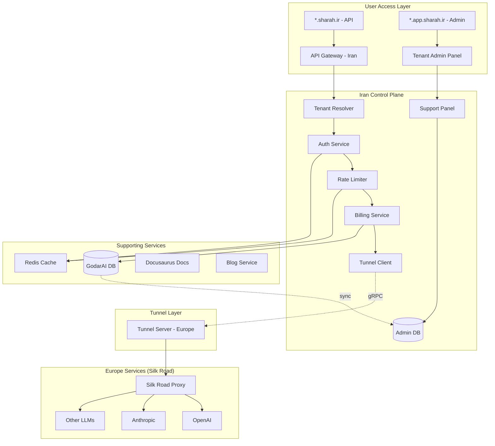

# GodarAI Framework - Documentation Index

## Overview

This directory contains the foundational documentation for **Shahrah** (شاهراه), a unified LLM gateway framework designed for the Iranian market. GodarAI is inspired by LiteLLM's architecture while introducing unique features for the Iranian market including Rial wallet payments, Iran-Europe tunnel service for bypassing sanctions, and multi-tenant subdomain isolation.

## Document Index

| # | Document | File | Status |
|---|----------|------|--------|
| 1 | Iranian Payment System (Wallet & Billing) | [`01_iranian_payment_system.md`](01_iranian_payment_system.md) | ✅ Complete |
| 2 | Multi-Tenant Architecture with On-Premise Support | [`02_multi_tenant_architecture.md`](02_multi_tenant_architecture.md) | ✅ Complete |
| 3 | Subdomain-Based Tenant Access | [`03_subdomain_tenant_access.md`](03_subdomain_tenant_access.md) | ✅ Complete |
| 4 | Microservices Architecture with Iran-Europe Tunnel | [`04_microservices_architecture.md`](04_microservices_architecture.md) | ✅ Complete |
| 5 | Admin Panel for GodarAI Management | [`05_admin_panel.md`](05_admin_panel.md) | ✅ Complete |
| 6 | Docusaurus Documentation System | [`06_docusaurus_documentation.md`](06_docusaurus_documentation.md) | ✅ Complete |
| 7 | Blog Service (Future) | [`07_blog_service.md`](07_blog_service.md) | ✅ Complete |
| 8 | SDK Development Strategy | [`08_sdk_development_strategy.md`](08_sdk_development_strategy.md) | ✅ Complete |
| 9 | GodarAI Features (LiteLLM-Inspired) | [`09_shahrah_features.md`](09_shahrah_features.md) | ✅ Complete |
| 10 | Performance & Availability Architecture | [`10_performance_availability.md`](10_performance_availability.md) | ✅ Complete |

| 11 | Observability Platform Implementation Plan | [`observability-platform-implementation-plan.md`](observability-platform-implementation-plan.md) | ✅ Complete |

## Architecture Summary

## Key Design Decisions

### 1. Payment System
- **Rial Wallet**: Customers top up in IRR through Iranian payment gateways
- **USD Token Pricing**: Token consumption priced in USD, converted at real-time rates
- **Exchange Rate API**: Real-time rate fetching from external providers
- **Tax Handling**: 9% VAT on subscription fees

### 2. Multi-Tenancy
- **Row-Level Isolation**: Shared database with `tenant_id` filtering
- **On-Premise Ready**: Architecture designed for future extraction to dedicated deployments
- **Subdomain Access**: `tenant.sharah.ir` for API, `tenant.app.sharah.ir` for admin

### 3. Iran-Europe Tunnel
- **gRPC Bidirectional Streaming**: Low-latency, secure tunnel between Iran and Europe
- **Silk Road Proxy**: Stateless reverse proxy in Europe, no business logic
- **mTLS Security**: Mutual TLS authentication between tunnel endpoints

### 4. Technology Stack
- **Backend**: Go (chi router, net/http) for both GodarAI Control Plane and Silk Road
- **Frontend**: Next.js + TailwindCSS + shadcn/ui for admin panels
- **Database**: PostgreSQL with Prisma ORM (Python) / GORM (Go)
- **Cache**: Redis Cluster with Sentinel (go-redis)
- **RPC**: gRPC with Protocol Buffers for Iran-Europe tunnel
- **SDKs**: Turborepo monorepo with TypeScript, Python, Next.js, NestJS packages

## Performance Targets

| Metric | Target |
|--------|--------|
| P95 Control Plane Latency | < 10ms |
| Availability | 99.99% |
| Throughput (single instance) | 10,000+ req/sec |

## Next Steps

1. **Review & Approve**: Review these documents and provide feedback
2. **Switch to Code Mode**: Begin implementation starting with:
   - Core project structure and monorepo setup
   - Database schema (Prisma)
   - Tenant resolution middleware
   - Tunnel gRPC protocol
   - Payment gateway integration
3. **Iterative Development**: Build in phases, starting with MVP features

## Recent Delivery Notes

- **2026-04-28**: Wallet top-up intent/callback/verify flow delivered in `services/control-plane` with provider adapters for `mock`, `zarinpal`, and `idpay`, plus idempotent wallet crediting and transaction auditing.

## LiteLLM Inspiration

GodarAI draws heavily from LiteLLM's proven architecture:
- OpenAI-compatible API interface
- Provider transformation patterns
- Router/load balancing strategies
- Caching system design
- Callback/observability framework
- Guardrail/content moderation system

See [`09_shahrah_features.md`](09_shahrah_features.md) for detailed feature mapping.
