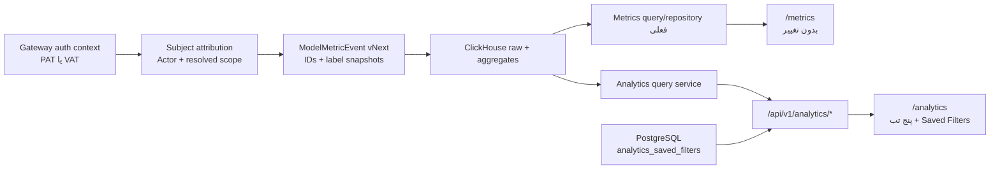

# Implementation Plan: تجربه Analytics گدارAI

## Objective

ساخت صفحه مستقل `/analytics` در لایه `tenant-admin` با تجربه چندتب و Saved Filters مشابه منطق Portkey، بدون حذف، Redirect یا Regression در صفحه فعلی `/metrics`.

خروجی MVP باید:

- پنج تب `Overview`، `Subjects`، `Errors`، `Cache` و `Summary` داشته باشد؛
- تب، Widget، Filter یا API مربوط به Feedback نداشته باشد؛
- چهار Subject گدارAI—کاربر حقیقی، کاربر مجازی، تیم و واحد سازمانی—را Filter، Rank و Group کند؛
- هر Request را به یک Actor اصلی و حداکثر یک تیم و واحد سازمانی نسبت دهد؛
- Predicateهای Analytics را به‌صورت Saved Filter ذخیره، اعمال، ویرایش، Rename، Update و Delete کند؛
- از ClickHouse و Metrics pipeline فعلی reuse کند و بر Inference hot path اثر مسدودکننده نگذارد؛
- صفحه و Endpoint فعلی Metrics را سازگار نگه دارد.

سند محصول مرجع:

- `plans/analytics-experience-prd.md`

## Inputs Reviewed

### Portkey

- `.portkey-docs/markdown/product/docs__product__observability__analytics.md`
- `.portkey-docs/markdown/product/docs__product__observability__filters.md`

از Portkey فقط مستندات و رفتار محصولی استفاده شده است؛ Source Code آن بررسی یا کپی نشده است.

### GodarAI plans

- `plans/README.md`
- `plans/analytics-experience-prd.md`
- `plans/observability-platform-implementation-plan.md`
- `plans/model-metrics-clickhouse-implementation-plan.md`
- `plans/model-metrics-contract-v2.md`
- `plans/model-metrics-runbook.md`
- `plans/tenant-organization-team-design.md`
- `plans/organization-team-virtualkey-design.md`
- `plans/phase2-tenant-admin-iam-rbac.md`
- `plans/database-conceptual-model.md`

### Existing code and schema

- `apps/tenant-admin/app/metrics/page.tsx`
- `apps/tenant-admin/app/components/model-metrics-dashboard.tsx`
- `apps/tenant-admin/app/components/model-metrics-utils.ts`
- `apps/tenant-admin/app/traces/[traceID]/page.tsx`
- `apps/tenant-admin/components/ui`
- `apps/tenant-admin/components/app-ui`
- `packages/contracts/platform/metrics.go`
- `packages/contracts/platform/types.go`
- `packages/contracts/platform/iam_entities.go`
- `packages/contracts/platform/logs_v2.go`
- `services/control-plane/internal/storage/auth_repo.go`
- `services/control-plane/internal/storage/metrics_repo_clickhouse.go`
- `services/control-plane/internal/storage/log_saved_views_repo.go`
- `services/control-plane/internal/admin/metrics_handlers.go`

## Fact، Recommendation و Assumption

### Fact

- `/metrics` اکنون Route فعال `tenant-admin` و مصرف‌کننده Metrics API موجود است.
- `ModelMetricEvent` فعلی فیلدهای `user_id`، `user_email`، `virtual_account_*` و آرایه‌های `team_ids/team_names` دارد.
- Auth context گدارAI `user_id`، `virtual_user_id`، `team_id` و `org_unit_id` را می‌شناسد.
- VAT هنگام صدور می‌تواند Scope کاربر مجازی، تیم و واحد سازمانی را resolve کند.
- Logs از قبل الگوی Tenant-safe برای Saved Views دارد.
- مدل IAM اجازه عضویت یک User در چند Team یا Org Unit را می‌دهد.

### Recommendation

- قرارداد canonical Analytics به‌جای آرایه عضویت‌ها، یک Actor و Scope resolved همان Request را ثبت کند.
- Event شامل ID و Label snapshot شود تا Query Analytics به Join زمان اجرا با IAM نیاز نداشته باشد.
- `/analytics` API دامنه‌ای مستقل داشته باشد، ولی repository و aggregateهای Metrics را reuse کند.
- Saved Filters جدول و API مخصوص Analytics داشته باشند و در MVP با Saved Views لاگ ادغام نشوند.
- Metrics و Analytics در Navigation دو Job-to-be-done روشن و دو Route مستقل داشته باشند.

### Assumption

- نام فارسی Route جدید «تحلیل‌ها» و نام Route فعلی «متریک مدل‌ها» باقی می‌ماند.
- Dataset قابل مشاهده در MVP Tenant-wide و تحت مجوز `analytics:read` است.
- Team/Org Unit filter و group در MVP وجود دارد، ولی محدودسازی کل Dataset بر اساس Scope نقش به فاز بعد می‌رود.
- Time Range، Tab، Subject type، Latency selector و Group By داخل Saved Filter ذخیره نمی‌شوند.
- Retention انتخاب‌پذیر MVP حداکثر ۹۰ روز است.

## Scope Decisions

### Include now

- Route و Navigation مستقل `/analytics`؛
- حفظ `/metrics` بدون Redirect؛
- Subject attribution برای چهار نوع؛
- Analytics query و facets؛
- پنج تب بدون Feedback؛
- Filter bar مشترک و URL state؛
- Saved Filter CRUD با scopeهای `tenant` و `private`؛
- IRR/USD، Errors، Cache و Summary؛
- RBAC، Audit، Tenant isolation، RTL، Accessibility و Telemetry؛
- Drill-down به Logs؛
- تست Regression مسیر Metrics.

### Defer

- Team/Org Unit-scoped authorization برای محدودکردن کل Dataset؛
- مقایسه بازه فعلی با بازه قبلی؛
- Metadata و Trace ID پیشرفته؛
- Export، Report و Scheduled report؛
- ادغام Saved Filters با Logs؛
- تصمیم درباره Deprecation یا همگرایی احتمالی `/metrics`؛
- Workspace-level analytics access override.

### Exclude

- Feedback tab، Widget، Filter و weighted feedback؛
- فعالیت Login یا Session اعضای پنل؛
- Query/SQL آزاد؛
- دسترسی مستقیم UI به ClickHouse؛
- ثبت Raw PAT/VAT، Token hash، Prompt یا Response در Metrics event.

## Architecture



قواعد معماری:

- Attribution failure نباید Inference را Fail کند؛ Event با Actor ناشناخته و Scope خالی ثبت می‌شود.
- Tenant ID فقط از Auth context گرفته می‌شود.
- UI Analytics قرارداد ClickHouse یا Metrics aggregate داخلی را نمی‌شناسد.
- Query هر تب فقط Widgetهای همان تب را محاسبه می‌کند.
- IAM lookup در Query hot path ممنوع است؛ Facet و Group By بر snapshot event اجرا می‌شوند.
- Queryهای قابل استفاده مجدد به repository فعلی Metrics delegate می‌شوند.

## Data Model

### Metric event vNext

فیلدهای P0:

| Field | Type | Nullable | Source |
|---|---|---:|---|
| `actor_type` | `real_user|virtual_user|unknown` | خیر | نوع Credential/Auth context |
| `actor_id` | UUID | بله | `user_id` یا `virtual_user_id` |
| `actor_label_snapshot` | string | بله | نام/alias امن در لحظه Request |
| `resolved_team_id` | UUID | بله | Scope صریح Credential/Request |
| `resolved_team_label_snapshot` | string | بله | نام تیم در لحظه Request |
| `resolved_org_unit_id` | UUID | بله | Scope صریح یا Parent تیم |
| `resolved_org_unit_label_snapshot` | string | بله | نام واحد در لحظه Request |
| `credential_type` | `pat|vat|other` | خیر | Auth context |
| `credential_id` | UUID | بله | شناسه امن Credential |
| `cost_irr` | decimal | بله | Cost snapshot |
| `total_tokens` | uint | خیر | Derived یا stored |
| `fallback_count` | uint | خیر | Request lifecycle |
| `fallback_status` | string | بله | Request lifecycle |
| `final_status_code` | uint16 | بله | نتیجه نهایی |

قواعد:

- `actor_type=real_user` فقط با `actor_id=user_id` و `virtual_user` فقط با `actor_id=virtual_user_id` ساخته شود.
- تیم از همه Membershipهای Actor استخراج نمی‌شود؛ فقط Scope resolved Request معتبر است.
- Org Unit از Scope صریح یا Parent تیم در لحظه Request resolve می‌شود.
- هر Event صفر یا یک Team و صفر یا یک Org Unit دارد.
- Label snapshot برای Subject حذف‌شده یا تغییرنام‌یافته حفظ می‌شود.
- Eventهای Legacy فقط با Evidence قطعی backfill می‌شوند؛ موارد مبهم `unknown` می‌مانند.

### ClickHouse

- ستون‌های جدید nullable یا دارای default سازگار اضافه شوند.
- Raw table منبع Group By چهار Subject باشد.
- aggregateهای کم‌کاردینالیتی موجود برای Overview و Model حفظ شوند.
- Materialized View Subject فقط پس از Benchmark و اثبات نقض SLO اضافه شود.
- Dictionary یا Join زنده IAM در مسیر Query اصلی اضافه نشود.

### PostgreSQL Saved Filters

جدول پیشنهادی `analytics_saved_filters`:

- `id UUID PK`
- `tenant_id UUID NOT NULL`
- `name VARCHAR(120) NOT NULL`
- `shared_scope VARCHAR(16) NOT NULL` با مقادیر `tenant|private`
- `schema_version INT NOT NULL`
- `filters JSONB NOT NULL`
- `created_by_user_id UUID NOT NULL`
- `version INT NOT NULL DEFAULT 1`
- `created_at TIMESTAMPTZ NOT NULL`
- `updated_at TIMESTAMPTZ NOT NULL`

Constraint و Index:

- نام normalize‌شده در Scope مالک یکتا باشد؛
- `(tenant_id, shared_scope, updated_at DESC)`؛
- `(tenant_id, created_by_user_id, updated_at DESC)`؛
- Lookup، Update و Delete همیشه با `tenant_id` انجام شود.

## API Contract

### Analytics query

```http
POST /api/v1/analytics/query
```

```json
{
  "tab": "subjects",
  "startTs": "2026-07-22T08:00:00.000Z",
  "endTs": "2026-07-23T08:00:00.000Z",
  "filters": [
    {
      "fieldName": "resolvedTeamID",
      "operator": "IN",
      "value": ["2d2707b0-14a9-4ac3-b341-86b30c819ee8"]
    }
  ],
  "intervalInSeconds": 300,
  "options": {
    "subjectType": "virtualUser",
    "latencyMetric": "p50",
    "groupBy": null,
    "sortBy": "requests",
    "sortOrder": "desc",
    "limit": 25,
    "cursor": null
  }
}
```

Allow-list:

- `tab`: `overview|subjects|errors|cache|summary`
- `subjectType`: `realUser|virtualUser|team|orgUnit`
- Subject filter fields:
  - `actorType`
  - `realUserID`
  - `virtualUserID`
  - `resolvedTeamID`
  - `resolvedOrgUnitID`

Validation:

- `actorType=real_user` و `virtualUserID` با هم `400` هستند.
- Range بیش از Retention یا `startTs >= endTs` برابر `400` است.
- Field، Operator، Group By و Sort ناشناخته برابر `400` است.
- Timeout یا partial widget failure با `warnings` پاسخ داده شود؛ failure کلی فقط وقتی هیچ داده قابل اتکایی قابل تولید نیست.

### Facets

```http
GET /api/v1/analytics/facets?field=realUserID&q=ali&startTs=...&endTs=...&limit=50
```

- Tenant، Time Range و Predicateهای سازگار را رعایت کند.
- Search server-side و Cursor/hasMore داشته باشد.
- Subjectهای تاریخی حذف‌شده را از snapshot event برگرداند.
- Email و Label حساس را مطابق permission mask کند.
- Secret یا Token hash هرگز بازنگرداند.

### Saved filters

```http
GET    /api/v1/analytics/saved-filters
POST   /api/v1/analytics/saved-filters
PATCH  /api/v1/analytics/saved-filters/:id
DELETE /api/v1/analytics/saved-filters/:id
```

- `expectedVersion` برای Update/Rename لازم است.
- Conflict نسخه یا نام برابر `409` است.
- Delete نیاز به مجوز و ثبت Audit دارد.
- Apply کردن Saved Filter، Tab، Time Range، Subject type و Group By جاری را تغییر نمی‌دهد.

### Metrics compatibility

- `POST /api/v1/metrics/query` تغییر ناسازگار نمی‌کند.
- `apps/tenant-admin/app/metrics/page.tsx` Redirect نمی‌شود.
- تغییر Event با default/nullable و dual-read سازگار عرضه می‌شود.

## Work Breakdown

### Phase 0 — Contract freeze و baseline

- [ ] Fixture مرجع شامل هر چهار Subject و حالت‌های unknown تهیه شود.
- [ ] الگوریتم Subject attribution با تیم IAM/Security تأیید شود.
- [ ] JSON contract Analytics query/facets/saved filters نهایی شود.
- [ ] Golden response صفحه فعلی `/metrics` و Queryهای متداول آن ثبت شود.
- [ ] Permissionهای `analytics:read` و `analytics:saved_filters_manage` به catalog اضافه شوند.
- [ ] Feature flag پیشنهادی `ANALYTICS_EXPERIENCE_ENABLED` تعریف شود.

Exit criteria:

- برای PAT، VAT، Tenant-level، Team-level، Org Unit-level و Legacy event نتیجه انتساب قطعی مستند و تست‌پذیر باشد.

### Phase 1 — Subject attribution و ingest

- [ ] `packages/contracts/platform/metrics.go` با فیلدهای vNext توسعه یابد.
- [ ] Auth/Gateway mapping برای PAT و VAT اضافه شود.
- [ ] Resolver تیم و واحد سازمانی از Credential scope پیاده‌سازی شود.
- [ ] Label snapshot با fallback امن ساخته شود.
- [ ] ClickHouse migration برای ستون‌های جدید اضافه شود.
- [ ] `metrics_repo_clickhouse.go` insert mapping به‌صورت backward-compatible به‌روزرسانی شود.
- [ ] Processor و fixtureهای ingest برای unknown/partial attribution پوشش داده شوند.
- [ ] Telemetry نرخ `actor_type=unknown` و Scope خالی ثبت شود.

Exit criteria:

- Event جدید در ClickHouse قابل Query باشد، Metrics قدیمی کار کند و خطای enrichment inference را Fail نکند.

### Phase 2 — Analytics query backend

- [ ] قراردادها در `packages/contracts/platform/analytics.go` اضافه شوند.
- [ ] orchestration دامنه‌ای در `services/control-plane/internal/analyticsquery` یا package هم‌سطح ساخته شود.
- [ ] queryهای Overview، Subjects، Errors، Cache و Summary پیاده‌سازی شوند.
- [ ] facetهای چهار Subject و فیلدهای P0 پیاده‌سازی شوند.
- [ ] Field/operator/group/sort allow-list و limitها enforce شوند.
- [ ] Handlerها و routeهای tenant-admin اضافه شوند.
- [ ] Cancellation، timeout، partial warning و cache کوتاه پیاده‌سازی شوند.
- [ ] Benchmark بازه‌های ۱h/۲۴h/۷d/۳۰d/۹۰d اجرا شود.

Exit criteria:

- Queryهای P0 با Fixture درست و SLO PRD را پاس کنند و هیچ Query بدون Tenant predicate اجرا نشود.

### Phase 3 — Saved Filters backend

- [ ] Migration PostgreSQL برای `analytics_saved_filters` اضافه شود.
- [ ] Repository با الگوی `log_saved_views_repo.go` و مدل مستقل ساخته شود.
- [ ] CRUD، normalize نام، optimistic concurrency و `409` پیاده‌سازی شود.
- [ ] scopeهای `tenant` و `private` و permissionها enforce شوند.
- [ ] Audit برای Create/Update/Rename/Delete ثبت شود.
- [ ] Schema version و validation Predicate ذخیره‌شده اضافه شود.

Exit criteria:

- CRUD، conflict، tenant isolation، owner/private و migration forward/rollback تست شده باشند.

### Phase 4 — Tenant Admin shell، Route و state

- [ ] پیش از UI، `docs/design-system/DESIGN.md` و `COMPONENT_USAGE.md` دوباره مرور شوند.
- [ ] Route جدید `apps/tenant-admin/app/analytics/page.tsx` ساخته شود.
- [ ] آیتم «تحلیل‌ها» کنار آیتم موجود «متریک مدل‌ها» اضافه شود.
- [ ] صفحه، Navigation و لینک‌های `/metrics` بدون Redirect و تغییر ناسازگار حفظ شوند.
- [ ] app-route proxyهای `apps/tenant-admin/app/api/analytics/*` اضافه شوند.
- [ ] URL codec برای Tab، Time Range، filters، latency، subject type و group by ساخته شود.
- [ ] shell صفحه و responsive/sticky behavior با RTL/LTR پیاده‌سازی شود.
- [ ] Translationهای فارسی و انگلیسی اضافه شوند.

Exit criteria:

- هر دو Route مستقل باز شوند، Refresh state را حفظ کند و تست Metrics baseline پاس بماند.

### Phase 5 — Filter bar و Saved Filter UX

- [ ] `AnalyticsFilterBar` با Componentهای موجود Design System ساخته شود.
- [ ] Editorهای searchable multi-select، range و exact input پیاده‌سازی شوند.
- [ ] Chipهای commit‌شده و منطق AND/IN پیاده‌سازی شوند.
- [ ] Create، Apply، Dirty، Update، Cancel، Edit، Rename و Delete Saved Filter ساخته شوند.
- [ ] Time Range، Tab، Subject type، Latency و Group By از Dirty detection خارج شوند.
- [ ] Deep-link با `saved_filter_id` و state حذف‌شده/غیرمجاز پوشش داده شود.
- [ ] اگر pattern جدید reusable شد، Design System playground به‌روزرسانی شود.

Exit criteria:

- تمام stateهای Saved Filter PRD با Keyboard، RTL و Error/Conflict قابل استفاده باشند.

### Phase 6 — Tabها و Drill-down

- [ ] Overview با IRR/USD، Tokens، Latency، Requests، Active Actors، Top Subjects و Top Models.
- [ ] Subjects با selector چهار نوع، Active/Top/Cost/Trend و drill-down.
- [ ] Errors با Error rate/count/type، Rescued Requests و trend.
- [ ] Cache با hit rate، speedup، savings، mode/match breakdown.
- [ ] Summary با Group By چهار Subject و سایر ابعاد P0، sort و pagination server-side.
- [ ] Deep-link Analytics به Logs با انتقال Predicateهای قابل تبدیل.
- [ ] Empty، loading، partial error و stale-data state هر Widget.

Exit criteria:

- هیچ Feedback surface وجود نداشته باشد و هر Request در Breakdown هر Subject حداکثر یک بار شمرده شود.

### Phase 7 — Hardening و rollout

- [ ] Reconciliation هزینه IRR/USD با Spend/Wallet.
- [ ] Load test و Query cancellation.
- [ ] Accessibility، RTL/LTR، mobile و keyboard E2E.
- [ ] Security test برای tenant isolation، IDOR و فیلترهای دست‌کاری‌شده.
- [ ] Internal tenant rollout پشت Feature flag.
- [ ] Pilot tenant rollout با داشبورد unknown attribution و query latency.
- [ ] GA در کنار `/metrics`.
- [ ] Telemetry مقایسه استفاده `/metrics` و `/analytics` برای تصمیم محصولی آینده.

Exit criteria:

- SLO، correctness، security و Regression gateها پاس شوند و rollback فقط با خاموش‌کردن Feature flag ممکن باشد.

## Suggested Code Changes

### Frontend

- `apps/tenant-admin/app/analytics/page.tsx`
- `apps/tenant-admin/app/components/analytics-dashboard.tsx`
- `apps/tenant-admin/app/components/analytics-filter-bar.tsx`
- `apps/tenant-admin/app/components/analytics-saved-filter-actions.tsx`
- `apps/tenant-admin/app/components/analytics-subjects-tab.tsx`
- `apps/tenant-admin/app/components/analytics-url-state.ts`
- `apps/tenant-admin/app/api/analytics/*`
- `apps/tenant-admin/messages/modules/analytics/fa.json`
- `apps/tenant-admin/messages/modules/analytics/en.json`
- Navigation source فعلی `tenant-admin`
- `apps/tenant-admin/app/design-system/page.tsx` فقط در صورت افزودن pattern reusable

### Contracts and backend

- `packages/contracts/platform/analytics.go`
- `packages/contracts/platform/metrics.go`
- `services/control-plane/internal/admin/analytics_handlers.go`
- `services/control-plane/internal/analyticsquery/*`
- `services/control-plane/internal/storage/analytics_saved_filters_repo.go`
- `services/control-plane/internal/storage/metrics_repo_clickhouse.go`
- `services/control-plane/internal/observability/metrics/processor.go`
- `services/control-plane/internal/server/routes_tenant_admin.go`

### Migrations and docs

- `infra/k8s/local/migrations/*_analytics_saved_filters.sql`
- `infra/clickhouse/migrations/*_analytics_subject_attribution.sql`
- `apps/docs/docs/observability-analytics.mdx`
- Cross-link غیرمخرب در `apps/docs/docs/observability-model-metrics.mdx`

## Testing Strategy

### Unit

- Subject resolver برای PAT، VAT، Team، Org Unit و unknown؛
- جلوگیری از الصاق همه Membershipهای Actor؛
- URL codec و filter reducer؛
- Saved Filter dirty detection و version conflict؛
- Metric definitions و interval selection؛
- predicate validation و field mapping.

### Backend integration

- ClickHouse insert/query برای هر چهار Subject؛
- حذف/تغییرنام Subject و حفظ Label تاریخی؛
- request بدون Team/Org Unit؛
- Legacy event مبهم؛
- Summary group/sort/pagination؛
- Facet high-cardinality و masking؛
- Saved Filter CRUD و tenant isolation؛
- Query cancellation و partial warning؛
- IRR/USD، Cache و Error reconciliation.

### Regression

- `/metrics` همچنان Component فعلی را Render کند؛
- Query Parameterهای پشتیبانی‌شده Metrics حفظ شوند؛
- `POST /api/v1/metrics/query` پاسخ سازگار بدهد؛
- لینک فعلی Trace به Metrics همچنان `/metrics` را باز کند؛
- migration ستون‌های جدید insertهای قدیمی را نشکند.

### Frontend integration and E2E

- Navigation مستقل Metrics و Analytics؛
- نبود Redirect بین دو Route؛
- حفظ Filter/Time Range هنگام تغییر Tab؛
- انتخاب چهار Subject و افزودن Subject filter؛
- تمام عملیات Saved Filter؛
- Deep-link معتبر، حذف‌شده و غیرمجاز؛
- RTL فارسی، LTR انگلیسی، mobile و keyboard-only؛
- loading، empty، partial error و stale data؛
- Analytics به Logs با Context قابل تبدیل.

### Performance

- ۱h، ۲۴h، ۷d، ۳۰d و ۹۰d؛
- cardinality بالای Real User، Virtual User، Team و Org Unit؛
- پنج Widget هم‌زمان؛
- facet search؛
- تغییر سریع filter و cancellation؛
- مقایسه Raw query و aggregate برای تصمیم Materialized View.

## Rollout Plan

1. Migrationهای additive PostgreSQL و ClickHouse.
2. Deploy event writer با dual-compatible schema.
3. مشاهده unknown attribution و ingest error حداقل یک چرخه ترافیک.
4. Deploy read-only Analytics query/facets.
5. Deploy Saved Filters backend.
6. Deploy UI پشت `ANALYTICS_EXPERIENCE_ENABLED`.
7. فعال‌سازی Tenant داخلی.
8. Pilot برای Tenantهای منتخب.
9. GA مرحله‌ای؛ `/metrics` در تمام مراحل فعال می‌ماند.

Rollback:

- Feature flag فقط Route/Nav Analytics را غیرفعال کند.
- Writer جدید با ستون‌های nullable/default قابل ادامه یا rollback باشد.
- Migration additive حذف فوری نشود.
- Saved Filterها حفظ شوند.
- Metrics page و endpoint مسیر fallback محصولی باقی بمانند.

## Observability and Product Telemetry

- Analytics query latency و timeout به تفکیک Tab/Range؛
- partial widget failure؛
- facet latency و zero-result rate؛
- Saved Filter create/apply/update/conflict؛
- `actor_type=unknown`؛
- درصد Requestهای بدون Team یا Org Unit؛
- drill-down به Logs؛
- adoption و session depth `/analytics`؛
- استفاده مقایسه‌ای `/metrics` و `/analytics` بدون تصمیم خودکار برای حذف Metrics.

## Release Gates

- [ ] صفر مورد Tenant isolation failure.
- [ ] صفر Secret در URL، Facet، Table یا browser log.
- [ ] نرخ unknown attribution در محدوده تأییدشده محصول.
- [ ] عدم دوباره‌شماری Request/Cost در چهار Subject با fixture مرجع.
- [ ] Cost reconciliation در tolerance مصوب.
- [ ] Query p95 مطابق PRD.
- [ ] Metrics Regression suite سبز.
- [ ] RTL، Accessibility و mobile E2E سبز.
- [ ] Runbook و مستند کاربری منتشرشده.

## Open Questions

1. Label snapshot کاربر حقیقی نام نمایشی باشد یا Email mask‌شده؟
2. Credential قدیمی بدون Scope صریح باید unknown بماند یا Migration قطعی جداگانه داشته باشد؟
3. Default selector تب Subjects «کاربر حقیقی» باشد یا آخرین انتخاب کاربر؟
4. Saved Filter پیش‌فرض `tenant` باشد یا `private`؟
5. Team Admin در MVP Analytics Tenant-wide می‌بیند یا دسترسی‌اش تا Phase scoped authorization بسته می‌ماند؟
6. Currency اصلی همیشه IRR است یا از Tenant billing currency خوانده می‌شود؟
7. Microcopy Navigation چگونه تفاوت «متریک مدل‌ها» و «تحلیل‌ها» را توضیح دهد؟

