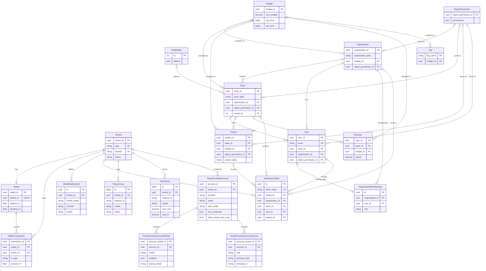

# Conceptual Entity Model (from `packages/database/schema.prisma`)

## Notes

Standalone models in Prisma (no explicit relation edges):
- `Credential`
- `Guardrail`
- `Policy`
- `ExchangeRate`
- `shahrah_sql_migrations`
