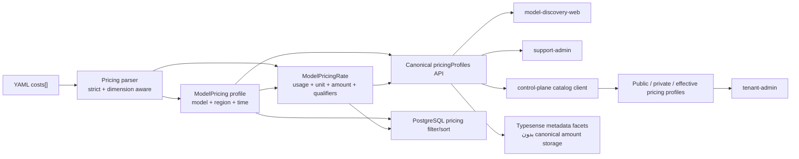

# پلن اجرایی مهاجرت یک‌مرحله‌ای قیمت‌گذاری مدل‌ها

## هدف

جایگزین‌کردن مدل قیمت‌گذاری ستونی و token-centric فعلی با یک مدل نرخ عمومی، چندواحدی و dimension-aware که بتواند تمام الگوهای قیمت‌گذاری موجود در YAMLها را بدون از دست‌دادن region، جهت مصرف، واحد، کیفیت ویدیو، service tier و tiered pricing نگه‌داری و عرضه کند.

این تغییر یک breaking cutover است:

- backward compatibility لازم نیست؛
- dual-write و legacy response shape نداریم؛
- همه مصرف‌کننده‌های repository در همان release به قرارداد جدید منتقل می‌شوند؛
- داده‌های catalog از YAML مجدداً ساخته می‌شوند و legacy pricing backfill نمی‌شود؛
- rollback از طریق snapshot دیتابیس و image قبلی انجام می‌شود، نه با compatibility code.

## دامنه بررسی‌شده

### منبع داده

- `D:\source\models\providers`
- `apps/model-discovery/scripts/import-models-from-yaml.ts`
- `apps/model-discovery/scripts/import-models-from-git.ts`

### دیتامدل و API اصلی

- `apps/model-discovery/prisma/schema.prisma`
- `apps/model-discovery/src/import/import.controller.ts`
- `apps/model-discovery/src/catalog`
- `apps/model-discovery/src/providers`
- `apps/model-discovery/src/indexing`
- `apps/model-discovery/src/openapi.module.ts`
- `apps/model-discovery/openapi`

### مصرف‌کننده‌ها

- `apps/model-discovery-web`
- `apps/support-admin`
- `packages/contracts/platform/tenant_provider_account.go`
- `services/control-plane/internal/admin/provider_catalog.go`
- `services/control-plane/internal/admin/handlers_provider_accounts.go`
- `services/control-plane/internal/storage/tenant_provider_account_repo.go`
- `packages/database/schema.prisma`
- `db/main/migrations`
- `apps/tenant-admin`
- contract testهای `services/control-plane/internal/admin`

## واقعیت‌های فعلی

### وضعیت مدل‌های ویدیویی فعال

در snapshot فعلی repository مدل‌ها، ۸۰ مدل غیرمنسوخ با `mode=video` یا `supportedModes` شامل `video` وجود دارد.

| الگوی قیمت | تعداد فایل فعال |
|---|---:|
| `output_cost_per_second` بدون کیفیت | ۱۵ |
| `output_cost_per_second_<resolution>` | ۱۲ |
| `input_cost_per_second` | ۴ |
| `input_cost_per_request` | ۲۸ |
| `output_cost_per_video_token` | ۳ |
| token-based معمولی | ۱۱ |
| بدون `costs` | ۱۰ |

این دسته‌ها در برخی فایل‌ها هم‌پوشانی دارند.

کیفیت‌های فعلی عبارت‌اند از:

- `480p`
- `540p`
- `720p`
- `1024p` در داده منسوخ
- `1080p`
- `4k`

بنابراین resolution نباید enum بسته باشد.

### تنوع کل pricing corpus

مدل نرخ جدید فقط برای ویدیو طراحی نمی‌شود. جایگزینی کامل schema فعلی باید الگوهای فعال زیر را نیز پوشش دهد:

- input/output token؛
- cache read و cache creation/write؛
- batch pricing؛
- priority pricing؛
- tiered pricing با threshold و حالت cumulative؛
- audio token و video token و image token؛
- second، image، request، character، query، page و annotated page؛
- resolution روی قیمت تصویر یا ویدیو؛
- regionهای متعدد برای یک مدل.

در import نهایی هیچ pricing key فعال نباید silently ignored شود.

### ایرادهای فعلی

- کلیدهای per-second، per-request و video-token وارد دیتابیس نمی‌شوند.
- importer فقط `request_cost` را می‌خواند، درحالی‌که corpus از `input_cost_per_request` استفاده می‌کند.
- pricing rowهای دارای کلید ناشناخته با تمام مبالغ `null` ساخته می‌شوند.
- `undefined` در محاسبه `free` صفر فرض می‌شود و مدل‌های قیمت‌دار به‌اشتباه رایگان می‌شوند.
- سرویس‌های list/provider فقط یک pricing row را با `take: 1` انتخاب می‌کنند؛ در مدل چندregion نتیجه arbitrary است.
- APIهای مختلف سه naming متفاوت برای قیمت دارند:
  - `inputPricePerMillionTokens`
  - `inputPerMillionTokens`
  - `input_usd_per_1m`
- `control-plane` و UIها قیمت را فقط input/output token می‌دانند.
- Typesense فقط سه فیلد token-price دارد.

## تصمیم‌های قطعی معماری

### ۱. ModelPricing یک profile منطقه‌ای و زمانی است

هر عضو `costs[]` در YAML یک pricing profile برای یک region است. مشخصات مشترک profile:

- model؛
- region؛
- currency؛
- source؛
- effective interval.

قیمت‌های داخل آن profile به‌صورت rateهای فرزند ذخیره می‌شوند.

### ۲. هر مبلغ یک PricingRate مستقل است

یک rate باید حداقل این ابعاد را داشته باشد:

- usage: `input | output | cache_read | cache_write`
- unit؛
- amount؛
- quantity؛
- service tier؛
- resolution اختیاری؛
- tier threshold اختیاری؛
- qualifiers توسعه‌پذیر.

### ۳. پول با Decimal ذخیره و به‌صورت string منتقل می‌شود

- دیتابیس: `Decimal @db.Decimal(30, 18)`
- JSON/OpenAPI/Go/TypeScript: decimal string
- تبدیل به `number` فقط در لایه presentation و بعد از validation انجام شود.

این تصمیم از خطای precision برای نرخ‌هایی مانند `0.0000033333333333` جلوگیری می‌کند.

### ۴. resolution یک dimension باز است

- فیلد canonical: `resolution`
- مقدار نمونه: `540p`, `720p`, `1080p`, `4k`
- مقدار `null`: نرخ مستقل از resolution یا نرخ عمومی
- انتخاب rate: exact resolution مقدم بر نرخ عمومی است.

### ۵. region هیچ‌وقت با `take: 1` انتخاب نمی‌شود

- `*` و `global` به `global` normalize می‌شوند.
- profileهای همه regionها در قرارداد کامل برگردانده می‌شوند.
- هیچ consumer حق انتخاب arbitrary اولین region را ندارد.
- اگر در آینده rating نیازمند انتخاب region باشد، ترتیب resolution چنین است:
  1. region دقیق request/account؛
  2. `global`؛
  3. تنها profile موجود؛
  4. در غیر این صورت unresolved.

### ۶. free با pricing unknown یکی نیست

Boolean فعلی `Model.free` با enum زیر جایگزین شود:

```text
unknown | priced | free
```

قواعد import:

- حداقل یک rate مثبت: `priced`
- بدون rate معتبر: `unknown`
- تمام rateها صفر ولی بدون علامت صریح رایگان‌بودن: `unknown`
- فقط `free: true` صریح در source یا ورودی admin: `free`

صفرهای placeholder مانند «not found in official docs» نباید مدل را رایگان کنند.

### ۷. legacy pricing columns حذف می‌شوند

ستون‌های زیر حذف خواهند شد:

- `inputPricePerMillionTokens`
- `outputPricePerMillionTokens`
- `cachedInputPricePerMillionTokens`
- `imageInputPrice`
- `imageOutputPrice`
- `audioInputPrice`
- `audioOutputPrice`
- `requestPrice`

هیچ dual-write یا fallback به این ستون‌ها وجود نخواهد داشت.

## معماری هدف



## دیتامدل هدف

نام دقیق enumها هنگام implementation می‌تواند با convention پروژه تنظیم شود، ولی semantics زیر ثابت است.

```prisma
enum ModelPricingStatus {
  unknown
  priced
  free
}

enum PricingUsage {
  input
  output
  cache_read
  cache_write
}

enum PricingServiceTier {
  standard
  batch
  priority
}

model ModelPricing {
  id            String   @id @default(cuid())
  modelId       String
  regionId      String
  currency      String   @default("USD")
  effectiveFrom DateTime?
  effectiveTo   DateTime?
  sourceUrl     String?
  createdAt     DateTime @default(now())
  updatedAt     DateTime @updatedAt

  model  Model              @relation(...)
  region Region             @relation(...)
  rates  ModelPricingRate[]

  @@index([modelId, regionId])
  @@index([modelId, effectiveFrom, effectiveTo])
}

model ModelPricingRate {
  id               String               @id @default(cuid())
  modelPricingId   String
  rateKey          String
  usage            PricingUsage
  unit             String
  amount           Decimal              @db.Decimal(30, 18)
  quantity         Int
  serviceTier      PricingServiceTier   @default(standard)
  resolution       String?
  tierFrom         Int?
  tierTo           Int?
  tierMode         String?
  qualifiers       Json?
  createdAt        DateTime             @default(now())
  updatedAt        DateTime             @updatedAt

  pricing ModelPricing @relation(...)

  @@unique([modelPricingId, rateKey])
  @@index([usage, unit])
  @@index([resolution])
  @@index([amount])
}
```

قواعد تکمیلی:

- `Model.pricingStatus` جایگزین `Model.free` شود.
- `regionId` برای profile اجباری باشد؛ region نامشخص به `global` تبدیل شود.
- `unit` عمداً string یا lookup باز باشد تا اضافه‌شدن unit جدید migration enum نخواهد.
- `rateKey` از تمام dimensionهای مؤثر به‌صورت deterministic ساخته شود.
- `qualifiers` فقط برای dimensionهای جدید/کم‌کاربرد است؛ resolution و tierهای پرکاربرد ستون typed دارند.
- validation برنامه باید `amount >= 0` و `quantity > 0` را enforce کند.

### واحدها و quantity استاندارد

| Unit | quantity canonical |
|---|---:|
| `token` | 1,000,000 |
| `audio_token` | 1,000,000 |
| `video_token` | 1,000,000 |
| `image_token` | 1,000,000 |
| `token_hour` | 1,000,000 |
| `character` | 1,000 |
| `second` | 1 |
| `image` | 1 |
| `request` | 1 |
| `query` | 1 |
| `page` | 1 |
| `annotated_page` | 1 |

Importer نرخ per-one موجود در YAML را با Decimal در quantity canonical ضرب می‌کند. فرمول rating/display عمومی:

```text
cost = usageAmount / rate.quantity * rate.amount
```

## قرارداد canonical API

### Pricing profile

```json
{
  "region": "us-west-2",
  "currency": "USD",
  "effectiveFrom": "2026-07-27T00:00:00.000Z",
  "effectiveTo": null,
  "sourceUrl": "https://example.com/pricing",
  "rates": [
    {
      "key": "output:second:standard:resolution=540p:base",
      "usage": "output",
      "unit": "second",
      "amount": "0.75",
      "quantity": 1,
      "serviceTier": "standard",
      "resolution": "540p",
      "tier": null,
      "qualifiers": {}
    }
  ]
}
```

### Model response

تمام endpointهای catalog/provider/compare از naming واحد زیر استفاده کنند:

```json
{
  "pricingStatus": "priced",
  "pricingProfiles": []
}
```

نام‌های token-specific قدیمی از DTO، response و OpenAPI حذف شوند.

### List pricing summary

list endpoint علاوه بر `pricingProfiles` یا به‌جای payload کامل، projection صریح زیر را برگرداند:

```json
{
  "pricingSummary": {
    "usage": "output",
    "unit": "second",
    "currency": "USD",
    "quantity": 1,
    "minimumAmount": "0.05",
    "maximumAmount": "0.25",
    "regions": ["global"],
    "resolutions": ["720p", "1080p", "4k"],
    "rateCount": 3
  }
}
```

Summary فقط وقتی معتبر است که selector آن صریح باشد. مبلغ واحدهای متفاوت هرگز با هم مقایسه یا در یک min/max ادغام نشود.

### Query و sort قیمت

پارامترهای token-specific فعلی حذف و با این قرارداد جایگزین شوند:

- `price_usage`
- `price_unit`
- `price_region`
- `price_resolution`
- `price_service_tier`
- `min_price`
- `max_price`
- `sort=price_asc|price_desc`

قواعد:

- `min_price`, `max_price` و sort قیمت بدون `price_usage` و `price_unit` با HTTP 400 رد شوند.
- مقایسه amount فقط بین rateهایی با unit و quantity canonical یکسان انجام شود.
- در صورت چند rate منطبق، کمترین rate مبنای sort list باشد.
- detail endpoint همیشه profileها و rateهای کامل را برگرداند.

## mapping کلیدهای YAML

Parser باید table-driven و مستقل از عملیات دیتابیس باشد.

| YAML | usage | unit | service tier / qualifier |
|---|---|---|---|
| `input_cost_per_token` | input | token | standard |
| `output_cost_per_token` | output | token | standard |
| `cache_read_input_token_cost` | cache_read | token | standard |
| `cache_creation_input_token_cost` | cache_write | token | standard |
| `cache_creation_input_token_cost_per_hour` | cache_write | token_hour | standard |
| `input_cost_per_token_batches` | input | token | batch |
| `output_cost_per_token_batches` | output | token | batch |
| `input_cost_per_audio_token` | input | audio_token | standard |
| `output_cost_per_audio_token` | output | audio_token | standard |
| `cache_read_input_audio_token_cost` | cache_read | audio_token | standard |
| `cache_creation_input_audio_token_cost` | cache_write | audio_token | standard |
| `input_cost_per_video_token` | input | video_token | standard |
| `output_cost_per_video_token` | output | video_token | standard |
| `input_cost_per_image_token` | input | image_token | standard |
| `output_cost_per_image_token` | output | image_token | standard |
| `input_cost_per_second` | input | second | standard |
| `output_cost_per_second` | output | second | standard، resolution=null |
| `output_cost_per_second_<resolution>` | output | second | resolution از suffix |
| `input_cost_per_image` | input | image | standard |
| `output_cost_per_image` | output | image | standard |
| `output_cost_per_image_<resolution>` | output | image | resolution از suffix |
| `input_cost_per_request` | input | request | standard |
| `input_cost_per_character` | input | character | standard |
| `input_cost_per_query` | input | query | standard |
| `input_cost_per_page` | input | page | standard |
| `input_cost_per_annotated_page` | input | annotated_page | standard |

ساختارهای nested:

- `priority_pricing`: همان mapping نرخ‌ها با `serviceTier=priority`
- `tiered_pricing.input`: usage=input
- `tiered_pricing.output`: usage=output
- `tiered_pricing.cache_read`: usage=cache_read
- `tiered_pricing.cache_write`: usage=cache_write
- `from`: `tierFrom`
- مرز بعدی: `tierTo`
- `pricing_mode`: `tierMode`

Parser در برابر key جدید:

1. در dry-run آن را با file/model/region گزارش می‌کند.
2. import واقعی به‌صورت پیش‌فرض fail می‌شود.
3. flag تشخیصی `--allow-unknown-pricing-keys` فقط برای بررسی محلی مجاز است و در automation استفاده نمی‌شود.

## Workstream 1: schema و migration دیتابیس model-discovery

### کارها

- [ ] افزودن enumها، `ModelPricingRate` و relationها.
- [ ] حذف ستون‌های legacy از `ModelPricing`.
- [ ] اجباری‌کردن region profile.
- [ ] جایگزینی `Model.free` با `Model.pricingStatus`.
- [ ] افزودن constraintهای amount، quantity و effective interval در SQL migration.
- [ ] افزودن indexهای lookup/filter.
- [ ] حذف pricing data موجود در migration یا truncate کنترل‌شده قبل از re-import.
- [ ] اجرای Prisma generate و commit خروجی generated موردنیاز repository.

### تصمیم migration

چون source of truth دیتای catalog همان YAML است:

- pricing rowهای قبلی migrate نمی‌شوند؛
- `ModelPricing` موجود پاک و از YAML دوباره ساخته می‌شود؛
- مدل‌ها، providerها، sourceها و taxonomyهای غیرقیمتی حفظ می‌شوند؛
- migration باید صریحاً destructive بودن pricing data را در comment و release note ثبت کند.

### معیار پذیرش

- schema هیچ ستون token/image/audio/request-specific قدیمی ندارد.
- یک profile می‌تواند چند rate با resolution متفاوت داشته باشد.
- duplicate `rateKey` در یک profile رد می‌شود.
- Decimalهای کوچک بدون round شدن قابل round-trip هستند.

## Workstream 2: parser و YAML importer

### ساختار کد

منطق parsing از script اجرایی خارج و به ماژول pure منتقل شود؛ برای مثال:

```text
apps/model-discovery/src/pricing/
  pricing.types.ts
  pricing-key-map.ts
  pricing-parser.ts
  pricing-normalizer.ts
  pricing-parser.spec.ts
```

Script فقط orchestration فایل، provider/model upsert و transaction را انجام دهد.

### کارها

- [ ] خواندن mode از union `mode` و `supportedModes`.
- [ ] تبدیل هر `costs[]` به یک profile منطقه‌ای.
- [ ] استخراج همه rateهای scalar، resolution، batch، priority و tiered.
- [ ] استفاده از timestamp واحد برای کل import run.
- [ ] نساختن profile بدون rate معتبر.
- [ ] تعیین `pricingStatus` با قواعد priced/free/unknown.
- [ ] حذف منطق `perTokenToPerMillion` پراکنده و انتقال scale به normalizer عمومی.
- [ ] ثبت diagnostic شامل unknown keys، invalid amount، duplicate rate و empty profile.
- [ ] fail کردن import واقعی در صورت pricing diagnostic خطادار.
- [ ] توسعه dry-run با summary بر اساس usage/unit/tier/resolution/region.
- [ ] استفاده از transaction برای replace کردن profileها و rateهای هر مدل.
- [ ] هماهنگ‌کردن `import-models-from-git.ts` با exit code و report جدید.
- [ ] اصلاح `packageRunner` در صورت لمس فایل تا فقط از `pnpm` استفاده کند.

### fixtureهای الزامی

- Luma: یک region و دو resolution؛
- Grok: per-second بدون resolution؛
- Google Vertex Veo: چندregion و چندresolution؛
- Object Detector: input per second؛
- Pixverse: per request؛
- Seedance/Gemini Omni: video token؛
- Azure Sora legacy fixture: نرخ عمومی و resolution-specific هم‌زمان؛
- token + cache read/write؛
- batch + priority؛
- tiered cumulative؛
- unknown key؛
- all-zero unknown pricing؛
- malformed/non-finite/negative amount.

## Workstream 3: model-discovery service و API

### DTO و validation

- [ ] تعریف DTOهای `PricingProfileDto` و `PricingRateDto`.
- [ ] حذف DTOهای token-specific.
- [ ] تغییر admin import به `pricingProfiles[]`.
- [ ] تغییر model upsert به repeatable pricing profiles/rates.
- [ ] validate کردن decimal string، rate key uniqueness و qualifiers.
- [ ] response mapping مشترک برای catalog، providers و compare.
- [ ] حذف return مستقیم Prisma object از detail endpoint و استفاده از mapper صریح.

### catalog queries

- [ ] active pricing profile بر اساس effective interval انتخاب شود.
- [ ] regionها کامل برگردند.
- [ ] list summary فقط با selector واحد ساخته شود.
- [ ] pricing filter/sort روی PostgreSQL relation اجرا شود.
- [ ] `freeModels()` به `pricingStatus=free` تغییر کند.
- [ ] endpoint یا filter برای `pricingStatus=unknown` فراهم شود تا داده ناقص قابل کشف باشد.

### OpenAPI

- [ ] کلاس‌های OpenAPI با قرارداد جدید جایگزین شوند.
- [ ] JSON و YAML spec دوباره تولید شوند.
- [ ] `docs/model-discovery-api-contract.md` با response و breaking change جدید به‌روز شود.
- [ ] contract test کنترل‌پلین بر fieldها و required constraintهای جدید assert کند.

## Workstream 4: Typesense و search

Canonical pricing amount در Typesense نگه‌داری نشود.

### projection ایندکس

- `pricingStatus`
- `pricingUsages[]`
- `pricingUnits[]`
- `pricingResolutions[]`
- `pricingRegions[]`
- `pricingServiceTiers[]`

### قواعد

- queryهای بدون price amount filter/sort می‌توانند از Typesense استفاده کنند.
- query دارای `min_price`, `max_price` یا price sort از PostgreSQL اجرا شود.
- نتیجه Typesense در صورت نیاز با summary دیتابیس hydrate شود.
- collection schema version افزایش یابد و index کامل rebuild شود.
- هیچ نتیجه search نباید pricing arbitrary یک region را نمایش دهد.

### تست

- parity نتیجه DB و Typesense برای queryهای بدون amount؛
- bypass قطعی Typesense برای amount filter/sort؛
- reindex بعد از import؛
- حذف fieldهای token-specific از Typesense schema.

## Workstream 5: control-plane و قراردادهای Go

### قرارداد shared

`ModelPrice` token-only با قراردادهای زیر جایگزین شود:

```go
type PricingRate struct {
    Key          string
    Usage        string
    Unit         string
    Amount       string
    Quantity     int
    ServiceTier  string
    Resolution   string
    Tier         *PricingTier
    Qualifiers   map[string]interface{}
}

type PricingProfile struct {
    Region        string
    Currency      string
    EffectiveFrom string
    EffectiveTo   string
    SourceURL     string
    Rates         []PricingRate
}
```

نام نهایی typeها با convention Go هماهنگ شود، ولی decimal string و rate dimensions تغییر نکنند.

### provider catalog client

- [ ] `modelDiscoveryPricing` با `pricingProfiles` جایگزین شود.
- [ ] mapping public catalog همه profileها را حفظ کند.
- [ ] clone helperها deep-copy واقعی profile/rate انجام دهند.
- [ ] internal mock یک rate token صریح با amount صفر و status free داشته باشد.
- [ ] registry fallback token-price، در صورت حفظ، از طریق adapter به profile canonical تبدیل شود.
- [ ] هیچ fallbackی pricing ناقص را صفر تلقی نکند.

### public/private/effective pricing

- [ ] `public_pricing`, `private_pricing` و `effective_pricing` به profile/rate contract جدید تبدیل شوند.
- [ ] private pricing یک full replacement باشد، نه partial override مبهم.
- [ ] UI بتواند public rate keys را clone و amount خصوصی را ویرایش کند.
- [ ] custom model بدون public pricing بتواند profile/rate کامل تعریف کند.
- [ ] readiness بر وجود حداقل یک profile معتبر با حداقل یک rate معتبر تکیه کند.
- [ ] amount صفر، اگر صریح و معتبر است، resolved محسوب شود؛ resolved بودن با مثبت‌بودن اشتباه نشود.
- [ ] duplicate rate key، amount نامعتبر و profile بدون region رد شود.
- [ ] انتخاب region arbitrary حذف شود.

### دیتابیس control-plane

- JSONB بودن pricing حفظ می‌شود ولی schema payload یک‌باره تغییر می‌کند.
- چون مشتری فعال وجود ندارد:
  - legacy `public_pricing` و `private_pricing` پاک شوند؛
  - account/model selectionهای test/dev در صورت نیاز دوباره seed شوند؛
  - migration تبدیل best-effort JSON قدیمی نوشته نشود.
- `packages/database/schema.prisma` با columnهای واقعی SQL، از جمله `public_pricing`، همگام شود.

### نکته billing runtime

Billing token فعلی مصرف‌کننده مستقیم `model-discovery` نیست و usage event ویدیو نیز duration/resolution canonical ندارد. این cutover:

- catalog، private pricing، readiness و effective pricing را کامل می‌کند؛
- rate contract را برای rating آینده آماده می‌کند؛
- محاسبه نهایی هزینه ویدیو در inference/runtime را تا زمان تعریف usage event شامل seconds/resolution انجام نمی‌دهد.

افزودن runtime video rating باید plan جداگانه با قرارداد usage ویدیو، provider response mapping و fallback policy داشته باشد؛ نباید در این migration به request duration HTTP تکیه شود.

## Workstream 6: model-discovery-web

پیش از هر تغییر UI، implementer باید design systemهای مربوط و componentهای موجود همان app را بررسی کند.

### list/explorer

- [ ] حذف ستون‌های ثابت input/output/cache token.
- [ ] نمایش summary واحدمحور، مانند:
  - `$3 / 1M input tokens`
  - `$0.05 / output second`
  - `$0.40 / request`
- [ ] نمایش range برای چندresolution: `از $0.08 تا $0.25 / ثانیه`.
- [ ] selectorهای usage، unit، region، resolution و service tier.
- [ ] ارسال query جدید برای price filter/sort.
- [ ] عدم مقایسه قیمت unitهای متفاوت.

### detail

- [ ] جدول rateها گروه‌بندی‌شده بر اساس region و service tier.
- [ ] ستون‌های usage، unit، amount/quantity، resolution و tier.
- [ ] نمایش `pricingStatus=unknown` به‌صورت «قیمت اعلام نشده»، نه صفر یا رایگان.
- [ ] نمایش source و effective interval.
- [ ] fallback نرخ عمومی resolution به شکل قابل‌فهم.

### compare

- [ ] ساخت ردیف‌های pricing به‌صورت dynamic از rate keyهای مشترک.
- [ ] نمایش «ناموجود» برای rate key غایب.
- [ ] حذف اتکا به `pricing[0]`.

### i18n و accessibility

- [ ] ترجمه واحدها و usageها در فارسی و انگلیسی.
- [ ] مقدار عدد، currency و rate key در RTL با `bdi dir=ltr`.
- [ ] headerهای جدول، control labelها و empty state قابل دسترس باشند.

## Workstream 7: support-admin

- [ ] فرم token-only ساخت/ویرایش مدل با editor تکرارشونده profile/rate جایگزین شود.
- [ ] امکان افزودن region، rate، usage، unit، amount، quantity، tier و resolution.
- [ ] rate key از فیلدها ساخته و قبل از submit نمایش داده شود.
- [ ] validation client و server یکسان باشد.
- [ ] diagnostics importer و unknown pricing modelها در admin قابل مشاهده باشند.
- [ ] zero amount نیازمند تأیید صریح باشد و مدل را خودکار free نکند.
- [ ] API proxyها payload جدید را بدون تغییر معنایی عبور دهند.

## Workstream 8: tenant-admin

قبل از UI implementation رعایت این موارد اجباری است:

1. خواندن `docs/design-system/DESIGN.md`
2. خواندن `docs/design-system/COMPONENT_USAGE.md`
3. بررسی `apps/tenant-admin/components/ui`
4. بررسی `apps/tenant-admin/components/app-ui`
5. استفاده از semantic Tailwind tokens و حفظ RTL
6. به‌روزرسانی playground در صورت ساخت pattern reusable

### provider account wizard

- [ ] typeهای public/private pricing به profile/rate تبدیل شوند.
- [ ] private pricing editor از profile عمومی clone شود.
- [ ] validation full replacement بر اساس rate key انجام شود.
- [ ] پیام `private pricing requires input/output values` با پیام unit-agnostic جایگزین شود.
- [ ] readiness به rate معتبر متکی باشد، نه input/output token.
- [ ] filter/sort قیمت نیازمند انتخاب usage/unit باشد.

### model catalog

- [ ] public و effective pricing به‌صورت unit-aware نمایش داده شوند.
- [ ] drawer جزئیات، profileهای region و rateها را نشان دهد.
- [ ] card/table summary هیچ قیمت unit متفاوتی را مخلوط نکند.
- [ ] unknown/free/priced سه state متمایز داشته باشند.

### private pricing persistence

- [ ] JSON payload از decimal string استفاده کند.
- [ ] rate order قبل از ذخیره canonical شود تا diff و audit پایدار باشد.
- [ ] تست round-trip فرم، API و JSONB نوشته شود.

## Workstream 9: مستندات و seed

- [ ] `apps/model-discovery/README.md` با syntax، dry-run report و strict import به‌روز شود.
- [ ] `docs/model-discovery-api-contract.md` قرارداد canonical را ثبت کند.
- [ ] seed نمونه catalog از `pricingProfiles/rates` استفاده کند.
- [ ] مستندات UI که فقط `/1M tokens` می‌گویند unit-aware شوند.
- [ ] release note breaking migration و re-import requirement را ثبت کند.
- [ ] runbook import/reindex ترتیب اجرای production-like را توضیح دهد.

## ترتیب اجرای پیشنهادی

### فاز ۰: contract freeze

- [ ] نام نهایی fieldها، enumها و API example تأیید شود.
- [ ] inventory تمام pricing keyهای active corpus به fixture snapshot تبدیل شود.
- [ ] acceptance rule «صفر unknown pricing key» در CI تعریف شود.

خروجی: contract document و parser fixture matrix.

### فاز ۱: دیتامدل و parser

- [ ] Prisma schema و migration.
- [ ] pure parser/normalizer.
- [ ] unit testهای fixture.
- [ ] importer dry-run strict.

خروجی: import معتبر در دیتابیس محلی، بدون API consumer.

### فاز ۲: model-discovery API و search

- [ ] service mapperها و queryها.
- [ ] admin import/upsert.
- [ ] generic filter/sort.
- [ ] Typesense schema و reindex.
- [ ] OpenAPI export.

خروجی: API canonical کامل و تست‌شده.

### فاز ۳: Go contract و control-plane

- [ ] shared contract.
- [ ] discovery client.
- [ ] public/private/effective pricing.
- [ ] storage JSONB و migration پاک‌سازی.
- [ ] readiness و sort/filter.
- [ ] contract tests.

خروجی: control-plane بدون هیچ token-only assumption در provider catalog domain.

### فاز ۴: UIها

- [ ] model-discovery-web.
- [ ] support-admin.
- [ ] tenant-admin.
- [ ] i18n، RTL، accessibility و component tests.

خروجی: همه UIها با profile/rate contract جدید.

### فاز ۵: integration و corpus validation

- [ ] import کامل `D:\source\models\providers`.
- [ ] reindex.
- [ ] API smoke.
- [ ] control-plane provider onboarding smoke.
- [ ] private pricing round-trip.
- [ ] UI e2e.

خروجی: release candidate.

### فاز ۶: one-shot cutover

- [ ] backup/snapshot دیتابیس‌های model-discovery و control-plane.
- [ ] توقف importerهای زمان‌بندی‌شده و writeهای provider-account.
- [ ] deploy migrationها و تمام service/app imageهای هماهنگ در maintenance window.
- [ ] re-import کامل YAML.
- [ ] rebuild کامل Typesense.
- [ ] اجرای smoke suite.
- [ ] بازکردن writeها و پایان maintenance.

## استراتژی cutover و rollback

### Cutover

1. ثبت commit SHA منبع مدل‌ها.
2. snapshot PostgreSQL و Typesense.
3. توقف `model-discovery`, importer و consumerهای write.
4. اجرای migration model-discovery.
5. اجرای migration control-plane برای پاک‌سازی JSON legacy.
6. deploy هم‌زمان model-discovery، control-plane و سه UI.
7. import از commit SHA ثبت‌شده.
8. reindex کامل.
9. اجرای verification queryها.
10. فعال‌کردن traffic.

### Rollback

به‌دلیل نبود compatibility:

1. traffic متوقف شود؛
2. imageهای قبلی restore شوند؛
3. snapshot هر دو PostgreSQL restore شود؛
4. Typesense snapshot/collection قبلی restore شود؛
5. importer قبلی فقط پس از restore دیتابیس اجرا شود.

Rollback با downgrade migration روی دیتای جدید انجام نشود.

## Test matrix

### Parser unit tests

- generic output second؛
- resolution-specific output second؛
- generic + specific fallback؛
- input second؛
- request؛
- video/audio/image token؛
- standard/batch/priority؛
- tiered cumulative؛
- multiple regions؛
- decimal precision؛
- duplicate rate؛
- negative/non-finite amount؛
- unknown key strict failure؛
- pricing status.

### Model-discovery integration

- create/read profile و rates؛
- effective interval؛
- region filtering؛
- generic price filter/sort validation؛
- detail/list/provider/compare shape consistency؛
- unknown/free/priced endpoints؛
- import transaction rollback؛
- Typesense bypass و reindex.

### Corpus acceptance

روی repository مدل‌ها:

- unknown pricing key فعال: `0`
- pricing profile خالی: `0`
- rate با amount نامعتبر: `0`
- duplicate rate key: `0`
- region arbitrary: `0`
- مدل per-second با `pricingStatus=free`: `0`

assertهای نمونه:

- Luma در `us-west-2`: دو rate با `540p=0.75` و `720p=1.5`.
- Grok: یک rate output/second بدون resolution.
- Veo 3.1 Fast Vertex: ۲۹ profile و سه rate در هر profile.
- Pixverse T2V HD: input/request.
- Seedance/Gemini Omni: video token.

### Control-plane

- OpenAPI contract؛
- mapping کامل profile/rate؛
- clone بدون aliasing؛
- public/private/effective resolution؛
- private full replacement validation؛
- zero rate resolved؛
- missing pricing unresolved؛
- JSONB round-trip؛
- tenant catalog sort/filter unit-aware.

### UI

- list/detail/compare مدل‌ها؛
- public/private pricing editor؛
- سه pricing status؛
- multiple region/resolution؛
- decimal input؛
- RTL و `bdi`؛
- keyboard navigation؛
- translation completeness.

## فرمان‌های verification

همه فرمان‌های JavaScript/TypeScript با `pnpm` اجرا شوند.

```powershell
pnpm --filter model-discovery prisma:generate
pnpm --filter model-discovery test
pnpm --filter model-discovery build
pnpm --dir apps/model-discovery openapi:export

pnpm --filter @shahrah/model-discovery-web lint
pnpm --filter @shahrah/model-discovery-web build

pnpm --filter @shahrah/support-admin lint
pnpm --filter @shahrah/support-admin build

pnpm --filter @shahrah/tenant-admin validate:i18n
pnpm --filter @shahrah/tenant-admin test
pnpm --filter @shahrah/tenant-admin lint
pnpm --filter @shahrah/tenant-admin build

go test ./services/control-plane/internal/admin
go test ./services/control-plane/internal/storage
go test ./packages/contracts/platform
```

برای corpus validation:

```powershell
pnpm --filter model-discovery import:providers:yaml -- --providers-root D:\source\models\providers --dry-run
```

سپس import واقعی روی دیتابیس disposable integration و reindex کامل اجرا شود.

## معیارهای پذیرش نهایی

- [ ] هیچ legacy pricing column یا response field باقی نمانده است.
- [ ] همه endpointها naming و shape یکسان دارند.
- [ ] همه pricing keyهای فعال corpus شناخته و import می‌شوند.
- [ ] per-second با و بدون resolution درست ذخیره و نمایش داده می‌شود.
- [ ] input-second، per-request و video-token پشتیبانی می‌شوند.
- [ ] region و resolution هیچ‌جا با انتخاب اولین row از بین نمی‌روند.
- [ ] `free`, `priced`, `unknown` سه state مستقل هستند.
- [ ] قیمت با Decimal بدون precision loss round-trip می‌شود.
- [ ] Typesense source of truth قیمت نیست.
- [ ] control-plane public/private/effective pricing را به‌صورت profile/rate نگه می‌دارد.
- [ ] tenant-admin و model-discovery-web قیمت unit-aware نشان می‌دهند.
- [ ] OpenAPI artifact و contract testها به‌روز هستند.
- [ ] dry-run کامل corpus بدون diagnostic خطادار تمام می‌شود.
- [ ] import، reindex و smoke suite در runbook قابل تکرار است.

## Definition of Done

این migration زمانی تمام‌شده است که:

1. schema جدید تنها representation قیمت‌گذاری در model-discovery باشد؛
2. import کامل YAML بدون silent loss انجام شود؛
3. model-discovery، control-plane و تمام UIهای repository فقط قرارداد جدید را مصرف کنند؛
4. قیمت ویدیویی بر اساس second و resolution در catalog و private/effective pricing قابل مشاهده و ویرایش باشد؛
5. هیچ مدل قیمت‌دار به علت unsupported key رایگان نمایش داده نشود؛
6. test suite و corpus acceptance سبز باشند؛
7. cutover و rollback یک‌بار روی محیط disposable تمرین شده باشند.
