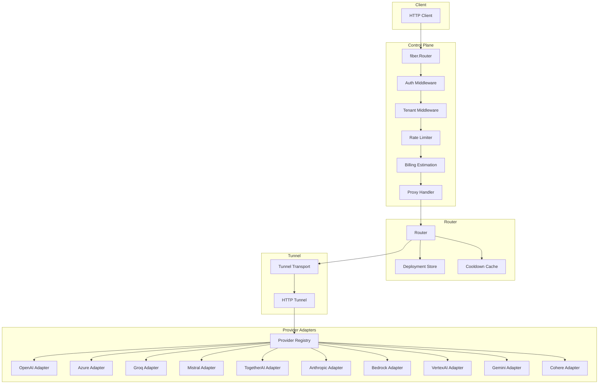

# Phase 2: LiteLLM Provider Support - Implementation Plan

> **Status:** Superseded
> **Created:** 2026-04-26
> **Priority:** P0 - Core feature for GodarAI gateway

> This document describes an abandoned direct-adapter design. The
> `services/control-plane/internal/providers` tree was removed because it had no
> production importer. Current control-plane code uses
> `internal/providerregistry` for canonical provider capabilities and dispatches
> requests through the tunnel to provider adapters in `services/silk-road`.
> Paths and implementation steps below are retained only as historical context.

---

## Executive Summary

This plan implements multi-provider LLM support for Shahrah, enabling routing to 10 LiteLLM-supported providers while maintaining the OpenAI-compatible public API. The implementation builds on the existing provider interface in [`services/control-plane/internal/providers/provider.go`](../services/control-plane/internal/providers/provider.go:1) and extends it with a registry-based adapter selection mechanism.

### Target Providers (Priority Order)

| Wave | Providers | Rationale |
|------|------------|------------|
| Wave 1 | OpenAI, Azure OpenAI, Groq, Mistral, Together AI | Fastest to implement, OpenAI-compatible APIs |
| Wave 2 | Anthropic, AWS Bedrock, Google Vertex AI, Gemini | Require AWS SigV4/Google Auth, Converse API |
| Wave 3 | Cohere + Hardening | Specialized, less common |

### Current State Assessment

| Component | Status | Gap |
|-----------|--------|-----|
| Provider Interface | ~90% | Only OpenAI client exists |
| Router Provider Parsing | ~60% | Defaults to "openai" for non-openai/ prefixes |
| Deployment Config | ~70% | Missing provider-specific auth fields |
| Error Handling | ~40% | Needs provider error mapping |
| Pricing Registry | ~0% | None exists |

---

## Implementation Breakdown

### Step 1: Lock API Contract (P0)

**Files:**
- `packages/contracts/openai/types.go`
- `services/control-plane/internal/proxy/handler.go`

**Scope:**
- Maintain `/v1/chat/completions` (sync + stream) as primary endpoint
- Support `/v1/completions` legacy endpoint
- Limit MVP to text/chat; defer images/audio/rerank
- All requests mapped to OpenAI-compatible request/response format

**Validation Rules (add to proxy handler):**
```go
// Temperature: 0-2
if req.Temperature != nil && (*req.Temperature < 0 || *req.Temperature > 2) {
    return error
}
// TopP: 0-1
if req.TopP != nil && (*req.TopP <= 0 || *req.TopP > 1) {
    return error
}
// MaxTokens: >=1
if req.MaxTokens != nil && *req.MaxTokens < 1 {
    return error
}
// Messages: non-empty, role required
```

### Step 2: Fix Provider Parsing in Router

**File:** `services/control-plane/internal/router/router.go` (lines 82-90)

**Current Problem:**
```go
// Only handles "openai/" prefix
if idx := len("openai/"); idx < len(modelParts) && modelParts[:idx] == "openai/" {
    deployment.Provider = "openai"
    deployment.Model = modelParts[idx:]
} else {
    deployment.Provider = "openai" // default - SILENTLY DEFAULTS!
    deployment.Model = modelParts
}
```

**Fix - Extract provider from deployment config (not model string):**
```go
// Use md.ProviderEndpoint.Provider if set, otherwise parse from model
if md.ProviderEndpoint.Provider != "" {
    deployment.Provider = md.ProviderEndpoint.Provider
} else {
    // Legacy fallback - parse from model string prefix
    for _, prefix := range []string{"openai/", "azure/", "anthropic/", "groq/", "mistral/", "togetherai/"} {
        if strings.HasPrefix(modelParts, prefix) {
            deployment.Provider = strings.TrimSuffix(prefix, "/")
            deployment.Model = strings.TrimPrefix(modelParts, prefix)
            break
        }
    }
    if deployment.Provider == "" {
        deployment.Provider = "openai" // Required - explicit fallback
        deployment.Model = modelParts
    }
}
```

### Step 3: Provider Registry + Adapter Selection

**New File:** `services/control-plane/internal/providers/registry.go`

```go
// ProviderRegistry maps provider name to adapter factory
type ProviderRegistry map[string]ProviderFactory

type ProviderFactory func(cfg ProviderConfig) Provider

var registry = make(ProviderRegistry)

// Register adds a provider adapter to the registry
func Register(name string, factory ProviderFactory) {
    registry[name] = factory
}

// Get retrieves a provider adapter by name
func Get(name string, cfg ProviderConfig) (Provider, error) {
    factory, ok := registry[name]
    if !ok {
        return nil, fmt.Errorf("unsupported provider: %s", name)
    }
    return factory(cfg), nil
}

// Supported returns list of supported provider names
func Supported() []string {
    names := make([]string, 0, len(registry))
    for name := range registry {
        names = append(names, name)
    }
    return names
}
```

**Registration in providerinit package:**
```go
// services/control-plane/internal/providers/providerinit/init.go
package providerinit

import (
    "github.com/Delpak/shahrah/services/control-plane/internal/providers"
    "github.com/Delpak/shahrah/services/control-plane/internal/providers/openai"
    // ... other providers
)

func Init() {
    providers.Register("openai", openai.NewClient)
    providers.Register("azure", azure.NewClient)
    // ... register all supported providers
}
```

### Step 4: Extend Deployment Config

**File:** `services/control-plane/internal/config/config.go`

**Add to ProviderEndpointConfig:**
```go
type ProviderEndpointConfig struct {
    // ... existing fields
    Provider     string  `mapstructure:"provider"` // REQUIRED: provider name (openai, azure, anthropic, etc.)
    AuthMode     string  `mapstructure:"auth_mode"` // api_key, azure_ad, aws_sigv4, bearer
    ProjectID    string  `mapstructure:"project_id"` // For Vertex AI
    EndpointID  string  `mapstructure:"endpoint_id"` // For Azure OpenAI
    CustomHeaders map[string]string `mapstructure:"custom_headers"` // Provider-specific headers
    // AWS-specific
    AWSRegion    string  `mapstructure:"aws_region"`
    AWSAccessKey string  `mapstructure:"aws_access_key"`
    AWSSecretKey string  `mapstructure:"aws_secret_key"`
}
```

### Step 5: Implement Provider Adapters (Wave 1 - Priority)

#### 5.1 OpenAI Adapter (Refactor existing)

**File:** `services/control-plane/internal/providers/openai/client.go`

**Endpoint:** `https://api.openai.com/v1`
**Auth:** `Authorization: Bearer {api_key}`

**Already implemented:** ✓

#### 5.2 Azure OpenAI Adapter

**New File:** `services/control-plane/internal/providers/azure/client.go`

**Endpoint:** `https://{resource}.openai.azure.com/openai/deployments/{deployment}/chat/completions?api-version={version}`
**Auth:** `api-key` header (or Azure AD for RBAC)

```go
type Client struct {
    resource   string  // e.g., "my-resource"
    deployment string  // e.g., "gpt-35-turbo"
    apiVersion string  // e.g., "2024-02-15"
    apiKey    string
    httpClient *http.Client
}
```

**Request Transform:**
- OpenAI `model` field removed or set to deployment name
- Azure-specific query params: `api-version`

**Response Transform:**
- Same as OpenAI format ✓

#### 5.3 Groq Adapter

**New File:** `services/control-plane/internal/providers/groq/client.go`

**Endpoint:** `https://api.groq.com/openai/v1`
**Auth:** `Authorization: Bearer {api_key}`

```go
const defaultAPIBase = "https://api.groq.com/openai/v1"
```

**Request Transform:** Same as OpenAI ✓
**Response Transform:** Same as OpenAI ✓

#### 5.4 Mistral Adapter

**New File:** `services/control-plane/internal/providers/mistral/client.go`

**Endpoint:** `https://api.mistral.ai/v1`
**Auth:** `Authorization: Bearer {api_key}`

```go
const defaultAPIBase = "https://api.mistral.ai/v1"
```

**Request Transform:**
- Map `model` to Mistral model names
- Messages: same format ✓

**Response Transform:** Same as OpenAI ✓

#### 5.5 Together AI Adapter

**New File:** `services/control-plane/internal/providers/togetherai/client.go`

**Endpoint:** `https://api.together.ai/v1`
**Auth:** `Authorization: Bearer {api_key}`

```go
const defaultAPIBase = "https://api.together.ai/v1"
```

**Request Transform:** Same as OpenAI ✓
**Response Transform:** Same as OpenAI ✓

### Step 6: Implement Provider Adapters (Wave 2)

#### 6.1 Anthropic Adapter

**New File:** `services/control-plane/internal/providers/anthropic/client.go`

**Endpoint:** `https://api.anthropic.com/v1/messages`
**Auth:** `x-api-key` header, `anthropic-version` header

```go
type Client struct {
    apiKey     string
    apiVersion string  // e.g., "2023-06-01"
    httpClient *http.Client
}
```

**Request Transform:**
```go
// Convert OpenAI request to Anthropic messages API
type AnthropicRequest struct {
    Model       string    `json:"model"`
    Messages   []AnthropicMessage `json:"messages"`
    MaxTokens  int       `json:"max_tokens,omitempty"`
    Temperature *float64  `json:"temperature,omitempty"`
    // ...
}

type AnthropicMessage struct {
    Role    string `json:"role"`
    Content string `json:"content"`
}

// Map roles:
// user -> user
// assistant -> assistant
// system -> prepend to first message as "system" role
```

**Response Transform:**
```go
// Convert Anthropic response to OpenAI format
type AnthropicResponse struct {
    ID        string   `json:"id"`
    Type     string   `json:"type"`
    Role     string   `json:"role"`
    Content  []ContentBlock `json:"content"`
    Model    string   `json:"model"`
    Usage    Usage    `json:"usage"`
}

// Map back to OpenAI ChatCompletionResponse
```

#### 6.2 AWS Bedrock Adapter

**New File:** `services/control-plane/internal/providers/bedrock/client.go`

**Endpoint:** `https://bedrock-runtime.{region}.amazonaws.com/model/{model}/invoke`
**Auth:** AWS SDK (boto3) or SigV4 signing

```go
type Client struct {
    region    string
    model     string  // e.g., "anthropic.claude-3-sonnet-20240229-v1:0"
    httpClient *http.Client
    // AWS credentials
    accessKey string
    secretKey string
}
```

**Request Transform:**
- Use Bedrock Converse API (recommended) or Invoke API
- Convert OpenAI messages to Bedrock format

**Response Transform:**
- Convert Bedrock response to OpenAI format

**Reference:** `.llmLite_docs/providers/bedrock.md`

#### 6.3 Google Vertex AI Adapter

**New File:** `services/control-plane/internal/providers/vertexai/client.go`

**Endpoint:** `https://{region}-aiplatform.googleapis.com/v1/projects/{project}/locations/{region}/publishers/google/models/{model}:predict`
**Auth:** Google OAuth2 / ADC

```go
type Client struct {
    project   string
    location  string  // e.g., "us-central1"
    model     string  // e.g., "gemini-1.5-pro-preview-0409"
    httpClient *http.Client
}
```

**Request Transform:**
- Use Gemini for AI Studio compatibility
- Convert messages to GenerateContentRequest

**Response Transform:**
- Convert GenerateContentResponse to OpenAI format

#### 6.4 Google Gemini (AI Studio) Adapter

**New File:** `services/control-plane/internal/providers/gemini/client.go`

**Endpoint:** `https://generativelanguage.googleapis.com/v1/models/{model}:generateContent`
**Auth:** `GOOGLE_API_KEY` or OAuth2

```go
type Client struct {
    apiKey    string
    model     string
    httpClient *http.Client
}
```

**Reference:** `.llmLite_docs/providers/gemini.md`

### Step 7: Implement Provider Adapters (Wave 3)

#### 7.1 Cohere Adapter

**New File:** `services/control-plane/internal/providers/cohere/client.go`

**Endpoint:** `https://api.cohere.ai/v1/chat`
**Auth:** `Authorization: Bearer {api_key}`

```go
const defaultAPIBase = "https://api.cohere.ai/v1"
```

**Request Transform:**
- Cohere has slightly different chat API
- Map messages to Cohere format

**Response Transform:**
- Map Cohere response to OpenAI format

### Step 8: Provider Error Mapping

**File:** `services/control-plane/internal/proxy/errors.go` (new or extend)

**Map provider errors to OpenAI envelope:**
```go
// Error types matching LiteLLM exception_mapping.md
const (
    ErrBadRequest          = 400
    ErrAuthentication     = 401
    ErrPermissionDenied   = 403
    ErrNotFound          = 404
    ErrTimeout           = 408
    ErrRateLimit         = 429
    ErrInternal          = 500
    ErrServiceUnavailable = 503
)

func TransformProviderError(provider string, status int, body []byte) APIError {
    switch provider {
    case "openai", "azure", "groq", "mistral", "togetherai":
        // Parse OpenAI-style error
        return parseOpenAIError(body)
    case "anthropic":
        return parseAnthropicError(body)
    case "bedrock":
        return parseBedrockError(body)
    default:
        return parseGenericError(status, body)
    }
}
```

**Error Response Format:**
```go
type APIError struct {
    Error ErrorInfo `json:"error"`
}

type ErrorInfo struct {
    Message string `json:"message"`
    Type    string `json:"type"`    // e.g., "invalid_request_error"
    Param   string `json:"param,omitempty"`
    Code    string `json:"code,omitempty"` // e.g., "400"
}
```

### Step 9: Normalize Usage/Token Fields

**Files:**
- `packages/contracts/openai/types.go`
- Billing service

**Standardize Usage struct:**
```go
type Usage struct {
    PromptTokens     int `json:"prompt_tokens"`
    CompletionTokens int `json:"completion_tokens"`
    TotalTokens      int `json:"total_tokens"`
}
```

**Per-provider mappings:**
```go
// anthropic: { input_tokens, output_tokens }
usage.PromptTokens = anthropicResp.Usage.InputTokens
usage.CompletionTokens = anthropicResp.Usage.OutputTokens
usage.TotalTokens = usage.PromptTokens + usage.CompletionTokens

// bedrock: { inputTokens, outputTokens }
usage.PromptTokens = bedrockResp.Usage.InputTokens
usage.CompletionTokens = bedrockResp.Usage.OutputTokens

// vertex/gemini: { promptTokenUsage, candidatesTokenUsage }
```

**Fallback for missing usage:**
- Use token estimation (see LiteLLM token counting docs)
- Log warning when estimation used

### Step 10: Pricing Registry

**New File:** `services/control-plane/internal/billing/pricing.go` (extend existing)

```go
type ModelPricing struct {
    Provider   string
    Model      string
    InputPrice float64  // per 1M tokens
    OutputPrice float64 // per 1M tokens
    Unit       string   // "token" or "1M_tokens"
}

var pricingRegistry = map[string]ModelPricing{
    // OpenAI
    "openai/gpt-4":      {Provider: "openai", Model: "gpt-4", InputPrice: 30.0, OutputPrice: 60.0},
    "openai/gpt-4o":     {Provider: "openai", Model: "gpt-4o", InputPrice: 5.0, OutputPrice: 15.0},
    // Azure (same as OpenAI, varies by deployment)
    "azure/gpt-4":       {Provider: "azure", Model: "gpt-4", InputPrice: 30.0, OutputPrice: 60.0},
    // Anthropic
    "anthropic/claude-3-5-sonnet-20240620": {Provider: "anthropic", Model: "claude-3-5-sonnet-20240620", InputPrice: 3.0, OutputPrice: 15.0},
    // Groq
    "groq/llama-3.1-70b-versatile": {Provider: "groq", Model: "llama-3.1-70b-versatile", InputPrice: 0.8, OutputPrice: 0.8},
    // Mistral
    "mistral/mistral-large-latest": {Provider: "mistral", Model: "mistral-large-latest", InputPrice: 2.0, OutputPrice: 6.0},
    // ... add all models
}

func GetPricing(provider, model string) (ModelPricing, bool) {
    key := provider + "/" + model
    pricing, ok := pricingRegistry[key]
    if !ok {
        // Fallback to provider default
        for k, p := range pricingRegistry {
            if strings.HasPrefix(k, provider+"/") {
                return p, false // found but not exact
            }
        }
    }
    return pricing, ok
}
```

**Reference:** `.llmLite_docs/providers/` for model-specific pricing

### Step 11: Unit Tests

**Test files to create:**
```
services/control-plane/tests/unit/providers/
  ├── registry_test.go
  ├── openai_adapter_test.go
  ├── azure_adapter_test.go
  ├── anthropic_adapter_test.go
  ├── bedrock_adapter_test.go
  ├── vertexai_adapter_test.go
  ├── gemini_adapter_test.go
  ├── groq_adapter_test.go
  ├── mistral_adapter_test.go
  ├── togetherai_adapter_test.go
  ├── cohere_adapter_test.go
  └── error_mapping_test.go
```

**Test cases per adapter:**
| Test | Description |
|------|-------------|
| Complete_Success | Valid request returns completion |
| Complete_AuthError | 401 returns transformed error |
| Complete_ProviderError | 4xx/5xx returns transformed error |
| Stream_Success | Streaming returns chunks |
| Stream_Disconnect | Graceful disconnect handling |
| TransformRequest | OpenAI -> Provider format |
| TransformResponse | Provider -> OpenAI format |

### Step 12: End-to-End Tests

**Flow to test:**
```
Control Plane (proxy handler)
  -> Tunnel (HTTP)
    -> Tunnel Server (relay)
      -> Provider Adapter
        -> Upstream LLM Provider
```

**Integration test file:**
```
services/control-plane/tests/integration/
  └── provider_integration_test.go
```

**Test providers by wave:**
- Wave 1: Mock HTTP responses for fast test
- Wave 2: Mock boto3/Google Auth
- Wave 3: Mock as needed

---

## Architecture Diagram



---

## Files to Modify/Create

### Modify (Existing)

| File | Changes |
|------|---------|
| `services/control-plane/internal/router/router.go` | Fix provider parsing, use deployment.Provider |
| `services/control-plane/internal/config/config.go` | Add provider-specific config fields |
| `packages/contracts/openai/types.go` | Add error types if needed |

### Create (New)

| File | Description |
|------|-------------|
| `services/control-plane/internal/providers/registry.go` | Provider registry |
| `services/control-plane/internal/providers/providerinit/init.go` | Provider registration |
| `services/control-plane/internal/providers/azure/client.go` | Azure adapter |
| `services/control-plane/internal/providers/groq/client.go` | Groq adapter |
| `services/control-plane/internal/providers/mistral/client.go` | Mistral adapter |
| `services/control-plane/internal/providers/togetherai/client.go` | Together AI adapter |
| `services/control-plane/internal/providers/anthropic/client.go` | Anthropic adapter |
| `services/control-plane/internal/providers/bedrock/client.go` | Bedrock adapter |
| `services/control-plane/internal/providers/vertexai/client.go` | Vertex AI adapter |
| `services/control-plane/internal/providers/gemini/client.go` | Gemini adapter |
| `services/control-plane/internal/providers/cohere/client.go` | Cohere adapter |
| `services/control-plane/internal/proxy/errors.go` | Error transformation |
| `services/control-plane/internal/billing/pricing.go` | Pricing registry |
| `services/control-plane/tests/unit/providers/*` | Unit tests |
| `services/control-plane/tests/integration/provider_integration_test.go` | E2E tests |

---

## Implementation Order

1. **Week 1:** Steps 1-4 (API contract, router fix, registry, config)
2. **Week 2-3:** Step 5 (Wave 1 adapters)
3. **Week 4-5:** Step 6 (Wave 2 adapters)
4. **Week 6:** Step 7 (Wave 3) + Step 8 (Error mapping)
5. **Week 7:** Steps 9-10 (Usage normalization, pricing)
6. **Week 8:** Steps 11-12 (Tests)

---

## Dependencies

- **LiteLLM reference:** `.llmLite_docs/providers/*.md`
- **Exception mapping:** `.llmLite_docs/exception_mapping.md`
- **Token counting:** `.llmLite_docs/anthropic_count_tokens.md`
- **Cost tracking:** `.llmLite_docs/a2a_cost_tracking.md`

---

## Acceptance Criteria

- [ ] All 10 providers routable via `/v1/chat/completions`
- [ ] Streaming works across all providers
- [ ] Provider errors mapped to OpenAI envelope
- [ ] Usage fields normalized for billing
- [ ] Pricing available for common models
- [ ] Unit tests pass per adapter
- [ ] E2E test flow works: control-plane -> tunnel -> adapter -> provider

---

## Notes for Code Mode

- Start with Wave 1 adapters (simplest, OpenAI-compatible)
- Use existing OpenAI client as template
- Mock HTTP responses in tests to avoid API key requirements
- Each adapter should handle: auth, endpoint, request transform, response transform, streaming
