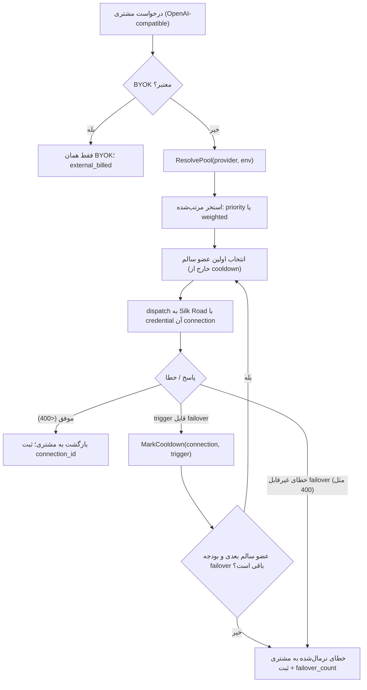

# PRD: استخر اندپوینت پروایدر و Failover خودکار (Provider Endpoint Pool)

> وضعیت: پیشنهاد محصولی برای تصمیم‌گیری
> تاریخ: ۱۴۰۵/۰۶/۲۲
> دامنه: اعتبارنامه‌های **پلتفرمی** (متعلق به گدارAI) که در `support-admin` مدیریت می‌شوند
> نویسنده: محصول — با رویکرد متخصص LLM Gateway
> اسناد بالادستی: [`platform-managed-provider-credentials-product-analysis.md`](platform-managed-provider-credentials-product-analysis.md)، [`platform-managed-provider-credentials-provider-matrix.md`](platform-managed-provider-credentials-provider-matrix.md)، [`README.md`](README.md)

## خلاصه تصمیم

گدارAI باید بتواند برای هر پروایدر **چند اندپوینت و اعتبارنامه پلتفرمی** را به‌صورت یک «استخر» (Pool) نگه دارد و وقتی یک اندپوینت به دلیل **اتمام شارژ/سهمیه**، **Rate limit (429)**، **خطای احراز هویت** یا **خطای سمت پروایدر** از دسترس خارج شد، درخواست را به‌صورت خودکار و شفاف به اندپوینت بعدی در همان استخر منتقل کند. همه این تنظیمات باید در `support-admin` قابل مدیریت باشد.

این قابلیت در عمل همان آیتمی است که در سند «تحلیل محصولی مدیریت اعتبارنامه‌های پلتفرمی» به‌عنوان **P2 تعویق** افتاده بود: «چند Connection و weighted/fallback routing». این سند آن آیتم را به یک فیچر مستقل و اولویت‌دار ارتقا می‌دهد.

نکته کلیدی معماری: **مدل داده تقریباً آماده است**، اما **لایه runtime هنوز تک-اعتبارنامه‌ای است**.

- جدول `platform_provider_connections` همین حالا فیلدهای `priority`، `weight`، `is_primary`، `status`، `region` و وضعیت تست/سلامت را دارد.
- اما `platformcredentials.Manager.Resolve(providerSlug, environment)` دقیقاً **یک** `ResolvedCredential` برمی‌گرداند، چون snapshot با کلید `{provider_slug, environment}` ذخیره می‌شود.

پس بخش اصلی کار، **pool-aware کردن resolve در runtime** و **افزودن حلقه failover + cooldown در سطح connection** است، نه ساخت مدل داده از صفر. این یعنی هزینه پیاده‌سازی نسبت به ارزش عملیاتی آن پایین است.

پیشنهاد MVP (فصل‌بندی دقیق در بخش «خط برش MVP»):

- **P0:** resolve چند اندپوینت فعال به‌عنوان یک استخر مرتب‌شده؛ failover واکنشی روی triggerهای نرمال‌شده؛ cooldown در سطح connection؛ تضمین «فقط یک primary»؛ مدیریت priority/enable/disable و مشاهده سلامت در `support-admin`؛ ثبت `connection_id` و تعداد failover در trace.
- **P1:** استراتژی weighted برای پخش بار پیش‌دستانه؛ cooldown مبتنی بر `Retry-After`؛ شمارنده مصرف RPM/TPM هر اندپوینت برای اجتناب پیش‌دستانه از مرز rate limit؛ cooldown/restore دستی؛ policy سطح استخر در UI؛ هشدار روی failover پرتکرار.
- **P2:** انتخاب مبتنی بر latency؛ dashboard هزینه/مصرف هر اندپوینت؛ اطلاع‌رسانی شارژ حساب (webhook/polling)؛ sticky routing؛ محدودیت هم‌زمانی (concurrency)؛ انتخاب region-aware؛ و در نهایت pool برای BYOK مشتری (خارج از دامنه این سند).

## تعریف مسئله و چراییِ الان

### مسئله

هر پروایدر LLM برای هر حساب/کلید، سقف مشخصی از **Rate limit** (RPM/TPM) و **موجودی/سهمیه** دارد. وقتی گدارAI برای یک پروایدر فقط یک اعتبارنامه فعال دارد:

- با رشد ترافیک، اولین نقطه شکست **429 Rate limit** روی همان یک حساب است.
- وقتی شارژ/سهمیه حساب تمام می‌شود، **کل آن پروایدر** برای همه مشتریان از دسترس خارج می‌شود تا اپراتور دستی اعتبارنامه جدید بگذارد.
- چرخش اعتبارنامه (rotation) یا افزودن حساب دوم، امروز بدون تغییر در resolve runtime ممکن نیست، چون خروجی آن تک‌مقداری است.

نتجه محصولی: availability پایین‌تر، تجربه کاربری بد (خطای ۴۲۹/۵۰۳ به مشتری)، و بار عملیاتی بالا روی تیم پشتیبانی برای جابه‌جایی دستی کلیدها.

### چرا این مسئله با «معماری فعلی» قابل حل است

مسیر مصرف پلتفرمی در گدارAI **wallet-billed** است و همه connectionهای یک پروایدر متعلق به خود گدارAI هستند. برخلاف fallback از BYOK کاربر به کلید پلتفرم (که در سند بالادستی به‌درستی **Exclude** شد چون مالک هزینه را عوض می‌کند)، failover بین چند connection پلتفرمی **مالک هزینه را تغییر نمی‌دهد**: همه `wallet_billed` می‌مانند. این یعنی provider-level pooling از نظر billing **امن** است و می‌توان آن را با ریسک پایین‌تری به MVP آورد.

### چرا «در سطح پروایدر» و نه «مدل مجازی»

مدل مجازی (Virtual Model) در گدارAI امروز routing را در سطح **alias مدل** انجام می‌دهد و می‌تواند بین مدل‌ها/پروایدرهای مختلف با استراتژی `priority` یا `weighted` جابه‌جا شود (نگاه کنید به `services/control-plane/internal/virtualmodels/virtualmodels.go`). اما مسئله این سند متفاوت است: **همان پروایدر و همان مدل**، ولی **چند حساب/اندپوینت/کلید** برای ضرب‌کردن rate limit و failover روی اتمام شارژ. به زبان کاربر: «شبیه مدل مجازی، اما در سطح پروایدر». این دو لایه مکمل‌اند و باید با هم ترکیب شوند، نه جای هم را بگیرند.

## وضعیت فعلی در کد گدارAI (مستند)

| جزء | فایل | وضعیت فعلی | اثر بر این فیچر |
|---|---|---|---|
| Router | `services/control-plane/internal/router/router.go` | چند deployment برای هر model، `CooldownCache`، انتخاب weighted (`weightedRandomPick`)، fallback در سطح model | ماشین cooldown/weighted/fallback **وجود دارد** و باید بازاستفاده شود |
| resolve اعتبارنامه پلتفرم | `services/control-plane/internal/platformcredentials/manager.go` | `Resolve(providerSlug, environment)` → **یک** `ResolvedCredential`؛ snapshot با کلید `{provider_slug, environment}` | **گلوگاه اصلی**؛ باید به `ResolvePool` تبدیل شود |
| اعمال اعتبارنامه روی route | `router.go → applyCredentials` | بعد از انتخاب deployment، یک credential پلتفرم resolve و جایگزین می‌شود | نقطه تزریق حلقه failover سطح connection |
| executor تلاش/fallback | `virtualmodels/virtualmodels.go → Executor.ExecuteSync/ExecuteStream` | حلقه retry + fallback با `ShouldRetryOnStatus` / `ShouldFallbackOnStatus` | الگوی قابل بازاستفاده برای حلقه failover استخر |
| مدل داده | `packages/database/schema.prisma → platform_provider_connections` | `priority`, `weight`, `is_primary`, `status`, `region`, `last_test_*`, `last_success_at` | **آماده**؛ فقط به policy سطح استخر و قید «یک primary» نیاز دارد |
| ماتریس پروایدر | `platform-managed-provider-credentials-provider-matrix.md` | ۲۱ پروایدر؛ زیرمجموعه‌ای `Runtime ready = yes` | failover باید از پروایدرهای runtime-ready شروع شود |
| گردش support-admin | (حافظه پروژه) draft → test → activate | تست از مسیر `TestPlatformProviderCredentialVersion` و prober مشترک | UX موجود باید با «تنظیمات استخر» گسترش یابد |

جمع‌بندی: **حدود ۷۰٪ زیرساخت لازم موجود است.** کار اصلی، تبدیل resolve تک‌مقداری به استخر، افزودن نرمال‌سازی خطای پروایدرها به triggerهای failover، و افزودن کنترل استخر در `support-admin` است.

## الهام از محصولات دیگر (شاهد بازار)

این فیچر یک الگوی اثبات‌شده در LLM Gatewayهاست. از PortKey و TrueFoundry به‌عنوان **شاهد محصولی** استفاده می‌کنیم، نه الگوی پیاده‌سازی.

### PortKey

- **Load Balancing** با الگوی صریح «Multiple API Keys (same provider) — distribute load across rate limits from different accounts». weightها به ۱۰۰٪ نرمال می‌شوند؛ `weight = 0` ترافیک را بدون حذف از config متوقف می‌کند.
- نقل مستند: «add multiple account details from one provider and effectively **multiply your available rate limits**».
- **Fallbacks** با `on_status_codes: [429]` (یا پیش‌فرض هر non-2xx) و زنجیره چندلایه؛ همه تلاش‌ها با Trace ID ثبت می‌شوند.
- **Tackling Rate Limiting**: دو راه — (۱) fallback واکنشی روی ۴۲۹، (۲) load-balance پیش‌دستانه بین چند حساب.
- **Automatic Retries**: تا ۵ تلاش، backoff نمایی، و `use_retry_after_headers` برای احترام به `retry-after` / `retry-after-ms` / `x-ms-retry-after-ms` با سقف تجمعی ۶۰ ثانیه.

منابع: `.portkey-docs/markdown/product/docs__product__ai-gateway__load-balancing.md`، `.../fallbacks.md`، `.../automatic-retries.md`، `.portkey-docs/markdown/guides/docs__guides__getting-started__tackling-rate-limiting.md`، `.portkey-docs/markdown/guides/docs__guides__use-cases__setting-up-resilient-load-balancers-with-failure-mitigating-fallbacks.md`.

### TrueFoundry

- **Routing Config** با استراتژی‌های `weight-based`، `latency-based` و `priority-based`؛ قوانین به‌ترتیب ارزیابی و **اولین قانون منطبق** برنده است.
- مثال مستقیم «Priority chain — fail over on rate limit» با `fallback_status_codes: ["429"]` روی هر target.
- به‌ازای هر target: `retry_config` (attempts/delay/on_status_codes با پیش‌فرض `["429","500","502","503"]`)، `fallback_status_codes` (پیش‌فرض `["401","403","404","429","500","502","503"]`)، `fallback_candidate` و `override_params`.
- برای Anthropic streaming، fallback روی `overloaded_error` **قبل از اولین chunk** خروجی.
- توصیه رسمی TrueFoundry: برای مالکیت/کنترل دسترسی بهتر، routing را به **Virtual Models** منتقل کنید (که گدارAI هم‌راستا با آن است).

منابع: `.truefoundry-docs/markdown/docs__ai-gateway__load-balancing-overview.md`، `.truefoundry-docs/markdown/docs__ai-gateway__virtual-model.md`، `.truefoundry-docs/markdown/docs__ai-gateway__virtual-model-advanced.md`. (توجه: `.truefoundry-docs/markdown/docs__loadbalancers.md` درباره LoadBalancer زیرساخت/K8s-Istio است و به این فیچر ربطی ندارد.)

### سایر الگوهای بازار (برای جهت‌گیری)

- **LiteLLM Router**: چند deployment برای یک مدل، cooldown خودکار پس از خطا، و routing آگاه از مصرف (TPM/RPM) — تأیید می‌کند که «cooldown + usage-aware» الگوی غالب است.
- **OpenRouter**: routing بین چند provider با fallback و کنترل قیمت/دسترس‌پذیری — شاهد اینکه «چند حساب برای یک مدل» یک نیاز واقعی است.

### نقشه تطبیق به گدارAI

| قابلیت در محصولات دیگر | ارزش/مشکل کاربر | تصمیم گدارAI | تطبیق گدارAI |
|---|---|---|---|
| چند کلید/حساب برای یک پروایدر (PortKey LB) | ضرب rate limit، پایداری | **Include now (P0 data + P1 weighted)** | connectionهای متعدد پلتفرمی در یک استخر |
| Fallback روی `429` / status codes | شکست واکنشی و شفاف | **Include now (P0)** | حلقه failover در `applyCredentials` با trigger نرمال‌شده |
| Cooldown پس از خطا (LiteLLM) | جلوگیری از کوبیدن بر اندپوینت خراب | **Include now (P0)** | بازاستفاده از `CooldownCache` در کلید connection |
| Retry + `Retry-After` (PortKey) | احترام به پنجره reset پروایدر | **Defer (P1)** | تنظیم مدت cooldown از هدر `Retry-After` |
| Weighted LB (PortKey/TrueFoundry) | پخش پیش‌دستانه بار | **Defer (P1)** | استراتژی `weighted` روی استخر (الگوی موجود در router) |
| Usage-based routing (RPM/TPM) | اجتناب پیش‌دستانه از ۴۲۹ | **Defer (P1/P2)** | شمارنده Redis در سطح connection |
| Latency-based routing (TrueFoundry) | بهینه‌سازی p95 | **Defer (P2)** | نیازمند حلقه تله‌متری بلوغ‌یافته |
| Canary با weight کم | rollout تدریجی حساب جدید | **Defer (P1)** | weight پایین برای connection تازه |
| Sticky routing (PortKey) | ثبات نشست/مکالمه | **Defer (P2)** | افزونه weighted، نه استراتژی مستقل |
| Fallback خاموش BYOK → پلتفرم | — | **Exclude** | مالک هزینه را عوض می‌کند (مطابق سند بالادستی) |

## اهداف

- اجازه به اپراتور برای تعریف **چند اندپوینت + اعتبارنامه پلتفرمی** برای هر (پروایدر، محیط) و مدیریت اولویت/وزن/وضعیت آن‌ها در `support-admin`.
- **failover خودکار و شفاف** وقتی یک اندپوینت به دلیل اتمام شارژ/سهمیه، rate limit، خطای احراز هویت یا خطای پروایدر از دسترس خارج می‌شود.
- **افزایش availability** و کاهش خطاهای ۴۲۹/۵۰۳ که به مشتری می‌رسد، بدون تغییر در قرارداد API مشتری (OpenAI-compatible باقی می‌ماند).
- **کاهش بار عملیاتی** چرخش/افزودن حساب، با حذف نیاز به restart یا تغییر env.
- **قابل مشاهده بودن**: اپراتور باید بداند هر درخواست از کدام connection سرو شده، چند failover رخ داده، و هر connection چقدر مصرف/خطا داشته است.
- **حفظ صحت billing**: همه مسیرهای استخر `wallet_billed` بمانند و `credential_source`/`connection_id`/`credential_version_id` در trace ثبت شود.

## غیراهداف

- **pool برای BYOK مشتری** (tenant-admin) — خارج از دامنه این سند؛ در P2 به‌صورت جداگانه بررسی می‌شود.
- تغییر قرارداد عمومی API مشتری یا شکستن OpenAI-compatibility.
- auto-rotation خودکار اعتبارنامه یا ساخت secret manager جدید (فقط بازاستفاده از envelope encryption موجود).
- routing آگاه از region/geo یا data-residency به‌عنوان بخشی از MVP.
- جایگزینی مدل مجازی؛ این لایه **مکمل** مدل مجازی است.
- مدیریت هزینه/قیمت‌گذاری هر connection (فقط ثبت داده مصرف برای گزارش‌های بعدی).

## کاربران و سناریوها

| کاربر | سناریو | نشانه موفقیت |
|---|---|---|
| اپراتور پشتیبانی (`support-admin`) | برای OpenAI سه حساب با priority متفاوت تعریف می‌کند تا وقتی حساب اول ۴۲۹ داد، ترافیک به حساب دوم برود | بدون دخالت دستی، خطای ۴۲۹ به مشتری نمی‌رسد؛ در trace دیده می‌شود که connection دوم سرو کرده |
| اپراتور پشتیبانی | شارژ حساب اصلی Anthropic تمام می‌شود | اندپوینت به cooldown می‌رود و استخر به‌طور خودکار از حساب پشتیبان سرو می‌کند؛ هشدار «اتمام شارژ» ثبت می‌شود |
| تیم پلتفرم (DevOps) | افزودن حساب جدید بدون restart | connection جدید draft → test → activate می‌شود و در < ۶۰ ثانیه در runtime اثر می‌کند |
| مشتری نهایی (غیرمستقیم) | ارسال درخواست در ساعت اوج | نرخ موفقیت درخواست بالا می‌ماند؛ latency اضافی ناشی از failover در حد پذیرفتنی است |
| تیم مالی/محصول | تفکیک مصرف بین حساب‌های یک پروایدر | مصرف به تفکیک `connection_id` در metric/trace قابل گزارش است |

## مفاهیم و مدل ذهنی

- **Endpoint (اندپوینت):** یک رکورد `platform_provider_connection` = یک مسیر اتصال عملیاتی شامل provider، environment، region، auth mode، config غیرمحرمانه، و یک credential version فعال. این همان موجودیت فعلی است.
- **Pool (استخر):** مجموعه connectionهای `Active` برای یک کلید `(provider_slug, environment)`. استخر حداقل یک عضو دارد و اگر چند عضو داشته باشد، ordered/weighted است.
- **Selection strategy (استراتژی انتخاب):**
  - `priority` (پیش‌فرض MVP): به ترتیب `priority` صعودی؛ اولین عضو سالم انتخاب می‌شود؛ بقیه به‌عنوان زنجیره failover.
  - `weighted` (P1): پخش ترافیک بر اساس `weight` (نرمال به ۱۰۰٪)؛ اعضای با `weight = 0` یا `status = disabled` کنار گذاشته می‌شوند.
- **Failover trigger (محرک failover):** دسته نرمال‌شده خطا که تصمیم می‌گیرد آیا به عضو بعدی برویم یا نه. دسته‌های اصلی: `rate_limited`، `insufficient_balance`/`quota_exhausted`، `auth_failed`، `provider_error` (5xx)، `timeout`.
- **Cooldown:** یک connection پس از trigger مشخص، برای مدت معین (ثابت، یا مشتق از `Retry-After` در P1) از چرخه انتخاب خارج می‌شود. Cooldown **موقت و runtime** است (Redis/in-memory)، نه وضعیت دائم DB.
- **Health status:** `Active`، `Degraded` (خطاهای پراکنده)، `CoolingDown` (موقتاً خارج)، `Disabled` (توسط اپراتور)، `Draft`/`Testing` (قبل از فعال‌سازی).
- **primary:** یک connection با `is_primary = true` که نقطه شروع پیش‌فرض استخر است. **قید: حداکثر یک primary برای هر `(provider_slug, environment)`.**

## رفتار Runtime

### ترتیب انتخاب منبع اعتبارنامه (بدون تغییر در مالکیت هزینه)

۱. اگر target یک Provider Account با **BYOK معتبر** باشد، فقط همان BYOK استفاده می‌شود و `billing = external_billed`. **استخر پلتفرم در این مسیر دخالت نمی‌کند.**
۲. اگر target فاقد BYOK و مجاز برای مصرف پلتفرمی باشد، **استخر پلتفرم** برای `(provider_slug, environment)` resolve می‌شود و `billing = wallet_billed`.
۳. اگر استخر هیچ عضو `Active` و سالم (خارج از cooldown) نداشته باشد، target **پیش از تماس با upstream** Unavailable می‌شود (خطای شفاف، نه timeout بی‌پاسخ).
۴. شکست BYOK هرگز به‌صورت خاموش به استخر پلتفرم fallback نمی‌کند (مطابق سند بالادستی).

### حلقه failover در یک درخواست



نکات کلیدی:

- **بودجه failover:** هر درخواست حداکثر `max_failover_attempts` عضو دیگر را امتحان می‌کند (پیش‌فرض پیشنهادی: `min(pool_size - 1, 3)`). این از retry storm جلوگیری می‌کند.
- **retry در برابر failover:** retry روی **همان connection** (برای خطاهای گذرا مثل ۵۰۰) از failover به **connection بعدی** (برای ۴۲۹/اتمام شارژ/۴۰۱) متمایز است. الگوی موجود در `virtualmodels.Executor` (تفکیک `ShouldRetryOnStatus` و `ShouldFallbackOnStatus`) دقیقاً همین تفکیک را دارد و باید بازاستفاده شود.
- **Streaming:** failover فقط **قبل از commit اولین بایت/chunk** به مشتری مجاز است. برای Anthropic، `overloaded_error` پیش از اولین chunk باید trigger failover شود (الگو از TrueFoundry). پس از شروع stream، خطا فقط به مشتری منتقل می‌شود.
- **cooldown کلید connection:** از `CooldownCache` موجود بازاستفاده می‌شود اما کلید آن `connection_id` (نه فقط `deployment_id`) است تا چند deployment که از یک connection سرو می‌گیرند، با هم cool down شوند.

### کارایی در hot path

مدل فعلی snapshot اتمیک و **بدون I/O** در مسیر درخواست است (نگاه کنید به کامنت `Manager.Resolve`: «یک atomic pointer load و یک map lookup»). این مدل باید حفظ شود:

- `ResolvePool` باید از همان snapshot تغییرناپذیر بخواند؛ **هیچ** query به PostgreSQL/Redis/decrypt/probe در hot path.
- snapshot به‌جای `map[key]ResolvedCredential` به `map[key][]ResolvedCredential` (از پیش مرتب‌شده بر اساس priority) تغییر می‌کند.
- cooldown/usage در Redis یا in-memory با TTL کوتاه نگه‌داری می‌شود و **خارج از** snapshot است تا reload کامل برای هر خطا لازم نباشد.

### نرمال‌سازی خطای پروایدر به trigger

پروایدرها «اتمام شارژ» و «rate limit» را متفاوت گزارش می‌کنند. یک لایه نرمال‌سازی باید خطای خام را به دسته canonical تبدیل کند. این جدول نقطه شروع P0 است و باید به‌تدریج برای پروایدرهای `Runtime ready = yes` تکمیل شود.

| Trigger (canonical) | HTTP status | سیگنال‌های پروایدر (نمونه) | failover پیش‌فرض | cooldown پیش‌فرض |
|---|---:|---|---|---|
| `rate_limited` | 429 | OpenAI `rate_limit_exceeded`؛ Anthropic `rate_limit_error`؛ صفر شدن `x-ratelimit-remaining-*` | بله | ۳۰–۶۰ ثانیه (یا `Retry-After` در P1) |
| `insufficient_balance` | 429 / 402 | OpenAI `insufficient_quota`؛ OpenRouter «credit balance is too low»؛ خطای موجودی/شارژ حساب | بله | طولانی (تا reset یا شارژ مجدد؛ پیشنهادی ۱۵ دقیقه + هشدار) |
| `quota_exhausted` | 429 | سهمیه روزانه/دقیقه‌ای تمام‌شده (توکن یا درخواست) | بله | تا پنجره reset |
| `auth_failed` | 401 / 403 | `invalid_api_key`، کلید منقضی/لغو، `forbidden` | بله | طولانی + هشدار فوری (اعتبارنامه خراب) |
| `provider_error` | 500 / 502 / 503 / 504 | Anthropic `overloaded_error` / `api_error`؛ خطای داخلی پروایدر | بله (با ۱ retry کوتاه قبل از failover) | کوتاه (۱۰–۳۰ ثانیه) |
| `timeout` | — | اتمام timeout شبکه/سرویس | بله | کوتاه |
| `bad_request` | 400 / 422 | درخواست نامعتبر از سمت مشتری، پارامتر ناسازگار | **خیر** | — (خطا به مشتری برمی‌گردد) |

اصل: **خطاهای «مالکیت حساب» (charge/rate/auth/5xx) منجر به failover می‌شوند؛ خطاهای «محتوای درخواست» (400) بدون failover به مشتری برمی‌گردند.** این مانع از آن می‌شود که یک درخواست بد چند بار بین حساب‌ها تکرار شود.

## الزامات عملکردی (با اولویت)

### P0 — هسته failover واکنشی و کنترل پایه استخر

- **FR-1 (P0):** برای هر `(provider_slug, environment)` همه connectionهای `Active` با credential version فعال، به‌صورت یک **استخر مرتب‌شده** resolve شوند (نه یک مقدار). ترتیب پیش‌فرض بر اساس `priority` صعودی و سپس `is_primary`.
- **FR-2 (P0):** اگر عضو انتخابی با trigger قابل failover (`rate_limited`، `insufficient_balance`/`quota_exhausted`، `auth_failed`، `provider_error`، `timeout`) پاسخ دهد، درخواست **به‌صورت خودکار** به عضو سالم بعدی منتقل شود.
- **FR-3 (P0):** عضو خطادیده برای مدت cooldown (قابل تنظیم، با پیش‌فرض‌های جدول بالا) از چرخه انتخاب خارج شود. cooldown موقت و runtime است.
- **FR-4 (P0):** قید «حداکثر یک `is_primary = true` برای هر `(provider_slug, environment)`» در لایه داده و اعتبارسنجی admin تضمین شود.
- **FR-5 (P0):** اپراتور بتواند در `support-admin` برای یک پروایدر چند اندپوینت بسازد و `priority`، `is_primary`، و `status` (active/disabled) را تنظیم کند. حذف فیزیکی لازم نیست؛ disable کافی است.
- **FR-6 (P0):** نمایش سلامت هر اندپوینت در admin: وضعیت، آخرین تست، آخرین موفقیت، cooldown فعال (اگر هست)، و خطای خلاصه‌شده.
- **FR-7 (P0):** ثبت در trace/metric به ازای هر درخواست: `credential_source`، `connection_id`، `credential_version_id`، `failover_count`، و `trigger` نهایی. هیچ secret یا هدر احراز هویت ثبت نشود.
- **FR-8 (P0):** همه مسیرهای استخر `billing = wallet_billed` بمانند. هیچ fallback خاموش از BYOK به استخر پلتفرم رخ ندهد.
- **FR-9 (P0):** سازگاری عقب‌رو: اگر استخر فقط یک عضو دارد، رفتار دقیقاً مثل امروز باشد. مسیر `env` و `break-glass` بدون تغییر بماند. هیچ migration مخربی لازم نباشد.
- **FR-10 (P0):** اگر همه اعضای استخر در cooldown/غیرفعال باشند، یک خطای شفاف و قابل اقدام (`provider_pool_exhausted`) با status مناسب (۵۰۳) برگردد، نه یک timeout یا خطای مبهم.

### P1 — پخش بار پیش‌دستانه و کنترل عملیاتی

- **FR-11 (P1):** استراتژی `weighted` برای پخش ترافیک بر اساس `weight` (نرمال به ۱۰۰٪)؛ `weight = 0` یعنی توقف ترافیک بدون حذف از config.
- **FR-12 (P1):** اگر پروایدر هدر `Retry-After` / `retry-after-ms` / `x-ms-retry-after-ms` بدهد، مدت cooldown از آن مشتق شود (با سقف محافظتی، مثل ۶۰ ثانیه برای هر تلاش).
- **FR-13 (P1):** عملیات دستی «cool down now» و «restore» برای هر اندپوینت در admin (مثلاً وقتی اپراتور می‌داند حساب در حال شارژ است).
- **FR-14 (P1):** policy سطح استخر در admin قابل تنظیم باشد: `selection_strategy`، `max_failover_attempts`، اینکه کدام triggerها failover کنند، و پیش‌فرض مدت cooldown هر trigger.
- **FR-15 (P1):** شمارنده مصرف هر اندپوینت (RPM/TPM در پنجره جاری) در Redis نگه‌داری شود تا بتوان از ارسال به اندپوینتِ نزدیک به مرز rate limit **پیش‌دستانه** اجتناب کرد (usage-aware selection).
- **FR-16 (P1):** هشدار/رویداد وقتی یک اندپوینت مکرراً failover می‌شود، یا وقتی همه اعضای یک استخر هم‌زمان cool down هستند (خطر outage پروایدر).
- **FR-17 (P1):** canary: امکان دادن `weight` پایین به یک connection تازه برای ورود تدریجی ترافیک قبل از primary شدن.

### P2 — بلوغ عملیاتی و هوشمندی

- **FR-18 (P2):** استراتژی `latency_based` (کمترین latency اخیر، با SLA cutoff و آنتی‌thrashing) — منوط به بلوغ حلقه تله‌متری.
- **FR-19 (P2):** dashboard مصرف/هزینه به تفکیک هر اندپوینت (بر پایه `connection_id` در metricها) برای تصمیم‌گیری مالی و ظرفیت.
- **FR-20 (P2):** تشخیص پیش‌دستانه موجودی حساب از طریق webhook یا polling موجودی/سهمیه پروایدر (هرجا که API آن موجود باشد) به‌جای صرفاً واکنش به خطا.
- **FR-21 (P2):** sticky routing به‌عنوان افزونه weighted (hash روی `metadata.user_id`/`session_id` با TTL) برای ثبات نشست.
- **FR-22 (P2):** محدودیت هم‌زمانی (concurrency) هر اندپوینت و انتخاب آگاه از region/geo.
- **FR-23 (P2):** pool برای **BYOK مشتری** در `tenant-admin` — نیازمند سند و مدل مالکیت هزینه جداگانه؛ صراحتاً خارج از دامنه این PRD.

## الزامات غیرعملکردی

- **پایداری (Reliability):** هدف، کاهش نرخ خطای ۴۲۹/۵۰۳ قابل‌مشاهده برای مشتری وقتی استخر ≥ ۲ عضو سالم دارد. failover نباید هرگز باعث «موفقیت کاذب» یا پاسخ نیمه‌stream شود.
- **Latency:** هر failover یک hop اضافه می‌کند. بودجه پیشنهادی: مجموع زمان تلاش‌ها + backoff برای یک درخواست < ۶۰ ثانیه (هم‌راستا با سقف PortKey). در streaming، failover فقط قبل از اولین chunk.
- **Hot path بدون I/O:** `ResolvePool` باید مثل `Resolve` فعلی، فقط از snapshot تغییرناپذیر بخواند. هیچ DB/Redis/decrypt/probe در مسیر درخواست. هدف P95 کنترل‌پلین < ۱۰ms (مطابق `README.md`) حفظ شود.
- **امنیت:** secret هرگز در log/trace/audit/error/cache توزیع‌شده/analytics ظاهر نشود. `base_url` قابل تنظیم باید در برابر SSRF محافظت شود (allowlist پروایدر). cooldown/usage state نباید secret نگه دارد.
- **سازگاری بین نمونه‌ها:** cooldown/usage باید بین نمونه‌های کنترل‌پلین هم‌گرا باشد. برای MVP، Redis مشترک یا TTL کوتاه قابل قبول است (الگوی موجود: `CooldownCache` روی `cache.Cache`). واگرایی موقت پذیرفتنی است به شرط اینکه هر نمونه به‌طور مستقل از اندپوینت خراب پرهیز کند.
- **اعمال تغییر بدون restart:** افزودن/activate/disable یک اندپوینت باید در < ۶۰ ثانیه در runtime اثر کند (الگوی موجود: `Reload` + `Reconcile` ≤ ۳۰ ثانیه + `Invalidate`).
- **مشاهده‌پذیری:** metricهای تفکیک‌شده بر اساس `connection_id` و `trigger`. نگاشت هر failover به trace.
- **مقیاس‌پذیری:** سقف محافظتی روی اندازه استخر هر پروایدر (مثلاً ≤ ۳۲ عضو فعال) تا snapshot و منطق انتخاب سنگین نشود (هم‌راستا با `maxSnapshotEntries = 1024` فعلی در کل snapshotها).

## تجربه ادمین در `support-admin`

> این بخش UX را توصیف می‌کند؛ پیاده‌سازی باید از design system پیروی کند: خواندن `docs/design-system/DESIGN.md` و `COMPONENT_USAGE.md`، بازاستفاده از کامپوننت‌های `apps/support-admin/components`، استفاده از توکن‌های معنایی Tailwind، و حفظ رفتار RTL.

### نمای استخر (Pool)

در صفحه پروایدرها، برای هر `(provider, environment)` یک بخش «استخر اندپوینت» نمایش داده می‌شود که شامل:

- استراتژی انتخاب (`priority` / `weighted`) و خلاصه policy استخر؛
- تعداد اعضای `Active` و اینکه آیا primary تعیین شده است؛
- لیست اعضا به ترتیب اولویت/وزن.

### کارت هر اندپوینت

- provider، نام connection، environment، region، auth mode؛
- نشانگر `Primary` و `priority` / `weight`؛
- وضعیت: `Draft` / `Testing` / `Active` / `Degraded` / `CoolingDown` / `Disabled`؛
- نسخه فعال credential و زمان آخرین rotation؛
- آخرین تست (موفق/ناموفق) + دسته خطای خلاصه‌شده (`last_test_category`)؛
- آخرین موفقیت (`last_success_at`) و cooldown فعال (با زمان باقی‌مانده)؛
- مدل‌ها/scopeهای وابسته؛
- (P1) مصرف جاری: RPM/TPM و نرخ failover اخیر.

### افزودن اندپوینت جدید (بازاستفاده از گردش موجود)

۱. انتخاب provider و environment؛ ۲. انتخاب auth mode؛ ۳. فرم provider-specific از schema؛ ۴. تعیین `priority`/`weight`/`is_primary`/`region`/scope؛ ۵. ثبت به‌عنوان draft version؛ ۶. تست اتصال؛ ۷. فعال‌سازی. این همان گردش draft → test → activate فعلی است و فقط فیلدهای استخر به آن اضافه می‌شود.

### مدیریت استخر

- تغییر ترتیب اولویت (عدد `priority` یا drag)، تعیین/انتقال `primary`، تنظیم `weight`؛
- enable/disable بدون حذف؛ `weight = 0` برای توقف موقت ترافیک؛
- عملیات دستی (P1): «Cool down now» و «Restore»؛
- پنل policy استخر (P1): `max_failover_attempts`، فعال/غیرکردن هر trigger، پیش‌فرض مدت cooldown.

### حالت‌های لبه

- **استخر خالی / بدون عضو Active:** هشدار واضح «این پروایدر در runtime unavailable است».
- **بدون primary:** مجاز است (ترتیب با `priority` حل می‌شود) اما با راهنمای ملایم.
- **همه در cooldown:** بنر قرمز «خطر outage پروایدر» + دکمه Restore دستی.
- **تلاش برای دومین primary:** جلوگیری با پیام خطا (قید FR-4).

### RBAC و secret

- بازاستفاده از مجوزهای پیشنهادی سند بالادستی (`platform_credentials:*`) به‌علاوه یک مجوز جدید `platform_credentials:configure_pool` برای تغییر priority/weight/primary/policy.
- `support_agent` فقط metadata و سلامت را ببیند؛ تغییر چینش استخر نقش محدودتر (`credential_admin`/`super_admin`).
- secret موجود هرگز به مرورگر برنگردد؛ ورودی خالی در edit یعنی «بدون تغییر».

## رفتار API

### APIهای داخلی کنترل (توسعه مجموعه سند بالادستی)

| متد و مسیر | کاربرد | اولویت |
|---|---|---:|
| `GET /api/v1/platform/provider-connection-pools/:provider/:environment` | اعضای استخر + سلامت + policy (همه redacted) | P0 |
| `PATCH /api/v1/platform/provider-connections/:id` | تغییر `priority`/`weight`/`is_primary`/`status`/config غیرمحرمانه | P0 |
| `POST /api/v1/platform/provider-connections/:id/credential-versions/:version/test` | تست (موجود) | P0 |
| `POST /api/v1/platform/provider-connections/:id/credential-versions/:version/activate` | فعال‌سازی (موجود) | P0 |
| `PATCH /api/v1/platform/provider-connection-pools/:provider/:environment` | تنظیم policy استخر (strategy, triggers, cooldowns, max attempts) | P1 |
| `POST /api/v1/platform/provider-connections/:id/cooldown` و `/restore` | cooldown/restore دستی | P1 |

همه read responseها redacted هستند و `support-admin` اینها را فقط از route handler سروری با service credential scoped فراخوانی می‌کند.

### قرارداد runtime (تغییر Go interface)

```go
// جایگزین/تکمیل Resolve فعلی؛ همچنان بدون I/O و از snapshot تغییرناپذیر.
func (m *Manager) ResolvePool(providerSlug, environment string) (ProviderCredentialPool, error)

type ProviderCredentialPool struct {
    Strategy  string             // "priority" | "weighted"
    Members   []ResolvedCredential // از پیش مرتب/وزن‌دهی‌شده
    Policy    PoolPolicy         // max attempts, trigger→cooldown map
}
```

### مدل خطا و موارد لبه

- `provider_pool_exhausted` (۵۰۳): همه اعضا در cooldown/غیرفعال. باید پیام قابل اقدام و `retry_after` تقریبی بدهد.
- `provider_pool_unavailable`: هیچ عضو Active برای `(provider, env)` وجود ندارد (قبل از تماس upstream).
- اگر یک عضو `400 bad_request` بگیرد، **بدون failover** همان خطا به مشتری برمی‌گردد.

## مدل داده

### آماده (بدون تغییر)

`platform_provider_connections` همین حالا دارد: `priority` (default 0)، `weight` (default 1)، `is_primary` (default false)، `status`، `region`، `active_credential_version_id`، `last_test_status/category/summary`، `last_tested_at`، `last_success_at`، `revision`. ایندکس `idx_platform_provider_connections_lookup` روی `[provider_slug, environment, status, is_primary]` برای resolve استخر مناسب است.

### افزودنی‌های پیشنهادی

- **قید یک primary (P0):** یک partial unique index تا برای هر `(provider_slug, environment)` حداکثر یک `is_primary = true` وقتی `status = 'active'` باشد.
- **policy استخر (P1):** یک جدول کوچک `platform_provider_connection_pools` با `provider_slug`, `environment`, `selection_strategy`, `max_failover_attempts`, `failover_triggers_json`, `cooldown_defaults_json`, `updated_by`, timestamps. (برای MVP می‌توان policy را hardcode/پیش‌فرض نگه داشت و فقط استراتژی `priority` را فعال کرد.)
- **وضعیت runtime (cooldown/usage):** در Redis، نه DB. این داده گذراست و نباید snapshot یا migration را سنگین کند.

### روش migration

طبق قرارداد پروژه، **Goose منبع اصلی DDL است و Prisma مشتق می‌شود**. بنابراین: افزودن migration جدید در `db/main/migrations`، سپس همگام‌سازی Prisma از طریق اسکریپت sync. تغییرات باید additive و بدون شکستن داده موجود باشند.

## خط برش MVP

### اکنون (P0)

resolve استخر مرتب‌شده؛ failover واکنشی روی triggerهای نرمال‌شده؛ cooldown سطح connection؛ قید یک primary؛ مدیریت priority/enable/disable/primary و مشاهده سلامت در admin؛ ثبت trace/metric؛ حفظ `wallet_billed`؛ سازگاری عقب‌رو برای استخر تک‌عضو. شروع فقط با پروایدرهای `Runtime ready = yes` (مثل OpenAI، Anthropic، Google Gemini، Mistral، xAI، Groq، Together، DeepInfra، Cerebras، Cohere، OpenRouter).

### بعداً (P1)

weighted LB؛ cooldown با `Retry-After`؛ cooldown/restore دستی؛ policy سطح استخر در UI؛ شمارنده RPM/TPM و usage-aware selection؛ هشدارها؛ canary.

### دیرتر (P2)

latency-based؛ dashboard هزینه هر اندپوینت؛ تشخیص پیش‌دستانه موجودی؛ sticky؛ concurrency؛ region-aware؛ و pool برای BYOK مشتری (سند جداگانه).

## سنجه‌ها

- **Activation:** تعداد پروایدرهایی با اندازه استخر ≥ ۲؛ درصد ترافیک پلتفرمی که از عضو غیر-primary سرو شده.
- **Reliability:** نرخ موفقیت failover؛ درصد ۴۲۹/`insufficient_balance` که با failover به پاسخ موفق تبدیل شد؛ نرخ خطای قابل‌مشاهده مشتری قبل/بعد؛ تعداد و مدت cooldown.
- **Latency:** p95 latency اضافی ناشی از failover (هر hop).
- **Cost:** مصرف به تفکیک `connection_id`؛ توزیع هزینه wallet-billed بین حساب‌ها.
- **Support:** تعداد incidentهای ناشی از «یک اعتبارنامه خراب/تمام‌شده» (باید کاهش یابد).

## وابستگی‌ها

- **کدبیس:** `platformcredentials.Manager` (Resolve→ResolvePool)، `router.applyCredentials`، حلقه failover در لایه proxy، بازاستفاده از `virtualmodels.Executor` و `CooldownCache`، loader در storage، `packages/contracts/platform/types.go`، صفحه پروایدرها در `apps/support-admin`.
- **زیرساخت:** Redis برای cooldown/usage؛ KEK/KMS بدون تغییر؛ Silk Road بدون تغییر (secret همچنان در control-plane resolve و به‌ازای هر dispatch حمل می‌شود).
- **اسناد:** سند بالادستی اعتبارنامه پلتفرمی، ماتریس پروایدر، اسناد virtual-model routing.
- **کسب‌وکار:** گدارAI باید واقعاً چند حساب/کلید برای یک پروایدر داشته باشد تا این فیچر ارزش عملی پیدا کند.

## ریسک‌ها و کاهش آن‌ها

| ریسک | کاهش |
|---|---|
| retry storm / کوبیدن بر پروایدر هنگام outage | سقف `max_failover_attempts`، backoff، احترام به `Retry-After`، cooldown، circuit-breaker در سطح استخر |
| تشخیص نادرست «اتمام شارژ» (مثبت/منفی کاذب) | جدول نرمال‌سازی محافظه‌کارانه؛ شروع با پروایدرهای runtime-ready؛ تست هر دسته خطا |
| واگرایی cooldown بین نمونه‌ها | Redis مشترک یا TTL کوتاه؛ پذیرش واگرایی موقت با پرهیز مستقل هر نمونه |
| نشت secret در trace/log | redaction قطعی؛ `ResolvedCredential` هیچ‌گاه marshal/log نشود (طبق کامنت موجود در types.go) |
| misconfiguration (دو primary / استخر خالی) | قید DB + اعتبارسنجی admin + هشدار در UX |
| کاهش ناخواسته latency مشتری | بودجه failover، failover فقط قبل از اولین chunk در stream، metric روی p95 |
| خروج ناخواسته از دامنه به BYOK | غیرهدف صریح؛ مرز runtime: BYOK هرگز به استخر پلتفرم fallback نمی‌کند |

## معیارهای پذیرش (Acceptance Criteria)

- با دو اندپوینت Active برای یک پروایدر، وقتی اولی `429` می‌دهد، درخواست به‌طور خودکار از دومی سرو می‌شود و مشتری پاسخ موفق می‌گیرد؛ `failover_count = 1` و `connection_id` دومی در trace ثبت می‌شود.
- وقتی یک اندپوینت خطای `insufficient_balance` می‌دهد، برای مدت cooldown تعیین‌شده از چرخه خارج می‌شود و درخواست‌های بعدی مستقیماً از عضو سالم سرو می‌شوند.
- اگر همه اعضا در cooldown باشند، خطای `provider_pool_exhausted` با status ۵۰۳ برگردد (بدون تماس با upstream).
- درخواست با خطای `400` بدون failover به مشتری برگردد و بین حساب‌ها تکرار نشود.
- ساختن دو primary برای یک `(provider, environment)` هم در DB و هم در admin رد شود.
- استخر تک‌عضو دقیقاً مثل امروز رفتار کند (رگرسیون نداشته باشد).
- هیچ secret یا هدر احراز هویت در log/trace/audit دیده نشود.
- activate/disable یک اندپوینت بدون restart و در < ۶۰ ثانیه در runtime اثر کند.
- `billing_mode` برای همه مسیرهای استخر `wallet_billed` بماند.

## نقشه راه فازبندی‌شده

### فاز ۱ — پایه runtime (P0)

- [ ] تغییر snapshot به `map[key][]ResolvedCredential` مرتب‌شده و افزودن `ResolvePool` در `platformcredentials`.
- [ ] افزودن حلقه failover سطح connection در مسیر proxy با بازاستفاده از الگوی `virtualmodels.Executor`.
- [ ] لایه نرمال‌سازی خطای پروایدر → trigger (برای پروایدرهای runtime-ready).
- [ ] cooldown کلید `connection_id` روی `CooldownCache`.
- [ ] migration (Goose) برای قید «یک primary» + sync Prisma.
- [ ] ثبت `connection_id`/`credential_version_id`/`failover_count`/`trigger` در trace و metric.
- [ ] تست واحد/یکپارچه: failover روی ۴۲۹/insufficient_balance/۵۰۰، عدم failover روی ۴۰۰، pool_exhausted.

### فاز ۲ — کنترل استخر در `support-admin` (P0)

- [ ] نمای استخر + کارت اندپوینت با سلامت و cooldown.
- [ ] مدیریت priority/is_primary/status (enable/disable) با اعتبارسنجی.
- [ ] نمایش حالت‌های لبه (خالی، تک‌عضو، همه در cooldown).
- [ ] RBAC و افزودن `platform_credentials:configure_pool`.

### فاز ۳ — پخش بار و عملیات (P1)

- [ ] استراتژی `weighted` + canary.
- [ ] cooldown با `Retry-After`.
- [ ] policy سطح استخر (API + UI) و cooldown/restore دستی.
- [ ] شمارنده RPM/TPM و usage-aware selection.
- [ ] هشدارها برای failover پرتکرار و pool_exhausted.

### فاز ۴ — بلوغ (P2)

- [ ] latency-based selection، dashboard هزینه، تشخیص موجودی، sticky، concurrency، region-aware.

## پرسش‌های باز

- آیا policy استخر برای MVP به‌صورت پیش‌فرض سراسری (hardcode) کافی است یا از روز اول باید per-provider قابل تنظیم باشد؟
- مقدار پیش‌فرض `max_failover_attempts` و مدت cooldown هر trigger چقدر باشد؟
- cooldown در MVP روی Redis مشترک باشد یا in-memory با TTL کوتاه (با پذیرش واگرایی موقت)؟
- آیا `insufficient_balance` باید cooldown طولانی‌تر از `rate_limited` داشته باشد یا تا شارژ مجدد حساب به‌طور نامحدود خارج بماند؟
- برای streaming، آیا fallback روی `overloaded_error` قبل از اولین chunk در همه پروایدرها لازم است یا فقط Anthropic؟

## شواهد بررسی‌شده

### اسناد PortKey

- `.portkey-docs/markdown/product/docs__product__ai-gateway__load-balancing.md`
- `.portkey-docs/markdown/product/docs__product__ai-gateway__fallbacks.md`
- `.portkey-docs/markdown/product/docs__product__ai-gateway__automatic-retries.md`
- `.portkey-docs/markdown/guides/docs__guides__getting-started__tackling-rate-limiting.md`
- `.portkey-docs/markdown/guides/docs__guides__use-cases__setting-up-resilient-load-balancers-with-failure-mitigating-fallbacks.md`

### اسناد TrueFoundry

- `.truefoundry-docs/markdown/docs__ai-gateway__load-balancing-overview.md`
- `.truefoundry-docs/markdown/docs__ai-gateway__virtual-model.md` و `virtual-model-advanced.md`

### کد و schema گدارAI

- `services/control-plane/internal/router/router.go`
- `services/control-plane/internal/platformcredentials/manager.go` و `types.go`
- `services/control-plane/internal/virtualmodels/virtualmodels.go`
- `services/control-plane/internal/provideraccounts/service.go`
- `packages/database/schema.prisma` (`platform_provider_connections` و جداول مرتبط)

### اسناد گدارAI

- `plans/README.md`
- `plans/platform-managed-provider-credentials-product-analysis.md`
- `plans/platform-managed-provider-credentials-provider-matrix.md`
- `plans/truefoundry-provider-account-management-reference.md`
- `plans/virtual-model-routing-strategies-executable-prompt.md`

## تفکیک fact، recommendation و assumption

**Fact (مستند در کد/اسناد):** `platform_provider_connections` فیلدهای `priority`/`weight`/`is_primary`/`status`/`region`/`last_test_*`/`last_success_at` دارد؛ `Manager.Resolve` یک `ResolvedCredential` بر اساس کلید `{provider_slug, environment}` برمی‌گرداند؛ Router چند deployment، `CooldownCache` و انتخاب weighted دارد؛ `virtualmodels.Executor` retry و fallback را با تفکیک status code اجرا می‌کند؛ سند بالادستی «weighted multi-credential routing» را P2/Defer گذاشته و fallback خاموش BYOK→پلتفرم را Exclude کرده است؛ PortKey و TrueFoundry هر دو fallback روی ۴۲۹ و LB بین چند حساب را پشتیبانی می‌کنند.

**Recommendation (پیشنهاد محصولی):** `Resolve` به `ResolvePool` ارتقا یابد؛ failover واکنشی P0 و weighted/usage-aware P1 باشد؛ cooldown کلید `connection_id` و در Redis/in-memory نگه‌داری شود؛ خطاها به triggerهای canonical نرمال شوند؛ policy استخر به‌صورت یک جدول کوچک و additive اضافه شود؛ شروع فقط با پروایدرهای runtime-ready.

**Assumption (فرض):** برای MVP یک استخر با ترتیب `priority` و failover واکنشی کافی است و weighted/usage-aware می‌تواند در P1 بیاید؛ گدارAI چند حساب واقعی برای پروایدرهای کلیدی دارد یا خواهد داشت؛ cooldown موقت با TTL کوتاه برای MVP قابل قبول است؛ این فیچر فقط دامنه پلتفرمی (support-admin) را پوشش می‌دهد و BYOK مشتری در سند جداگانه بررسی می‌شود.
