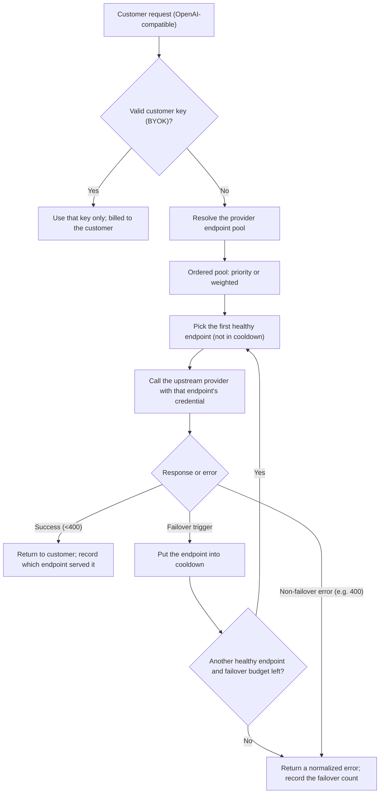

# PRD: Provider Endpoint Pool & Automatic Failover

> **Status:** Product proposal for review
> **Last updated:** September 2026
> **Audience:** Product and engineering review. No prior knowledge of GodarAI internals is assumed.
> **Scope:** GodarAI-managed provider accounts, meaning the credentials GodarAI itself uses to call upstream AI providers. Customer-supplied "bring your own key" (BYOK) accounts are out of scope for now.

## The idea in one paragraph

Today each AI provider in GodarAI is backed by a single active credential. This proposal lets us configure **a pool of endpoints and credentials per provider**. When one endpoint runs out of balance, hits a rate limit, or fails authentication, the gateway **automatically fails over** to the next healthy endpoint in the same pool, so the customer never sees the error. Operators manage the pool (order, weights, enable/disable, health) in the admin console. It is the "virtual model" idea applied one level down: **same provider, same model, several accounts behind it.**

## Problem

Every LLM provider caps each account or key with rate limits (requests and tokens per minute) and a balance or quota. With only one credential per provider:

- The first thing to break under load is a **429 rate-limit** error on that single account.
- When the account's **balance or quota runs out**, the whole provider goes down for every customer until an operator manually swaps in a new credential.
- Adding a second account or rotating a key cannot take effect cleanly today, because the system resolves one credential per provider at request time.

The product impact is lower availability, more 429/503 errors reaching customers, and manual operational toil for the support team.

## Proposed solution

### Core concepts

- **Endpoint:** one operational connection to a provider, made of an account/credential plus its non-secret settings (region, base URL, auth method).
- **Pool:** the set of active endpoints for a given provider and environment (for example, production). A pool has at least one member; when it has several, they are ordered or weighted.
- **Selection strategy:**
  - **Priority (MVP default):** try endpoints in priority order. The first healthy one serves the request; the rest form the failover chain.
  - **Weighted (fast-follow):** spread traffic across endpoints by weight, normalized to 100%. A weight of 0 pauses traffic without removing the endpoint.
- **Failover trigger:** the normalized error category that decides whether to move to the next endpoint (rate limit, insufficient balance/quota, auth failure, provider error, timeout).
- **Cooldown:** after a trigger, an endpoint is temporarily removed from selection for a configured period, so we stop hammering a known-bad account. Cooldown is temporary runtime state, not a permanent status.
- **Health:** each endpoint shows as Active, Degraded, Cooling down, or Disabled, along with its last successful test and last successful call.

### How a request flows

Key rules:

- **Failover budget:** a single request tries at most N additional endpoints (suggested default: the smaller of "pool size minus 1" and 3) to avoid retry storms.
- **Retry versus failover:** a retry re-attempts the same endpoint for transient errors such as a 500; a failover moves to the next endpoint for a 429, balance, or auth error. The two are handled separately.
- **Streaming:** failover is allowed only before the first byte or chunk reaches the customer. Once a stream has started, an error is passed through.
- **Request errors do not fail over:** a 400 (bad request) is the caller's problem and is returned as-is. We never replay it across accounts.

### Turning provider errors into triggers

Providers report "out of balance" and "rate limited" in different ways. A normalization layer maps raw errors to canonical triggers. This is the starting point:

| Trigger | HTTP status | Example provider signals | Fail over? | Default cooldown |
|---|---:|---|---|---|
| `rate_limited` | 429 | OpenAI `rate_limit_exceeded`; Anthropic `rate_limit_error`; zero remaining in `x-ratelimit-*` headers | Yes | 30–60s (or `Retry-After` in P1) |
| `insufficient_balance` | 429 / 402 | OpenAI `insufficient_quota`; OpenRouter "credit balance is too low" | Yes | Long (until reset or top-up; suggested 15 min + alert) |
| `quota_exhausted` | 429 | Daily or per-minute token/request quota used up | Yes | Until the reset window |
| `auth_failed` | 401 / 403 | `invalid_api_key`; expired or revoked key; forbidden | Yes | Long + immediate alert (bad credential) |
| `provider_error` | 500 / 502 / 503 / 504 | Anthropic `overloaded_error` / `api_error`; provider internal error | Yes (after one short retry) | Short (10–30s) |
| `timeout` | — | Network or service timeout | Yes | Short |
| `bad_request` | 400 / 422 | Invalid request from the caller; incompatible parameter | No | — (returned to the customer) |

Principle: **account-ownership errors (balance, rate, auth, 5xx) trigger failover; request-content errors (400) do not.** This stops a single bad request from being replayed across every account.

## Inspiration from other products

This is a proven pattern in LLM gateways. We borrow the product ideas, not the implementations.

- **Portkey** offers load balancing across "multiple API keys (same provider) to distribute load across rate limits from different accounts." In their words, adding multiple accounts for one provider "effectively multiplies your available rate limits." Fallbacks can trigger on specific status codes such as 429, and retries can respect a provider's `Retry-After` header.
- **TrueFoundry** supports priority, weight, and latency routing, including a documented "priority chain, fail over on rate limit" pattern using fallback status codes like 429. For Anthropic streaming, it fails over on `overloaded_error` before the first output chunk.
- **LiteLLM** runs multiple deployments per model with automatic cooldown after errors and usage-aware (TPM/RPM) routing. This confirms that "cooldown plus usage awareness" is the dominant approach.
- **OpenRouter** routes across providers with fallback plus price and availability controls, which is further evidence that "several accounts behind one model" is a real market need.

### How this maps to GodarAI

| Capability in other products | User value | GodarAI decision |
|---|---|---|
| Multiple keys/accounts per provider (Portkey load balancing) | Multiply rate limits, add resilience | **Include now** (pool + priority failover); weighted is fast-follow |
| Fallback on 429 / status codes | Reactive, transparent failover | **Include now (P0)** |
| Cooldown after errors (LiteLLM) | Stop hitting a bad endpoint | **Include now (P0)** |
| Retry that respects `Retry-After` (Portkey) | Honor provider reset windows | Defer (P1) |
| Weighted load balancing | Spread traffic proactively | Defer (P1) |
| Usage-based routing (RPM/TPM) | Avoid 429 before it happens | Defer (P1/P2) |
| Latency-based routing (TrueFoundry) | Optimize p95 latency | Defer (P2) |
| Canary via low weight | Roll a new account in gradually | Defer (P1) |
| Sticky routing (Portkey) | Keep sessions on one endpoint | Defer (P2) |
| Silent fallback from a customer key to a platform key | — | **Exclude** (changes who pays) |

## Where GodarAI stands today (high level)

- GodarAI is an LLM gateway. It accepts OpenAI-compatible requests from customers and routes them to upstream providers such as OpenAI, Anthropic, Google, xAI, and Mistral.
- The gateway already handles request routing, automatic retries, fallback between models, and "virtual models" that spread traffic across several targets. It also has a health and cooldown mechanism for routing.
- Provider credentials are managed in an internal admin console: created as drafts, tested before activation, versioned, and stored encrypted.
- **The gap:** at request time, each provider resolves to a single active credential. There is no pool and no automatic switching between multiple accounts for the same provider.
- **The good news:** the underlying data already stores a per-endpoint priority, weight, and "primary" flag, and the routing, retry, and cooldown machinery already exists. So this work is mostly about making credential resolution pool-aware, adding a failover loop, normalizing provider errors, and exposing pool controls in the admin console, rather than building from scratch.

> Detailed code and data-model grounding lives in the internal version of this PRD.

## Goals

- Let operators define multiple endpoints and credentials per provider and manage their order, weights, and status in the admin console.
- Fail over automatically and transparently when an endpoint runs out of balance or quota, hits a rate limit, or fails authentication.
- Increase availability and reduce the 429/503 errors that reach customers, with no change to the customer-facing API.
- Reduce the operational toil of rotating or adding accounts, with no restart or environment change required.
- Keep the system observable: operators can see which endpoint served each request, how many failovers happened, and each endpoint's usage and errors.
- Preserve billing correctness: pool paths stay platform-billed, and every request records the endpoint and credential version used.

## Non-goals

- Pools for customer-supplied keys (BYOK) in the tenant console. This is out of scope and handled separately later.
- Changing the public customer API or breaking OpenAI compatibility.
- Automatic credential rotation or building a new secrets manager. We reuse the existing encrypted storage.
- Region/geo-aware routing or data residency as part of the MVP.
- Replacing virtual models. This layer complements them.
- Per-endpoint pricing or cost management. We only record usage data for later reporting.

## Users and use cases

| User | Use case | Success signal |
|---|---|---|
| Support operator | Set up three accounts for a provider in priority order so a 429 on account 1 rolls to account 2 | No 429 reaches the customer; logs show account 2 served the request |
| Support operator | A provider account runs out of balance | The endpoint cools down, the pool serves from a backup automatically, and an "out of balance" alert fires |
| Platform / DevOps | Add a new account without downtime | The new endpoint goes draft → test → activate and takes effect in under a minute |
| End customer (indirect) | Send requests during peak traffic | The success rate stays high and the extra latency from failover stays acceptable |
| Finance / product | See usage split across a provider's accounts | Usage is attributable per endpoint in metrics |

## Requirements (prioritized)

### P0 — Core reactive failover and basic pool control

- **FR-1:** Resolve all active endpoints for a provider (and environment) as an ordered pool, not a single value. Default order is by priority, then the "primary" flag.
- **FR-2:** If the chosen endpoint returns a failover trigger (rate limit, insufficient balance/quota, auth failure, provider error, timeout), move the request automatically to the next healthy endpoint.
- **FR-3:** Put a failed endpoint into cooldown for a configured period. Cooldown is temporary runtime state.
- **FR-4:** Enforce "at most one primary endpoint per provider and environment."
- **FR-5:** Let operators create multiple endpoints per provider in the admin console and set priority, primary, and enable/disable. Disabling is enough; forced deletion is not required.
- **FR-6:** Show endpoint health in the console: status, last test, last success, any active cooldown, and a summarized error category.
- **FR-7:** Record per request: the credential source, the endpoint, the credential version, the number of failovers, and the final trigger. Never log secrets or auth headers.
- **FR-8:** Every pool path stays platform-billed. There is no silent fallback from a customer key to a platform key.
- **FR-9:** Stay backward compatible: a single-endpoint pool behaves exactly as today, the existing environment-based and emergency ("break-glass") paths are unchanged, and no destructive migration is needed.
- **FR-10:** If every endpoint is in cooldown or disabled, return a clear, actionable "provider pool exhausted" error (503), not a timeout or a vague error.
- Roll out first for providers whose request and auth handling is already fully supported in production.

### P1 — Proactive load spreading and operational control

- **FR-11:** Weighted strategy (normalize weights to 100%; a weight of 0 pauses traffic without removal).
- **FR-12:** Derive the cooldown duration from `Retry-After` / `retry-after-ms` / `x-ms-retry-after-ms` when the provider sends it, with a protective cap (for example, 60s per attempt).
- **FR-13:** Manual "cool down now" and "restore" actions per endpoint.
- **FR-14:** Pool-level policy in the console: selection strategy, max failover attempts, which triggers cause failover, and the default cooldown per trigger.
- **FR-15:** Track per-endpoint usage (RPM/TPM in the current window) to proactively avoid an endpoint that is approaching its rate limit.
- **FR-16:** Alerts when an endpoint fails over repeatedly, or when a whole pool is cooling down at once (provider outage risk).
- **FR-17:** Canary: give a new endpoint a low weight to ease traffic in before promoting it to primary.

### P2 — Operational maturity and intelligence

- **FR-18:** Latency-based selection (lowest recent latency, with an SLA cutoff and anti-thrashing), once telemetry is mature.
- **FR-19:** Per-endpoint usage and cost dashboard for finance and capacity decisions.
- **FR-20:** Proactive balance detection via provider webhooks or polling where available, instead of only reacting to errors.
- **FR-21:** Sticky routing as a weighted add-on (hash on user/session with a TTL) for session consistency.
- **FR-22:** Per-endpoint concurrency limits and region-aware selection.
- **FR-23:** Pools for customer-supplied keys (BYOK) in the tenant console. This needs a separate cost-ownership model and is explicitly out of scope here.

## Admin experience

- A **provider endpoint pool** section per provider and environment, showing the selection strategy, a policy summary, the number of active endpoints, and whether a primary is set.
- Each **endpoint card** shows: name, region, auth method, status, priority or weight, a primary badge, the last test and last success, any active cooldown with time remaining, and (in P1) current usage and recent failover rate.
- **Adding an endpoint** reuses the existing draft → test → activate flow, plus the pool fields (priority, weight, primary, region, scope).
- **Managing the pool**: reorder priority, set or transfer primary, adjust weights, enable/disable, manual cooldown/restore (P1), and a pool policy panel (P1).
- **Edge states**: empty pool, single member, all endpoints cooling down (red banner plus a restore action), and attempting to set a second primary (blocked with a clear message).
- **Access control**: viewing health is broadly available to support staff; changing pool order, weights, or policy is restricted to an admin role. Stored secrets are never returned to the browser.

## MVP cutline

- **Ships now (P0):** pool resolution, reactive failover on normalized triggers, per-endpoint cooldown, the single-primary rule, console controls for priority/enable/disable/primary and health, request tracing and metrics, platform billing preserved, and backward compatibility for single-endpoint pools. Start with fully supported providers.
- **Fast-follow (P1):** weighted load balancing, `Retry-After` cooldown, manual cooldown/restore, pool policy in the console, usage counters with usage-aware selection, alerts, and canary.
- **Later (P2):** latency-based selection, a per-endpoint cost dashboard, proactive balance detection, sticky routing, concurrency limits, region-aware selection, and BYOK pools (separate document).

## Metrics

- **Activation:** number of providers with a pool size of 2 or more; percentage of platform traffic served by a non-primary endpoint.
- **Reliability:** failover success rate; percentage of 429 and insufficient-balance events converted into a successful response via failover; customer-visible error rate before and after; cooldown count and duration.
- **Latency:** added p95 latency per failover hop.
- **Cost:** usage split per endpoint; distribution of platform-billed spend across accounts.
- **Support:** number of incidents caused by "a single exhausted or broken credential" (this should drop).

## Risks and mitigations

| Risk | Mitigation |
|---|---|
| Retry storm / hammering a provider during an outage | Cap max failover attempts, use backoff, honor `Retry-After`, apply cooldown, add a pool-level circuit breaker |
| Misclassifying "out of balance" (false positive or negative) | Conservative normalization table, start with fully supported providers, test each error category |
| Cooldown divergence across gateway instances | Use a shared cache or a short TTL; temporary divergence is acceptable if each instance independently avoids a bad endpoint |
| Secret leakage in logs or traces | Strict redaction; resolved credentials are never serialized or logged |
| Misconfiguration (two primaries or an empty pool) | Data constraint plus console validation plus UX warnings |
| Added customer latency | Failover budget, failover only before the first chunk in streams, and a p95 metric |
| Scope creep into customer BYOK | Explicit non-goal; the runtime keeps BYOK separate from the platform pool |

## Acceptance criteria

- With two active endpoints for a provider, when the first returns 429, the request is served automatically by the second and the customer gets a success. The trace records a failover count of 1 and the second endpoint.
- When an endpoint returns insufficient balance, it is removed from rotation for the configured cooldown, and subsequent requests go straight to a healthy endpoint.
- If all endpoints are cooling down, a "provider pool exhausted" 503 is returned without calling upstream.
- A 400 request error is returned to the customer without failing over or replaying across accounts.
- Creating a second primary for the same provider and environment is rejected in both the data layer and the console.
- A single-endpoint pool behaves exactly as today (no regression).
- No secret or auth header appears in logs, traces, or audit records.
- Activating or disabling an endpoint takes effect at runtime in under a minute, without a restart.
- All pool paths remain platform-billed.

## Roadmap

- **Phase 1 — Runtime foundation (P0):** pool-aware resolution, the failover loop, provider-error normalization, per-endpoint cooldown, the single-primary constraint, request tracing and metrics, and tests for each behavior.
- **Phase 2 — Admin console (P0):** pool view and endpoint cards with health, controls for priority/primary/enable-disable, edge states, and access control.
- **Phase 3 — Load spreading and operations (P1):** weighted strategy and canary, `Retry-After` cooldown, pool policy (API and UI), manual cooldown/restore, usage counters with usage-aware selection, and alerts.
- **Phase 4 — Maturity (P2):** latency-based selection, cost dashboard, balance detection, sticky routing, concurrency limits, and region-aware selection.

## Open questions

- Should pool policy be a global default for the MVP, or per-provider configurable from day one? (Recommendation: global default first, to keep the P0 cut small.)
- What default values should we use for max failover attempts and the cooldown of each trigger?
- Should cooldown use a shared cache or a per-instance cache with a short TTL for the MVP?
- Should insufficient balance cool down longer than a rate limit, or stay out of rotation until the account is topped up?
- For streaming, is pre-first-chunk failover on overload needed for all providers, or only Anthropic?

## Sources

- **Portkey** — Load Balancing, Fallbacks, Automatic Retries, and "Tackling Rate Limiting."
- **TrueFoundry** — AI Gateway routing and load balancing, and Virtual Models.
- **LiteLLM** and **OpenRouter** — public routing, cooldown, and multi-account behavior.
- **GodarAI internal** — the detailed PRD with code and data-model grounding: `platform-provider-endpoint-pool-failover-prd.md`.
