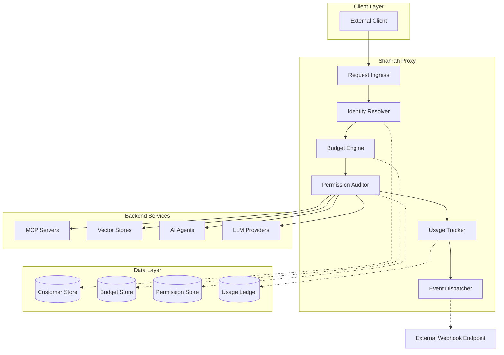
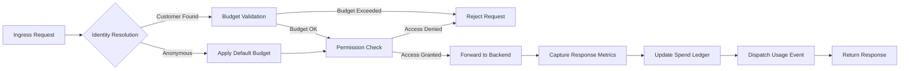
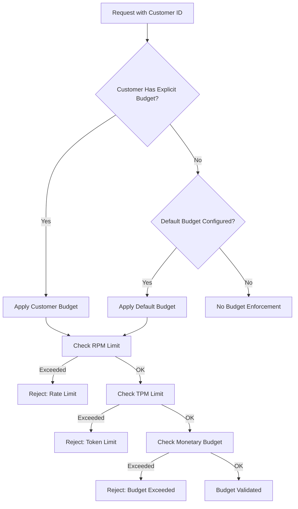
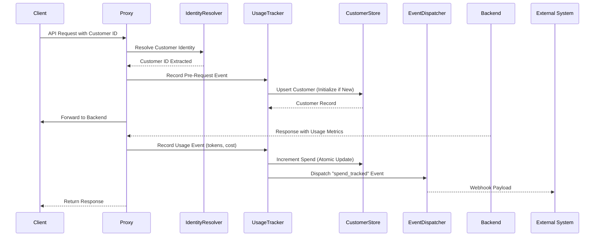
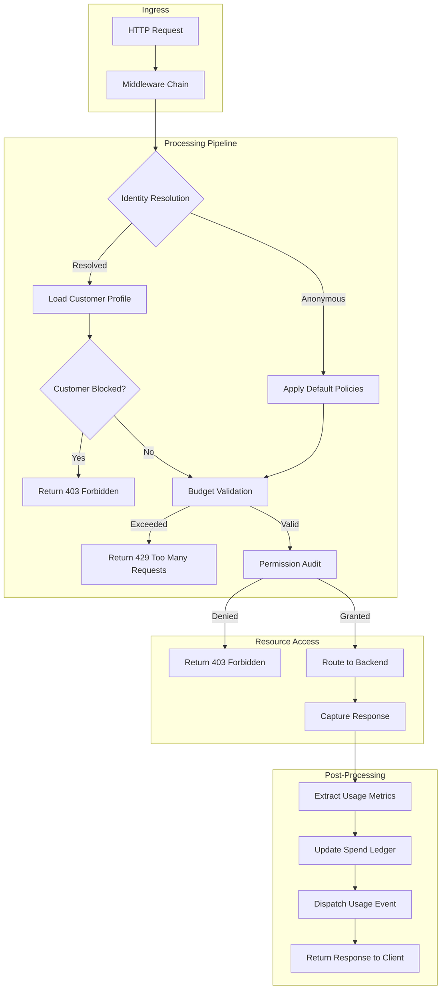
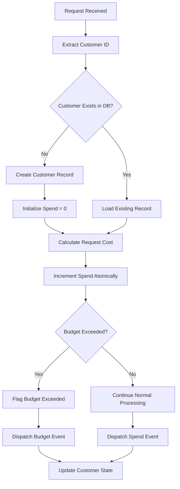
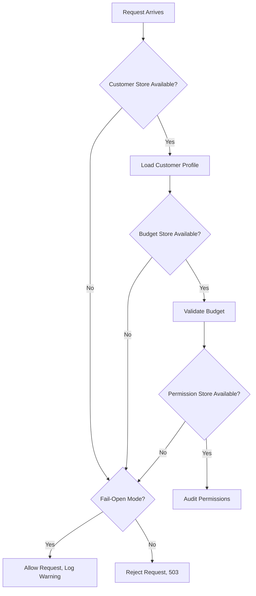

# Shahrah Proxy System: Technical Design Document

## Customer Spend Tracking, Budget Enforcement, and Resource Permissions

**Version:** 1.0  
**Status:** Draft  
**Author:** Architecture Team  
**Last Updated:** 2026-04-25

---

## Executive Overview

Shahrah is a high-performance, Go-native proxy system engineered to provide granular control over customer spend tracking, budget enforcement, and resource access permissions in multi-tenant AI service environments. The system operates as an intelligent gateway between end-users and AI model providers, enforcing policies, tracking usage metrics, and managing access control lists for heterogeneous backend resources.

### Design Principles

1. **Identity-First Architecture**: Every request is attributed to a customer identity through a cascading header/body resolution strategy
2. **Incremental Spend Tracking**: Atomic spend accumulation with upsert semantics for customer records
3. **Hierarchical Budget Control**: Default budgets apply globally, explicit budgets override per-customer
4. **Granular Resource Permissions**: Fine-grained access control for MCP servers, vector stores, agents, and tool-level permissions
5. **Event-Driven Observability**: Real-time webhook notifications for spend tracking and budget events
6. **Zero-Trust Default Stance**: Null permissions deny all; explicit allow-lists required for resource access

### Key Capabilities

- Multi-source customer identity extraction with configurable priority chains
- Real-time spend accumulation and budget enforcement (RPM, TPM, monetary)
- Tiered pricing models with budget templates
- Object-level permission management for AI infrastructure resources
- Event webhook integration for external system synchronization
- Projected spend analytics and budget exhaustion forecasting

---

## System Architecture

### High-Level Component Diagram



### Request Processing Pipeline



---

## Core Module Specifications

### 1. Identity Resolution Module

The Identity Resolution Module extracts customer identifiers from incoming requests using a configurable priority chain. First match wins.

#### Default Resolution Chain

| Priority | Extraction Source | Location | Description |
|----------|-------------------|----------|-------------|
| 1 | `X-Shahrah-Customer-ID` | HTTP Header | Primary standard header |
| 2 | `X-Shahrah-End-User-ID` | HTTP Header | Alternate standard header |
| 3 | Custom Header (Configurable) | HTTP Header | Defined via `userHeaderMappings` |
| 4 | `user` Field | Request Body | OpenAI-compatible field |
| 5 | `shahrah_metadata.user` Field | Request Body | Metadata-style user field |
| 6 | `metadata.user_id` Field | Request Body | Generic metadata pattern |
| 7 | `safety_identifier` Field | Request Body | Responses API identifier |

#### Go Implementation Structure

```go
// IdentityResolver handles customer ID extraction from requests
type IdentityResolver struct {
    priorityChain []IdentitySource
    headerMappings []HeaderMapping
}

// IdentitySource represents a single extraction method
type IdentitySource struct {
    Priority int
    Extractor  func(*http.Request) (string, error)
}

// HeaderMapping defines custom header configurations
type HeaderMapping struct {
    HeaderName   string
    UserRole     string
}

// ResolutionResult contains the extracted identity
type ResolutionResult struct {
    CustomerID  string
    Source      string
    Priority    int
}
```

#### Resolution Algorithm

```go
func (r *IdentityResolver) Resolve(req *http.Request) (*ResolutionResult, error) {
    for _, source := range r.priorityChain {
        id, err := source.Extractor(req)
        if err == nil && id != "" {
            return &ResolutionResult{
                CustomerID: id,
                Source:     source.Name,
                Priority:   source.Priority,
            }, nil
        }
    }
    return nil, ErrCustomerIdentityNotFound
}
```

---

### 2. Budget Engine Module

The Budget Engine enforces spending and rate limits at multiple levels: customer-specific, default fallback, and tier-based.

#### Budget Configuration Schema

```yaml
budget:
  budgetId: string           # Unique budget identifier
  maxBudget: float64         # Maximum monetary spend (null = unlimited)
  rpmLimit: int              # Requests per minute limit
  tpmLimit: int              # Tokens per minute limit
  resetPeriod: string        # "monthly", "daily", "weekly"
  
globalSettings:
  defaultBudgetId: string    # Applied to customers without explicit budgets
```

#### Go Implementation Structure

```go
// Budget defines spending and rate constraints
type Budget struct {
    BudgetID    string
    MaxBudget   *float64
    RPMLimit    int
    TPMLimit    int
    ResetPeriod ResetPeriod
}

// BudgetEnforcer evaluates budget constraints
type BudgetEnforcer struct {
    store        BudgetStore
    rateLimiter  RateLimiter
    defaultBudget *Budget
}

// BudgetCheckResult contains validation results
type BudgetCheckResult struct {
    Allowed          bool
    RemainingBudget  float64
    ProjectedExhaust *time.Time
    Reason           string
}

// RateLimiter handles RPM/TPM tracking
type RateLimiter interface {
    CheckRate(customerID string, tokens int) (*RateStatus, error)
    RecordUsage(customerID string, tokens int, cost float64) error
}
```

#### Budget Resolution Logic



#### Default Budget Application

The default budget mechanism applies rate limiting and spending controls to all customers who do not have explicit budgets assigned. This is configured via:

```yaml
globalSettings:
  defaultBudgetId: "budget-global-default"
```

Customers with explicit budgets are unaffected by the default budget configuration.

---

### 3. Permission Auditor Module

The Permission Auditor enforces object-level access control for AI infrastructure resources including MCP servers, vector stores, agents, and tool-level permissions.

#### Object Permission Schema

```go
// ObjectPermission defines resource access controls
type ObjectPermission struct {
    PermissionID      string
    MCPServers        []string             // Allowed MCP server IDs
    MCPAccessGroups   []string             // MCP server group memberships
    MCPToolPermissions map[string][]string  // Server ID -> allowed tools
    VectorStores      []string             // Allowed vector store IDs
    Agents            []string             // Allowed agent IDs
    AgentAccessGroups []string             // Agent group memberships
}

// CustomerProfile combines identity, budget, and permissions
type CustomerProfile struct {
    UserID            string
    Blocked           bool
    Alias             *string
    Spend             float64
    AllowedModelRegion *string
    DefaultModel      *string
    BudgetID          *string
    ObjectPermission  *ObjectPermission
}
```

#### Permission Types

| Permission Type | Description | Configuration |
|----------------|-------------|---------------|
| MCP Servers | Direct server access allow-list | `mcpServers: ["server-1", "server-2"]` |
| MCP Access Groups | Group-based server access | `mcpAccessGroups: ["public-group"]` |
| MCP Tool Permissions | Granular tool-level control | `mcpToolPermissions: {"server-1": ["tool-a"]}` |
| Vector Stores | Knowledge base access control | `vectorStores: ["vs-1"]` |
| Agents | Agent interaction permissions | `agents: ["agent-1"]` |
| Agent Access Groups | Group-based agent access | `agentAccessGroups: ["basic-agents"]` |

#### Access Control Evaluation

```mermaid
flowchart TD
    A[Resource Access Request] --> B{Customer Blocked?}
    B -->|Yes| C[Deny Access]
    B -->|No| D{Permission Object Exists?}
    D -->|No (Null/Empty)| E[Allow All Access]
    D -->|Yes| F{Direct Server/Resource ID in Allow-List?}
    F -->|Yes| G[Grant Access]
    F -->|No| H{Access Group Membership?}
    H -->|Yes| G
    H -->|No| I{Tool-Level Permission Required?}
    I -->|Yes| J{Specific Tool Allowed?}
    J -->|Yes| G
    J -->|No| C
    I -->|No| C
```

#### Permission Update API

```go
// UpdatePermissionRequest defines the permission update payload
type UpdatePermissionRequest struct {
    UserID           string             `json:"user_id"`
    ObjectPermission *ObjectPermission  `json:"object_permission,omitempty"`
}

// PermissionStore handles persistence
type PermissionStore interface {
    GetPermissions(ctx context.Context, userID string) (*ObjectPermission, error)
    UpsertPermissions(ctx context.Context, userID string, perm *ObjectPermission) error
    CheckAccess(ctx context.Context, userID string, resourceType string, resourceID string) (bool, error)
}
```

---

### 4. Usage Tracker Module

The Usage Tracker maintains atomic spend ledgers, computes usage analytics, and triggers budget exhaustion projections.

#### Usage Event Schema

```go
// UsageEvent represents a single usage transaction
type UsageEvent struct {
    EventID              string
    CustomerID           string
    Spend                float64
    TokenCount           int
    Model                string
    Timestamp            time.Time
    RequestID            string
}

// UsageSummary provides aggregated customer metrics
type UsageSummary struct {
    CustomerID           string
    TotalSpend           float64
    TotalTokens          int
    RequestCount         int
    CurrentRPMAverage    float64
    CurrentTPMAverage    float64
    ProjectedExceededDate *time.Time
    ProjectedSpend       *float64
}
```

#### Spend Tracking Flow



#### Go Implementation Structure

```go
// UsageTracker manages spend accumulation and analytics
type UsageTracker struct {
    store          UsageStore
    eventBus       EventBus
    costCalculator CostCalculator
}

// UsageStore handles persistence
type UsageStore interface {
    UpsertCustomer(ctx context.Context, customer *Customer) error
    IncrementSpend(ctx context.Context, customerID string, amount float64) error
    GetUsageSummary(ctx context.Context, customerID string) (*UsageSummary, error)
    RecordEvent(ctx context.Context, event *UsageEvent) error
}

// UsageEventPayload defines the webhook event structure
type UsageEventPayload struct {
    Spend                float64  `json:"spend"`
    MaxBudget            *float64 `json:"max_budget,omitempty"`
    Token                string   `json:"token"`
    CustomerID           string   `json:"customer_id"`
    UserID               *string  `json:"user_id,omitempty"`
    TeamID               *string  `json:"team_id,omitempty"`
    UserEmail            *string  `json:"user_email,omitempty"`
    KeyAlias             *string  `json:"key_alias,omitempty"`
    ProjectedExceededDate *time.Time `json:"projected_exceeded_date,omitempty"`
    ProjectedSpend       *float64 `json:"projected_spend,omitempty"`
    Event                string   `json:"event"`
    EventGroup           string   `json:"event_group"`
    EventMessage         string   `json:"event_message"`
}
```

---

### 5. Event Dispatcher Module

The Event Dispatcher publishes usage events to configured webhook endpoints for external system synchronization.

#### Webhook Configuration

```yaml
alerting:
  - webhook

webhookSettings:
  url: "https://external-system.example.com/webhook"
  retryPolicy:
    maxRetries: 3
    backoffMs: 1000
  timeoutMs: 5000
```

#### Event Types

| Event Name | Event Group | Trigger |
|------------|-------------|---------|
| `spend_tracked` | `customer` | Customer usage recorded |
| `budget_exceeded` | `customer` | Customer budget exceeded |
| `rate_limit_exceeded` | `customer` | RPM/TPM limit exceeded |
| `access_denied` | `permission` | Resource access denied |

#### Go Implementation Structure

```go
// EventDispatcher handles webhook delivery
type EventDispatcher struct {
    httpClient   *http.Client
    config       WebhookConfig
    retryPolicy  RetryPolicy
}

// WebhookConfig defines webhook settings
type WebhookConfig struct {
    URL         string
    Enabled     bool
    Timeout     time.Duration
    MaxRetries  int
    BackoffMs   int
}

// Dispatch sends an event to the webhook endpoint
func (d *EventDispatcher) Dispatch(ctx context.Context, payload UsageEventPayload) error {
    // Implementation with retry logic and timeout handling
}
```

---

## Configuration Schemas

### Complete Configuration Example

```yaml
# shahrah-config.yaml

# Global Settings
globalSettings:
  defaultBudgetId: "budget-default"
  alerting:
    - webhook
  userHeaderMappings:
    - headerName: "X-MyApp-User-ID"
      userRole: "customer"

# Webhook Settings
webhookSettings:
  url: "https://external-system.example.com/webhook"
  retryPolicy:
    maxRetries: 3
    backoffMs: 1000
  timeoutMs: 5000

# Budget Definitions
budgets:
  - budgetId: "budget-free"
    maxBudget: 4.00
    rpmLimit: 10
    tpmLimit: 5000
    resetPeriod: "monthly"
    
  - budgetId: "budget-premium"
    maxBudget: 100.00
    rpmLimit: 100
    tpmLimit: 50000
    resetPeriod: "monthly"
    
  - budgetId: "budget-default"
    maxBudget: 10.00
    rpmLimit: 5
    tpmLimit: 2000
    resetPeriod: "monthly"

# Customer Definitions (Optional - can be created via API)
customers:
  - userId: "customer-free-001"
    budgetId: "budget-free"
    objectPermission:
      mcpAccessGroups: ["public-group"]
      agentAccessGroups: ["basic-agents"]
      
  - userId: "customer-premium-001"
    budgetId: "budget-premium"
    objectPermission:
      mcpServers: ["server-1", "server-2", "server-3"]
      vectorStores: ["vs-1", "vs-2"]
      agents: ["agent-1", "agent-2"]
```

### API Endpoint Schemas

#### Create Customer

```
POST /api/v1/customers

Request Body:
{
  "user_id": "string",
  "alias": "string (optional)",
  "budget_id": "string (optional)",
  "max_budget": float64 (optional, inline budget),
  "rpm_limit": int (optional),
  "tpm_limit": int (optional),
  "object_permission": {
    "mcp_servers": ["string"],
    "mcp_access_groups": ["string"],
    "mcp_tool_permissions": {"server_id": ["tool_name"]},
    "vector_stores": ["string"],
    "agents": ["string"],
    "agent_access_groups": ["string"]
  }
}

Response (200):
{
  "user_id": "string",
  "blocked": false,
  "alias": "string",
  "spend": float64,
  "allowed_model_region": "string",
  "default_model": "string",
  "budget_id": "string",
  "object_permission": { ... }
}
```

#### Get Customer Info

```
GET /api/v1/customers/{customer_id}

Response (200):
{
  "user_id": "string",
  "blocked": false,
  "alias": "string",
  "spend": float64,
  "allowed_model_region": "string",
  "default_model": "string",
  "budget_id": "string",
  "object_permission": { ... }
}
```

#### Update Customer Permissions

```
POST /api/v1/customers/{customer_id}/permissions

Request Body:
{
  "object_permission": {
    "mcp_servers": ["string"],
    "mcp_access_groups": ["string"],
    "mcp_tool_permissions": {"server_id": ["tool_name"]},
    "vector_stores": ["string"],
    "agents": ["string"],
    "agent_access_groups": ["string"]
  }
}
```

---

## Go-Specific Implementation Guidelines

### Package Structure

```
shahrah/
├── cmd/
│   └── shahrah/
│       └── main.go
├── internal/
│   ├── identity/
│   │   ├── resolver.go
│   │   ├── sources.go
│   │   └── resolver_test.go
│   ├── budget/
│   │   ├── enforcer.go
│   │   ├── rate_limiter.go
│   │   └── budget_test.go
│   ├── permission/
│   │   ├── auditor.go
│   │   ├── evaluator.go
│   │   └── permission_test.go
│   ├── usage/
│   │   ├── tracker.go
│   │   ├── ledger.go
│   │   └── usage_test.go
│   ├── events/
│   │   ├── dispatcher.go
│   │   ├── webhook.go
│   │   └── dispatcher_test.go
│   └── config/
│       ├── loader.go
│       ├── schema.go
│       └── validation.go
├── pkg/
│   ├── models/
│   │   ├── customer.go
│   │   ├── budget.go
│   │   └── permission.go
│   ├── store/
│   │   ├── customer_store.go
│   │   ├── budget_store.go
│   │   └── usage_store.go
│   └── middleware/
│       ├── auth.go
│       ├── identity.go
│       └── rate_limit.go
├── api/
│   ├── handlers/
│   │   ├── customer.go
│   │   ├── budget.go
│   │   └── permission.go
│   └── routes/
│       └── routes.go
├── configs/
│   └── default-config.yaml
└── tests/
    ├── integration/
    └── benchmarks/
```

### Concurrency Patterns

#### Atomic Spend Updates

```go
// UsageStore implements atomic spend accumulation
func (s *PostgresUsageStore) IncrementSpend(ctx context.Context, customerID string, amount float64) error {
    query := `
        INSERT INTO customers (user_id, spend)
        VALUES ($1, $2)
        ON CONFLICT (user_id)
        DO UPDATE SET spend = customers.spend + $2
    `
    _, err := s.db.ExecContext(ctx, query, customerID, amount)
    return err
}
```

#### Rate Limiter with Sliding Window

```go
// SlidingWindowRateLimiter implements RPM/TPM tracking
type SlidingWindowRateLimiter struct {
    mu       sync.RWMutex
    windows  map[string]*SlidingWindow
    windowSize time.Duration
}

type SlidingWindow struct {
    events []time.Time
    mu     sync.Mutex
}

func (r *SlidingWindowRateLimiter) CheckRate(customerID string, tokens int) (*RateStatus, error) {
    r.mu.RLock()
    window, exists := r.windows[customerID]
    r.mu.RUnlock()
    
    if !exists {
        window = &SlidingWindow{}
        r.mu.Lock()
        r.windows[customerID] = window
        r.mu.Unlock()
    }
    
    return window.Check(time.Now(), r.windowSize)
}
```

### Error Handling Strategy

```go
// Error types for budget and permission failures
var (
    ErrCustomerIdentityNotFound = errors.New("customer identity not found in request")
    ErrBudgetExceeded           = errors.New("customer budget exceeded")
    ErrRateLimitExceeded        = errors.New("rate limit exceeded (RPM/TPM)")
    ErrAccessDenied             = errors.New("resource access denied by permission auditor")
    ErrCustomerBlocked          = errors.New("customer is blocked")
)

// BudgetError provides detailed budget rejection information
type BudgetError struct {
    CustomerID      string
    BudgetLimit     float64
    CurrentSpend    float64
    ProjectedDate   *time.Time
}

func (e *BudgetError) Error() string {
    return fmt.Sprintf("budget exceeded for customer %s: spend=%.2f, limit=%.2f",
        e.CustomerID, e.CurrentSpend, e.BudgetLimit)
}
```

---

## Data Flow Diagrams

### Complete Request Lifecycle



### Customer Spend Tracking Flow



---

## Performance and Fault-Tolerance Strategies

### Performance Optimization

#### In-Memory Caching

```go
// CustomerCache provides fast customer profile lookup
type CustomerCache struct {
    cache  *sync.Map  // userID -> *CachedProfile
    ttl    time.Duration
    loader CustomerLoader
}

type CachedProfile struct {
    Profile   *CustomerProfile
    ExpiresAt time.Time
}

func (c *CustomerCache) Get(ctx context.Context, userID string) (*CustomerProfile, error) {
    if cached, ok := c.cache.Load(userID); ok {
        entry := cached.(*CachedProfile)
        if time.Now().Before(entry.ExpiresAt) {
            return entry.Profile, nil
        }
        c.cache.Delete(userID)
    }
    
    profile, err := c.loader.Load(ctx, userID)
    if err != nil {
        return nil, err
    }
    
    c.cache.Store(userID, &CachedProfile{
        Profile:   profile,
        ExpiresAt: time.Now().Add(c.ttl),
    })
    
    return profile, nil
}
```

#### Rate Limiter Optimization

Use Redis-backed rate limiting for distributed deployments:

```go
// RedisRateLimiter implements distributed rate limiting
type RedisRateLimiter struct {
    client     *redis.Client
    prefix     string
}

func (r *RedisRateLimiter) CheckRate(ctx context.Context, customerID string, tokens int) (*RateStatus, error) {
    key := fmt.Sprintf("%s:rate:%s", r.prefix, customerID)
    now := time.Now().UnixMilli()
    windowStart := now - 60000  // 1-minute window
    
    pipe := r.client.Pipeline()
    pipe.ZRemRangeByScore(ctx, key, "0", fmt.Sprintf("%d", windowStart))
    pipe.ZCard(ctx, key)
    pipe.ZAdd(ctx, key, redis.Z{Score: float64(now), Member: fmt.Sprintf("%d", now)})
    pipe.Expire(ctx, key, 2*time.Minute)
    
    results, err := pipe.Exec(ctx)
    if err != nil {
        return nil, err
    }
    
    count := results[1].(*redis.IntCmd).Val()
    return &RateStatus{
        CurrentRPM: count,
        Allowed:    count < r.rpmLimit,
    }, nil
}
```

### Fault Tolerance

#### Graceful Degradation



#### Database Connection Resilience

```go
// ResilientStore wraps database operations with retry logic
type ResilientStore struct {
    db       *sql.DB
    config   RetryConfig
}

func (s *ResilientStore) ExecuteWithRetry(ctx context.Context, fn func(context.Context, *sql.DB) error) error {
    var lastErr error
    for attempt := 0; attempt < s.config.MaxRetries; attempt++ {
        err := fn(ctx, s.db)
        if err == nil {
            return nil
        }
        
        lastErr = err
        if !isRetryableError(err) {
            return err
        }
        
        backoff := time.Duration(attempt) * s.config.Backoff
        select {
        case <-time.After(backoff):
            continue
        case <-ctx.Done():
            return ctx.Err()
        }
    }
    return lastErr
}
```

#### Webhook Delivery Reliability

```go
// WebhookDispatcher implements reliable event delivery
type WebhookDispatcher struct {
    client     *http.Client
    queue      chan UsageEventPayload
    config     WebhookConfig
}

func (d *WebhookDispatcher) Start(ctx context.Context) {
    go func() {
        for {
            select {
            case <-ctx.Done():
                return
            case payload := <-d.queue:
                d.deliverWithRetry(ctx, payload)
            }
        }
    }()
}

func (d *WebhookDispatcher) deliverWithRetry(ctx context.Context, payload UsageEventPayload) {
    for attempt := 0; attempt < d.config.MaxRetries; attempt++ {
        err := d.sendWebhook(ctx, payload)
        if err == nil {
            return
        }
        
        backoff := time.Duration(attempt+1) * time.Duration(d.config.BackoffMs) * time.Millisecond
        time.Sleep(backoff)
    }
    log.Error("webhook delivery failed after all retries", "payload", payload)
}
```

---

## Testing Strategy

### Unit Testing

```go
func TestIdentityResolver_PriorityChain(t *testing.T) {
    resolver := NewIdentityResolver([]IdentitySource{
        {Priority: 1, Name: "header-primary", Extractor: extractHeader("X-Shahrah-Customer-ID")},
        {Priority: 2, Name: "header-secondary", Extractor: extractHeader("X-Shahrah-End-User-ID")},
        {Priority: 3, Name: "body-user", Extractor: extractBodyUser},
    })
    
    tests := []struct {
        name       string
        headers    map[string]string
        body       map[string]interface{}
        expectedID string
    }{
        {
            name:       "primary header takes precedence",
            headers:    map[string]string{"X-Shahrah-Customer-ID": "customer-1", "X-Shahrah-End-User-ID": "customer-2"},
            expectedID: "customer-1",
        },
        // Additional test cases...
    }
    
    for _, tt := range tests {
        t.Run(tt.name, func(t *testing.T) {
            req := httptest.NewRequest("POST", "/chat", nil)
            for k, v := range tt.headers {
                req.Header.Set(k, v)
            }
            
            result, err := resolver.Resolve(req)
            require.NoError(t, err)
            assert.Equal(t, tt.expectedID, result.CustomerID)
        })
    }
}
```

### Integration Testing

```go
func TestCustomerSpendTracking(t *testing.T) {
    // Setup test environment
    env := setupTestEnvironment(t)
    defer env.Teardown()
    
    // Create customer
    customer := env.CustomerStore.CreateCustomer(context.Background(), &Customer{
        UserID: "test-customer",
    })
    
    // Record usage
    env.UsageTracker.RecordUsage(context.Background(), &UsageEvent{
        CustomerID: "test-customer",
        Spend:      0.001,
        TokenCount: 100,
    })
    
    // Verify spend accumulation
    summary, err := env.UsageTracker.GetUsageSummary(context.Background(), "test-customer")
    require.NoError(t, err)
    assert.Equal(t, 0.001, summary.TotalSpend)
}
```

### Load Testing

```go
func BenchmarkBudgetEnforcer_CheckRate(b *testing.B) {
    enforcer := setupBudgetEnforcer(b)
    customerID := "benchmark-customer"
    
    b.ResetTimer()
    b.RunParallel(func(pb *testing.PB) {
        for pb.Next() {
            _, _ = enforcer.CheckRate(context.Background(), customerID, 100)
        }
    })
}
```

---

## Phased Rollout Plan

### Phase 1: Core Infrastructure (Weeks 1-3)

**Objectives:**
- Establish project structure and build system
- Implement configuration loading and validation
- Build core data models (Customer, Budget, ObjectPermission)
- Set up database schema and migrations
- Implement basic API server with health endpoints

**Deliverables:**
- [ ] Go module initialization with dependency management
- [ ] Configuration schema definition and YAML parser
- [ ] Prisma-style ORM layer or raw SQL abstraction
- [ ] Customer CRUD API endpoints
- [ ] Budget CRUD API endpoints
- [ ] Health check and readiness endpoints
- [ ] Basic logging and structured error handling

### Phase 2: Identity Resolution (Weeks 4-5)

**Objectives:**
- Implement priority-chain based customer identity extraction
- Support all identity sources (headers, body fields, metadata)
- Add configurable header mappings
- Write comprehensive unit tests

**Deliverables:**
- [ ] IdentityResolver with priority chain
- [ ] HTTP header extractors
- [ ] Request body field extractors
- [ ] Configuration for custom header mappings
- [ ] Unit test suite for all resolution paths
- [ ] Integration tests with mock HTTP server

### Phase 3: Usage Tracking (Weeks 6-8)

**Objectives:**
- Implement atomic spend accumulation
- Build usage event ledger
- Create customer spend query endpoint
- Add webhook event dispatching

**Deliverables:**
- [ ] UsageStore with atomic upsert operations
- [ ] Spend increment logic
- [ ] Customer info endpoint with spend data
- [ ] EventDispatcher with webhook delivery
- [ ] Retry logic for failed webhook deliveries
- [ ] Usage event payload serialization

### Phase 4: Budget Engine (Weeks 9-11)

**Objectives:**
- Implement budget validation logic
- Build sliding window rate limiter for RPM/TPM
- Add default budget fallback mechanism
- Create budget exhaustion projections

**Deliverables:**
- [ ] BudgetEnforcer with validation pipeline
- [ ] In-memory rate limiter implementation
- [ ] Redis-backed distributed rate limiter
- [ ] Default budget resolution logic
- [ ] Budget exhaustion projection algorithm
- [ ] Budget exceeded error responses

### Phase 5: Permission Auditor (Weeks 12-14)

**Objectives:**
- Implement object-level permission evaluation
- Support MCP server, vector store, and agent access controls
- Add tool-level permission granularity
- Create permission update API

**Deliverables:**
- [ ] PermissionAuditor with access evaluation
- [ ] Direct resource ID allow-list checking
- [ ] Access group membership resolution
- [ ] MCP tool-level permission enforcement
- [ ] Permission update endpoint
- [ ] Permission query endpoint

### Phase 6: Integration and Performance (Weeks 15-17)

**Objectives:**
- Wire all modules into unified request pipeline
- Implement caching layer for customer profiles
- Optimize database queries and connection pooling
- Conduct load testing and performance tuning

**Deliverables:**
- [ ] Unified middleware chain
- [ ] Customer profile caching
- [ ] Database connection pool configuration
- [ ] Load testing harness
- [ ] Performance benchmarks and optimization
- [ ] Distributed deployment support

### Phase 7: Production Hardening (Weeks 18-20)

**Objectives:**
- Implement graceful degradation modes
- Add comprehensive observability (metrics, traces, logs)
- Build admin dashboard API
- Conduct security audit and penetration testing

**Deliverables:**
- [ ] Fail-open/fail-close configuration
- [ ] Prometheus metrics export
- [ ] OpenTelemetry tracing integration
- [ ] Admin dashboard endpoints
- [ ] Security audit findings remediation
- [ ] Production deployment documentation

---

## API Reference Summary

### Customer Management

| Endpoint | Method | Description |
|----------|--------|-------------|
| `/api/v1/customers` | POST | Create new customer |
| `/api/v1/customers/{id}` | GET | Retrieve customer info |
| `/api/v1/customers/{id}` | PUT | Update customer |
| `/api/v1/customers/{id}/permissions` | POST | Update object permissions |

### Budget Management

| Endpoint | Method | Description |
|----------|--------|-------------|
| `/api/v1/budgets` | POST | Create new budget |
| `/api/v1/budgets/{id}` | GET | Retrieve budget |
| `/api/v1/budgets/{id}` | PUT | Update budget |

### Usage Analytics

| Endpoint | Method | Description |
|----------|--------|-------------|
| `/api/v1/customers/{id}/usage` | GET | Get customer usage summary |
| `/api/v1/usage/events` | GET | Query usage events (admin) |

---

## Conclusion

Shahrah provides a production-grade foundation for multi-tenant AI proxy deployments with comprehensive spend tracking, budget enforcement, and resource permission management. The Go-native architecture ensures high throughput and low latency while maintaining strict consistency guarantees through atomic database operations and distributed rate limiting.

The modular design enables independent scaling of components, graceful degradation during partial failures, and extensible configuration for diverse deployment scenarios. The event-driven webhook integration ensures seamless synchronization with external billing, analytics, and customer management systems.
