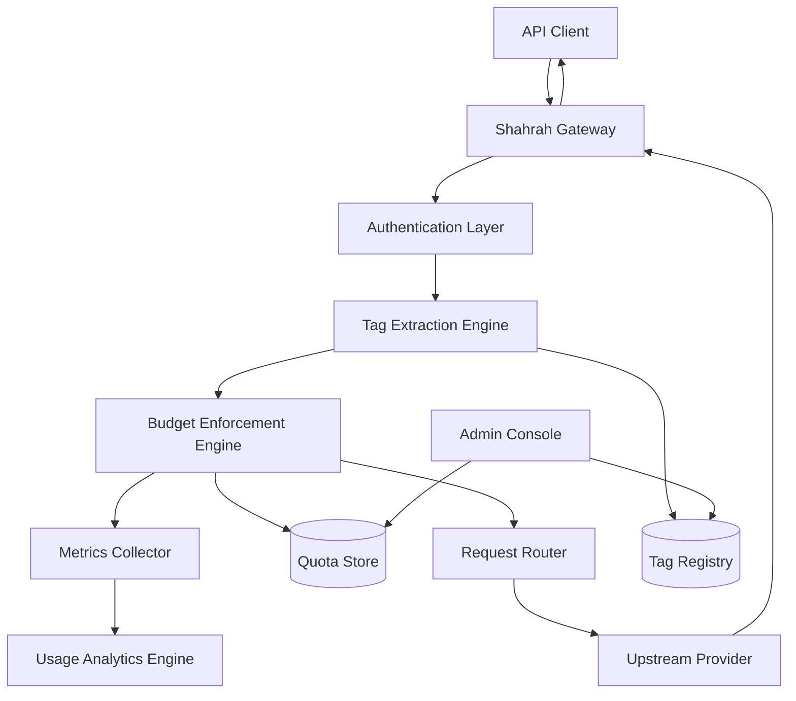
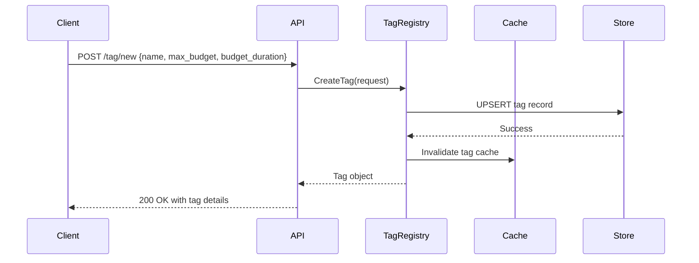
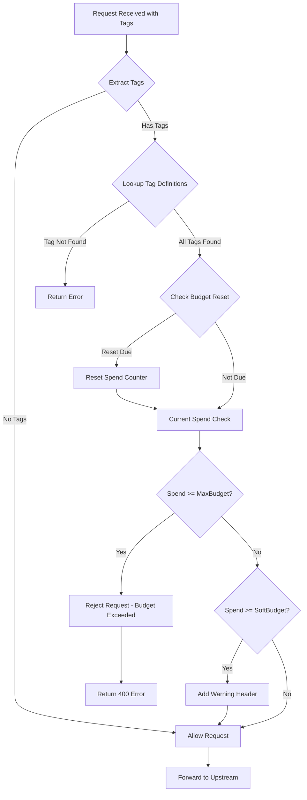
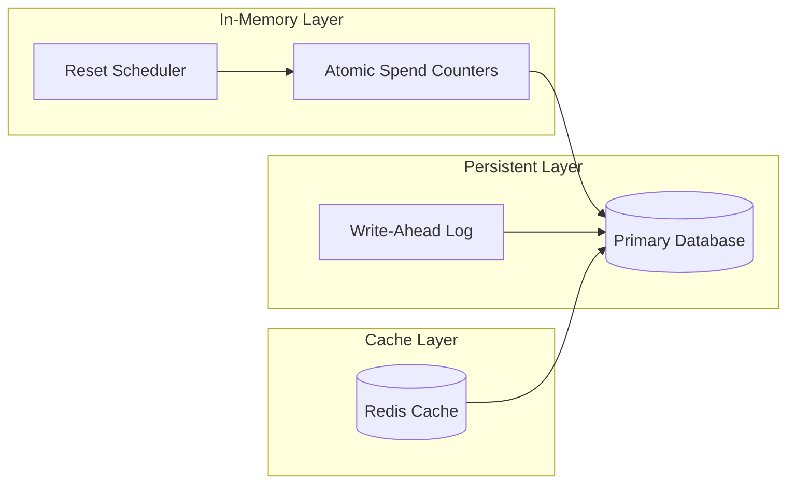
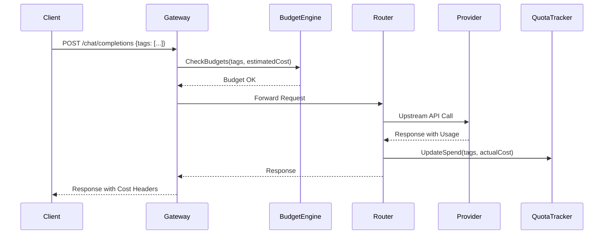
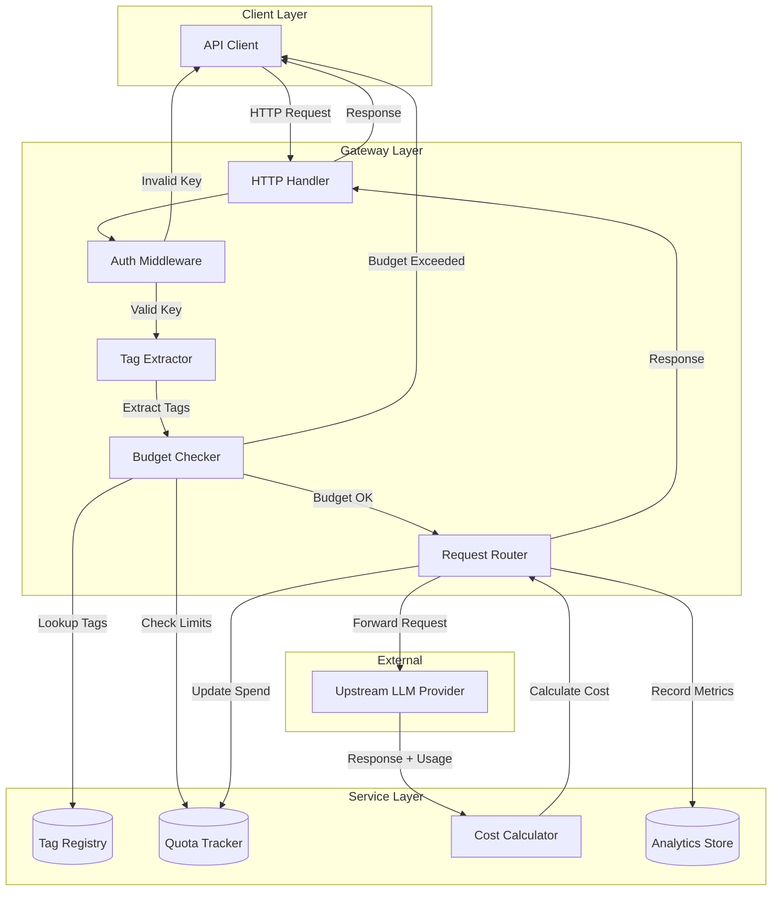
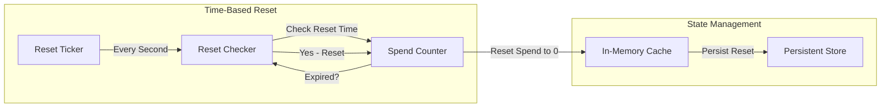
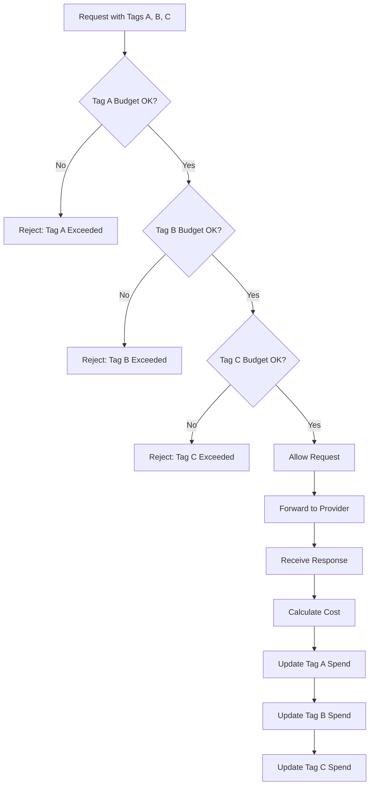
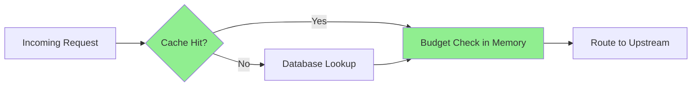
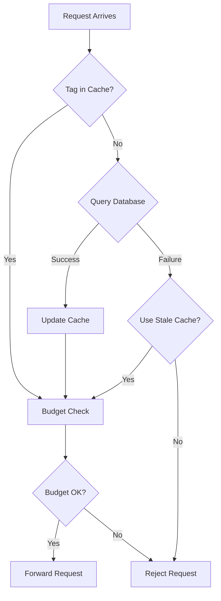

# Shahrah: Tag-Based Budget Management Architecture

### Core Capabilities

- **Tag-Based Cost Attribution**: Attach semantic labels to API requests for granular spend tracking across organizational dimensions
- **Configurable Budget Enforcement**: Define hard and soft spending limits with automatic periodic reset cycles
- **Multi-Dimensional Tracking**: Apply multiple tags per request for simultaneous cost tracking across independent categories
- **Real-Time Quota Management**: Atomic budget tracking with immediate rejection when limits are exceeded
- **Usage Analytics**: Comprehensive spend visibility with historical tracking and trend analysis
- **High-Throughput Mediation**: Go-native concurrency patterns for low-latency request processing at scale

### Design Principles

1. **Zero Trust Budget Enforcement**: Every request is validated against current quota state before forwarding
2. **Eventual Consistency with Strong Guarantees**: Budget counters use atomic operations with periodic persistence
3. **Composability**: Tags combine orthogonally; each tag's budget is evaluated independently
4. **Observability First**: All budget events emit structured logs and metrics for operational visibility

---

## System Architecture

### High-Level Architecture



### Component Breakdown

| Component | Responsibility |
|-----------|----------------|
| **Gateway** | HTTP/HTTPS entry point, request lifecycle management, response transformation |
| **Authentication Layer** | API key validation, request identity extraction |
| **Tag Extraction Engine** | Parse tags from request metadata, validate tag existence |
| **Budget Enforcement Engine** | Check current spend against limits, reject or allow requests |
| **Request Router** | Forward validated requests to upstream providers |
| **Quota Store** | Persistent storage for budget state, atomic counter operations |
| **Tag Registry** | Tag definitions, configurations, lifecycle management |
| **Metrics Collector** | Real-time spend aggregation, counter updates |
| **Usage Analytics Engine** | Historical reporting, trend analysis, alert generation |

---

## Core Module Specifications

### 1. Tag Registry Module

#### Purpose

The Tag Registry manages the lifecycle of budget tags, including creation, modification, deletion, and lookup operations. Each tag represents a distinct cost-tracking dimension with configurable budget parameters.

#### Data Model

```go
type Tag struct {
    Name           string     `json:"name" db:"name"`                    // Unique identifier
    Description    string     `json:"description,omitempty" db:"description"`
    MaxBudget      float64    `json:"max_budget,omitempty" db:"max_budget"`
    BudgetDuration string     `json:"budget_duration,omitempty" db:"budget_duration"`
    SoftBudget     float64    `json:"soft_budget,omitempty" db:"soft_budget"`
    Models         []string   `json:"models,omitempty" db:"models"`
    Spend          float64    `json:"spend" db:"spend"`
    BudgetResetAt  time.Time  `json:"budget_reset_at" db:"budget_reset_at"`
    CreatedAt      time.Time  `json:"created_at" db:"created_at"`
    UpdatedAt      time.Time  `json:"updated_at" db:"updated_at"`
}
```

#### Budget Duration Semantics

| Duration Token | Reset Frequency |
|----------------|-----------------|
| `1s` | Every second |
| `1m` | Every minute |
| `1h` | Every hour |
| `1d` | Every day |
| `7d` | Every week |
| `30d` | Every month |

#### API Endpoints

| Method | Path | Description |
|--------|------|-------------|
| `POST` | `/tag/new` | Create a new tag with budget configuration |
| `POST` | `/tag/info` | Retrieve tag information by name(s) |
| `POST` | `/tag/update` | Update an existing tag's budget configuration |
| `POST` | `/tag/delete` | Delete a tag and associated budget state |

#### Concurrency Model

The Tag Registry uses a read-optimized cache backed by a persistent store. Tag creation and modification acquire write locks; lookups use atomic reads. Cache invalidation occurs on write operations.



---

### 2. Budget Enforcement Engine

#### Purpose

The Budget Enforcement Engine evaluates each incoming request against the current spend state of all associated tags. If any tag exceeds its configured `max_budget`, the request is rejected with a descriptive error.

#### Enforcement Flow



#### Budget Check Algorithm

```go
type BudgetEnforcer interface {
    // CheckBudgets evaluates all tags against their limits.
    // Returns BudgetExceededError if any tag exceeds its max_budget.
    CheckBudgets(ctx context.Context, tags []string, requestCost float64) error
    
    // UpdateSpend atomically increments the spend counter for all tags.
    UpdateSpend(ctx context.Context, tags []string, cost float64) error
}

type BudgetExceededError struct {
    TagName   string
    Spend     float64
    MaxBudget float64
}

func (e *BudgetExceededError) Error() string {
    return fmt.Sprintf("Budget has been exceeded! Tag=%s Current cost: %.2f, Max budget: %.2f",
        e.TagName, e.Spend, e.MaxBudget)
}
```

#### Atomic Spend Updates

The engine uses atomic operations for counter updates to ensure correctness under concurrent load:

```go
// SpendUpdate represents an atomic spend increment
type SpendUpdate struct {
    TagName string
    Cost    float64
}

// BatchUpdateSpend processes multiple tag spend updates atomically
func (e *BudgetEnforcerImpl) BatchUpdateSpend(ctx context.Context, updates []SpendUpdate) error {
    // Implementation uses optimistic concurrency control with retry
    // or database-level atomic increments depending on store backend
}
```

---

### 3. Quota Tracking Module

#### Purpose

The Quota Tracking Module maintains real-time spend counters for all active tags, supporting atomic increments, periodic resets, and concurrent access patterns.

#### Storage Architecture



#### Counter Implementation

```go
// TagCounter tracks spend for a single tag with atomic operations
type TagCounter struct {
    mu        sync.RWMutex
    name      string
    spend     float64
    maxBudget float64
    resetAt   time.Time
    duration  time.Duration
}

// Increment atomically adds to the spend counter
func (c *TagCounter) Increment(cost float64) (float64, error) {
    c.mu.Lock()
    defer c.mu.Unlock()
    
    if time.Now().After(c.resetAt) {
        c.spend = 0
        c.resetAt = c.resetAt.Add(c.duration)
    }
    
    c.spend += cost
    return c.spend, nil
}

// Check returns current spend and whether budget is exceeded
func (c *TagCounter) Check() (spend float64, exceeded bool) {
    c.mu.RLock()
    defer c.mu.RUnlock()
    
    if time.Now().After(c.resetAt) {
        return 0, false
    }
    
    return c.spend, c.spend >= c.maxBudget
}
```

#### Reset Scheduler

The reset scheduler proactively resets budget counters when their duration expires:

```go
type ResetScheduler struct {
    counters sync.Map // map[string]*TagCounter
    ticker   *time.Ticker
}

func (s *ResetScheduler) Start() {
    s.ticker = time.NewTicker(1 * time.Second)
    go s.run()
}

func (s *ResetScheduler) run() {
    for range s.ticker.C {
        now := time.Now()
        s.counters.Range(func(key, value interface{}) bool {
            counter := value.(*TagCounter)
            counter.mu.Lock()
            if now.After(counter.resetAt) {
                counter.spend = 0
                counter.resetAt = counter.resetAt.Add(counter.duration)
            }
            counter.mu.Unlock()
            return true
        })
    }
}
```

---

### 4. Intelligent Request Router

#### Purpose

The Request Router receives validated requests and forwards them to upstream providers. It handles request transformation, response aggregation, and cost calculation.

#### Request Flow



#### Cost Calculation

The router calculates request cost based on token usage from the upstream response:

```go
// CostCalculator computes the cost of a request based on usage
type CostCalculator struct {
    priceMap map[string]ModelPrice // model -> pricing info
}

type ModelPrice struct {
    InputCostPerToken   float64
    OutputCostPerToken  float64
}

func (c *CostCalculator) CalculateCost(model string, inputTokens, outputTokens int) float64 {
    pricing, ok := c.priceMap[model]
    if !ok {
        return 0 // Unknown model, no cost tracking
    }
    return float64(inputTokens)*pricing.InputCostPerToken +
           float64(outputTokens)*pricing.OutputCostPerToken
}
```

#### Model Restriction

Tags can restrict which models are allowed:

```go
// ValidateModel checks if a model is permitted for the given tags
func (e *BudgetEnforcerImpl) ValidateModel(model string, tags []string) error {
    for _, tagName := range tags {
        tag, err := e.registry.GetTag(tagName)
        if err != nil {
            return err
        }
        if len(tag.Models) > 0 && !contains(tag.Models, model) {
            return fmt.Errorf("model %s not allowed for tag %s", model, tagName)
        }
    }
    return nil
}
```

---

### 5. Usage Analytics Engine

#### Purpose

The Usage Analytics Engine collects spend data, generates reports, and provides visibility into budget utilization across all tag dimensions.

#### Analytics Data Model

```go
type SpendRecord struct {
    ID          string    `json:"id" db:"id"`
    TagName     string    `json:"tag_name" db:"tag_name"`
    Cost        float64   `json:"cost" db:"cost"`
    Model       string    `json:"model" db:"model"`
    InputTokens int       `json:"input_tokens" db:"input_tokens"`
    OutputTokens int      `json:"output_tokens" db:"output_tokens"`
    Timestamp   time.Time `json:"timestamp" db:"timestamp"`
    RequestID   string    `json:"request_id" db:"request_id"`
}

type TagSpendSummary struct {
    TagName      string    `json:"tag_name"`
    TotalSpend   float64   `json:"total_spend"`
    RequestCount int       `json:"request_count"`
    AvgCost      float64   `json:"avg_cost"`
    PeriodStart  time.Time `json:"period_start"`
    PeriodEnd    time.Time `json:"period_end"`
}
```

#### Query Endpoints

| Method | Path | Description |
|--------|------|-------------|
| `GET` | `/analytics/spend/{tag}` | Get spend summary for a specific tag |
| `GET` | `/analytics/spend` | Get spend summaries for all tags |
| `GET` | `/analytics/spend/{tag}/timeseries` | Get time-series spend data for a tag |
| `GET` | `/analytics/budget-utilization` | Get budget utilization percentages |

#### Metrics Collection

```go
// MetricsCollector aggregates spend data for analytics
type MetricsCollector struct {
    buffer   chan SpendRecord
    store    AnalyticsStore
    ticker   *time.Ticker
}

func (m *MetricsCollector) Start() {
    go m.flushLoop()
}

func (m *MetricsCollector) Record(record SpendRecord) {
    select {
    case m.buffer <- record:
    default:
        // Buffer full, drop record or flush synchronously
    }
}

func (m *MetricsCollector) flushLoop() {
    for range m.ticker.C {
        records := m.drainBuffer()
        if len(records) > 0 {
            m.store.BatchInsert(records)
        }
    }
}
```

---

## Configuration Schemas

### Server Configuration

```yaml
server:
  port: 4000
  host: "0.0.0.0"
  read_timeout: 30s
  write_timeout: 60s
  idle_timeout: 120s

database:
  url: "${DATABASE_URL}"
  max_connections: 20
  connection_lifetime: 1h

cache:
  type: "redis"  # redis | memory
  redis_url: "${REDIS_URL}"
  ttl: 5m

upstream:
  default_timeout: 60s
  retry_attempts: 3
  retry_backoff: 1s

budget:
  enforcement_mode: "hard"  # hard | soft
  soft_budget_warning_threshold: 0.8
  spend_calculation_mode: "actual"  # actual | estimated

analytics:
  enabled: true
  flush_interval: 30s
  retention_days: 90

logging:
  level: "info"
  format: "json"
  output: "stdout"
```

### Tag Configuration

```json
{
  "name": "engineering",
  "description": "Engineering department cost center",
  "max_budget": 500.0,
  "budget_duration": "30d",
  "soft_budget": 400.0,
  "models": ["gpt-4", "gpt-3.5-turbo", "claude-3-opus"]
}
```

### Request Metadata Format

```json
{
  "model": "gpt-4",
  "messages": [{"role": "user", "content": "Hello"}],
  "metadata": {
    "tags": ["engineering", "project-alpha", "customer-acme"]
  }
}
```

---

## Go Implementation Guidelines

### Concurrency Patterns

#### Worker Pool for Budget Checks

```go
type BudgetCheckWorker struct {
    enforcer BudgetEnforcer
    requests chan BudgetCheckRequest
    results  chan BudgetCheckResult
}

type BudgetCheckRequest struct {
    Tags       []string
    Cost       float64
    ResponseCh chan BudgetCheckResult
}

type BudgetCheckResult struct {
    Allowed bool
    Error   error
}

func (w *BudgetCheckWorker) Start(workers int) {
    for i := 0; i < workers; i++ {
        go w.worker()
    }
}

func (w *BudgetCheckWorker) worker() {
    for req := range w.requests {
        err := w.enforcer.CheckBudgets(context.Background(), req.Tags, req.Cost)
        req.ResponseCh <- BudgetCheckResult{
            Allowed: err == nil,
            Error:   err,
        }
    }
}
```

#### Graceful Shutdown

```go
func GracefulShutdown(server *http.Server, scheduler *ResetScheduler, collector *MetricsCollector) {
    quit := make(chan os.Signal, 1)
    signal.Notify(quit, syscall.SIGINT, syscall.SIGTERM)
    <-quit

    ctx, cancel := context.WithTimeout(context.Background(), 30*time.Second)
    defer cancel()

    // Stop accepting new requests
    server.Shutdown(ctx)
    
    // Flush analytics buffers
    collector.Flush()
    
    // Stop reset scheduler
    scheduler.Stop()
    
    // Persist in-memory counters
    PersistCounters()
}
```

### Error Handling

```go
// ShahrahError is the base error type with categorization
type ShahrahError struct {
    Code    ErrorCode
    Message string
    Details map[string]interface{}
}

type ErrorCode string

const (
    ErrBudgetExceeded  ErrorCode = "budget_exceeded"
    ErrTagNotFound     ErrorCode = "tag_not_found"
    ErrInvalidModel    ErrorCode = "invalid_model"
    ErrAuthFailed      ErrorCode = "auth_failed"
    ErrInternalError   ErrorCode = "internal_error"
)

func (e *ShahrahError) Error() string {
    return fmt.Sprintf("[%s] %s", e.Code, e.Message)
}

func (e *ShahrahError) ToHTTPResponse() (int, ErrorResponse) {
    var statusCode int
    switch e.Code {
    case ErrBudgetExceeded:
        statusCode = http.StatusBadRequest
    case ErrTagNotFound:
        statusCode = http.StatusNotFound
    case ErrAuthFailed:
        statusCode = http.StatusUnauthorized
    default:
        statusCode = http.StatusInternalServerError
    }
    
    return statusCode, ErrorResponse{
        Error: ErrorDetail{
            Message: e.Message,
            Type:    string(e.Code),
            Code:    statusCode,
        },
    }
}
```

---

## Data Flow Diagrams

### Complete Request Lifecycle



### Tag Budget Reset Flow



### Multi-Tag Budget Evaluation



---

## Performance Strategies

### Throughput Optimization

1. **Atomic Counter Operations**: Use `sync/atomic` for lock-free spend counter updates where possible
2. **Batched Database Writes**: Accumulate spend records and flush in batches to reduce I/O pressure
3. **Read-Optimized Cache**: Tag definitions cached with TTL-based invalidation for fast lookup
4. **Connection Pooling**: Pre-warmed upstream connection pools with configurable limits
5. **Async Spend Recording**: Cost updates happen asynchronously to avoid blocking the response path

### Latency Reduction



### Memory Management

1. **Bounded Cache Size**: Limit in-memory tag cache to prevent unbounded growth
2. **Ring Buffer for Analytics**: Use ring buffers for metrics collection with fixed memory footprint
3. **Object Pooling**: Reuse request/response objects through `sync.Pool`
4. **Streaming Responses**: Stream upstream responses directly to clients without buffering

---

## Fault Tolerance Strategies

### Database Failure Handling



### Graceful Degradation

| Failure Mode | Behavior |
|--------------|----------|
| Database unavailable | Serve from stale cache with configurable TTL extension |
| Cache unavailable | Direct database queries with increased latency |
| Upstream timeout | Return timeout error to client, do not charge budget |
| Spend update failure | Log error, allow request, flag for reconciliation |
| Tag registry corruption | Fail-closed: reject all tagged requests until recovery |

### Reconciliation Process

```go
// Reconciler ensures in-memory counters match persistent state
type Reconciler struct {
    store  QuotaStore
    cache  *TagCache
}

func (r *Reconciler) Run(ctx context.Context) {
    ticker := time.NewTicker(5 * time.Minute)
    defer ticker.Stop()
    
    for {
        select {
        case <-ctx.Done():
            return
        case <-ticker.C:
            r.reconcile()
        }
    }
}

func (r *Reconciler) reconcile() {
    tags := r.cache.AllTags()
    for _, tag := range tags {
        dbSpend, _ := r.store.GetSpend(tag.Name)
        r.cache.SyncSpend(tag.Name, dbSpend)
    }
}
```

### Circuit Breaker Pattern

```go
type CircuitBreaker struct {
    mu            sync.Mutex
    failures      int
    threshold     int
    state         CircuitState
    lastFailure   time.Time
    recoveryTime  time.Duration
}

type CircuitState int

const (
    StateClosed CircuitState = iota
    StateOpen
    StateHalfOpen
)

func (cb *CircuitBreaker) Allow() bool {
    cb.mu.Lock()
    defer cb.mu.Unlock()
    
    switch cb.state {
    case StateClosed:
        return true
    case StateOpen:
        if time.Since(cb.lastFailure) > cb.recoveryTime {
            cb.state = StateHalfOpen
            return true
        }
        return false
    case StateHalfOpen:
        return true
    }
    return false
}

func (cb *CircuitBreaker) RecordSuccess() {
    cb.mu.Lock()
    defer cb.mu.Unlock()
    cb.failures = 0
    cb.state = StateClosed
}

func (cb *CircuitBreaker) RecordFailure() {
    cb.mu.Lock()
    defer cb.mu.Unlock()
    cb.failures++
    cb.lastFailure = time.Now()
    if cb.failures >= cb.threshold {
        cb.state = StateOpen
    }
}
```

---

## Phased Rollout Plan

### Phase 1: Foundation

**Objective**: Establish core infrastructure and basic tag management

| Deliverable | Description |
|-------------|-------------|
| Project scaffolding | Go module structure, Makefile, CI configuration |
| Database schema | Tag, spend, and analytics table definitions |
| Tag CRUD API | Create, read, update, delete tag endpoints |
| Basic gateway | HTTP server with request forwarding |
| Authentication | API key validation middleware |

**Duration**: 2-3 weeks

### Phase 2: Budget Enforcement

**Objective**: Implement real-time budget checking and enforcement

| Deliverable | Description |
|-------------|-------------|
| In-memory counters | Atomic spend tracking with reset scheduler |
| Budget enforcement | Pre-request budget validation |
| Error responses | Structured budget exceeded errors |
| Soft budget warnings | Warning headers when approaching limits |
| Model restrictions | Tag-level model allowlisting |

**Duration**: 2-3 weeks

### Phase 3: Usage Analytics

**Objective**: Build spend reporting and analytics capabilities

| Deliverable | Description |
|-------------|-------------|
| Spend recording | Asynchronous cost tracking per request |
| Analytics API | Spend summary and timeseries endpoints |
| Budget utilization | Utilization percentage calculations |
| Admin dashboard | Tag overview with budget progress |
| Alerting | Configurable alerts for budget thresholds |

**Duration**: 2-3 weeks

### Phase 4: Performance Optimization

**Objective**: Optimize for production-scale throughput

| Deliverable | Description |
|-------------|-------------|
| Cache layer | Redis-backed tag cache with TTL |
| Batch writes | Buffered spend record flushing |
| Connection pooling | Upstream connection pool management |
| Load testing | Performance benchmarking suite |
| Profiling | pprof integration and optimization |

**Duration**: 2 weeks

### Phase 5: Production Readiness

**Objective**: Harden for production deployment

| Deliverable | Description |
|-------------|-------------|
| Graceful shutdown | Clean connection draining and state persistence |
| Health checks | Readiness and liveness endpoints |
| Monitoring | Prometheus metrics and structured logging |
| Disaster recovery | Reconciliation processes and backup procedures |
| Documentation | API reference, deployment guide, runbooks |

**Duration**: 2 weeks

---

## Appendix: API Reference

### Tag Management

#### Create Tag

```
POST /tag/new
Content-Type: application/json
Authorization: Bearer {api_key}

{
    "name": "engineering",
    "description": "Engineering department cost center",
    "max_budget": 500.0,
    "budget_duration": "30d",
    "soft_budget": 400.0,
    "models": ["gpt-4", "gpt-3.5-turbo"]
}
```

**Response** (200 OK):
```json
{
    "name": "engineering",
    "description": "Engineering department cost center",
    "max_budget": 500.0,
    "budget_duration": "30d",
    "soft_budget": 400.0,
    "models": ["gpt-4", "gpt-3.5-turbo"],
    "spend": 0.0,
    "budget_reset_at": "2025-11-10T00:00:00Z",
    "created_at": "2025-10-11T00:00:00Z"
}
```

#### Get Tag Info

```
POST /tag/info
Content-Type: application/json
Authorization: Bearer {api_key}

{
    "names": ["engineering", "marketing"]
}
```

**Response** (200 OK):
```json
{
    "engineering": {
        "name": "engineering",
        "spend": 245.50,
        "max_budget": 500.0,
        "budget_duration": "30d",
        "budget_reset_at": "2025-11-10T00:00:00Z"
    },
    "marketing": {
        "name": "marketing",
        "spend": 89.20,
        "max_budget": 300.0,
        "budget_duration": "30d",
        "budget_reset_at": "2025-11-10T00:00:00Z"
    }
}
```

#### Update Tag

```
POST /tag/update
Content-Type: application/json
Authorization: Bearer {api_key}

{
    "name": "engineering",
    "max_budget": 750.0,
    "budget_duration": "30d"
}
```

#### Delete Tag

```
POST /tag/delete
Content-Type: application/json
Authorization: Bearer {api_key}

{
    "name": "engineering"
}
```

### Request with Tags

```
POST /chat/completions
Content-Type: application/json
Authorization: Bearer {api_key}

{
    "model": "gpt-4",
    "messages": [{"role": "user", "content": "Hello"}],
    "metadata": {
        "tags": ["engineering", "project-alpha"]
    }
}
```

**Budget Exceeded Response** (400 Bad Request):
```json
{
    "error": {
        "message": "Budget has been exceeded! Tag=engineering Current cost: 505.50, Max budget: 500.0",
        "type": "budget_exceeded",
        "param": null,
        "code": 400
    }
}
```

### Analytics

#### Get Spend Summary

```
GET /analytics/spend?tag=engineering&period=30d
Authorization: Bearer {api_key}
```

**Response** (200 OK):
```json
{
    "tag_name": "engineering",
    "total_spend": 245.50,
    "request_count": 1523,
    "avg_cost": 0.161,
    "period_start": "2025-09-11T00:00:00Z",
    "period_end": "2025-10-11T00:00:00Z",
    "budget_utilization": 0.491
}
```

---

## Appendix: Database Schema

```sql
-- Tags table
CREATE TABLE tags (
    name VARCHAR(255) PRIMARY KEY,
    description TEXT,
    max_budget DECIMAL(10, 4),
    budget_duration VARCHAR(10),
    soft_budget DECIMAL(10, 4),
    models JSONB,
    spend DECIMAL(10, 4) DEFAULT 0,
    budget_reset_at TIMESTAMPTZ,
    created_at TIMESTAMPTZ DEFAULT NOW(),
    updated_at TIMESTAMPTZ DEFAULT NOW()
);

-- Spend records table
CREATE TABLE spend_records (
    id UUID PRIMARY KEY DEFAULT gen_random_uuid(),
    tag_name VARCHAR(255) REFERENCES tags(name),
    cost DECIMAL(10, 6) NOT NULL,
    model VARCHAR(255),
    input_tokens INTEGER,
    output_tokens INTEGER,
    request_id VARCHAR(255),
    created_at TIMESTAMPTZ DEFAULT NOW()
);

-- Index for efficient queries
CREATE INDEX idx_spend_records_tag_created ON spend_records(tag_name, created_at);
CREATE INDEX idx_spend_records_request ON spend_records(request_id);
```
