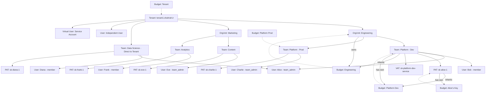

# Shahrah: Tenant, Organization Unit, and Team Design

> This document defines the hierarchical structure for Shahrah's multi-tenant architecture, enabling enterprise tenants to manage organizational units, teams, and users with granular access control and budget management.

---

## Table of Contents

1. [Overview](#overview)
2. [Core Concepts](#core-concepts)
3. [Hierarchy Diagram](#hierarchy-diagram)
4. [Data Model](#data-model)
5. [Entity Relationships](#entity-relationships)
6. [Access Control](#access-control)
7. [Budget and Rate Limiting](#budget-and-rate-limiting)
8. [API Keys](#api-keys)
9. [Use Cases](#use-cases)
10. [API Endpoints](#api-endpoints)

---

## Overview

GodarAI implements a flexible multi-tenant architecture where each **Tenant** (customer) has a dedicated subdomain (e.g., `tenant1.shahrah.ir`) and can organize their resources using:

- **Organization Units**: Optional logical grouping for large organizational divisions
- **Teams**: Working groups that can belong to an Organization Unit or directly to a Tenant
- **Users**: Individual members who can be independent or belong to multiple teams
- **Virtual Users**: Service accounts for applications and automated systems

This structure provides:

- **Flexibility**: Organization Units are optional; teams can exist at tenant level
- **Isolation**: Complete data separation between tenants
- **Granular Control**: Budget and rate limits at all levels
- **Scalability**: Support for complex organizational structures

---

## Core Concepts

### Tenant

A **Tenant** represents a paying customer or organization. It is the root isolation boundary with:

- Unique subdomain (e.g., `tenant1.shahrah.ir`)
- Dedicated API endpoint (`https://tenant1.shahrah.ir/api/v1/`)
- Complete data isolation from other tenants
- Tenant-level administrators with full access

### Organization Unit (OrgUnit)

An **Organization Unit** is an optional logical grouping within a tenant. It represents:

- Large organizational divisions (e.g., Engineering, Marketing, HR)
- Business units or departments
- Cost centers for budget tracking

Organization Units:
- Are optional - teams can exist without an Organization Unit
- Can have their own budget and rate limits
- Have Organization Unit admins who manage teams within the unit
- Aggregate spend across all their teams

### Team (Workspace)

A **Team** is a working group within an Organization Unit or directly under a Tenant. Teams:

- Can belong to an Organization Unit or directly to a Tenant
- Function as a Workspace for collaborative work
- Have their own budget and rate limits
- Control which models are accessible
- Have team admins and team members
- Generate API keys for access
- Track spend independently

Teams can have a `workspace_type`:
- `development`: For development and testing
- `production`: For production workloads
- `testing`: For QA and testing environments
- `general`: Default type for general use

### User

A **User** is an individual member of the GodarAI platform. Users:

- Can be independent (tenant-level only) or belong to multiple teams
- Can belong to multiple organizations (via `OrganizationMembership`)
- Can belong to multiple teams (via `TeamMembership`)
- Have roles within each context (e.g., `org_admin`, `team_admin`, `member`)
- Can generate Personal Access Tokens (PATs)
- Have individual budget and rate limits (optional)

### Virtual User

A **Virtual User** is a service account for applications and automated systems. Virtual Users:

- Are not associated with a human user
- Can belong to teams for team-level service access
- Can be independent at tenant level
- Generate Virtual Account Tokens (VATs)
- Persist even when team members leave
- Use team-level limits when associated with a team

### API Keys

GodarAI supports two types of API keys:

| Type | Associated With | Use Case | Lifecycle |
|------|----------------|----------|-----------|
| **PAT** (Personal Access Token) | User | Individual developers, human users | Deleted when user is deleted |
| **VAT** (Virtual Account Token) | Virtual User | Production applications, CI/CD, services | Persists independently |

---

## Hierarchy Diagram



### Relationship Rules

1. A **Tenant** contains multiple **OrgUnits** (optional) and **Teams**
2. An **OrgUnit** belongs to exactly one **Tenant**
3. An **OrgUnit** contains multiple **Teams** (optional)
4. A **Team** belongs to either an **OrgUnit** OR directly to a **Tenant**
5. A **User** can be independent or belong to multiple **Teams**
6. A **User** can belong to multiple **OrgUnits** (via membership)
7. A **Virtual User** can be independent or belong to **Teams**
8. **API Keys** are associated with a **User** (PAT) or **Virtual User** (VAT)
9. **Budgets** can be attached to any entity level

---

## Data Model

### Entity Relationships

```
Tenant (1) -----> (0..N) OrgUnit
Tenant (1) -----> (0..N) Team
OrgUnit (1) -----> (0..N) Team
Team (1) -----> (0..N) TeamMembership
Team (1) -----> (0..N) VirtualKey
User (1) -----> (0..N) TeamMembership
User (1) -----> (0..N) PersonalAccessKey (PAT)
VirtualUser (1) -----> (0..N) VirtualAccountKey (VAT)
Budget (1) -----> (0..N) Tenant / OrgUnit / Team / User / VirtualUser / Key
```

### Core Tables

| Table | Primary Key | Key Fields | Relations |
|-------|-------------|------------|-----------|
| `Tenant` | `tenant_id` | `slug`, `subdomain`, `status`, `config` | Has OrgUnits, Teams, Users |
| `OrgUnit` | `org_unit_id` | `alias`, `tenant_id`, `budget_id`, `metadata` | Belongs to Tenant, has Teams |
| `Team` | `team_id` | `alias`, `org_unit_id` (nullable), `tenant_id`, `workspace_type`, `budget_id` | Belongs to OrgUnit or Tenant, has Members, has Keys |
| `User` | `user_id` | `email`, `mobile`, `tenant_id`, `role` | Belongs to Tenant, has Memberships, has PATs |
| `VirtualUser` | `virtual_user_id` | `alias`, `tenant_id`, `team_id` (nullable) | Belongs to Tenant or Team, has VATs |
| `PersonalAccessKey` (PAT) | `token_hash` | `key_alias`, `user_id`, `team_id` (nullable), `models[]`, `spend`, `max_budget` | Belongs to User, optionally Team |
| `VirtualAccountKey` (VAT) | `token_hash` | `key_alias`, `virtual_user_id`, `team_id` (nullable), `models[]`, `spend`, `max_budget` | Belongs to Virtual User, optionally Team |
| `TeamMembership` | `(user_id, team_id)` | `role`, `spend`, `budget_id` | Links User to Team |
| `OrgUnitMembership` | `(user_id, org_unit_id)` | `role`, `spend` | Links User to OrgUnit |
| `Budget` | `budget_id` | `max_budget`, `soft_budget`, `tpm_limit`, `rpm_limit`, `budget_duration` | Attached to any entity |

---

## Access Control

### User Roles

| Role | Scope | Permissions |
|------|-------|-------------|
| `tenant_admin` | Tenant | Full access to all resources in tenant |
| `org_admin` | OrgUnit | Manage teams within org unit, view org spend |
| `team_admin` | Team | Manage team members, create keys, manage team settings |
| `team_member` | Team | Access team resources based on permissions |
| `tenant_user` | Tenant | Independent user with own keys, can join teams |

### Team Member Permissions

Non-admin team members can be granted specific permissions:

```json
{
  "team_member_permissions": [
    "/key/generate",
    "/key/update",
    "/key/delete",
    "/model/new"
  ]
}
```

### Access Validation Flow

When a request arrives with an API key:

1. Validate key exists and is not expired/blocked
2. Check key models against team models (if team-associated)
3. Check key budget (if key has own budget)
4. Check team budget (inherited, if applicable)
5. Check org unit budget (inherited, if applicable)
6. Check tenant budget (inherited)
7. Check TPM/RPM limits at all applicable levels
8. Apply policies and guardrails
9. Forward request to upstream provider

---

## Budget and Rate Limiting

### Budget Hierarchy

Budgets can be configured at multiple levels:

```
Level 1: Tenant Budget
    ├── max_budget: $50,000/month
    ├── tpm_limit: 5,000,000
    └── rpm_limit: 50,000
    
    Level 2: OrgUnit Budget (optional)
        ├── max_budget: $10,000/month
        ├── tpm_limit: 1,000,000
        └── rpm_limit: 10,000
        
        Level 3: Team Budget
            ├── max_budget: $2,000/month
            ├── tpm_limit: 200,000
            └── rpm_limit: 1,000
            
            Level 4: Key Budget
                ├── max_budget: $500/month
                ├── tpm_limit: 50,000
                └── rpm_limit: 250
```

### Budget Inheritance

Keys inherit budgets from their parent entity hierarchy:

```
Tenant Budget (always applies)
    └── OrgUnit Budget (if team belongs to org unit)
        └── Team Budget (if key belongs to team)
            └── Key Budget (key's own budget)
```

If a key has its own budget, it uses that budget. Otherwise, it inherits from parent entities.

### Budget Validation Rules

1. **Team budget cannot exceed OrgUnit budget** (if applicable)
2. **Team budget cannot exceed Tenant budget** (if no org unit)
3. **Key budget cannot exceed Team budget** (if team-associated)
4. **Model access validation**: Teams can only access models allowed by parent entities
5. **TPM/RPM overallocation prevention**: Sum of child budgets should not exceed parent budget

---

## API Keys

### Personal Access Token (PAT)

PATs are associated with individual users:

- `user_id` is required
- `team_id` is optional (for team-scoped keys)
- Deleted when user is deleted
- Tracked against user's individual limits
- Use case: Individual developers, human users

### Virtual Account Token (VAT)

VATs are associated with virtual users:

- `virtual_user_id` is required
- `team_id` is optional (for team-scoped keys)
- Persist independently of human users
- Tracked against team limits (if team-associated)
- Use case: Production applications, CI/CD, services

### Key Generation Parameters

| Parameter | Type | Description |
|-----------|------|-------------|
| `key_alias` | `string` | Human-readable name |
| `user_id` | `string` | For PATs only |
| `virtual_user_id` | `string` | For VATs only |
| `team_id` | `string` | Optional team association |
| `models` | `string[]` | Accessible models |
| `max_budget` | `float` | Maximum spend |
| `budget_duration` | `string` | Reset period (e.g., "30d") |
| `tpm_limit` | `int` | Tokens per minute |
| `rpm_limit` | `int` | Requests per minute |
| `duration` | `string` | Key expiration |
| `metadata` | `object` | Custom metadata |

---

## Use Cases

### Use Case 1: Large Enterprise with Multiple Divisions

**Scenario**: TechCorp has Engineering, Marketing, and HR divisions.

```
Tenant: TechCorp (techcorp.shahrah.ir)
├── OrgUnit: Engineering
│   ├── Team: Platform (workspace_type: production, budget: $5,000/mo)
│   ├── Team: Mobile (workspace_type: production, budget: $3,000/mo)
│   └── Team: Data Science (workspace_type: development, budget: $8,000/mo)
├── OrgUnit: Marketing
│   ├── Team: Content (workspace_type: production, budget: $2,000/mo)
│   └── Team: Analytics (workspace_type: production, budget: $1,000/mo)
├── OrgUnit: HR
│   └── Team: Recruiting (workspace_type: production, budget: $500/mo)
├── User: alice@techcorp.com (independent, can join teams)
└── Virtual User: ci-cd-service (for automated deployments)
```

### Use Case 2: Small Startup without OrgUnits

**Scenario**: StartupXYZ doesn't need OrgUnits, just teams.

```
Tenant: StartupXYZ (startupxyz.shahrah.ir)
├── Team: Backend (workspace_type: production, budget: $2,000/mo)
├── Team: Frontend (workspace_type: production, budget: $1,500/mo)
├── Team: ML (workspace_type: development, budget: $3,000/mo)
├── User: founder@startupxyz.com (independent)
└── Virtual User: monitoring-service (for alerts)
```

### Use Case 3: User with Multiple Team Memberships

**Scenario**: Alice works across multiple teams.

```
User: alice@techcorp.com
├── Team: Platform (role: team_admin)
├── Team: Data Science (role: member)
└── Team: Analytics (role: member)

Alice can:
- Create keys for Platform team (as admin)
- Use keys from all three teams
- View spend across all teams she's a member of
```

### Use Case 4: Service Account with Team Access

**Scenario**: CI/CD service needs access to production team.

```
Virtual User: ci-cd-service
└── Team: Platform (team_id: team-platform-prod)

VAT: sk-ci-cd-platform
├── virtual_user_id: ci-cd-service
├── team_id: team-platform-prod
├── models: [gpt-4, claude-3]
├── max_budget: $1,000/mo
└── persists even when team members leave
```

---

## API Endpoints

### Tenant Endpoints

| Method | Endpoint | Description |
|--------|----------|-------------|
| GET | `/tenant/info` | Get tenant details |
| PATCH | `/tenant/update` | Update tenant settings |
| GET | `/tenant/usage` | Get tenant-wide usage stats |

### OrgUnit Endpoints

| Method | Endpoint | Description |
|--------|----------|-------------|
| POST | `/org-unit/new` | Create a new org unit |
| PATCH | `/org-unit/update` | Update org unit settings |
| DELETE | `/org-unit/delete` | Delete an org unit |
| GET | `/org-unit/info` | Get org unit details |
| GET | `/org-unit/list` | List org units |
| POST | `/org-unit/member_add` | Add a member to org unit |
| DELETE | `/org-unit/member_delete` | Remove a member from org unit |

### Team Endpoints

| Method | Endpoint | Description |
|--------|----------|-------------|
| POST | `/team/new` | Create a new team |
| PATCH | `/team/update` | Update team settings |
| DELETE | `/team/delete` | Delete a team |
| GET | `/team/info` | Get team details |
| GET | `/team/list` | List teams |
| POST | `/team/member/add` | Add a member to team |
| POST | `/team/member/delete` | Remove a member from team |
| GET | `/team/usage` | Get team usage stats |

### User Endpoints

| Method | Endpoint | Description |
|--------|----------|-------------|
| POST | `/user/new` | Create a new user |
| PATCH | `/user/update` | Update user settings |
| DELETE | `/user/delete` | Delete a user |
| GET | `/user/info` | Get user details |
| GET | `/user/list` | List users |
| GET | `/user/teams` | Get teams user belongs to |

### Virtual User Endpoints

| Method | Endpoint | Description |
|--------|----------|-------------|
| POST | `/virtual-user/new` | Create a new virtual user |
| PATCH | `/virtual-user/update` | Update virtual user |
| DELETE | `/virtual-user/delete` | Delete a virtual user |
| GET | `/virtual-user/list` | List virtual users |

### API Key Endpoints

| Method | Endpoint | Description |
|--------|----------|-------------|
| POST | `/key/generate` | Generate a new PAT |
| POST | `/key/virtual/generate` | Generate a new VAT |
| POST | `/key/update` | Update key settings |
| POST | `/key/delete` | Delete a key |
| GET | `/key/info` | Get key details |
| GET | `/key/list` | List keys |

### Budget Endpoints

| Method | Endpoint | Description |
|--------|----------|-------------|
| POST | `/budget/new` | Create a new budget |
| PATCH | `/budget/update` | Update budget settings |
| DELETE | `/budget/delete` | Delete a budget |
| GET | `/budget/info` | Get budget details |
| GET | `/budget/list` | List budgets |

---

## Implementation Notes

### Database Schema Considerations

1. **Tenant-level isolation**: All queries must include `tenant_id` filter
2. **Optional OrgUnit**: `org_unit_id` in Team table is nullable
3. **Composite keys**: Use `(user_id, team_id)` for TeamMembership
4. **Key hashing**: Never store raw API keys, use SHA-256 hashing
5. **Audit fields**: Include `created_at`, `updated_at`, `created_by`, `updated_by`

### Caching Strategy

1. **Key validation cache**: Cache key lookups with TTL
2. **Entity cache**: Cache team/org/tenant objects
3. **Budget cache**: Cache budget calculations
4. **Invalidation**: Clear cache on updates

### Security Considerations

1. **Subdomain validation**: Verify tenant subdomain on each request
2. **Cross-tenant access prevention**: Strict tenant_id filtering
3. **Key exposure**: Show full key only once at generation
4. **Audit logging**: Track all key operations
5. **Rate limiting**: Apply at proxy level in addition to per-key limits

### Performance Considerations

1. **Indexing**: Index `tenant_id`, `team_id`, `user_id`, `token_hash`
2. **Pagination**: All list endpoints support pagination
3. **Batch operations**: Support bulk operations where possible
4. **Lazy loading**: Don't load all relations by default
> **Update 2026-10-19:** the organizational unit concept described here was removed from the product. Teams are now the only grouping inside a workspace. See the org-unit removal PRs and migration 074.
